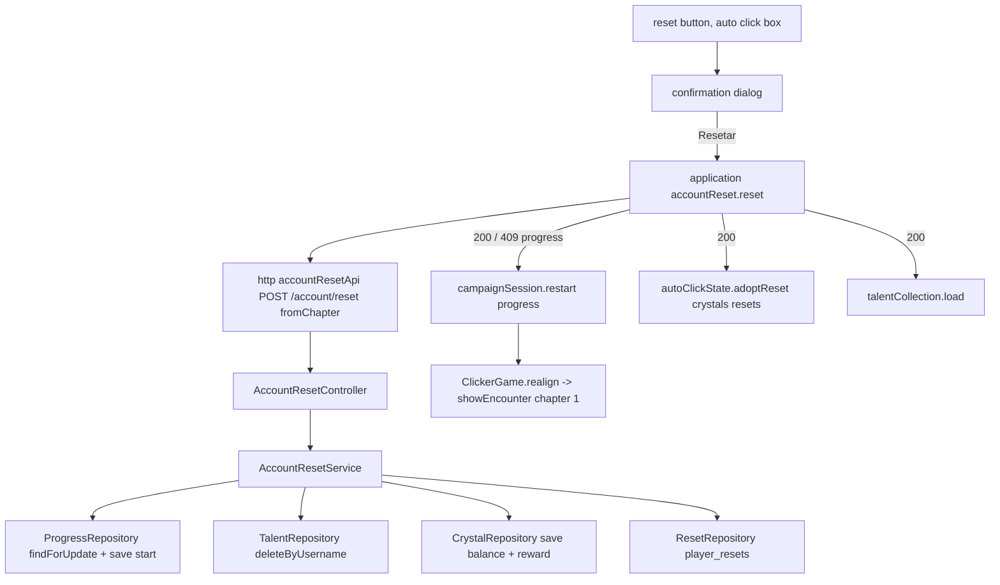

# Account Reset Design

**Spec**: `.specs/features/account-reset/spec.md`
**Status**: Approved (owner: "aprovadooooo!", 2026-10-27)

---

## Architecture Overview

The backend owns the reset like every other paid action (AD-009, AD-011, AD-014): one POST, sent from the chapter the player saw, under the `progress` row lock. In one transaction it puts the progress back at `Progress.start`, deletes the talent levels and awards (`TalentRepositoryPort.deleteByUsername`), adds the reward to `player_crystals` and raises `player_resets`. The auto click unlock rule gains the reset count on both sides.

The game has a pure reward rule, an application service that sends the reset and hands the answer to the campaign session (which adopts the progress and voids its queue, the same path as a 409 realign), the auto click state (crystals and resets) and the talent collection (reload). `ClickerGame` renders the button in the auto click box and a confirmation dialog.

---

## Code Reuse Analysis

| Component | Location | How to Use |
| --- | --- | --- |
| Auto click upgrade flow | `backend/.../service/AutoClickService.kt` | Same shape: require user, `createIfAbsent` + `findForUpdate`, domain check, save, log |
| `Progress.start`, `withNextChapterOpen` | `backend/.../domain/Progress.kt` | The reset target; the stored chapter is read after opening the next chapter, like `ProgressService.load` |
| `TalentRepositoryPort.deleteByUsername` | `backend/.../port/TalentRepositoryPort.kt` | Already deletes levels and awards (legacy included) |
| `CrystalRepository` | `backend/.../adapter/repository/CrystalRepository.kt` | Balance read and save |
| `AutoClickRepository` | `backend/.../adapter/repository/AutoClickRepository.kt` | Shape of the new `ResetRepository` (no row = 0) |
| `progressConflict` handler | `backend/.../adapter/web/ApiExceptionHandler.kt:54` | The mismatch carries `progress` the same way |
| `ProgressResponse.from(view)` | `backend/.../adapter/web/ProgressController.kt` | The `progress` field of the answer |
| Campaign session `adopt` | `game/src/application/campaign/campaignSession.js:27` | Exposed as `restart(progress)`: adopt, void the queue, fire realign |
| `realign(encounter)` | `game/src/adapters/phaser/ClickerGame.js` | Restarts the fight at the adopted encounter |
| `HeroUi.showNotice` | `game/src/adapters/phaser/HeroUi.js:610` | The `+N cristais` notice (3 s) |
| Pause confirm | `ClickerGame` pause menu | Same DOM confirm pattern for the dialog |
| `fakeBackend` | `game/e2e/support/fakeBackend.js` | New `/account/reset` route |

---

## Components

### Backend domain - `domain/AccountReset.kt`

- `object AccountReset { const val MAX_REWARD = 5; fun reward(progress): Int?` - null at chapter 1 not completed, else `min(chapter, 5)`; `fun check(progress, fromChapter, view: () -> ProgressView): Int` - throws `ResetChapterMismatchException(view())` when `fromChapter != chapter`, then `ResetLockedException` when the reward is null; returns the reward.
- Check order: mismatch, then locked, so a double click's second request (stored chapter 1, sent 3) answers mismatch.
- Exceptions: `ResetRequestException` (400 `INVALID_RESET_REQUEST`), `ResetConflictException` (409 base), `ResetChapterMismatchException(current: ProgressView)`, `ResetLockedException`.
- `autoClickUnlocked(progress, resets: Int)` in `AutoClick.kt` - true also when `resets >= 1`.

### Backend persistence

- `V7__player_resets.sql`: `player_resets (username pk fk users on delete cascade, resets integer not null check (resets >= 1))`.
- `port/ResetRepositoryPort.kt`: `count(username): Int`, `save(username, resets)`. `adapter/repository/ResetRepository.kt`.

### Backend service, use case, controller

- `usecase/AccountResetUseCase.kt`: `ResetAccountUseCase.reset(username, fromChapter): ResetResult(reward, crystals, resets, view)`.
- `service/AccountResetService.kt`: require user; create + lock progress; open the next chapter if stored completed; `AccountReset.check`; save `Progress.start`; `talentRepository.deleteByUsername`; crystals `balance + reward`; resets `count + 1`; log info; refusals log warn.
- `AutoClickService`: reads `resetRepository.count` for `get` (answer field `resets`) and for the unlock of `upgrade`. `PlayerAutoClick` gains `resets: Int = 0`.
- `adapter/web/AccountResetController.kt`: `POST /account/reset { fromChapter }` → `{ reward, crystals, resets, progress }`; handlers in `ApiExceptionHandler` (mismatch with `progress`).

### Game

- `domain/campaign/accountReset.js`: `RESET_MAX_REWARD = 5`, `resetReward({ chapter, completed })` → null or `min(chapter, 5)`. `domain/combat/autoClick.js`: `autoClickUnlocked({ chapter, completed, resets })`.
- `adapters/http/accountResetApi.js`: `reset(fromChapter)` → POST `/account/reset`.
- `application/accountReset/accountReset.js`: `createAccountReset({ gateway, session, autoClick, talents })` → `reset()`: sends `session.chapter`; 200 → `session.restart(answer.progress)`, `autoClick.adoptReset(answer)`, `talents.load()`, resolves the answer; 409 with `body.progress` → `session.restart(body.progress)` and rethrow; anything else rethrows.
- `campaignSession.restart(progress)`; `autoClickState.adoptReset({ crystals, resets })` merges into the loaded state and fires change.
- `adapters/phaser/views/resetView.js`: `resetButtonText(n)`, `resetDialogText(n)`, `RESET_ERROR_TEXT`, `renderResetDialog({ reward, busy, error })`.
- `ClickerGame`: the box is visible while auto click open or a reward exists; the reset button is part of the box; a `hud-reset-dialog` DOM element (depth over the HUD) with `Resetar` / `Cancelar`.

---

## Error Handling Strategy

| Error Scenario | Handling | User Impact |
| --- | --- | --- |
| 409 mismatch / locked | session restarts at `body.progress` (mismatch) or keeps its own (locked); dialog closes | The fight shows the stored chapter; crystals unchanged |
| Network / 5xx | rethrow; dialog stays with `Não foi possível resetar. Tente de novo.` | Retry possible |
| Talent reload fails | the collection keeps the empty tree from `load` failure path; next tick reloads | Talentos screen shows unavailable until it loads |
| Outcome report in flight | the server serializes on the progress lock; a report landing after the reset gets the existing 409 and realigns to chapter 1 | None |

---

## Risks & Concerns

| Concern | Location (file:line) | Impact | Mitigation |
| --- | --- | --- | --- |
| A report landing before the reset moves the chapter | `campaignSession.flush` | Reset answers mismatch | Spec AC: realign and keep crystals; the player presses again |
| Old scene tests assume the box hidden at chapter 1 | `ClickerGame.test.js` | Must stay true with resets 0 | The stub state carries no resets; unlock only with `resets >= 1` |

---

## Tech Decisions

| Decision | Choice | Rationale |
| --- | --- | --- |
| Endpoint | `POST /account/reset` | The reset acts on the whole account, not one resource |
| Reset count | Own table `player_resets`, no row = 0 | Same as `player_auto_click`; a future prestige feature can read it |
| Talent wipe | Reuse `deleteByUsername` | Already removes levels and every award, `legacy` included |
| Check order | mismatch, then locked | A double click's second request must answer mismatch (spec AC 12) |
