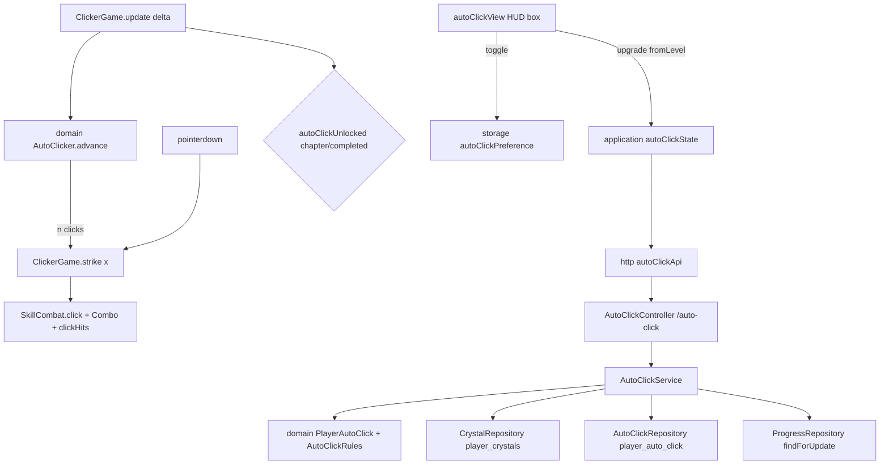

# Auto Click Design

**Spec**: `.specs/features/auto-click/spec.md`
**Status**: Approved (owner: "pode seguir com tudo", 2026-10-27)

---

## Architecture Overview

The backend owns the crystals and the auto click level exactly like the talents own their levels (AD-009, AD-011): a GET answers the state with the interval and the next price, a POST upgrades from the level the player saw under the `progress` row lock. The game keeps a pure `AutoClicker` that turns frame time into a number of clicks, an application service that mirrors the backend state, a `localStorage` preference for the switch, and a DOM view for the HUD box. `ClickerGame` feeds the frame time to the clicker and routes each auto click through the same hit path as a manual click (AD-012).

---

## Code Reuse Analysis

### Existing Components to Leverage

| Component | Location | How to Use |
| --- | --- | --- |
| Talent upgrade flow | `backend/.../service/TalentService.kt` | Same shape: `createIfAbsent` + `findForUpdate` on progress, load, domain `upgrade`, save, log |
| Talent exceptions | `backend/.../domain/TalentExceptions.kt` | Same family: request (400) and conflict (409) base classes |
| `ApiExceptionHandler` | `backend/.../adapter/web/ApiExceptionHandler.kt` | Two new handlers; the mismatch carries the stored state like `progressConflict` |
| `TalentConfig` | `backend/.../adapter/config/TalentConfig.kt` | `@ConfigurationProperties("app.auto-click")` building validated rules |
| `TalentRepository` | `backend/.../adapter/repository/TalentRepository.kt` | Entity + Jpa interface + port adapter in one file |
| `TalentControllerIT` | `backend/src/test/.../TalentControllerIT.kt` | Register a player, seed rows, race test with an executor |
| `talentApi` / `talentCollection` | `game/src/adapters/http`, `game/src/application/talents` | Same gateway port and 409 reload |
| `Combo` | `game/src/domain/combat/combo.js` | Same frame-time style for `AutoClicker` |
| `hitMonster` | `game/src/adapters/phaser/ClickerGame.js:768` | Extracted to `strike(x)`; the pointer and the auto click both call it |
| Farm toggle | `game/src/adapters/phaser/ClickerGame.js:69` | Same interactive `hud-box` HTML for the switch |
| `fakeBackend` | `game/e2e/support/fakeBackend.js` | New `/auto-click` routes |

### Integration Points

| System | Integration Method |
| --- | --- |
| Progress | The service reads the locked `Progress` for the chapter check (chapter >= 2 or completed) |
| Database | Flyway `V6__auto_click.sql`: `player_crystals`, `player_auto_click`, both cascading with `users` (AD-010) |
| Game services | `composition.js` adds `createAutoClickState` and `autoClickPreference` to `services` |

---

## Components

### Backend domain - `domain/AutoClick.kt`, `domain/AutoClickExceptions.kt`

- **Purpose**: The rules (intervals, prices) and one player's level and crystals.
- **Interfaces**:
  - `AutoClickRules(intervalsMs: List<Int>, prices: List<Long>)` - `init` requires `intervalsMs.size == prices.size + 1`, intervals positive and strictly decreasing, prices positive; `maxLevel`, `intervalAt(level)`, `priceTo(level)`.
  - `PlayerAutoClick(username, level, crystals)` - `intervalMs(rules)`, `next(rules): AutoClickStep?`, `upgrade(fromLevel, unlocked, rules): PlayerAutoClick`.
  - Check order in `upgrade`: mismatch (`fromLevel != level`) → max level → locked → not enough crystals.
  - `AutoClickStep(level, intervalMs, price)`.
  - `fun autoClickUnlocked(progress: Progress) = progress.completed || progress.position.chapter >= 2`.
  - Exceptions: `AutoClickRequestException` (400 `INVALID_AUTO_CLICK_REQUEST`), `AutoClickConflictException` (409 base), `AutoClickLevelMismatchException(current: PlayerAutoClick)`, `AutoClickMaxLevelException`, `AutoClickLockedException`, `NotEnoughCrystalsException`.

### Backend ports and repositories

- `port/AutoClickPorts.kt`: `CrystalRepositoryPort { balance(username): Long; save(username, crystals) }`, `AutoClickRepositoryPort { level(username): Int; save(username, level) }`.
- `adapter/repository/CrystalRepository.kt`, `adapter/repository/AutoClickRepository.kt`: entity + Jpa + adapter; no row = 0.

### Backend service, use cases, config, controller

- `usecase/AutoClickUseCase.kt`: `GetAutoClickUseCase.get(username)`, `UpgradeAutoClickUseCase.upgrade(username, fromLevel)`.
- `service/AutoClickService.kt`: `@Transactional`; requires the user; upgrade: `createIfAbsent(Progress.start)`, `findForUpdate`, load, `upgrade`, save both, log info; rejections log warn.
- `adapter/config/AutoClickConfig.kt`: `app.auto-click.intervals-ms` `[500, 250, 150, 100, 50]`, `prices` `[10, 25, 50, 100]`.
- `adapter/web/AutoClickController.kt`: `GET /auto-click`, `POST /auto-click/upgrade` `{ fromLevel }` → `AutoClickResponse { level, maxLevel, intervalMs, crystals, next: { level, intervalMs, price } | null }`.

### Game domain - `game/src/domain/combat/autoClick.js`

- `AUTO_CLICK_BASE_MS = 500`, `AUTO_CLICK_MAX_PER_FRAME = 5`.
- `autoClickUnlocked({ chapter, completed })` - true when `completed` or `chapter >= 2`.
- `class AutoClicker { intervalMs; advance(ms): number }` - accumulates, returns `min(5, floor(acc / interval))`, removes that many intervals from the accumulator. The scene calls `advance` only while the auto click is active.

### Game http, application, storage

- `adapters/http/autoClickApi.js`: `get()`, `upgrade(fromLevel)`.
- `application/autoClick/autoClickState.js`: `createAutoClickState({ gateway })` - `load()`, `upgrade()` (sends the level it holds; on 409 reloads and rethrows), `state()` (null until loaded), `intervalMs()` (500 until loaded or after a failed load), `loaded`, `onChange`.
- `adapters/storage/autoClickPreference.js`: `createAutoClickPreference(storage)` → `{ enabled(): boolean, setEnabled(on) }`, key `infinity-grove.auto-click`, default true, every access in try/catch.

### Game view and scene

- `adapters/phaser/views/autoClickView.js`: `renderAutoClick({ enabled, intervalMs, state, busy })` → DOM nodes: checkbox `Auto clique`, `<interval> ms`, `Cristais: <n>` (state only), button `Melhorar: <ms> ms (<price> cristais)` (state with `next` only), disabled when `crystals < price` or `busy`.
- `ClickerGame`: an interactive `hud-box hud-auto-click` element (hidden while locked), `AutoClicker` fed in `update` only while unlocked, enabled, not paused and the monster alive; each returned click calls `strike(MONSTER.x)` and stops when the monster dies.

---

## Error Handling Strategy

| Error Scenario | Handling | User Impact |
| --- | --- | --- |
| GET /auto-click fails | `autoClickState` keeps `state()` null; interval 500 | Auto click runs at 500 ms; no crystals, no button |
| Upgrade 409 | `autoClickState` reloads, rethrows; view re-renders | Button shows the stored state |
| Upgrade network error | rethrow; busy cleared | Button enabled again, nothing changed |
| `localStorage` throws | preference returns true, ignores writes | Switch on |

---

## Risks & Concerns

| Concern | Location (file:line) | Impact | Mitigation |
| --- | --- | --- | --- |
| `ClickerGame` is a 1000-line scene mixing rendering and rules | `game/src/adapters/phaser/ClickerGame.js` | Auto click logic could leak into it | Timing in `AutoClicker`, text in `autoClickView`, the scene only wires |
| Scene tests with chapter 2+ that call `update` would now get auto clicks | `game/src/adapters/phaser/ClickerGame.test.js:410` | Pinned damage numbers change | The test harness gets an auto click preference that the old tests start off; new tests turn it on |
| Integration-test cleanup must remove the new rows | `backend/src/test/.../IntegrationTestBase.kt` | Leaking rows between tests | Rows cascade with `users`; the base deletes users |

---

## Tech Decisions

| Decision | Choice | Rationale |
| --- | --- | --- |
| Where crystals live | Own table `player_crystals` | A general currency for the future source; the `wallets` row carries drop queues and is created lazily |
| Level storage | `player_auto_click` row only from level 1, no row = 0 | Same as `player_talents` |
| Mismatch body | 409 carries `autoClick` with the stored state | Spec AC; mirrors `progressConflict` |
| Check order | mismatch, max level, locked, crystals | A stale double click must answer mismatch first |
