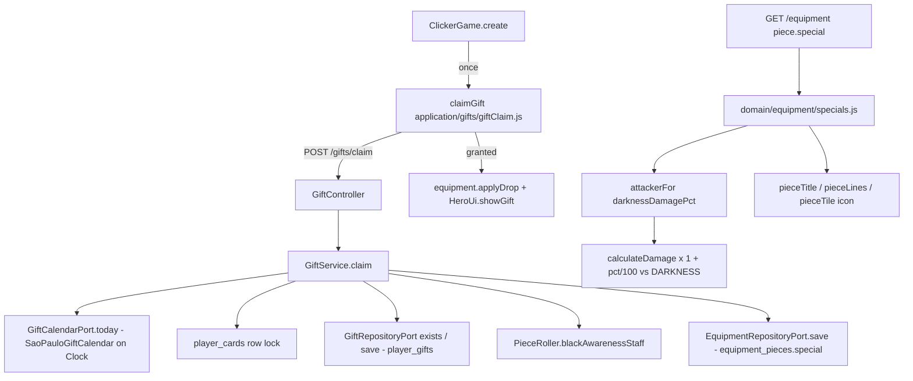

# Black Awareness Staff Design

**Spec**: `.specs/features/black-awareness-staff/spec.md`
**Status**: Draft (waiting for the owner's answers to Q1 to Q6 of the spec)

---

## Architecture Overview

Two independent halves meet at one JSON field, `piece.special`.



- **Backend** (DDD layout, `kotlin-backend-ddd`): the gift is a use case of its own (`ClaimGiftUseCase`, `GiftService`, `GiftController`), not a change of the boss reward path. It takes the same player lock as every equipment change (`player_cards` row, ADR 0008), so it serialises with drops, sales and refines; the unique key of `player_gifts` is the second guard.
- **Game** (hexagonal, AD-003): the special is pure data in `domain/equipment/specials.js`; `attackerFor` turns it into one attacker number, `darknessDamagePct`; `calculateDamage` is the single place that reads it. Every leader strike (click, auto click, skill hit, aimed shot, tick) and every ally hit already goes through `calculateDamage` via `skillDamage.strike`, so one multiplication covers D7.

## Code Reuse Analysis

| Existing | Where | How it is reused |
| -------- | ----- | ---------------- |
| `PieceRoller.affix`, `pick`, `between`, `weaponClickRanges` | `backend/.../domain/PieceRoller.kt:9`, `:64-79` | The staff roll reads the same bands and the same chance order as a boss weapon after the slot pick |
| `Piece.copy` in `refined()` / `rerolled()` | `backend/.../domain/Equipment.kt:125-145` | A new constructor field `special` is kept by `copy`, so refine and reroll keep it with no new code |
| `EquipmentService.lockPlayer` pattern | `backend/.../service/EquipmentService.kt:162-169` | `GiftService` locks the same row the same way |
| `MutableClock`, `InMemoryEquipmentRepository`, `InMemoryPlayerCardsRepository`, `SequenceChanceRoller`, `SequenceIds` | `backend/src/test/.../Fakes.kt` | Unit tests of the calendar and the service |
| `ControllableChanceRoller` + `ChanceTestConfiguration` | `backend/src/test/.../IntegrationTestBase.kt:37-54` | Same `@Primary` pattern for `ControllableGiftCalendar` |
| `equipment.applyDrop` | `game/src/application/equipment/equipmentCollection.js:160` | The granted piece joins the list without a request; handles a load in flight |
| `HeroUi.showNotice`, `equipmentBadge` | `game/src/adapters/phaser/HeroUi.js:1166-1212` | The gift notice and the red dot |
| `iconWithFallback` | `game/src/adapters/phaser/views/dom.js:38` | The staff icon, with `slot-weapon` as the fallback name |
| `skillDamage.strike` `vsDarkness` | `game/src/domain/skills/skillDamage.js:19-36` | Luz Divina's own factor stays; the staff factor multiplies with it (D8) |

## Components

### Backend

- **`PieceSpecial`** (new enum in `domain/Equipment.kt`): `BLACK_AWARENESS_STAFF`. `Piece` gains `val special: PieceSpecial? = null` (last constructor parameter) and the rule `special == null || (slot == WEAPON && rarity == LEGENDARY)`.
- **`PieceRoller.blackAwarenessStaff(username, id, chance)`**: rolls base click in `10..12`, then 4 affixes from `AffixType.allowedOn(WEAPON)` exactly like `roll` after the slot; returns refine 0, `heroId` null, special set.
- **`GiftDay`** (new `domain/Gift.kt`): `GIFT_ID = "BLACK_AWARENESS_STAFF"`, `isGiftDay(date: LocalDate) = date.monthValue == 11 && date.dayOfMonth == 20`; `GiftGrant(username, giftId, pieceId, grantedAt)`; `GiftClaim(piece: Piece?)` with `granted = piece != null`.
- **Ports** (`port/GiftPorts.kt`): `GiftCalendarPort.today(): LocalDate`; `GiftRepositoryPort.exists(username, giftId)`, `save(grant)`.
- **Adapters**: `adapter/config/SaoPauloGiftCalendar.kt` (`@Component`, `clock.instant().atZone(ZoneId.of("America/Sao_Paulo")).toLocalDate()`); `adapter/repository/GiftRepository.kt` (`PlayerGiftEntity`, `JpaPlayerGiftRepository`, `GiftRepository`).
- **`GiftService`** (`service/GiftService.kt`, `@Service @Transactional`, implements `ClaimGiftUseCase`): user check, day check (no lock off the day), lock, exists check, roll, save piece (no capacity check, D6), save grant, log.
- **`GiftController`** (`adapter/web/GiftController.kt`): `POST /gifts/claim`. Authenticated by the existing `anyRequest, authenticated` rule; no `SecurityConfig` change.
- **Persistence**: `V14__black_awareness_staff.sql` adds `equipment_pieces.special varchar(32)` (nullable) and `player_gifts`. `PieceEntity` gains `special` (last constructor parameter, default null); `PieceResponse` gains `special` (omitted when null).

### Game

- **`domain/equipment/specials.js`** (new): `BLACK_AWARENESS_STAFF`, `SPECIALS`, `specialOf(piece)`, `GIFT_NOTICE`, `GIFT_NOTICE_MS = 6000`.
- **`domain/equipment/equipment.js`**: `pieceTitle`, `pieceLines` read `specialOf`; `attackerFor` adds `darknessDamagePct`.
- **`domain/combat/damage.js`**: `calculateDamage` multiplies by `1 + darknessDamagePct / 100` when `defender.element === DARKNESS`.
- **`domain/combat/allyAttacker.js`**: copies `darknessDamagePct` from the worn attacker.
- **`adapters/http/giftApi.js`** (new) + `composition.js` (`services.gifts`).
- **`application/gifts/giftClaim.js`** (new): `claimGift({ gateway, equipment, onGift })`.
- **`adapters/phaser/views/pieceTile.js`** + `public/style.css`: staff icon and `data-special`.
- **`adapters/phaser/HeroUi.js`**: `showNotice(text, ms = NOTICE_MS)`, `showGift(piece)`. **`ClickerGame.js`**: calls `claimGift` once in `createHeroUi`.

## Data Models

### `POST /gifts/claim` (no request body)

```json
{ "granted": true, "gift": "BLACK_AWARENESS_STAFF",
  "piece": { "id": "<uuid>", "slot": "WEAPON", "rarity": "LEGENDARY", "refine": 0, "clickDamage": 11.0,
             "affixes": [ { "type": "BOSS_DAMAGE_PCT", "value": 28 }, { "type": "BOSS_TIME_SECONDS", "value": 6 },
                          { "type": "CRIT_DAMAGE_PCT", "value": 55 }, { "type": "ARMOR_PIERCE_PCT", "value": 28 } ],
             "refineCost": 4000, "sellPrice": 500, "special": "BLACK_AWARENESS_STAFF" } }
```

`{ "granted": false }` otherwise (`gift` and `piece` omitted). 401 without token, 404 `USER_NOT_FOUND` for a deleted user. `refineCost` at +0 is `500 x 8 = 4000` (`Piece.refineCost`, legendary multiplier 8).

### `V14__black_awareness_staff.sql`

```sql
alter table equipment_pieces add column if not exists special varchar(32);

create table if not exists player_gifts (
    id         varchar(255) primary key,
    username   varchar(255) not null references users (username) on delete cascade,
    gift_id    varchar(64)  not null,
    piece_id   varchar(255) not null,
    granted_at bigint       not null,
    constraint uk_player_gifts_username_gift unique (username, gift_id)
);
```

`id` is `<username>/<giftId>`. `piece_id` has no foreign key: the staff may be sold (row deleted) and the grant must stay.

## Error Handling Strategy

| Error Scenario | Handling | User Impact |
| -------------- | -------- | ----------- |
| Not November 20 in Sao Paulo | `granted: false`, no lock, no write | Nothing |
| Already granted | `granted: false` | Nothing |
| Two tabs claim at once | Row lock serialises; the second sees the grant row | One staff |
| Unique key violation (lock bypassed) | Transaction rolls back, 500 by the existing handler; the piece insert rolls back with it | The other request already granted it |
| Claim request fails in the game | `claimGift` resolves `null`; no notice | Next start claims again (D15) |
| Unknown `special` in the game | `specialOf` returns null | Normal piece (D13) |
| Previous backend after V14 | Ignores the column and the table | Staff acts as a plain legendary on that backend |

## Tech Decisions

| Decision | Choice | Rationale |
| -------- | ------ | --------- |
| Trigger | Dedicated `POST /gifts/claim` from the battle start | No change to login, refresh or `GET /equipment` shapes; idempotent and testable |
| Clock in tests | `GiftCalendarPort` overridden in ITs | Replacing the global `Clock` would issue expired JWTs in ITs run after the date |
| Where the x3 lives | `calculateDamage` | The single function every strike passes through |
| Bag overflow | Allowed by one | `PlayerEquipment` already tolerates `pieces.size > capacity` (`isFull` is `>=`) |
