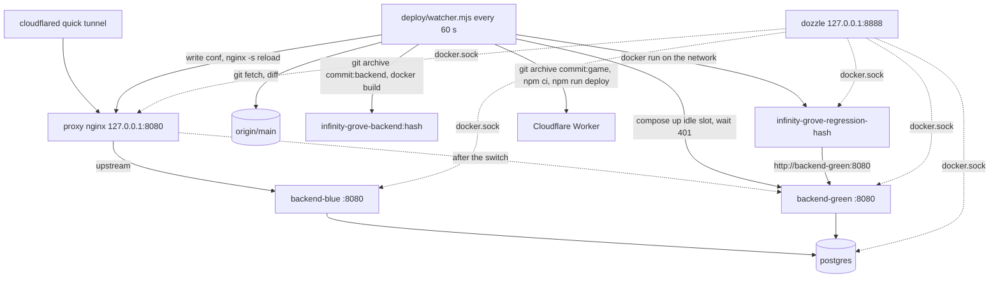

# Blue-Green Deploy Design

**Spec**: `.specs/features/blue-green-deploy/spec.md`
**Status**: Draft

---

## Architecture Overview

The deploy logic is plain Node (22, already on the machine) in a new top-level `deploy/` folder, split into small modules. Each module receives an `exec` (runs a command) and a `fetch`, so it is tested with `node --test` and fakes, with no new dependency. The shell scripts stay thin: `publish.sh` starts the stack, the tunnel and the watcher, and `deploy.sh` is the manual entry point (`--rollback`).

The containers go into the existing `backend/docker-compose.yml` under a `deploy` profile. They reuse the same `postgres` service and the same volume, so the players' data is the data the slots use. `start.sh` (dev) is unchanged because it starts only the services without a profile.



Deploy of commit `H` (slot `blue` active):

1. `git archive --format=tar H:backend | docker build -t infinity-grove-backend:H -` (the commit tree only).
2. `GREEN_IMAGE=infinity-grove-backend:H docker compose --profile deploy up -d --no-deps --force-recreate backend-green`.
3. Poll `http://127.0.0.1:18082/progress` until it answers 401, for at most 180 s. Flyway migrates on start.
4. Extract `deploy/regression.mjs` from commit `H` (fall back to the working tree copy when the commit has none) and run it in `node:22-alpine` named `infinity-grove-regression-H`, on the compose network, against `http://backend-green:8080`.
5. Write `deploy/nginx/default.conf` with `server backend-green:8080`, run `nginx -t`, then `nginx -s reload`.
6. Wait 10 s so requests in flight on the old upstream finish, then `docker stop infinity-grove-backend-blue`. The state records `previous = blue/<old hash>, stoppedAt`.
7. Every watcher tick removes the previous container and its image once `stoppedAt` is 5 minutes old.

Any failure in steps 1 to 5 removes the new slot (`compose rm -sf`) and leaves the proxy alone.

---

## Code Reuse Analysis

### Existing Components to Leverage

| Component | Location | How to Use |
| --- | --- | --- |
| Postgres service and volume | `backend/docker-compose.yml` | Same service; the slots reach it as `postgres:5432` |
| Game paths of the publish fingerprint | `publish.sh:48` (`game_fingerprint`) | Same list decides "the game changed" in `changes.mjs` |
| Tunnel liveness check | `publish.sh:66` (`tunnel_alive`) | Kept in the new `publish.sh` |
| Worker publish | `game/scripts/deploy.mjs` (`npm run deploy`) | Run inside the extracted commit tree |
| Default dev JWT secret | `start.sh:22` | Exported by `publish.sh`; both slots get the same value, so tokens survive a switch |
| `DELETE /users/{username}` | `UserController.kt:100` | Regression cleanup; every player table cascades on the user |
| Outcome contract | `ProgressController.kt:150` | The suite reports `CLEARED` at the position each answer returns until chapter 2 |

### Integration Points

| System | Integration Method |
| --- | --- |
| Spring backend | Env `SPRING_DATASOURCE_URL=jdbc:postgresql://postgres:5432/infinity_grove` and `JWT_SECRET` override `application.yml`; no code change |
| Cloudflare tunnel | Still `http://localhost:8080`, now served by the proxy |
| Git | `git fetch origin main`, `git rev-parse origin/main`, `git diff --name-only`, `git archive`, `git show` |

---

## Components

### Backend image

- **Purpose**: Build and run the backend of one commit.
- **Location**: `backend/Dockerfile`, `backend/.dockerignore`
- **Interfaces**: `docker build -t infinity-grove-backend:<hash> -` with the tar of `<hash>:backend` on stdin.
- **Details**: The build stage `eclipse-temurin:25-jdk` runs `./gradlew bootJar --no-daemon` (tests are not run here; the regression suite is the gate). The run stage `eclipse-temurin:25-jre` runs `java -jar app.jar` on 8080. The exact tags are pinned during the task after a `docker pull`.

### Compose services (profile `deploy`)

- **Location**: `backend/docker-compose.yml`
- **Services**:
  - `backend-blue`, `backend-green`: container `infinity-grove-backend-<slot>`, image `${BLUE_IMAGE}` / `${GREEN_IMAGE}`, ports `127.0.0.1:18081:8080` / `127.0.0.1:18082:8080` (readiness from the host only), `restart: unless-stopped`, depends on a healthy `postgres`.
  - `proxy`: `nginx` alpine, container `infinity-grove-proxy`, `127.0.0.1:8080:80`, mounts `../deploy/nginx` on `/etc/nginx/conf.d`.
  - `dozzle`: `amir20/dozzle`, container `infinity-grove-dozzle`, `127.0.0.1:8888:8080`, `/var/run/docker.sock` read-only, `DOZZLE_FILTER=name=infinity-grove`.

### `deploy/lib/run.mjs`

- **Purpose**: The one place that runs a command.
- **Interfaces**: `run(command, args, { cwd, env, input }) -> { status, stdout, stderr }` (spawnSync, 64 MB buffer, `input` a Buffer for piping).

### `deploy/lib/state.mjs`

- **Purpose**: `.deploy-state` (JSON) and `.deploy.lock`.
- **Interfaces**:
  - `readState(file) -> State | null`, `writeState(file, state)`
  - `acquireLock(file) -> boolean` (`open` with `wx`), `releaseLock(file)`, `clearStaleLock(file)`

### `deploy/lib/changes.mjs`

- **Purpose**: Decide what a commit range touches.
- **Interfaces**: `classify(files: string[]) -> { backend, game }`. `backend` = any `backend/**`. `game` = any of the `publish.sh` game paths, minus `*.test.js`. `changedFiles(exec, from, to) -> string[]`.

### `deploy/lib/proxy.mjs`

- **Purpose**: Point the proxy at a slot.
- **Interfaces**: `renderConf(slot) -> string`, `writeConf(dir, slot)`, `switchTo(exec, dir, slot) -> boolean` (`writeConf`, `nginx -t`, `nginx -s reload` through `docker exec infinity-grove-proxy`).

### `deploy/lib/slots.mjs`

- **Purpose**: The slot lifecycle.
- **Interfaces**:
  - `SLOTS = { blue: { port: 18081 }, green: { port: 18082 } }`, `otherSlot(slot)`, `imageOf(hash)`
  - `buildImage(exec, root, hash) -> boolean`
  - `startSlot(exec, root, slot, image) -> boolean`, `stopSlot(exec, slot)`, `removeSlot(exec, root, slot)`, `slotExists(exec, slot) -> boolean`, `removeImage(exec, image)`
  - `waitReady(fetch, slot, { timeoutMs = 180000, intervalMs = 2000, now, sleep }) -> boolean`: true on the first 401

### `deploy/regression.mjs`

- **Purpose**: The API suite (US-2).
- **Interfaces**: `runSuite(baseUrl, { fetch, log, now }) -> { ok, checks }` and a CLI `node regression.mjs <baseUrl>` (exit 0/1).
- **Checks** (in order, each a named step; the name goes in `FALHOU`):
  1. `cadastro`: `POST /users` 201 with `accessToken`, as `regression-<hash or local>-<random>` with `startingElement` `FIRE`
  2. `login`: `POST /users/login` 200
  3. `progresso inicial`: `GET /progress` 200 with chapter 1, stage 1
  4. `carteira`: `GET /wallet` 200
  5. `talentos`: `GET /talents` 200
  6. `heróis`: `GET /heroes` 200
  7. `equipamentos`: `GET /equipment` 200
  8. `auto clique inicial`: `GET /auto-click` 200 with level 0 and resets 0
  9. `reset bloqueado`: `POST /account/reset {fromChapter:1}` 409 `RESET_LOCKED`
  10. `capítulo 1`: `POST /progress/outcome` CLEARED at the returned position until chapter 2 (at most 200 posts)
  11. `reset`: `POST /account/reset {fromChapter:2}` 200 with reward 2 and progress chapter 1
  12. `auto clique após reset`: `GET /auto-click` 200 with resets 1 and crystals 2
- **Cleanup**: `finally` deletes the user with its token. A failed delete prints `FALHOU: limpeza: 204 / <status>` and makes the run fail.

### `deploy/lib/regressionRun.mjs`

- **Purpose**: Run the suite of a commit in its container.
- **Interfaces**: `runRegression(exec, root, hash, slot) -> boolean`. It writes `git show <hash>:deploy/regression.mjs` (or the working tree file) to a temp dir, then `docker run --rm --name infinity-grove-regression-<hash> --network backend_default -v <dir>:/suite:ro node:22-alpine node /suite/regression.mjs http://backend-<slot>:8080`.

### `deploy/lib/backendDeploy.mjs`

- **Purpose**: One blue-green deploy (US-1, BG-01 to BG-05, BG-08).
- **Interfaces**: `deployBackend({ exec, fetch, root, state, hash, log, sleep, now }) -> { ok, state }`.

### `deploy/lib/previous.mjs`

- **Purpose**: The previous slot (US-1 AC 7, US-4).
- **Interfaces**: `sweepPrevious({ exec, root, state, now, log }) -> state` (removes the container and image after 5 min), `rollback({ exec, fetch, root, state, log, sleep }) -> { ok, state }`.

### `deploy/lib/workerPublish.mjs`

- **Purpose**: Publish the Worker of a commit (BG-10, BG-11).
- **Interfaces**: `publishWorker({ exec, root, hash, tunnel, log }) -> boolean`. It extracts `git archive <hash> game` into a temp dir, runs `npm ci` and `BACKEND_URL=<tunnel> npm run deploy`, then removes the dir.

### `deploy/watcher.mjs`

- **Purpose**: The poll loop (US-3, BG-09, BG-14).
- **Interfaces**: `tick(deps) -> state` (one poll) and a CLI that runs `tick` now and every 60 s.
- **One tick**:
  1. `docker info` fails → log `Docker indisponível; nova tentativa em 60 s`.
  2. `git fetch origin main` fails → log `Não foi possível buscar origin/main; nova tentativa em 60 s`.
  3. Sweep the previous slot.
  4. Target equals `handled` → done. A rollback leaves `handled` alone, so the rolled-back commit is not redeployed (US-4 AC 3).
  5. The lock is taken → done.
  6. Classify `handled..target`. Run the backend deploy when it touches the backend. Publish the Worker when it touches the game and the backend part passed. Then `handled = target`.

### `deploy/deploy.mjs` and `deploy.sh`

- **Purpose**: The manual entry (`./deploy.sh --rollback`).
- **Interfaces**: `deploy.sh` runs `node deploy/deploy.mjs "$@"`, which takes the lock, calls `rollback`, saves the state and exits 0/1.

### `publish.sh` (rewritten)

1. Fail when Docker or cloudflared is missing. `git fetch origin main`. Remove a stale `.deploy.lock`. Export `JWT_SECRET`.
2. Pick the active slot and commit: from `.deploy-state`, or `blue` and `origin/main` on the first run (edge case 1). Build the image when it is missing, write the proxy conf, and run `compose --profile deploy up -d --wait postgres dozzle backend-<slot> proxy`.
3. Wait for `localhost:8080/progress`, then open the tunnel and record it in the state.
4. Unless `--no-deploy`, publish the Worker of the handled commit through the new tunnel.
5. Start `node deploy/watcher.mjs` in the background. Ctrl+C stops the watcher and the tunnel, then the deploy containers.
6. A second run while one is up (the state's tunnel alive) prints the tunnel and the active slot and exits. `--force` republishes the Worker of the handled commit.

---

## Data Models

```js
//  .deploy-state (JSON, gitignored)
{
  active:   { slot: 'blue' | 'green', commit: '<full hash>' },
  previous: { slot, commit, stoppedAt: <epoch ms> } | null,
  handled:  '<full hash>',      // last origin/main commit acted on
  tunnel:   'https://...trycloudflare.com' | null
}
```

Logs keep the short hash (7 characters); the state keeps the full one.

---

## Error Handling Strategy

| Error Scenario | Handling | User Impact |
| --- | --- | --- |
| Image build fails | Log `Deploy <h> falhou no build da imagem`, `handled = target` | None; the old slot serves |
| Slot not ready in 180 s | Remove the new slot, log `Deploy <h> falhou: o backend não ficou pronto em 180 s` | None |
| Suite fails | Remove the new slot, log `Deploy <h> falhou na regressão; o slot <s> continua ativo` | None |
| `nginx -t` or reload fails | Write back the old conf, remove the new slot, log `Deploy <h> falhou na troca do proxy; o slot <s> continua ativo` | None |
| Migration ran but the deploy failed | Stays applied (expand/contract, AD-016) | The old backend keeps working only if the migration is compatible |
| Worker publish fails | Log `Publicação do Worker <h> falhou`, `handled = target` | Players keep the previous game |
| Watcher dies | `publish.sh` keeps the tunnel up; the next `publish.sh` restarts everything | Deploys stop until then |

---

## Risks & Concerns

| Concern | Location (file:line) | Impact | Mitigation |
| --- | --- | --- | --- |
| A migration that breaks the old backend | `backend/src/main/resources/db/migration` | After a failed suite, the old slot runs on the new schema | AD-016 makes expand/contract the rule; the suite runs after Flyway, so the new slot is checked on the real schema |
| Docker socket in Dozzle | compose `dozzle` | Control of the machine | Bound to `127.0.0.1`, read-only mount, not routed by the proxy |
| nginx resolves upstream names on load | `deploy/nginx/default.conf` | A conf naming a stopped slot fails `nginx -t` | The conf only ever names the running slot; `publish.sh` writes it before the proxy starts |
| Uncommitted work no longer goes out with `publish.sh` | `publish.sh` | The owner's earlier choice "publish as-is" changes | The deploy follows the CLAUDE.md flow (everything pushed first); stated in CLAUDE.md |
| Sweeping only happens on a tick | `deploy/watcher.mjs` | Removal at 5 to 6 min, not exactly 5 | Accepted; `rollback` checks that the container exists |
| `.publish-state` becomes unused | `publish.sh:16` | Dead file | Removed with the rewrite; `.deploy-state` replaces it |

---

## Tech Decisions

| Decision | Choice | Rationale |
| --- | --- | --- |
| Orchestration language | Node modules with injected `exec`/`fetch` | Testable with `node --test`, no new dependency; bash stays a launcher |
| Same compose file | Profile `deploy` in `backend/docker-compose.yml` | Same Postgres volume as today; dev `start.sh` untouched |
| Readiness port | Slot ports on `127.0.0.1` only | Readiness from the host; the suite still uses the internal name |
| Suite version | `deploy/regression.mjs` of the deployed commit | A commit that changes the API ships its own checks |
| Drain before stop | 10 s after the reload | Requests still on the old upstream finish |

Project-level decision to append to `.specs/STATE.md`:

- **AD-016**: The backend goes live by the blue-green watcher from the commit on `origin/main`. Every Flyway migration must keep the previous backend working (expand/contract), because a failed deploy does not undo it.
