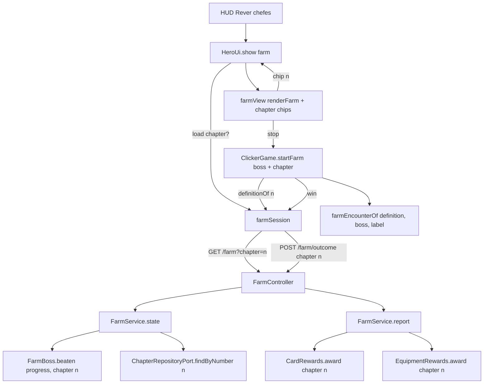

# Boss Replay Chapters Design

**Spec**: `.specs/features/boss-replay-chapters/spec.md`
**Status**: Approved by the owner on 2026-11-17 ("Aprovo os padrões"): every default of Q1 to Q8 accepted.

`<main>` is `backend/src/main/kotlin/br/com/woodriver/infinity_grove_ws`, `<test>` is `backend/src/test/kotlin/br/com/woodriver/infinity_grove_ws`.

---

## Architecture Overview

The fought chapter becomes an explicit input of the farm on both sides. The backend already stores every chapter definition (`ChapterSeeder`, chapters 1 to 15) and already passes a chapter number to every reward roll; today that number is always `progress.position.chapter`. The change replaces it with the chosen chapter after checking it is reached. The game asks the farm for one chapter at a time, keeps the definition of each chapter it loaded, and builds an earlier chapter's fight from that definition instead of the campaign's.



No approach alternatives are presented: the backend already keys every reward by a chapter number and holds every definition, so passing the chosen chapter is the only change that keeps one rule set. A client-side-only selector is impossible (the backend refuses bosses outside the current chapter).

---

## API Contract

### `GET /farm` and `GET /farm?chapter=<n>`

Query `chapter` optional. Absent: the current campaign chapter. An integer above the current chapter: the current chapter. Not an integer, or below 1: 400.

```json
{
  "chapter": 2,
  "chapters": [1, 2, 3],
  "bosses": [ { "kind": "MINIBOSS", "stage": 1 }, "... stages 2 to 10 ...", { "kind": "CHAPTER_BOSS" } ],
  "chapterBossWinsLeft": 10,
  "definition": {
    "bossHealth": 8000, "bossTimeLimitMs": 60000,
    "boss": { "element": "FIRE", "physicalDefense": 35, "magicalDefense": 35, "critResistance": 35 },
    "bossDropRuleId": 6,
    "stages": [ { "number": 1, "phasesPerStage": 5, "monsterHealth": 160, "minibossHealth": 800, "minibossTimeLimitMs": 30000,
                  "monster": { "...": "EnemyStatsResponse" }, "miniboss": { "...": "EnemyStatsResponse" },
                  "monsterDropRuleId": 4, "minibossDropRuleId": 5 }, "... 10 stages ..." ]
  }
}
```

| Field | Type | Note |
| --- | --- | --- |
| `chapter` | int | The chapter listed (new) |
| `chapters` | int[] | `1..current`, ascending (new) |
| `bosses` | `{ kind: "MINIBOSS" \| "CHAPTER_BOSS", stage?: int }[]` | Unchanged shape |
| `chapterBossWinsLeft` | int | Unchanged, shared by every chapter |
| `definition` | `ChapterResponse` | The class already used by `ProgressResponse.definition` (`ProgressController.kt:68`) (new) |

Errors: 400 ProblemDetail `{ "status": 400, "detail": "chapter must be an integer of at least 1" }` (thrown as `IllegalArgumentException`, mapped by `ApiExceptionHandler.badRequest`); 401 without a token (unchanged).

### `POST /farm/outcome`

```json
{ "boss": { "kind": "MINIBOSS", "stage": 3 }, "outcome": "CLEARED", "chapter": 2 }
```

`chapter` optional (absent or `null`: current chapter). Response unchanged: `{ "drop": DropResponse | null, "chapterBossWinsLeft": int, "equipmentDrop": EquipmentDropResponse | null }`.

| Case | Answer |
| --- | --- |
| `chapter` not an integer or below 1 | 400 `chapter must be an integer of at least 1` |
| `chapter` above the current chapter | 409 `BOSS_NOT_AVAILABLE` |
| Boss not in `FarmBoss.beaten(progress, definition of chapter)` | 409 `BOSS_NOT_AVAILABLE` |
| Chapter boss with 0 wins left today | 409 `DAILY_LIMIT_REACHED` (shared count) |
| Less than 5000 ms after the last farm win | 409 `FARM_TOO_FAST` (shared timestamp) |

---

## Code Reuse Analysis

### Existing Components to Leverage

| Component | Location | How to Use |
| --- | --- | --- |
| `FarmBoss.beaten` | `<main>/domain/Farm.kt:23` | Generalised to any chapter number |
| `ChapterRepositoryPort.findByNumber` | `<main>/port/ProgressPorts.kt` | Loads the definition of the chosen chapter |
| `CardRewards.award(cards, encounter, chapter, stage, fromFarm)` | `<main>/service/CardRewards.kt:36` | Called with the chosen chapter; no change |
| `EquipmentRewards.award(username, encounter, chapter)` | `<main>/service/EquipmentRewards.kt:26` | Called with the chosen chapter; no change |
| `ChapterResponse.from` | `<main>/adapter/web/ProgressController.kt:76` | Serialises `FarmState.definition` |
| `Campaign.farmEncounter` | `game/src/domain/campaign/campaign.js:106` | Body moved into a pure `farmEncounterOf(definition, boss, label)` it delegates to |
| `bossMapStops` | `game/src/domain/campaign/bossMap.js:15` | Fed a `completed: true` position for an earlier chapter: every stop comes from the boss list |
| `renderFarm` | `game/src/adapters/phaser/views/farmView.js:59` | Gains the chip row; title already reads `map.chapter` |
| `.equip-button` and `--btn-*` tokens | `game/public/style.css:1747`, `:82` | Chip colours, shadow and states |
| Fake backend farm handler | `game/e2e/support/fakeBackend.js:689` | Extended with `chapter` |

### Integration Points

| System | Integration Method |
| --- | --- |
| Database | None new: chapters 1 to 15 are already rows (`ChapterSeeder`); no Flyway migration |
| Cloud Run / Worker deploy (AD-023) | Backend first, game second in the same workflow run; both directions stay compatible (spec P2 Compatibility) |
| `deploy/regression.mjs` | Calls no `/farm` route; unchanged |

---

## Components

### Backend: `FarmBoss` (domain)

- **Purpose**: Say which bosses of a chapter the player has beaten, for any chapter, and which chapters are reached.
- **Location**: `<main>/domain/Farm.kt`
- **Interfaces**:
  - `FarmBoss.beaten(progress: Progress, chapter: ChapterDefinition): List<FarmBoss>` - `chapter.number > position.chapter`: empty; `chapter.number < position.chapter` or `progress.completed`: minibosses `1..stageCount` then the chapter boss; equal: today's rule.
  - `FarmBoss.reachedChapters(progress: Progress): List<Int>` - `(1..progress.position.chapter).toList()`.
  - `FarmState(bosses, chapterBossWinsLeft, chapter: Int, chapters: List<Int>, definition: ChapterDefinition)`.
- **Dependencies**: `Progress`, `ChapterDefinition`.
- **Reuses**: the existing filter.

### Backend: `FarmService` and use cases

- **Purpose**: Answer the farm state of a chosen chapter and apply a farm win of a chosen chapter.
- **Location**: `<main>/service/FarmService.kt`, `<main>/usecase/FarmUseCase.kt`
- **Interfaces**:
  - `GetFarmUseCase.state(username: String, chapter: Int? = null): FarmState`
  - `ReportFarmUseCase.report(username: String, boss: FarmBoss, outcome: Outcome, chapter: Int? = null): FarmResult`
- **Rules**: `require(chapter == null || chapter >= 1) { CHAPTER_MESSAGE }` with `CHAPTER_MESSAGE = "chapter must be an integer of at least 1"`; listed chapter `minOf(chapter ?: current, current)`; a report chapter above current throws `BossNotAvailableException(boss.label())` before any lock on `player_cards`; rewards get the fought chapter. Lock order unchanged: `progress` (`findForUpdate`) then `player_cards`, then the wallet inside `EquipmentRewards`.
- **Observability**: the two `logger.info` lines gain `chapter={}`; the rejection `logger.warn` gains `chapter={}`.

### Backend: `FarmController`

- **Purpose**: Parse the optional `chapter` of both routes and serialise the new state fields.
- **Location**: `<main>/adapter/web/FarmController.kt`
- **Interfaces**: `get(principal, @RequestParam(name = "chapter", required = false) chapter: String?)`; `outcome` reads `body["chapter"]`; `FarmStateResponse(bosses, chapterBossWinsLeft, chapter: Int, chapters: List<Int>, definition: ChapterResponse)`.

### Game: `farmApi`, `farmSession`

- **Purpose**: Carry the chapter to and from the backend and keep the definition of every chapter loaded.
- **Location**: `game/src/adapters/http/farmApi.js`, `game/src/application/farm/farmSession.js`
- **Interfaces**:
  - `farmApi.get(chapter?)` - `GET /farm` or `GET /farm?chapter=<n>`.
  - `farmApi.win({ kind, stage, chapter })` - body `{ boss, outcome: 'CLEARED' }` plus `chapter` when `Number.isInteger(chapter)`.
  - `farmSession.load(chapter?)`, `chapter(): number | null`, `chapters(): number[]`, `definitionOf(n): object | null`.

### Game: domain helpers

- **Location**: `game/src/domain/campaign/campaign.js`, `game/src/domain/campaign/bossMap.js`
- **Interfaces**:
  - `farmLabel(boss): string` - `Rever chefe: ${bossLabel(boss)}`, plus ` (Capítulo ${boss.chapter})` when `boss.chapter` is an integer.
  - `farmEncounterOf(definition, boss): encounter` - the body of today's `Campaign.farmEncounter`, label from `farmLabel(boss)`.
  - `farmMapPosition(current, listedChapter, stageCount)` - `current` when `listedChapter` is null or equals `current.chapter`; else `{ chapter: listedChapter, stage: stageCount, kind: 'CHAPTER_BOSS', stageCount, completed: true }`.

### Game: `farmView`, `HeroUi`, `ClickerGame`

- **farmView** `renderFarm(bosses, winsLeft, { onPick, map, chapters = [], chapter = null, currentChapter = null, busy = false, onChapter = () => {} })` - draws the chip row when `chapters.length >= 2`.
- **HeroUi** - `show('farm', { chapter })` loads that chapter (HUD opening passes none, so the current chapter loads); `render_farm` feeds the row, `farmMapPosition` and adds `chapter` to the picked boss only when the listed chapter differs from the current campaign chapter; `selectFarmChapter(n)` loads with the chips disabled.
- **stageLabel** (UI review #1, T15) `renderStageLabel(node, label)` in `game/src/adapters/phaser/views/stageLabel.js` - a label ending with ` (Capítulo <n>)` becomes a text node plus `span.stage-hud-chapter`, so the tag draws on a second line; any other label is written as text. The plate's `textContent` is the label unchanged.
- **ClickerGame timer placement** (UI review #1, T16) `placeBossTimer()` - writes `--timer-shift` = `max(0, ceil(156 + stageHud.offsetWidth + 12 - (512 - bossTimer.offsetWidth / 2)))` px; called after the countdown starts in `showEncounter` and when the timer text changes in `showCountdown` (not on every frame); `hideCountdown` removes it. `offsetWidth` is in scene px because Phaser scales the DOM layer with a transform.
- **ClickerGame** - `farmEncounterFor(boss)`: `boss.chapter` integer → `farmEncounterOf(this.farm.definitionOf(boss.chapter), boss)` (null definition → no fight); else `this.session.farmEncounter(boss)`. `startFarm` and `nextFarmEncounter` use it; the chapter boss at 0 wins reopens `show('farm', { chapter: boss.chapter })` when the boss has a chapter.

---

## Data Models

No table or column changes. Kotlin:

```kotlin
data class FarmState(
    val bosses: List<FarmBoss>,
    val chapterBossWinsLeft: Int,
    val chapter: Int,
    val chapters: List<Int>,
    val definition: ChapterDefinition,
)
```

Game farm state (from `GET /farm`): `{ chapter?: number, chapters?: number[], bosses, chapterBossWinsLeft, definition?: ChapterDefinitionPayload }`; a missing field means a previous backend.

---

## Error Handling Strategy

| Error Scenario | Handling | User Impact |
| --- | --- | --- |
| Chapter load fails (network, 5xx) | `farmSession.load` rejects and keeps its state; `HeroUi` re-renders the previous map and sets `Não foi possível carregar.` | Map stays; chips usable again |
| Win report 409 `BOSS_NOT_AVAILABLE` (reset elsewhere) | Existing `reportFarmWin` path: leave the farm, reload the state | Back to the campaign fight |
| Win report 409 `DAILY_LIMIT_REACHED` / `FARM_TOO_FAST` | Unchanged paths | Unchanged |
| No definition for the picked chapter | `startFarm` returns without starting | The campaign fight continues |
| Previous backend (no new fields) | No selector; fights from the campaign definition | As today |

---

## Risks & Concerns

| Concern | Location (file:line) | Impact | Mitigation |
| --- | --- | --- | --- |
| Balance: every earlier chapter boss becomes farmable from chapter 2 (today only after chapter 15). A chapter 6 player can farm the chapter 5 boss for an epic/legendary chance on each of the 10 daily wins | `<main>/domain/PieceRoller.kt:37`, `application.yaml` `chapter-boss-daily-limit` | More pieces and next-chapter cards early | Shared daily limit of 10 (Q2) caps it at today's maximum; recorded in AD-024 trade-off for the owner |
| A farm win of an earlier chapter boss missing from `cleared_chapters` adds it, and `cleared_chapters` opens ally slots (AD-018, chapter 4 + n) | `<main>/service/CardRewards.kt:57` | Only chapters below the current one can be farmed, and those were cleared to get there, so no slot opens early | Q8 records it; a backend test pins that a chapter 2 farm win at chapter 3 leaves `clearedChapters` = `{1, 2}` |
| `HeroUi.render_farm` clears the error line first (`setError('')`) | `game/src/adapters/phaser/HeroUi.js:690` | A failed chapter load would lose its message | T10 sets the error after the re-render |
| The game would build an earlier chapter fight from the campaign definition if it ignored the chapter | `game/src/adapters/phaser/ClickerGame.js:1195`, `:1220` | Wrong numbers, right rewards | T11 routes both calls through `farmEncounterFor`; unit tests pin the health of each chapter |
| Playwright string globs match the whole URL, so `**/api/farm` does not catch `/api/farm?chapter=2` | `game/e2e/support/fakeBackend.js:880` | e2e requests would hit the dev server | T12 registers the farm route with a URL predicate on `pathname` |
| `ui-redesign` Phase 11 is still open and edits `game/e2e/uiRedesign.spec.js`; the owner has uncommitted edits there | `game/e2e/uiRedesign.spec.js` | Merge conflicts | No task touches that file; game tasks rebase on `origin/main` before pushing |
| The map stop positions are being recalibrated by a separate fix | `game/src/adapters/phaser/views/mapLayout.js` | Conflict, or assertions on numbers that change | No task edits or asserts those numbers |

---

## Deploy Order

1. Phase 1 (backend) is pushed and goes live first. The previous game ignores the new fields and never sends `chapter` (spec Compatibility AC 1).
2. Phases 2 to 4 (game) follow. Against a backend still on the previous version the game shows no selector (AC 2).
3. No migration, so a rollback of either side needs no database step.

---

## Tech Decisions (only non-obvious ones)

| Decision | Choice | Rationale |
| --- | --- | --- |
| Clamp vs refuse `GET /farm?chapter` above the reached chapter | Clamp to the reached chapter | A stale tab after a reset still renders; the answer's `chapter` says what is shown |
| Where the definition of an earlier chapter comes from | In the `GET /farm` answer | One request per chip click; no new endpoint |
| When the game sends `chapter` | Only for a chapter other than the current one | Every existing request body and test stays as it is |
| Definition cache | `farmSession` keeps every loaded definition by chapter for the page's life | A farm fight keeps its numbers even if the player browses another chapter and closes the panel |

> Project-level decision recorded as AD-024 in `.specs/STATE.md` (supersedes the farm scope of AD-008).
