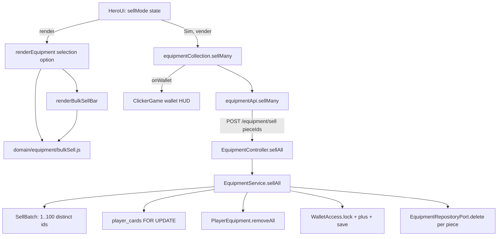
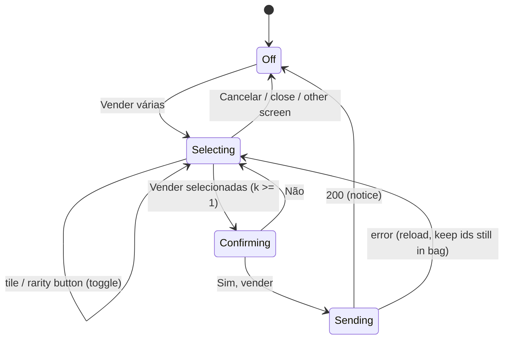

# Bulk Sell Design

**Spec**: `.specs/features/bulk-sell/spec.md`
**Status**: Approved (the user approved D1 to D12 of the spec on 2026-10-31)

---

## Architecture Overview

One new endpoint and one new screen state, both built from the single-sale code.

The backend adds `POST /equipment/sell`. It follows `EquipmentService.sell` (`backend/.../service/EquipmentService.kt:104-116`) step for step: take the player lock (`player_cards` row), load the pieces, find every listed piece (the first missing id throws 404 before anything is written), lock the wallet, credit the sum, save, delete the rows. The batch shape (1 to 100 distinct ids) is a domain value, `SellBatch`, checked before the lock. No schema change: the sale deletes `equipment_pieces` rows and updates `wallets` exactly as the single sale does.

The game adds `sellMany(pieceIds)` to the HTTP adapter and to `equipmentCollection`, a pure module of selection rules (`domain/equipment/bulkSell.js`), a view for the selection bar (`views/bulkSellView.js`), a `selection` option on `renderEquipment`, and the selection state machine in `HeroUi`. `pieceTile.js` and `dom.js` do not change (the owner has uncommitted edits in `dom.js` and `pieceTile.test.js`): `equipmentView` decorates the tiles it gets back.

Decisions honoured: AD-003 (hexagonal game layout: domain pure, collection behind a gateway port, views in adapters), AD-007 (Portuguese text), AD-009 (server-authoritative sale under the `player_cards` lock, lock order `player_cards` then `wallets`), AD-016 (no migration). No new AD: nothing conflicts.



### Selection state machine (game)



`HeroUi.sellMode` is `null` (Off) or `{ ids: Set<string>, confirming: boolean }`; Sending is `equipBusy = true` (the existing busy flag that disables every button of the screen).

---

## Code Reuse Analysis

### Existing Components to Leverage

| Component | Location | How to Use |
| --- | --- | --- |
| `EquipmentService.sell` | `backend/src/main/kotlin/br/com/woodriver/infinity_grove_ws/service/EquipmentService.kt:104-116` | Same lock, load, wallet and `store` sequence for `sellAll` |
| `EquipmentService.store` | same file `:119-127` | Deletes the pieces missing from the new value; no change |
| `PlayerEquipment.remove` / `find` | `backend/.../domain/PlayerEquipment.kt:25,68-71` | `removeAll` calls `find` for every id first, then filters |
| `Piece.sellPrice()` | `backend/.../domain/Equipment.kt:122` | Price of each piece; unchanged |
| `EquipmentRequestException` → 400 | `backend/.../domain/EquipmentExceptions.kt:4`, `ApiExceptionHandler.kt:70-71` | `InvalidSellBatchException` extends it, so no handler change |
| `EquipmentChangeResponse` | `backend/.../adapter/web/EquipmentController.kt:33-43` | Pattern for `BatchSaleResponse` |
| `EquipmentSellIT`, `EquipmentRefineIT:118-136` | `backend/src/test/kotlin/.../adapter/web/` | Test pattern for the new IT, including the two-thread race |
| `transferSet` failure path | `game/src/application/equipment/equipmentCollection.js:99-121` | `sellMany` reloads the list and rethrows the same way |
| `HeroUi.transferSet` | `game/src/adapters/phaser/HeroUi.js:383-418` | Pattern for `sellSelected`: busy flag, view guard, notice, error line |
| `formatCopper`, `RARITY_LABELS` | `game/src/domain/equipment/equipment.js:9,77-86` | Totals and rarity button labels |
| `el` | `game/src/adapters/phaser/views/dom.js` | DOM building (read only, not edited) |
| `.equip-button`, `.equip-notice`, rarity colours | `game/public/style.css:1409-1438, 1866-1924, 2033-2041` | The new buttons reuse `.equip-button`; the rarity button colours copy the tile frame colours |
| fake backend `handleEquipment` | `game/e2e/support/fakeBackend.js:593-646` | New branch for `POST /equipment/sell` |

### Integration Points

| System | Integration Method |
| --- | --- |
| Backend API | New route `POST /equipment/sell` on `EquipmentController` (`/equipment/{id}/sell` has three segments, so no path clash) |
| Database | None new: `equipment_pieces` rows deleted and `wallets.copper` updated through the existing ports |
| Game wallet HUD | `equipmentCollection.onWallet` (already wired in `ClickerGame.js:138`); `ClickerGame.js` is not edited |

---

## Components

### Backend: `SellBatch` (domain, new file)

- **Purpose**: The ids of one batch sale, valid by construction.
- **Location**: `backend/src/main/kotlin/br/com/woodriver/infinity_grove_ws/domain/SellBatch.kt`
- **Interfaces**: `data class SellBatch(val pieceIds: List<String>)` with `companion object { const val MAX_SIZE = 100 }`; the `init` block throws `InvalidSellBatchException` for 0 ids, more than 100 ids, or a repeated id.
- **Dependencies**: `InvalidSellBatchException` (new, `EquipmentExceptions.kt`, code `INVALID_SELL_BATCH`, extends `EquipmentRequestException` so the handler answers 400).

### Backend: `PlayerEquipment.removeAll` (domain)

- **Purpose**: Drop several pieces in one value change; one unknown id fails the whole call.
- **Interfaces**: `fun removeAll(pieceIds: List<String>): PlayerEquipment`.

### Backend: `SellPiecesUseCase` + `EquipmentService.sellAll` (use case, service)

- **Interfaces**: `data class BatchSale(val equipment: PlayerEquipment, val wallet: Wallet, val sold: Int, val earned: Long)`; `interface SellPiecesUseCase { fun sellAll(username: String, pieceIds: List<String>): BatchSale }`.
- **Order inside `sellAll`**: `SellBatch(pieceIds)` → `lockPlayer` → `load` → `batch.pieceIds.map(before::find)` → `earned = sum of sellPrice()` → `after = before.removeAll(...)` → `walletAccess.lock(username).plus(earned)` → `walletAccess.save` → `store(before, after)`.
- **Logging (convention, not an AC, lesson L-007)**: `info` "Batch sell requested username={} count={}" at the start and "Sold batch username={} pieces={} copper={}" at the end.

### Backend: `EquipmentController.sellAll` (adapter)

- **Interfaces**: `@PostMapping("/sell") fun sellAll(principal: Principal, @RequestBody body: Map<String, Any?>): BatchSaleResponse`; `data class BatchSaleResponse(val equipment: EquipmentResponse, val wallet: CoinsResponse, val sold: Int, val earned: Long)`.
- **Body parsing**: `body["pieceIds"] as? List<*>` else `IllegalArgumentException` (400 through `ApiExceptionHandler.badRequest`); every item `as? String` else `IllegalArgumentException`.

### Game: `equipmentApi.sellMany` and `equipmentCollection.sellMany`

- `equipmentApi.sellMany(pieceIds: string[]) -> Promise<{ equipment, wallet, sold, earned }>`: `POST /equipment/sell` with `{ pieceIds }`.
- `equipmentCollection.sellMany(pieceIds: string[]) -> Promise<{ sold, earned }>`: adopts `equipment`, reports `wallet` through `onWallet`; on a failure it calls `load()` (ignoring a second failure) and rethrows the first error.

### Game: `domain/equipment/bulkSell.js` (new, pure)

- `RARITY_ORDER = ['COMMON','UNCOMMON','RARE','EPIC','LEGENDARY']`
- `bagPieces(pieces) -> piece[]`, `sellTotal(pieces, ids: Set) -> number`, `toggleSelected(ids, id) -> Set`, `rarityState(ids, bag, rarity) -> { available, allSelected }`, `toggleRarity(ids, bag, rarity) -> Set`, `selectedInBag(ids, pieces) -> string[]`, `selectionSummary(count, total) -> string`, `sellQuestion(count, total) -> string`, `sellNotice(sold, earned) -> string`. Every function returns a new value; none mutates its input.

### Game: `views/bulkSellView.js` (new)

- `renderBulkSellBar({ count, total, rarities, confirming, onRarity, onSubmit, onCancel, onConfirm, onDecline }) -> HTMLElement`; `rarities` is `[{ rarity, available, allSelected }]` in `RARITY_ORDER`.

### Game: `renderEquipment` selection option (`views/equipmentView.js`)

- New options: `selection` (`null` or `{ ids, confirming, onToggle(piece), onRarity(rarity), onSubmit(), onCancel(), onConfirm(), onDecline() }`), `sellNotice` (string or null), `onStartSelling()`.

### Game: `HeroUi` selection state

- Field `sellMode`; methods `startSelling()`, `toggleSale(pieceId)`, `toggleSaleRarity(rarity)`, `askSale()`, `declineSale()`, `cancelSale()`, `sellSelected()`, and a helper `sellingOptions()` that builds the `selection` option. `show()` and `close()` reset `sellMode` to `null`.

---

## Screen layout (for `ui-artist`)

Selection mode of the Equipamento window, bag part (the leader panel and hero blocks above are unchanged except the dimmed worn tiles):

```
Mochila (4)                                      <- .bag-header (flex, space-between); the button `Vender várias` sits at the right when mode is off
┌─ .bulk-sell-bar ───────────────────────────────────────────────┐
│ Selecionadas: 2 · Total: 3 prata                               │  .bulk-sell-summary, heading font 15px
│ |Comum| |Incomum| |Raro| |Épico| |Lendário|                    │  .bulk-sell-rarities, pills 13px, 4px left border in the rarity colour
│ (Vender selecionadas) (Cancelar)                               │  .bulk-sell-actions; Vender selecionadas in accent fill
│   - or, while confirming -                                     │
│ Vender 2 peças por 3 prata?  (Sim, vender) (Não)               │  .bulk-sell-confirm; question bold accent-800
└────────────────────────────────────────────────────────────────┘
[c1 ✓] [c2] [u1 ✓] [e1]                                          <- tiles; selected: 3px accent outline at 6px offset, lifted 2px, round ✓ badge top-right
```

| Element | Size and style | Colours | States |
| --- | --- | --- | --- |
| `Vender várias` (`bulk-sell-start`) | `.equip-button` (pill, 15px heading font, 8px 18px padding) | as `.equip-button` | hidden in selection mode; absent with no unworn piece |
| `.bulk-sell-bar` | column, gap 8px, padding 10px 14px, radius `var(--radius-md)`, 1px border | background `var(--color-surface)` `#ebddc5`, border `var(--color-divider)` | present only in selection mode |
| Rarity button (`bulk-sell-rarity-<R>`) | `.equip-button`, padding 4px 12px, font 13px, 4px left border | left border: COMMON `#c0b6a5`, UNCOMMON `#5da048`, RARE `#3f8fd1`, EPIC `#9b59d0`, LEGENDARY `#d9a521` (the tile frame colours) | `aria-pressed="true"`: background `var(--color-neutral-300)` `#dcd3c4`, weight 700; disabled: opacity 0.5, cursor not-allowed |
| `Vender selecionadas` / `Sim, vender` | `.equip-button` | text `var(--color-bg)` `#f5ead8` on `var(--color-accent)` `#c67139`, hover `var(--color-accent-600)` `#b2622d`, shadow `var(--shadow-md)` | disabled: opacity 0.5, cursor not-allowed |
| `Cancelar` / `Não` | `.equip-button` | as `.equip-button` | hidden while confirming (`Cancelar`) |
| Question (`bulk-sell-question`) | 15px, weight 700 | `var(--color-accent-800)` `#643312` | - |
| Selected tile (`.piece-tile.is-selected`) | outline 3px at offset 6px (outside the RARE/EPIC/LEGENDARY rings, which reach 4px), `translateY(-2px)` | outline `var(--color-accent)` `#c67139` | - |
| Check badge (`.piece-check`) | 20x20 circle at top -8px, right -8px, z-index 3, glyph `✓` 13px weight 800, 2px border | text `var(--color-bg)` on `var(--color-accent)`, border `var(--color-bg)` | only on selected tiles |
| Locked worn tile (`.piece-tile.is-locked`) | opacity 0.45, cursor not-allowed | unchanged frame | selection mode only |
| Sell notice (`equip-sell-notice`) | existing `.equip-notice` pill | `var(--color-accent-2-900)` on `var(--color-accent-2-200)` | after a successful sale |

Assets: no new image. The check mark is the text glyph `✓` (U+2713); the tiles keep their slot icons (`game/public/assets/slot-*.png` or the drawn fallback). Reduced motion: the selected tile's `translateY(-2px)` is the only new motion and is static (no transition), so nothing changes under `prefers-reduced-motion`.

---

## Data Models

### Request and response of `POST /equipment/sell`

```json
// request
{ "pieceIds": ["c", "r", "u"] }
// 200
{
  "equipment": { "capacity": 100, "pieces": [ /* PieceResponse, same as GET /equipment */ ] },
  "wallet": { "gold": 0, "silver": 12, "copper": 50 },
  "sold": 3,
  "earned": 1200
}
// 400 INVALID_SELL_BATCH / 404 EQUIPMENT_NOT_FOUND: ProblemDetail with "code"
```

`sold` (int) and `earned` (long, copper) are always present.

---

## Error Handling Strategy

| Error Scenario | Handling | User Impact |
| --- | --- | --- |
| Empty, over 100 or repeated ids | `SellBatch` throws `InvalidSellBatchException` before the lock → 400 `INVALID_SELL_BATCH` | Unreachable from the game; error line if it happens |
| Missing body field or non-string id | Controller throws `IllegalArgumentException` → 400 | Same |
| Unknown or foreign id | `PlayerEquipment.find` throws before any write → 404, transaction rolls back | Error line `Não foi possível concluir a ação.`; list reloaded; the gone piece leaves the selection |
| Two batches at once | Second waits on `player_cards` lock, then reads the committed pieces → 404 | Second tab sees the error line |
| Network failure | `sellMany` reloads the list and rethrows | Error line; selection kept for the pieces still in the bag |
| Answer after the window closed | `view` guard in `HeroUi.sellSelected` | Nothing drawn |

---

## Risks & Concerns

| Concern | Location (file:line) | Impact | Mitigation |
| --- | --- | --- | --- |
| Owner's uncommitted edits in shared game files | `game/src/adapters/phaser/views/dom.js`, `views/pieceTile.test.js`, `ClickerGame.js`, `ClickerGame.test.js` (git status) | A task that edits or stages them mixes the owner's work into a feature commit | No task edits these files; tile decoration happens in `equipmentView.js`; every task adds files by path, never `git add -A` |
| `renderEquipment` keeps gaining options | `game/src/adapters/phaser/views/equipmentView.js:56` | The function grows hard to read | The bar lives in its own module (`bulkSellView.js`); `renderEquipment` only wires it and decorates tiles |
| Batch limit tied to the bag capacity by a constant | `SellBatch.MAX_SIZE = 100` vs `app.equipment.bag-capacity` (`EquipmentRules.bagCapacity`) | If the capacity config is raised above 100, a full-bag selection answers 400 | Logged here; raising the capacity must raise `MAX_SIZE` (or the game splits the request). Not reachable today |
| One `DELETE` per piece | `EquipmentService.store` (`EquipmentService.kt:119-127`) | Up to 100 statements in one transaction | Acceptable at 100 rows; a batch delete port method is a later optimisation |
| Locking proven only by annotation | Lesson L-015 | A regression could pay a piece twice | `EquipmentBatchSellIT` races two identical batches on the real database |
| Equipamento does not redraw on a drop | `HeroUi.showEquipmentDrop` (`HeroUi.js:566-576`) | A piece dropped during selection appears only at the next redraw | Every toggle redraws from `equipment.pieces()`; a HeroUi test pins that the new piece shows unselected and the selection stays |
| Disabled tiles still fire on a detached node | `HeroUi.sellSelected` | A fast double click on `Sim, vender` could send twice | `sellSelected` returns at once while `equipBusy` is true; tested |

---

## Tech Decisions (only non-obvious ones)

| Decision | Choice | Rationale |
| --- | --- | --- |
| Route | `POST /equipment/sell` with a JSON body | A body carries up to 100 ids; no clash with `/{id}/sell` |
| Batch validation | Domain value `SellBatch` built before the lock | Bad requests never take a row lock |
| Where the selection lives | `HeroUi` (adapter state), rules in `domain/equipment/bulkSell.js` | Same split as the transfer (`transferSet`); the rules are unit-tested without the DOM |
| Tile decoration | `equipmentView` adds `aria-pressed`, `is-selected`, `.piece-check` and `disabled` after `renderPieceTile` | Leaves `pieceTile.js` untouched while the owner edits its test |
| Response fields `sold`, `earned` | Server numbers drive the notice | AD-009: the server is the truth for money |
