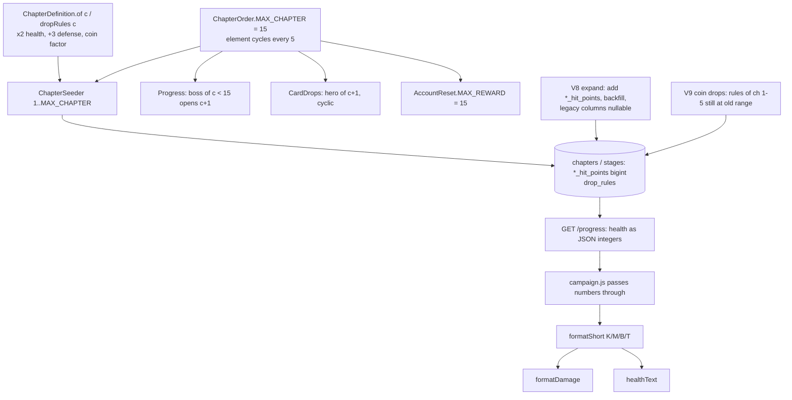

# Campaign Chapters Design

**Spec**: `.specs/features/campaign-chapters/spec.md`
**Status**: Draft (owner answers of 2026-10-30 and 2026-10-31 applied; AD-019 active)

---

## Architecture Overview

The feature changes catalog data and one constant, not the progress state machine. Most of the change is one rule set in `ChapterDefinition` (health, defenses, coin ranges per chapter) and one constant (`ChapterOrder.MAX_CHAPTER = 15`). The seeder, `Progress`, `CardDrops` and `AccountReset` already read both: the seeder creates chapters 6 to 15, `Progress` opens chapter 6 after the chapter 5 boss, `CardDrops` keeps its `minOf(chapter + 1, MAX_CHAPTER)` rule, and `AccountReset.MAX_REWARD` follows `MAX_CHAPTER`, so the reset pays up to 15. Two schema changes need migrations: health moves to `bigint` (expand, then contract) and the seeded coin ranges of chapters 1 to 5 move to the new values (data only).

The game changes in four pure places: a new `formatShort` in the combat domain, `formatDamage`, `healthText` and the reset reward cap. It already carries health as plain JavaScript numbers (`campaign.js`), so 64-bit values arrive with no code change.

## Code Reuse Analysis

| Existing | Reused for |
| --- | --- |
| `ChapterDefinition.of`, `healthFactor`, `dropRules` (`backend/.../domain/Chapter.kt:95-162`) | Same functions, new formulas for chapters 6+ and new coin ranges; chapters 1 to 5 keep their health and defenses |
| `ChapterSeeder` (`adapter/config/ChapterSeeder.kt:23-37`) | Unchanged: loops `1..MAX_CHAPTER`, only inserts missing rows |
| `Progress.withNextChapterOpen` (`domain/Progress.kt:75`) | Moves completed chapter 5 players to chapter 6 with no new code |
| `V4__monster_health_growth.sql` + `MonsterHealthMigrationIT` | Pattern for a data migration that only touches rows still holding the seeded value, and its test |
| `formatDamage` (`game/src/domain/combat/damage.js:31`), `healthText` (`game/src/domain/combat/monster.js:8`) | Keep their rounding, then hand values of 1 000 or more to `formatShort` |
| `resetReward` (`game/src/domain/campaign/accountReset.js`) | Only the cap constant changes |
| `game/e2e/support/fakeBackend.js` `afterOutcome` | Gains a `lastChapter` option (default 1, so every existing e2e keeps its behaviour) |

## Components

### Backend domain - `domain/Chapter.kt`

- `StageDefinition.monsterHealth`, `StageDefinition.minibossHealth` and `ChapterDefinition.bossHealth` become `Long`. The `require(... >= 1)` checks stay.
- `healthFactor(number: Int): Long`: `4^(number-1)` for 1 to 5, `256 x 2^(number-5)` from 6.
- `defenseBonus(number: Int): Int`: `5 x (number-1)` for 1 to 5, `20 + 3 x (number-5)` from 6.
- Caps for every chapter: defenses `min(.., 80)`, critical resistance `min(.., 70)`. Chapters 1 to 5 never reach them (chapter 5 maxima: 50 and 50), so their values do not change.
- `coinFactor(number: Int): Int`: `2^(number-1)` up to 8, then `128 + 32 x (number-8)`.
- `dropRules(number)`: `DropRule(3c-2, 2m, 6m, 1500)`, `DropRule(3c-1, 8m, 20m, 1500)`, `DropRule(3c, 30m, 70m, 1500)`.
- `of(number)` requires only `number >= 1`. `MAX_CHAPTER` decides what is seeded, not `of`.

### Backend domain - `domain/ChapterOrder.kt`

- `MAX_CHAPTER = 15`.
- `element(start, chapter)` returns `elements(start)[(chapter - 1) % 5]` and still requires `chapter in 1..MAX_CHAPTER`.
- `chapterOf` keeps returning 1 to 5 (the first chapter of that element). `GET /heroes` shows a hero's chapter 1 to 5 as today.

### Backend persistence - health expand/contract (AD-016)

Hibernate validates the schema at startup (`ddl-auto: validate`, AD-010). An entity field `Int` against a `bigint` column fails that check, so a plain `ALTER COLUMN ... TYPE bigint` would stop the previous slot from starting during the 5-minute rollback window. The change therefore takes three deploys:

| Step | Commit | Schema | Entity mapping | Rollback target and why it works |
| --- | --- | --- | --- | --- |
| A, expand (T1, T2) | `V8__health_hit_points_expand.sql` + Long domain | Adds `chapters.boss_hit_points`, `stages.monster_hit_points` and `stages.miniboss_hit_points` (`bigint not null`, check `>= 1`), backfilled from the legacy columns. Legacy `boss_health`, `monster_health` and `miniboss_health` stay `integer` but become nullable | Reads `*_hit_points`. Writes `*_hit_points` and also the legacy column when the value fits in `Int` (null otherwise; chapters 1 to 15 always fit) | The pre-feature backend still finds its `integer` columns, filled for every row, and ignores the new columns. It never inserts chapters 1 to 5 again because they exist |
| B, stop mapping (T13) | code only | unchanged | Drops the legacy fields from `ChapterEntity` and `StageEntity` | Step A maps the legacy columns as nullable `Int?`; they still exist |
| C, contract (T14) | `V10__health_legacy_columns_drop.sql` | Drops the three legacy columns | unchanged from B | Step B does not map them |

The watcher deploys only the newest commit it has not handled (`deploy/watcher.mjs:80`). If A, B and C arrived in one fetch, the rollback target would be the pre-feature backend on a schema without its columns. Steps B and C are therefore pushed one at a time. Each starts only after `.deploy-state` shows the previous step as `active.commit` and its 5-minute rollback window has passed. If `./publish.sh` is not running, Phase 5 waits and the deploy is reported pending.

Raw SQL in two tests inserts chapters and stages without the new columns (`ChapterRepositoryIT.kt:150-155`, `SchemaConstraintsIT.kt:48-52, 203`). T1 adds `*_hit_points` to those inserts. T14 removes the legacy columns from them and rewrites `MonsterHealthMigrationIT`, whose re-runs of V4 target the dropped columns.

### Backend persistence - coin drops (`V9__coin_drop_rebalance.sql`)

Fifteen `update drop_rules ... where id = ? and min_copper = <old> and max_copper = <old>` statements, one per rule of chapters 1 to 5. A tuned rule does not match and stays. Same columns, so the old backend keeps crediting kills. Pre-rolled values already in `wallet_drop_queues.drops` pay out at the old amount until consumed, which is accepted (at most 20 kills per rule per player). Chapters 6 to 15 have no rows yet when V9 runs; the seeder creates them with the new formula.

### Backend web - `adapter/web/ProgressController.kt`

`StageResponse.monsterHealth`, `StageResponse.minibossHealth` and `ChapterResponse.bossHealth` become `Long`. Jackson writes them as JSON integers, so 3 000 000 000 stays exact.

### Game

| File | Change |
| --- | --- |
| `game/src/domain/combat/numberFormat.js` (new) | `formatShort(value)`: values below 1 000 return `String(value)`; else the largest unit of K (1e3), M (1e6), B (1e9), T (1e12) that is ≤ value, `x = Math.round(value / unit * 10) / 10`; if `x >= 1000` and a bigger unit exists, redo with the bigger unit; returns `` `${x}${letter}` `` (`String` drops `.0`) |
| `game/src/domain/combat/damage.js` | `formatDamage(d)`: `r = Math.round(d * 10) / 10`; `r >= 1000 ? formatShort(r) : String(r)` |
| `game/src/domain/combat/monster.js` | `healthText`: current = the existing round-up value; `HP ${current >= 1000 ? formatShort(current) : current}/${formatShort(maxHealth)}` |
| `game/src/domain/campaign/accountReset.js` | `RESET_MAX_REWARD = 15` |
| `game/e2e/support/fakeBackend.js` | Option `lastChapter = 1`: reports are accepted from the stored chapter; a cleared chapter boss below `lastChapter` moves to the next chapter's stage 1 phase 1 |
| `game/e2e/campaignChapters.spec.js` (new) | Player-visible checks of the spec |

## Error Handling Strategy

| Case | Behaviour |
| --- | --- |
| Health below 1 in a definition | Domain `require` throws (unchanged); the database check `>= 1` on the new columns refuses the row |
| Health above `Int.MAX_VALUE` during step A | Stored in `*_hit_points`; the legacy column gets null |
| Old backend after A, a player at chapter 6 or later reports a miniboss or chapter boss clear | `ChapterOrder.element(start, 6)` in the old code throws, so the report answers 500 until roll-forward. Accepted: only during a rollback, at most 5 minutes after the deploy that seeds chapter 6; phase reports, progress reads and resets keep working |
| A drop rule tuned in the database | V9 leaves it; the seeder never overwrites it |

## Risks & Concerns

- **Balance**: the x2 health curve and the coin factor are not simulated. The coin table is an upper bound (kill allowance, AD-002).
- **Intermediate deploys**: every task commit is pushed and can go live. The order below keeps every commit safe: the formulas land before `MAX_CHAPTER` rises, so chapters 6 to 15 are never seeded with the old x4 numbers. Seeded rows are never overwritten.
- **Deploying the contract**: steps B and C need the watcher to have deployed each previous step. They wait for `.deploy-state`, as described in the persistence section.

## Tech Decisions

| Decision | Choice | Why |
| --- | --- | --- |
| New column names | `boss_hit_points`, `monster_hit_points`, `miniboss_hit_points` | Final names that need no rename later (a rename would be one more expand/contract) |
| Legacy columns during A | Nullable, written when the value fits | The old backend keeps reading filled rows; a future chapter above `Int.MAX_VALUE` stores null instead of failing |
| No trigger syncing the columns | Rejected | The old backend never inserts chapters after the new one seeded them; a trigger adds a hidden write path to remove later |
| Coin formula | `m = 2^(c-1)` to chapter 8, then `+32` a chapter | Hits both owner targets (1.21 and 9.95 ouro) and keeps late chapters below the refine sink |
| `formatShort` location | `game/src/domain/combat/numberFormat.js` | Pure rule next to its two callers (AD-003) |
