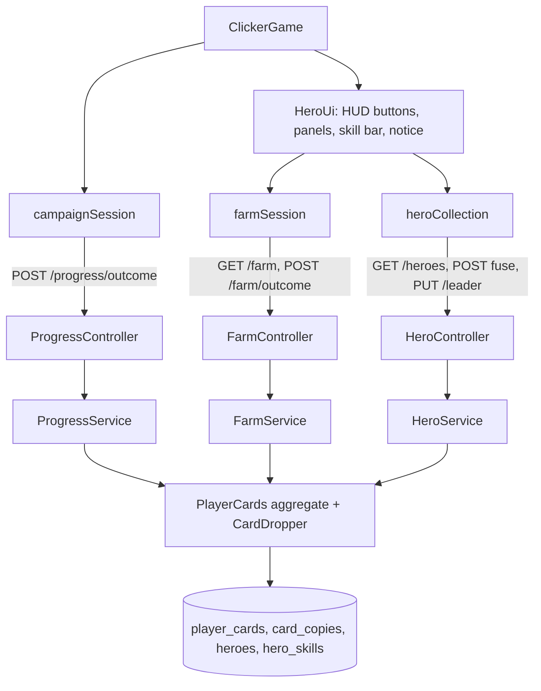

# Characters Design

**Spec**: `.specs/features/characters/spec.md`
**Status**: Approved (the owner asked to run the feature to completion)

---

## Architecture Overview

The backend owns every card rule (AD-002's direction): it rolls drops when it accepts an outcome report, stores the bag, fuses cards and keeps the leader. One aggregate, `PlayerCards`, holds everything per player: starting element, leader, copies per (hero, stars), chapters whose boss the player has beaten, the UTC day's boss wins and the time of the last farm win. One row of `player_cards` is locked (`PESSIMISTIC_WRITE`) for every operation that changes it, the same pattern as `wallets` and `progress`. Lock order is always `progress`, then `player_cards`, so no deadlock.

The game keeps a `heroCollection` service (the heroes payload, fuse, leader, local drop updates) and a `farmSession` service (farm state and farm win reports), both over HTTP gateways (ADR 0007). `ClickerGame` stays the combat scene; a new `HeroUi` adapter owns the HUD buttons, the panels, the skill bar and the drop notice, and talks to the scene through a small interface (pause, resume, start a farm fight).



### Approaches considered

| Approach | Verdict |
| -------- | ------- |
| **A. One `PlayerCards` aggregate, drops decided in the outcome transaction (chosen)** | One lock, one transaction with the progress change (spec: rollback on failure), simple tests with fakes |
| B. Separate `CardService` called by the game after each report | Two requests per win, the client could skip or repeat the call, no atomicity |
| C. Drops pre-rolled in queues like coins (ADR 0005) | A queue of 1 % events would let the client see the next card in advance and skip fights; rejected |

### Decisions

- **AD-005**: Hero cards are server-authoritative. The backend rolls the drop in the same transaction that accepts a `CLEARED` report; the response carries the card; the game never chooses it.
- **AD-006**: The hero of a chapter depends on the player. `PlayerCards.startingElement` plus the fixed order rule (start, the element it hits, the remaining triad element, DARKNESS, LIGHT) gives the chapter-to-hero map; the catalog stores only elements.
- **AD-007**: New player-facing text is Portuguese; existing English text is technical debt TD-001.

(AD entries are appended to `.specs/STATE.md`.)

---

## Code Reuse Analysis

| Component | Location | How to use |
| --------- | -------- | ---------- |
| `Progress`, `ProgressService` | `backend/.../domain/Progress.kt`, `service/ProgressService.kt` | The drop hook runs after `progress.report(...)` accepted the report; the position it left decides the drop |
| `Element`, `EnemyStats` | `backend/.../domain/Chapter.kt` | `Element` is the hero element and the registration choice |
| Wallet repository pattern | `adapter/repository/WalletRepository.kt`, `WalletEntities.kt` | `findForUpdate` + `createIfAbsent` + `save`, rows per (player, key) synced on save |
| `ChapterSeeder` | `adapter/config/ChapterSeeder.kt` | Same shape for `HeroSeeder`: seed what is missing, never overwrite |
| `WalletConfig` / `WalletProperties` | `adapter/config/WalletConfig.kt` | Same shape for `CardProperties` (`app.cards.*`) |
| `ApiExceptionHandler`, `BusinessException` | `adapter/web`, `domain` | New exceptions derive from three bases (400, 404, 409) |
| `Fakes.kt`, `IntegrationTestBase` | `backend/src/test/...` | In-memory fakes for the new ports; IT cleanup lists the new repositories |
| `Campaign`, `campaignSession` | `game/src/domain/campaign`, `application/campaign` | Farm encounters are built from the same definition; the session surfaces the drop of each accepted report |
| `createHttpClient` and the `create*Api` pattern | `game/src/adapters/http` | `heroesApi`, `farmApi` in the same shape |
| `createHtml`, DOM panels, `pause` fields | `game/src/adapters/phaser/ClickerGame.js` | Hero panels are DOM like the pause menu; opening one reuses `pauseFight`/`resumeFight` |
| `fakeBackend.js`, `openMainMenu` | `game/e2e/support` | Extended with heroes, farm and the registration field |

### Integration points

| System | Integration |
| ------ | ----------- |
| `POST /users` | Gains `startingElement`; creates the user and its `PlayerCards` in one transaction |
| `POST /progress/outcome` | Response gains `drop` (`{ heroId, heroName, stars }` or `null`) |
| New routes | `GET /heroes`, `POST /heroes/{id}/fuse`, `PUT /leader`, `GET /farm`, `POST /farm/outcome` (all authenticated by `anyRequest`) |
| Database | New tables `heroes`, `hero_skills`, `player_cards`, `card_copies` by `ddl-auto: update` (ADR 0005) |

---

## Components (backend)

All under `backend/src/main/kotlin/br/com/woodriver/infinity_grove_ws/`.

### Hero model and catalog (`domain/Hero.kt`, `domain/HeroSeed.kt`)
- `Hero(id, name, heroClass, element, leaderBonus, portrait, skills: List<Skill>)`, `Skill(slot 1..3, name, type, effect, cooldownSeconds, image)`; exactly three skills with slots 1, 2, 3.
- `HeroSeed.heroes()`: the five README heroes. Ids `kael`, `lyra`, `orina`, `seraphine`, `vex`. `portrait` is the art basename (`kael_position`), `image` the skill art basename.

### Chapter order (`domain/ChapterOrder.kt`)
- `ChapterOrder.elements(start: Element): List<Element>`: `FIRE, WATER, NATURE` only; otherwise `InvalidStartingElementException`.
- `ChapterOrder.chapterOf(start, element): Int`, `ChapterOrder.element(start, chapter): Element`, `MAX_CHAPTER = 5`.
- The "hits hardest" step reuses the triad cycle `FIRE→NATURE→WATER→FIRE`.

### Exceptions (`domain/HeroExceptions.kt`)
`HeroRequestException` (400: `INVALID_STARTING_ELEMENT`, `INVALID_FUSION`), `HeroNotFoundException` (404 `HERO_NOT_FOUND`), `HeroConflictException` (409: `NOT_ENOUGH_CARDS`, `HERO_NOT_OWNED`, `DAILY_LIMIT_REACHED`, `BOSS_NOT_AVAILABLE`, `FARM_TOO_FAST`), and `PlayerCardsMissingException` (422 `PLAYER_WITHOUT_HEROES`, a player created before this feature).

### Boss record (`domain/BossRecord.kt`)
- `BossRecord(clearedChapters: Set<Int>, winsDay: LocalDate?, winsToday: Int, lastFarmWinAt: Long)`.
- `hasWon(chapter)`, `winsLeft(today, limit)`, `afterChapterBossWin(chapter, today)` (adds to the chapter set and to today's count, resetting the count when the date changed), `afterFarmWin(now, minIntervalMs)` (throws `FarmTooFastException`), `requireWinsLeft(today, limit)` (throws `DailyLimitReachedException`).

### Card drops (`domain/CardDrops.kt`)
- `CardDropRates(minibossRate, chapterBossRate, dailyLimit, farmMinIntervalMs)`.
- `CardDropper.drop(encounter, chapter, startingElement, firstChapterBossWin, rates, chance: Double, heroes): Card?` pure: `MINIBOSS` → hero of `chapter` when `chance < rate`; `CHAPTER_BOSS` → hero of `min(chapter + 1, 5)`, certain when `firstChapterBossWin`, otherwise `chance < rate`; `PHASE` → none. `chance` is only read when needed (injected through a lambda, so the first win makes no roll).

### Player cards (`domain/PlayerCards.kt`)
- `PlayerCards(username, startingElement, leaderId, copies: Map<CopyKey, Int>, bosses: BossRecord)`; `CopyKey(heroId, stars)`.
- `start(username, element, heroOfElement)`, `add(heroId)`, `copiesOf`, `starsOf`, `owned`, `fuse(heroId, stars)` (`stars in 0..2`, 3 or more copies), `withLeader(heroId)` (must be owned), `withBosses(...)`.

### Ports (`port/HeroPorts.kt`)
`HeroRepositoryPort(findAll, findById, existsById, saveAll)`, `PlayerCardsRepositoryPort(findForUpdate, createIfAbsent, save, deleteByUsername)`, `ChanceRollerPort(roll(): Double)`.

### Persistence (`adapter/repository/HeroEntities.kt`, `HeroRepository.kt`, `PlayerCardsEntities.kt`, `PlayerCardsRepository.kt`)
- Tables: `heroes(id, name, hero_class, element, leader_bonus, portrait, sort_order)`, `hero_skills(id "hero/slot", hero_id, slot, name, type, effect, cooldown_seconds, image)`, `player_cards(username, starting_element, leader_id, cleared_chapters, wins_day, wins_today, last_farm_win_at)`, `card_copies(id "user/hero/stars", username, hero_id, stars, copies)`.
- `cleared_chapters` is comma-separated text (like the wallet queue). `PlayerCardsRepository.save` syncs the copy rows: upsert non-zero, delete rows that dropped out.

### Config (`adapter/config/HeroSeeder.kt`, `CardConfig.kt`)
`HeroSeeder` inserts missing heroes at startup. `CardConfig` binds `app.cards.*` (`miniboss-rate 0.01`, `chapter-boss-rate 0.10`, `chapter-boss-daily-limit 10`, `farm-min-interval-ms 5000`), validates ranges, exposes `CardDropRates` and a `ChanceRollerPort` over `ThreadLocalRandom`.

### Services and use cases
- `UserService.create(username, password, startingElement)`: registers the user, then `PlayerCards.start`, one transaction; `delete` also deletes the cards.
- `ProgressService.report` returns `OutcomeResult(view, drop)`; after the progress moved it loads `PlayerCards` (locked), asks `CardDropper`, adds the card, records a chapter boss win, saves both. A player with no `PlayerCards` gets no drop and a warning.
- `HeroService` (`usecase/HeroUseCase.kt`): `list(username)`, `fuse(username, heroId, stars)`, `setLeader(username, heroId)`.
- `FarmService` (`usecase/FarmUseCase.kt`): `state(username)`, `report(username, boss, outcome)`.

### Web (`adapter/web/HeroController.kt`, `FarmController.kt`, `ProgressController.kt`, `UserController.kt`, `ApiExceptionHandler.kt`)
- `GET /heroes` → `{ leaderId, heroes: [ { id, name, heroClass, element, leaderBonus, portrait, chapter, owned, stars, copies: { "0": n, ... "3": n }, skills: [ { slot, name, type, effect, cooldownSeconds, image, unlocked } ] } ] }`, heroes in catalog order.
- `POST /heroes/{id}/fuse { stars }` → one hero object. `PUT /leader { heroId }` → `{ leaderId }`.
- `GET /farm` → `{ bosses: [ { kind: "MINIBOSS", stage }, ..., { kind: "CHAPTER_BOSS" } ], chapterBossWinsLeft }`. `POST /farm/outcome { boss: { kind, stage? }, outcome }` → `{ drop, chapterBossWinsLeft }`.
- Handler mapping: `HeroRequestException` 400, `HeroNotFoundException` 404, `HeroConflictException` 409, all with `code`.

---

## Components (game)

All under `game/src/`.

### Domain `domain/heroes/heroes.js`
Pure helpers over the heroes payload: `bagEntries(heroes)` (pairs with copies ≥ 1), `fusionRows(heroes)` (stars 0 to 2, `canFuse`), `unlockedSlots(stars)`, `applyDrop(heroes, drop)`, `ELEMENT_LABELS` (`FIRE` → `Fogo`, `WATER` → `Água`, `NATURE` → `Natureza`, `LIGHT` → `Luz`, `DARKNESS` → `Escuridão`), `STARTING_CHOICES` (Fogo - Kael, Água - Orina, Natureza - Lyra).

### Domain `domain/campaign/campaign.js`
`Campaign.farmEncounter({ kind, stage })` builds the encounter of a defeated boss from the definition (health, stats, time limit, label `Rever chefe: ...`), with `kind: 'FARM'` so the scene can tell it from the campaign.

### Application
- `application/heroes/heroCollection.js`: `createHeroCollection({ gateway })`: `load()`, `heroes()`, `leader()`, `fuse(heroId, stars)`, `setLeader(heroId)`, `applyDrop(drop)`, `onChange(cb)`.
- `application/farm/farmSession.js`: `createFarmSession({ gateway })`: `load()` (bosses and wins left), `win(boss)` (one request, resolves with `{ drop, chapterBossWinsLeft }`, rejects with the `ApiError`), `winsLeft`.
- `application/campaign/campaignSession.js`: `onDrop(cb)` fires with the `drop` of each accepted report; `farmEncounter(boss)` delegates to the campaign.

### Adapters
- `adapters/http/heroesApi.js`, `farmApi.js`; `userApi.signUp(username, password, startingElement)`.
- `adapters/phaser/MainMenu.js`: three hero choices in the registration form.
- `adapters/phaser/views/` (`catalogView.js`, `bagView.js`, `fusionView.js`, `leaderView.js`, `farmView.js`, `skillBar.js`): DOM builders for the catalog and hero detail, bag and bag entry, fusion, leader picker, farm list and skill bar; no Phaser.
- `adapters/phaser/HeroUi.js`: builds the HUD buttons and panels with `scene.add.dom`, wires clicks to the services, shows the error line, calls `scene.pauseForMenu()` / `resumeFromMenu()`, renders the skill bar and the drop notice, and asks the scene to start a farm fight.
- `adapters/phaser/ClickerGame.js`: creates `HeroUi`, forwards `onDrop`, supports a farm mode (a win reports through `farmSession`, the fight restarts, `Leave fight` exits farm).
- `public/assets/heroes/*.jpg`: the `art/` files, copied unchanged.

### Composition
`composition.js` adds `heroesApi`, `farmApi`, `createHeroCollection`, `createFarmSession` to `services`.

---

## Data Models

```text
HeroesResponse   { leaderId: string, heroes: HeroResponse[] }
HeroResponse     { id, name, heroClass, element, leaderBonus, portrait, chapter, owned, stars,
                   copies: { "0".."3": int }, skills: SkillResponse[3] }
SkillResponse    { slot, name, type, effect, cooldownSeconds, image, unlocked }
Drop             { heroId, heroName, stars: 0 }  |  null
FarmState        { bosses: [{ kind, stage? }], chapterBossWinsLeft }
```

Relationships: `player_cards.username` and `card_copies.username` reference `users.username` (no FK, like `wallets`); `card_copies.hero_id` references `heroes.id`.

---

## Error Handling Strategy

| Error scenario | Handling | User impact |
| -------------- | -------- | ----------- |
| Bad `startingElement` | 400 `INVALID_STARTING_ELEMENT`, no account | Registration error line |
| Fuse without 3 copies | 409 `NOT_ENOUGH_CARDS` | Error line on Fusão, bag reloaded |
| Card grant fails inside an outcome report | Transaction rolls back the progress move | Report retried by the existing queue |
| Farm win too fast / limit reached / boss not available | 409 with `code`, nothing changes | Farm list reloads; the loop leaves on the limit |
| Heroes or farm request fails in the game | Error line on the panel, bag unchanged | Play continues |

---

## Risks & Concerns

| Concern | Where | Mitigation |
| ------- | ----- | ---------- |
| `ClickerGame.js` is 491 lines and its test file 1 596; more state (panels, farm mode) raises coupling | `ClickerGame.js` | Panels, skill bar and notice live in `HeroUi.js`; the scene only adds `pauseForMenu`, `resumeFromMenu`, `startFarm`, farm-mode branches |
| The existing sign-up e2e and unit tests post no hero | `e2e/auth.spec.js`, `MainMenu.test.js`, backend ITs | Task-by-task updates; spec success criteria allow this one change |
| Art files are about 2.4 MB each (about 48 MB for 20) and the game loads them as they are | `public/assets/heroes` | Out of scope by decision; same file names let prepared images replace them; images load only when a panel opens (`loading="lazy"` for off-screen ones) |
| The client can claim farm wins it did not make (AD-002) | `POST /farm/outcome` | Throttle of 5 s, daily limit of 10 for the chapter boss, boss must already be beaten |
| Two tabs fuse the same copies | `HeroService.fuse` | Row lock; the loser gets 409 and reloads |
| `ddl-auto: update` creates tables but never migrates data | All new tables | New tables only; no existing column changes |
| Existing accounts have no `player_cards` row | `ProgressService`, `HeroService` | The owner clears accounts; the code answers 422 `PLAYER_WITHOUT_HEROES` / skips the drop with a warning instead of crashing |
| The campaign "farm toggle" (checkbox) replays a boss unreported and now overlaps with "Rever chefes" | `ClickerGame.js` | Left as is (out of scope); it gives no drops; noted in TD-001's neighbourhood |
