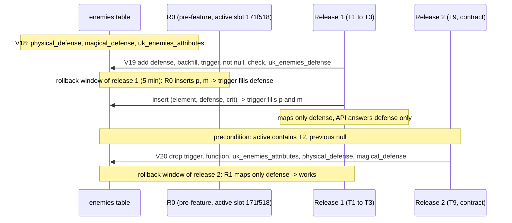

# Defense Contract Design

**Spec**: `.specs/features/defense-contract/spec.md`
**Status**: Approved by the owner on 2026-11-26 (recommended defaults)

Paths: `main/` = `backend/src/main/kotlin/br/com/woodriver/infinity_grove_ws/`, `test/` = `backend/src/test/kotlin/br/com/woodriver/infinity_grove_ws/`, `migration/` = `backend/src/main/resources/db/migration/`.

---

## Architecture Overview

Two backend releases and one game change, each deployable on its own (AD-016). The trigger of V19 is the bridge: during release 1 the pre-feature backend (call it R0) still writes and reads the old columns, the new backend writes and reads only `defense`, and every row holds the same number in the three columns.



| Step | Commit(s) | Deploys | Rollback target | Why the rollback target still works |
| --- | --- | --- | --- | --- |
| T1 | V19 only, no Kotlin | backend | R0 | R0 inserts the old columns; the trigger fills `defense`; R0 reads `physical_defense`, which V19 never changes |
| T2 | entity and repository on `defense` | backend | T1 (= R0 code + V19) | Rows the new code inserts get `physical_defense` and `magical_defense` from the trigger |
| T3 | API without the two fields | backend | T2 | No schema change |
| T4 | backend test SQL on `defense` | none (tests only, `backend/src/test` is not a deploy trigger) | - | - |
| T5 to T7 | game | Worker | - | Every backend since v0.5.0 answers `defense` |
| T9 | V20 | backend | the active release 1 commit (T3 or later) | It maps only `defense`, which V20 keeps |

The watcher deploys the newest unhandled commit every 60 s (`CLAUDE.md` § Deploy). T1, T2 and T3 may land in one watcher cycle; that is safe because each is compatible with R0 once V19 is in, and T2 and T3 both contain T1. T9 must be pushed alone, after its precondition (spec Q2).

---

## Code Reuse Analysis

| Component | Location | How to Use |
| --- | --- | --- |
| Expand/contract precedent | `.specs/features/campaign-chapters/tasks.md` T13, T14 | Precondition wording, `PreviousBackendCompatibilityIT` replay pattern, "Removals allowed" list |
| Previous-release replay | `test/adapter/repository/PreviousBackendCompatibilityIT.kt` `previousReleaseStartsOnMigratedSchema(lastVersion, futureMigrations)` | One new case per release; every existing case's `futureMigrations` grows by 1 per new migration |
| Migration IT pattern | `test/adapter/repository/HealthHitPointsMigrationIT.kt` (`information_schema.columns` reads) | `EnemyDefenseMigrationIT` |
| `assertRejected(sqlState, sql, args)` | `test/adapter/repository/SchemaConstraintsIT.kt` | SQL state 23514 and 23505 checks |
| Tolerant reader to remove | `game/src/domain/combat/monster.js:6-8` `defenseOf` | Becomes `stats.defense ?? 0`; its five callers stay |

---

## Components

### V19 `migration/V19__enemy_defense_expand.sql` (T1)

```sql
-- Expand step of TD-002 (spec defense-contract; AD-016, AD-021): the one enemy defense gets its own column `defense`. The backend before
-- this feature still reads physical_defense and writes physical_defense and magical_defense; the new backend reads and writes only
-- defense. The trigger fills whichever side an insert leaves null, so every row holds the same value in the three columns until V20
-- drops the old two. No code updates an enemy row, so the trigger runs on insert only.
alter table enemies add column if not exists defense integer;

update enemies set defense = physical_defense where defense is null;

create or replace function enemies_defense_sync() returns trigger
language plpgsql as $$
begin
    new.defense := coalesce(new.defense, new.physical_defense);
    new.physical_defense := coalesce(new.physical_defense, new.defense);
    new.magical_defense := coalesce(new.magical_defense, new.defense);
    return new;
end;
$$;

drop trigger if exists enemies_defense_sync on enemies;
create trigger enemies_defense_sync before insert on enemies for each row execute function enemies_defense_sync();

alter table enemies alter column defense set not null;
alter table enemies add constraint ck_enemies_defense check (defense between 0 and 90);
alter table enemies add constraint uk_enemies_defense unique (element, defense, crit_resistance);
```

PostgreSQL checks `not null` and the unique keys after `before` row triggers, and runs `before insert` triggers before `on conflict` arbitration, so both backends' inserts pass. The function is created in the schema Flyway migrates (its `search_path`), so the previous-release replay of `PreviousBackendCompatibilityIT` gets its own copy.

### Backend entity and repository (T2)

`main/adapter/repository/ChapterEntities.kt`:

```kotlin
/** One row per distinct enemy attribute set; stages and chapters point at it by id. */
@Entity
@Table(
    name = "enemies",
    uniqueConstraints = [
        UniqueConstraint(
            name = "uk_enemies_defense",
            columnNames = ["element", "defense", "crit_resistance"],
        ),
    ],
)
class EnemyEntity(
    @Id
    @GeneratedValue(strategy = GenerationType.IDENTITY)
    var id: Long? = null,
    @Column(nullable = false, length = 32)
    var element: String,
    @Column(nullable = false)
    var defense: Int,
    @Column(nullable = false)
    var critResistance: Int,
) {
    /** An element name outside the five fails the load instead of dealing a wrong multiplier. */
    fun toDomain() = EnemyStats(Element.valueOf(element), defense, critResistance)
}
```

`main/adapter/repository/EnemyRepository.kt`:

```kotlin
interface JpaEnemyRepository : JpaRepository<EnemyEntity, Long> {
    @Modifying(flushAutomatically = true, clearAutomatically = true)
    @Query(
        value =
            "insert into enemies (element, defense, crit_resistance) " +
                "values (:element, :defense, :critResistance) " +
                "on conflict (element, defense, crit_resistance) do nothing",
        nativeQuery = true,
    )
    fun insertIfAbsent(
        @Param("element") element: String,
        @Param("defense") defense: Int,
        @Param("critResistance") critResistance: Int,
    ): Int

    fun findByElementAndDefenseAndCritResistance(
        element: String,
        defense: Int,
        critResistance: Int,
    ): EnemyEntity?
}
```

`EnemyRepository.idOf(stats)` calls `insertIfAbsent(element, stats.defense, stats.critResistance)` and `findByElementAndDefenseAndCritResistance(element, stats.defense, stats.critResistance)`; its KDoc and error message are unchanged.

### API (T3)

`main/adapter/web/ProgressController.kt`:

```kotlin
/** One enemy of the progress and farm payloads (spec unified-damage, defense-contract): one defense. */
data class EnemyStatsResponse(
    val element: String,
    val defense: Int,
    val critResistance: Int,
) {
    companion object {
        fun from(stats: EnemyStats) = EnemyStatsResponse(stats.element.name, stats.defense, stats.critResistance)
    }
}
```

### V20 `migration/V20__enemy_defense_contract.sql` (T9)

```sql
-- Contract step of TD-002 (spec defense-contract; AD-016): the running backend (release 1) maps only `defense`, and the backend before
-- it is no longer a rollback target. The old columns, their unique key and the trigger that kept them filled go.
drop trigger if exists enemies_defense_sync on enemies;
drop function if exists enemies_defense_sync();
alter table enemies drop constraint if exists uk_enemies_attributes;
alter table enemies drop column if exists physical_defense;
alter table enemies drop column if exists magical_defense;
```

The checks `enemies_physical_defense_check` and `enemies_magical_defense_check` go with their columns.

### Game (T7)

```js
//  The one defense of a monster's stats (spec unified-damage, defense-contract): `defense`, else 0. The old fields `physicalDefense` and
//  `magicalDefense` are never read.
export const defenseOf = (stats) => stats.defense ?? 0;
```

`campaign.js:10-11` comment: the payload enemies are `{ element, defense, critResistance }`; a payload without them means `DEFAULT_STATS`. `damage.js:15` comment drops "`defenseOf` also reads an older payload". `RETIRED_TALENT_IDS` keeps the six `BOSS_TIME*` and `CRIT_RESIST_BREAK*` ids and its comment names only `talent-tree-rework`. `game/public/assets/talent-break-magical.png` is deleted with `git rm`.

---

## Fixture Conversion Rules (T4, T5, T6)

Every rule keeps the asserted values.

| Rule | Before | After |
| --- | --- | --- |
| R1 literal | `{ element, physicalDefense: X, magicalDefense: Y, critResistance: Z }` | `{ element, defense: X, critResistance: Z }` (the old `physicalDefense` was the defense the game read) |
| R2 literal with both | `{ element, defense: D, physicalDefense: D, magicalDefense: D, critResistance: Z }` | `{ element, defense: D, critResistance: Z }` |
| R3 positional helper | `(element, physicalDefense = 0, magicalDefense = 0, critResistance = 0) => ({ element, physicalDefense, magicalDefense, critResistance })` | `(element, defense = 0, critResistance = 0) => ({ element, defense, critResistance })` |
| R3 calls | `h(e, p, m, c)` / `h(e, p, m)` / `h(e, p)` / `h(e)` | `h(e, p, c)` / `h(e, p)` / `h(e, p)` / `h(e)` (the old third argument, the magical defense the game never read, is dropped) |
| R4 spread override | `{ ...bare('FIRE'), physicalDefense: 50 }` | `{ ...bare('FIRE'), defense: 50 }` |
| R5 read | `monster.stats.physicalDefense` | `monster.stats.defense` |
| R6 title | a title that says `physicalDefense N` for a converted fixture | says `defense N` |
| R7 backend SQL | `insert into enemies (element, physical_defense, magical_defense, crit_resistance) values (e, p, m, c)` | `insert into enemies (element, defense, crit_resistance) values (e, p, c)`; reads of `physical_defense` become reads of `defense`; `uk_enemies_attributes` becomes `uk_enemies_defense` |

Helpers that R3 changes (with every call): `game/src/domain/combat/damage.test.js` `enemy`; `game/src/domain/skills/skillCombat.test.js` `stats`; `game/src/adapters/phaser/ClickerGame.test.js` `stats` (the one of the enemy-stats describe, declared `(element, physicalDefense = 0, magicalDefense = 0, critResistance = 0)`), `fire` (declared `(physicalDefense = 0, magicalDefense = 0, critResistance = 0)`; becomes `(defense = 0, critResistance = 0)`, calls `fire(20, 20, 20)` -> `fire(20, 20)`, `fire(50, 50, 0)` -> `fire(50)`) and the equipment describe's `stats(element, physicalDefense = 0)` (becomes `(element, defense = 0) => ({ element, defense, critResistance: 0 })`); `game/e2e/uiRedesign.spec.js` and `game/ui-review/uiRedesign.shots.js` `bare` (call `bare('NATURE', 10, 20, 30)` -> `bare('NATURE', 10, 30)`, `bare('FIRE', 10, 20, 30)` -> `bare('FIRE', 10, 30)`).

## Legacy Payload Tests

After T7 these are the only tests under `game/` that name `physicalDefense` or `magicalDefense` (they pin spec Game AC 1 to 3). T5 and T6 leave the cases marked "T7" untouched; T7 rewrites them as listed.

| File | Test after T7 | Payload | Expected | Who |
| --- | --- | --- | --- | --- |
| `game/src/domain/combat/monster.test.js` | `reads defense first` | `{ defense: 40, physicalDefense: 70 }` | 40 | unchanged |
| same | `keeps a defense of 0 even when physicalDefense is set` | `{ defense: 0, physicalDefense: 50 }` | 0 | unchanged |
| same | `ignores physicalDefense of an old payload` (was `falls back to physicalDefense of an old payload`) | `{ physicalDefense: 50, magicalDefense: 10 }` | 0 | T7 |
| same | `never reads magicalDefense` | `{ magicalDefense: 30 }` | 0 | unchanged |
| `game/src/domain/combat/damage.test.js` | `never reads magicalDefense: a payload with only magicalDefense 80 deals 1` | `{ element: 'FIRE', magicalDefense: 80, critResistance: 0 }` (literal, was `enemy('FIRE', 0, 80)`) | 1 | T5 |
| same | `reads defense before physicalDefense: defense 40 and physicalDefense 70 deal 0.6` | literal as today | 0.6 | unchanged |
| same | `ignores physicalDefense of an old payload: physicalDefense 80 alone deals 1` (new) | `{ element: 'FIRE', physicalDefense: 80, magicalDefense: 80, critResistance: 0 }` | 1 | T7 |
| `game/src/domain/combat/fight.test.js` | `statsOf ignores physicalDefense of an old payload: physicalDefense 49 and an add of 30 read 30` (was `statsOf reads a legacy physicalDefense payload`, 79) | `{ element: 'FIRE', physicalDefense: 49, magicalDefense: 49, critResistance: 0 }`, `add(30, 30)` | 30 | T7 |
| `game/src/domain/combat/monsterAffix.test.js` | `ignores physicalDefense of an old payload: Blindado 20 reads 20` (was `reads physicalDefense of an old payload`, 53) | `{ element: 'FIRE', physicalDefense: 33, critResistance: 0 }`, `{ type: 'ARMORED', amount: 20 }` | 20 | T7 |
| `game/src/domain/talents/talents.test.js` | `ignores physicalDefense of an old payload and writes defense 0` (was `reads physicalDefense of an old payload and writes defense`) | `{ element: 'FIRE', physicalDefense: 20, magicalDefense: 20, critResistance: 0 }`, `PHYSICAL_BREAK: 5` | `{ element: 'FIRE', physicalDefense: 20, magicalDefense: 20, critResistance: 0, defense: 0 }` | T7 |
| same | `an old payload with only physicalDefense 50 and Orina's passive reads defense 0` (was `... reads defense 35`) | `{ element: 'FIRE', physicalDefense: 50, magicalDefense: 50, critResistance: 0 }`, `{ defenseBreak: 15 }` | 0 | T7 |
| `game/src/adapters/phaser/ClickerGame.test.js` | `ignores physicalDefense of an old payload: physicalDefense 50 takes a full click` (was `applies the defense of the monster: physicalDefense 50 of an old payload`, which used `stats('FIRE', 50, 10)`) | literal `{ element: 'FIRE', physicalDefense: 50, magicalDefense: 10, critResistance: 0 }` | health `maxHealth - 1` | T7 |
| same | `shows defense over physicalDefense when a payload has both: Defesa 40%` | literal as today | `Water  Defesa 40%  Seu crítico: 0%` | unchanged |
| same | `shows Defesa 0% for an old payload with only physicalDefense 50 and magicalDefense 10` (was `shows Defesa 50% ...`) | literal as today | `Darkness  Defesa 0%  Seu crítico: 0%`, no `Physical def`, no `Magical def` | T7 |
| `game/e2e/heroTeamCombat.spec.js` | `an old payload with only physicalDefense 50 no longer halves the ally hit: 2` (was `... halves the ally hit too`, 1) | as today | `dealt` 2 | T7 |
| `game/e2e/unifiedDamage.spec.js` | `Chuva de Meteoros ignores physicalDefense of an old payload: physicalDefense 50 and magicalDefense 10 make 25 x 1.4 = 35` (was `... x 0.5 = 17.5`) | as today | chips `Water  Defesa 0%  Seu crítico: 40%`, `dealt` `25 * STAR` | T7 |
| same | `defense wins over physicalDefense when a payload has both: Defesa 40%` | as today | as today | unchanged |

`game/e2e/elements.spec.js` is not in this table: its comment says it uses the old payload on purpose; T6 converts its fixtures with R1 and replaces the comment line with `//  The enemies use the payload of the backend: { element, defense, critResistance }.` Its asserted values stay, because R1 keeps the defense the game read.

## V16 Replay (T9)

`EarlyGameRebalanceMigrationIT.migrate()` runs the text of `V16__early_game_rebalance.sql`. After V20 it runs that text with these four literal replacements, applied in this order with `String.replace`:

| # | Find | Replace |
| --- | --- | --- |
| 1 | `n.physical_defense = e.physical_defense and n.magical_defense = e.magical_defense` | `n.defense = e.defense` |
| 2 | `e.physical_defense, e.magical_defense` | `e.defense` |
| 3 | `(element, physical_defense, magical_defense, crit_resistance)` | `(element, defense, crit_resistance)` |
| 4 | `uk_enemies_attributes` | `uk_enemies_defense` |

```kotlin
/** V16 as it reads on a database after V20 (spec defense-contract, design § V16 Replay): the dropped defense columns map to `defense`. */
private fun migrate() =
    jdbc.execute(
        ClassPathResource("db/migration/V16__early_game_rebalance.sql")
            .getContentAsString(Charsets.UTF_8)
            .replace("n.physical_defense = e.physical_defense and n.magical_defense = e.magical_defense", "n.defense = e.defense")
            .replace("e.physical_defense, e.magical_defense", "e.defense")
            .replace("(element, physical_defense, magical_defense, crit_resistance)", "(element, defense, crit_resistance)")
            .replace("uk_enemies_attributes", "uk_enemies_defense"),
    )
```

Each find string occurs in V16 (sections 6 and 7); after the replacements the text names neither old column.

---

## Error Handling Strategy

| Error Scenario | Handling | User Impact |
| --- | --- | --- |
| V19 meets duplicate `(element, physical_defense, crit_resistance)` | The unique key fails, Flyway rolls V19 back, the slot fails to start, the regression suite never runs, the watcher keeps the old slot | None; the deploy is reported failed in Dozzle |
| T9 pushed while R0 is still the rollback target | Prevented by the precondition (spec Q2); the task stops and reports the contract as pending | None |
| A game older than v0.5.0 loads progress after T3 | Reads every enemy defense as 0 until reloaded | Monsters take full damage in that tab (accepted, spec Q3) |
| A payload without `defense` after T7 | `defenseOf` reads 0 | Same as `DEFAULT_STATS` |

---

## Risks & Concerns

| Concern | Location (file:line) | Impact | Mitigation |
| --- | --- | --- | --- |
| Positional test helpers change arity | `damage.test.js:4`, `skillCombat.test.js:11`, `ClickerGame.test.js` `stats`, `fire`, `uiRedesign.spec.js:6`, `uiRedesign.shots.js:8` | A 4-argument call silently turns its critical resistance into the defense | Rule R3 with every call listed by the grep of T5/T6; the gate runs every changed file; T8 mutants |
| `EarlyGameRebalanceMigrationIT` replays V16 | `test/adapter/repository/EarlyGameRebalanceMigrationIT.kt:21` | Breaks after V20 | § V16 Replay in T9; T4 already moves its own SQL to `defense` |
| Every `PreviousBackendCompatibilityIT` case counts future migrations | `PreviousBackendCompatibilityIT.kt:171-193` | Off by one after V19 and V20 | T1 and T9 list the new counts |
| The trigger is invisible to JPA | V19 | A future feature could add an `update` of enemies before V20 and leave columns out of sync | V20 drops it in the same feature; no code updates enemies (Facts) |
| Flyway and `$$` bodies | V19 | A parser problem fails the migration | PostgreSQL dollar quoting is supported by Flyway's PostgreSQL parser; `EnemyDefenseMigrationIT` runs V19 on Testcontainers PostgreSQL in T1 |

---

## Tech Decisions (only non-obvious ones)

| Decision | Choice | Rationale |
| --- | --- | --- |
| Bridge between R0 and release 1 | A `before insert` trigger | Two releases instead of three; R0 never knows `defense` exists |
| Unique key | `uk_enemies_defense (element, defense, crit_resistance)` as a named constraint | `on conflict on constraint` in the V16 replay needs a constraint name; the JPA annotation documents it |
| Game fallback removal timing | Independent of the backend | Every backend since v0.5.0 answers `defense` |
| Fixture conversion owner | `test-engineer` before the production change | Each conversion keeps the values, so the suites stay green before T7 changes behaviour |

No new AD: the feature conforms to AD-016 (expand/contract, a destructive change in a later deploy) and closes the expand state AD-021 announced.
