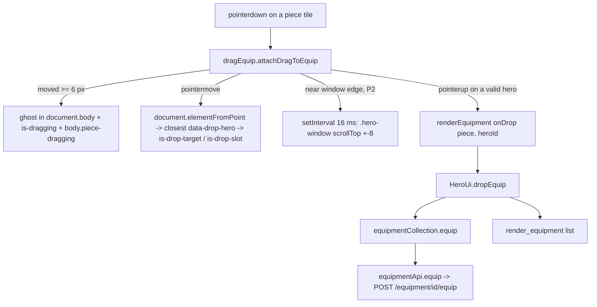

# Drag to Equip Design

**Spec**: `.specs/features/drag-equip/spec.md`
**Status**: Approved (D1 to D8). Amended 2026-11-02 after the UI review and the Verifier's FAIL: ghost placement, size and fade, drop-slot opacity (D6, DRG-15, DRG-31 to DRG-33) and the edge band beyond the window (D7, DRG-27, DRG-28). The amendment describes the code at `92abd66`; no production change follows from it.

---

## Architecture Overview

Game only. One new view helper, `views/dragEquip.js`, turns a piece tile into a drag source with Pointer Events (one path for mouse, touch and pen). `renderEquipment` attaches it to every bag and worn tile and marks every hero block as a target. `HeroUi` answers a drop with the existing `equipmentCollection.equip(pieceId, heroId)`, which calls the existing `POST /equipment/{id}/equip`. The backend, the HTTP adapter and the application layer do not change. AD-003 holds: the new file is an adapter view and imports nothing.



### Drag state machine (per press)

| State | Event | Guard | Next | Effect |
| ----- | ----- | ----- | ---- | ------ |
| idle | `pointerdown` on the tile | `active === null`, `event.isPrimary`, `event.button === 0`, `!tile.disabled` | pending | remember `pointerId`, `clientX`, `clientY`; listen to `pointermove`, `pointerup`, `pointercancel` on `document` |
| pending | `pointermove` (same `pointerId`) | `Math.hypot(dx, dy) < 6` | pending | none |
| pending | `pointermove` (same `pointerId`) | `Math.hypot(dx, dy) >= 6` | dragging | create the ghost, `is-dragging`, `body.piece-dragging`, then as a dragging move |
| pending | `pointerup` / `pointercancel` | - | idle | remove the listeners; the browser's click goes on (DRG-14) |
| dragging | `pointermove` | - | dragging | move the ghost, light the hero under the pointer, set `is-no-target` on the ghost when no valid hero is lit (removed when one is), steer the edge scroll |
| dragging | `pointerup` | - | idle | read the hero under the pointer, clean up, swallow the next click, call `onDrop(heroId)` when it is a valid target |
| dragging | `pointercancel` | - | idle | clean up, swallow the next click, no drop |

Events of any other `pointerId` are ignored in every state (DRG-25). `active` is one module-level variable, so a second tile cannot start while one press runs.

A valid target is the nearest ancestor with `data-drop-hero` of the element at the pointer, whose value differs from `piece.heroId`. Every owned hero has a block, so every block is an owned hero.

---

## Code Reuse Analysis

### Existing Components to Leverage

| Component | Location | How to Use |
| --------- | -------- | ---------- |
| `renderPieceTile` | `game/src/adapters/phaser/views/pieceTile.js:13` | The drag source; the ghost is `tile.cloneNode(true)` so it keeps the icon, frame and gems with no new asset |
| `renderEquipment` / `tileOf` | `game/src/adapters/phaser/views/equipmentView.js:73`, `:120` | The one place every bag and worn tile is built; attach the drag there |
| Hero block | `equipmentView.js:136` | Gains `data-drop-hero="<heroId>"` |
| `HeroUi.transferSet` | `game/src/adapters/phaser/HeroUi.js:397-432` | The pattern of `dropEquip`: `equipBusy`, view guard, error line, list re-render |
| `equipmentCollection.equip` | `game/src/application/equipment/equipmentCollection.js:87` | The request and the state update (adopts the answer, notifies the fight) |
| `EQUIPMENT_FAILED` | `HeroUi.js:51` | The error line `Não foi possível concluir a ação.` |
| Fake backend equip | `game/e2e/support/fakeBackend.js:636-644` | Already moves the old slot piece to the bag; no change |
| e2e fixtures | `game/e2e/equipmentUi.spec.js:5-36` | `piece`, `PIECES`, `startGame`, `openEquipment` |
| Phone project | `game/ui-review.config.js:16` | The `ui-artist` shots at 390x844 with touch |

### Integration Points

| System | Integration Method |
| ------ | ------------------ |
| Backend `POST /equipment/{id}/equip` | Unchanged; called through `equipmentCollection.equip` |
| Piece tooltip (`pieceTooltip.js`) | Unchanged; hidden during a drag by the CSS rule `body.piece-dragging .piece-tooltip { display: none; }` |
| Bulk-sell selection mode | `renderEquipment` attaches no drag while `selection` is set |
| `busy` | `renderEquipment` already disables every button; the press guard `!tile.disabled` refuses the drag |

---

## Components

### `dragEquip.js` (new)

- **Purpose**: Make one piece tile draggable onto hero blocks.
- **Location**: `game/src/adapters/phaser/views/dragEquip.js`
- **Interfaces**:
  - `DRAG_THRESHOLD_PX = 6`, `EDGE_PX = 40`, `SCROLL_STEP_PX = 8`, `SCROLL_TICK_MS = 16` - exported constants (spec D5, D7)
  - `attachDragToEquip(tile: HTMLButtonElement, piece: { heroId?: string|null, slot: string }, onDrop: (heroId: string) => void): void` - sets `data-draggable="true"` on the tile, blocks the native `dragstart`, and runs the state machine above
  - `ghostOf(tile)` (module-private) - clones the tile, removes its tooltip, adds `piece-drag-ghost` and `is-no-target`, sets the CSS variable `--ghost-scale` to `tile.getBoundingClientRect().width / tile.offsetWidth` (1 when `offsetWidth` is 0, as in jsdom), and gives the copy `data-testid="piece-drag-ghost"`, `aria-hidden="true"`, `tabindex="-1"`
  - edge band: `y - box.top <= EDGE_PX` scrolls up (this includes a pointer above the window, where the difference is negative), else `box.bottom - y <= EDGE_PX` scrolls down (includes a pointer below the window); `x` is not read (spec D7)
- **Dependencies**: `document`, `window`, `setTimeout`, `setInterval` only
- **Reuses**: none (no drag code exists in the game)

### `renderEquipment` (changed)

- **Purpose**: Wire the drag into the list.
- **Location**: `game/src/adapters/phaser/views/equipmentView.js`
- **Interfaces**:
  - new option `onDrop(piece, heroId)`; when it is given and `selection` is null, `tileOf` calls `attachDragToEquip(tile, piece, (heroId) => onDrop(piece, heroId))`
  - every hero block carries `data-drop-hero="<heroId>"`
- **Reuses**: `tileOf`, the block builder

### `HeroUi.dropEquip` (new method)

- **Purpose**: Equip after a drop and redraw the list.
- **Location**: `game/src/adapters/phaser/HeroUi.js`
- **Interfaces**: `async dropEquip(pieceId: string, heroId: string): Promise<void>`; `render_equipment` passes `onDrop: (picked, heroId) => this.dropEquip(picked.id, heroId)`
- **Reuses**: the `transferSet` shape (busy, view guard, `EQUIPMENT_FAILED`)

### Styles (changed)

- **Location**: `game/public/style.css`, a new block `/* Drag to equip */` right after the `.piece-tile.is-locked` rule (`style.css:2200-2203`).

---

## Visual Design (checked by the `ui-artist`)

No new asset: the ghost is a copy of the tile, which already loads `game/public/assets/slot-<slot>.png` and its rarity frame. Sizes are CSS px of the 1024x768 game, scaled by Phaser `FIT`.

| Element | State | Look |
| ------- | ----- | ---- |
| Draggable tile (`.piece-tile[data-draggable="true"]`) | idle | As today (60x60, rarity frame); cursor `grab`; `touch-action: none`; no text selection, no iOS callout |
| Source tile (`.piece-tile.is-dragging`) | dragging | Opacity 0.4, stays in its place (DRG-16) |
| Ghost (`.piece-tile.piece-drag-ghost`, `data-testid="piece-drag-ghost"`) | dragging, valid hero under the pointer | Copy of the tile, `position: fixed` in `document.body`, `left`/`top` = pointer; bottom-right corner 12 px left of and above the pointer so the slot under the pointer stays readable (`transform-origin: 100% 100%; transform: translate(calc(-100% - 12px), calc(-100% - 12px)) scale(calc(var(--ghost-scale, 1) * 1.1))`, DRG-15); on screen 1.1 times the source tile's on-screen size, because `--ghost-scale` carries the panel's `Scale.FIT` factor into `document.body` (DRG-31: 61.9 px for a 60 px tile at the 0.9375 scale of a 1280x720 viewport); opacity 1; shadow `var(--shadow-lg)`, `z-index: 1000`, `pointer-events: none` |
| Ghost (`.piece-tile.piece-drag-ghost.is-no-target`) | dragging, no valid hero under the pointer (bag, attribute panel, the wearer's own block, outside every block) | As above at opacity 0.6: releasing here cancels (DRG-32) |
| Hero block (`.equip-hero.is-drop-target`) | pointer over a valid hero | Outline 3 px solid `var(--color-accent)` (#c67139), offset 2 px; background `var(--color-accent-100)` (#fff2eb) instead of `var(--color-surface)` |
| Slot tile of that hero (`.piece-tile.is-drop-slot`) | same | Outline 3 px dashed `var(--color-accent)`, offset 3 px (the piece that will be replaced, or the empty `vazio` slot); `opacity: 1`, which overrides the 0.45 of `button:disabled` (`style.css:146-149`) on the empty slot (DRG-33) |
| Hero block of the wearer | pointer over it | No change (it is not a target) |
| Page (`body.piece-dragging`) | dragging | Cursor `grabbing` everywhere, no text selection, no piece tooltip |

```
 Equipamento                                        [x]
 +---------------------------------------------------+
 | Atributos de Kael ...                              |
 +---------------------------------------------------+
 | Kael      [Arma] [Armad.] [Anel] [Amuleto]         |
 +===================================================+  <- is-drop-target: accent outline, #fff2eb fill
 | Lyra      [Arma] [Armad.] [Anel] [:Amuleto:]       |  <- is-drop-slot: dashed outline
 +===================================================+
 Mochila (4)                       [Vender várias]
 [a1 40%] [m1] [c1] [u1]      [a1]       <- ghost of a1, x1.1, its bottom-right corner
                                   (o)   12 px up and left of the pointer (o); 0.6 here (no hero)
```

Screens the `ui-artist` shoots (`game/ui-review/dragEquip.shots.js`, desktop and phone): the list at rest; a drag held over a valid hero (ghost, dimmed source, lit block and slot); a drag held over the wearer's own block (no light); the list after a drop (piece in the slot, old piece in the bag).

---

## Error Handling Strategy

| Error Scenario | Handling | User Impact |
| -------------- | -------- | ----------- |
| Equip request refused or network down | `dropEquip` catches, `setError(EQUIPMENT_FAILED)`, list redrawn from the collection (unchanged, `equip` adopts only a success) | Error line `Não foi possível concluir a ação.`; the piece is where it was |
| Window closed or other screen opened before the answer | `view !== this.view` or `screen !== 'equipment'`: nothing drawn | None |
| Drop while a request runs | Tiles are disabled (`busy`) so no drag starts; `dropEquip` also returns at once when `equipBusy` | None |
| Browser takes the gesture (`pointercancel`) | Clean up, no drop | The ghost disappears; nothing changes |
| Screen redrawn during a drag | The release reads the block under the pointer at that moment; the old source tile is detached and its classes do not matter | The drop still works |

---

## Risks & Concerns

| Concern | Location (file:line) | Impact | Mitigation |
| ------- | -------------------- | ------ | ---------- |
| jsdom has no `document.elementFromPoint` and no layout (checked: `typeof document.elementFromPoint === 'undefined'`, `getBoundingClientRect` all zeros) | `game/vitest.config.js` (jsdom 29) | Unit tests cannot hit-test or measure | The helper calls `document.elementFromPoint?.(x, y)`; unit tests assign `document.elementFromPoint = vi.fn(...)` and stub `getBoundingClientRect` on the window; edge scroll does nothing when the window's rect height is 0, so other suites never start a timer |
| The Phaser DOM elements are CSS-transformed (`main.js:20-22`, `Scale.FIT`), so `position: fixed` inside the panel would be relative to the panel | `HeroUi.js:110` | A ghost inside the panel would sit at the wrong place | The ghost goes in `document.body`; pointer coordinates and `elementFromPoint` are viewport based and need no scale |
| The ghost must be above the Phaser DOM container | `style.css` new rule | A hidden ghost on some setup | `z-index: 1000` on a body-level fixed element; the `ui-artist` checks the desktop and phone shots |
| After a drag the browser fires `click` on the common ancestor of press and release | `dragEquip.js` | A click could reach a control (or the tile when released on itself) | One capture `click` listener on `window`, removed after `setTimeout(0)`, stops it (DRG-13) |
| Touch: implicit pointer capture keeps the tooltip guard (`pieceTooltip.js:38-44`) from seeing the pointer leave | `pieceTooltip.js` | A tooltip could stay over the drag on a phone | `body.piece-dragging .piece-tooltip { display: none; }` |
| Touch: `touch-action: none` on tiles means a swipe that starts on a tile does not scroll (spec D1) | `style.css` | Scrolling a phone window by swiping on the bag needs a gap between tiles | Accepted trade-off of D1; DRG-27/28 scroll the window during a drag; open question to the owner |
| Images inside the tile can start a native HTML5 drag, which fires `pointercancel` | `dom.js:43` (`` in `iconWithFallback`) | A mouse drag would stop at once | `tile.addEventListener('dragstart', (event) => event.preventDefault())` |

---

## Tech Decisions (only non-obvious ones)

| Decision | Choice | Rationale |
| -------- | ------ | --------- |
| Gesture API | Pointer Events on `document`, no pointer capture | HTML5 drag and drop does not fire on touch; jsdom has no `setPointerCapture`; document listeners see every move of the press |
| Hit test | `document.elementFromPoint(x, y).closest('[data-drop-hero]')` | No geometry code; the ghost has `pointer-events: none`, so it is never the element found |
| Edge scroll timer | `setInterval` of 16 ms, restarted only when the direction changes | Testable with `vi.useFakeTimers()`; restarting on every move would stop it from ever ticking at 60 Hz moves |
| Edge band beyond the window | Vertical test only: above the top edge scrolls up, below the bottom edge scrolls down, `x` ignored (D7) | A pointer that overshoots the edge asks for more of the same direction; the window fills most of the 720 px height, so the strips beyond it are under 30 screen px |
| Ghost size | `--ghost-scale` set from the tile's measured scale | The ghost lives outside the scaled panel (see Risks), so without it the copy would be drawn at layout size, larger than the tile it left |
| After a drop | List view, no notice | Spec D3 |

No project-level decision: no `AD-NNN` entry is added.
