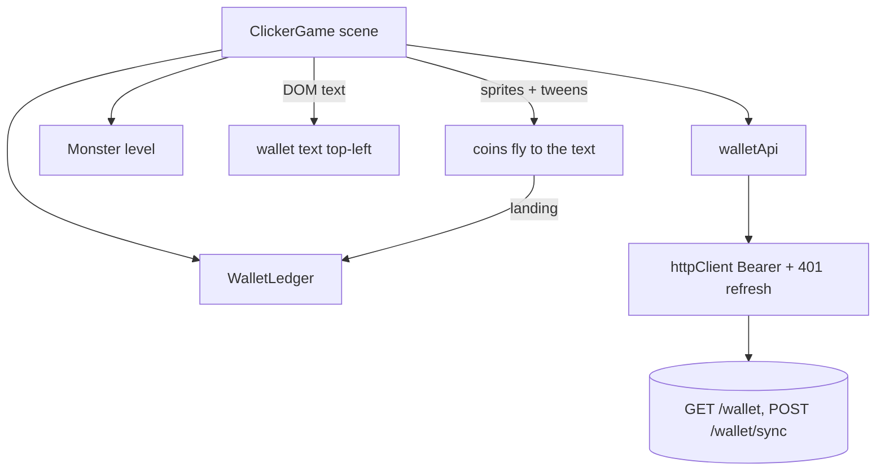

# Drops Design

**Spec**: `.specs/features/drops/spec.md`
**Status**: Approved (user asked to run the whole flow without stopping)

---

## Architecture Overview

The game keeps all drop bookkeeping in one pure module, `WalletLedger`, with no Phaser import, so every rule is unit-testable. `ClickerGame` owns the Phaser side: the wallet DOM text, the coin sprites and tweens, the 10 s timer, and the calls to `walletApi`. The backend (`wallet` feature) is the single source of truth; the ledger only mirrors it between syncs.



Flow of a kill: `Monster` reaches 0 health → scene asks `ledger.takeDrop(monster.level)` → value `v` and a drop id (or nothing) → scene spawns `v` coins, each tweened to the wallet text → each landing calls `ledger.land(id)` and refreshes the text. Every 10 s the scene calls `ledger.beginSync()`; if it returns kills, `walletApi.sync(kills)` runs and the result goes to `completeSync` or `failSync`.

---

## Code Reuse Analysis

### Existing Components to Leverage

| Component | Location | How to Use |
| --- | --- | --- |
| `httpClient` (Bearer, 401 refresh-and-retry, `ApiError`) | `src/api/httpClient.js` | `walletApi` calls it unchanged (DROP-spec assumption: 401 handling) |
| `userApi` pattern and test | `src/api/userApi.js`, `userApi.test.js` | Same thin wrapper and mock-the-client test style |
| `Monster` | `src/combat/monster.js` | Add a `level` (default 1) |
| `ClickerGame` + test stand-in | `src/scenes/ClickerGame.js`, `.test.js` | Add wallet text, coins, timer; extend `createScene()` with `add.dom`, `add.sprite`, `time.addEvent`, `events` stubs |
| `coin` atlas and `rotate` animation | `src/scenes/Preloader.js` | Coin sprites play `rotate` |
| DOM text via `add.dom().createFromHTML` | `src/scenes/MainMenu.js` | Wallet text is real HTML (ADR 0004) |
| `fakeBackend.js`, `game.js` | `e2e/support/` | Add the wallet routes to the fake backend; reuse `openMainMenu`, `fillCredentials` |

### Integration Points

| System | Integration Method |
| --- | --- |
| Backend `GET /wallet`, `POST /wallet/sync` | Through `httpClient` (Vite proxies `/api` to the backend) |
| Phaser Clock | `scene.time.addEvent({ delay: 10000, loop: true })` for the tick |
| Scene lifecycle | `this.events.once('shutdown', ...)` for the final sync |

---

## Components

### Monster level

- **Purpose**: Tell the drop which queue to read.
- **Location**: `src/combat/monster.js`
- **Interfaces**: `new Monster(maxHealth = 10, level = 1)`, `monster.level`.

### walletApi

- **Purpose**: Thin wrapper over the two wallet endpoints.
- **Location**: `src/api/walletApi.js` (exported from `src/api/index.js`)
- **Interfaces**: `walletApi.get(): Promise<{ wallet, drops }>` (GET `/wallet`), `walletApi.sync(kills): Promise<{ wallet, accepted, drops }>` (POST `/wallet/sync` with `{ kills }`).
- **Reuses**: `httpClient`.

### WalletLedger

- **Purpose**: The game-side mirror of the wallet: queues, taken drops, landed coins, sync bookkeeping.
- **Location**: `src/economy/walletLedger.js`
- **State**: `base` (`{ gold, silver, copper }` from the server), `queues` (`{ [level]: number[] }`), `ledger` (taken drops: `{ id, level, value, landed, inFlight }`), `loaded`, `syncing`.
- **Interfaces**:
  - `load({ wallet, drops })` - sets base and queues, marks loaded.
  - `takeDrop(level): { id, value } | null` - null when not loaded or the level's queue is empty or missing; otherwise pops the front value and records a ledger entry.
  - `land(id)` - adds 1 landed copper to that entry; no-op when the entry was already covered by a sync.
  - `display(): { gold, silver, copper }` - base plus the landed copper of every ledger entry, carried 100 copper to 1 silver and 100 silver to 1 gold.
  - `beginSync(): { [level]: count } | null` - null while syncing or when no entry is unreported; otherwise marks every unreported entry `inFlight`, sets `syncing`, returns the counts per level.
  - `completeSync({ wallet, drops })` - removes the in-flight entries, sets base from the response, replaces each queue with `drops[level]` minus the first m values (m = entries of that level taken since the request; a missing level becomes an empty queue), clears `syncing`.
  - `failSync()` - clears the in-flight marks and `syncing`; entries stay unreported.
  - `hasUnreported(): boolean`.
- **Dependencies**: none (pure JavaScript).

### ClickerGame (changed)

- **Purpose**: Wire the ledger to Phaser.
- **Location**: `src/scenes/ClickerGame.js`
- **Adds**: wallet DOM text at `WALLET = { x: 180, y: 32 }` hidden until loaded; `loadWallet()`; `dropCoins()`; `refreshWalletText()`; `tick()` every `WALLET_SYNC_MS = 10000`; `syncWallet()`; a `shutdown` handler that fires one final sync.
- **Constants**: `COIN = { duration: 600, stagger: 100 }`.
- **Reuses**: `DEATH`/`DAMAGE_TEXT` style constants, `showDamage` tween pattern.

---

## Data Models

```javascript
// Server responses (see the wallet feature)
GET  /wallet       -> { wallet: { gold, silver, copper }, drops: { "1": [3, 1, ...] } }
POST /wallet/sync  <- { kills: { "1": 3 } }
                   -> { wallet, accepted: { "1": 3 }, drops }
// Ledger entry
{ id, level, value, landed, inFlight }
```

Level keys are strings on the wire and in `queues`; `Monster.level` is a number, so the ledger converts with `String(level)`.

---

## Error Handling Strategy

| Error Scenario | Handling | User Impact |
| --- | --- | --- |
| `GET /wallet` fails | Wallet text stays hidden, kills drop nothing, retry at each tick | Player keeps fighting without rewards until the backend answers |
| `POST /wallet/sync` fails | `failSync()`, keep unreported kills and queues, retry at next tick | None visible |
| 401 on either call | Existing `httpClient` refresh-and-retry; a failed refresh surfaces as an error and is handled like any failure | None visible |
| Final sync on shutdown fails | Ignored, no retry | Those kills are lost |
| Server returns a level the game does not know | Ignored (queues are keyed by what the server sends) | None |

---

## Risks & Concerns

| Concern | Location (file:line) | Impact | Mitigation |
| --- | --- | --- | --- |
| Coins landing after a sync that covered them could be counted twice | `walletLedger.js` `land` / `completeSync` | Wallet text overshoots | Covered entries are removed at `completeSync`; `land` ignores unknown ids; unit test |
| Async GET/sync responses arriving after the scene shut down | `ClickerGame.js` handlers | Errors from a destroyed scene | Handlers return early when `this.sys.isActive()` is false (same guard as `MainMenu.js`) |
| Fake clock in e2e is awkward with Phaser's loop | `e2e/drops.spec.js` | Slow scenario | The scenario waits one real 10 s tick; one scenario only |
| `ClickerGame.test.js` stand-in grows | `ClickerGame.test.js:9` | Brittle tests | Add only the stubs the new code touches (`dom`, `sprite`, `time.addEvent`, `events`) |
| Wallet text is the only DOM in the game scene; `dom.createContainer` is already on | `src/main.js:17` | None | Reuse the container as `MainMenu` does |

---

## Tech Decisions (only non-obvious ones)

| Decision | Choice | Rationale |
| --- | --- | --- |
| Where the rules live | Pure `WalletLedger`, scene stays thin | Phaser is mocked in tests; pure code is cheap to test exhaustively |
| Double counting | Ledger entries with ids, removed at sync | The only way to answer "has this coin's value already reached the server?" exactly |
| Sync cadence constant | `WALLET_SYNC_MS = 10000` in the scene | Same style as the other scene constants; no env var needed yet |
| Wallet text | DOM element, not Phaser text | ADR 0004: player-facing text that tests verify is real DOM |
| Coin target | Fixed point `WALLET` | The DOM text is at a known position; no measuring |
