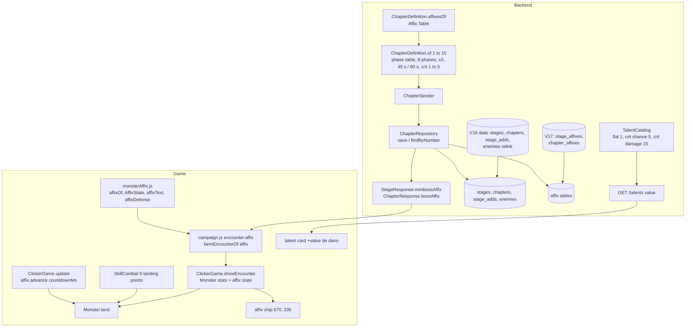

# Early Game Rebalance Design

**Spec**: `.specs/features/early-game-rebalance/spec.md`
**Status**: Approved by the owner on 2026-11-25 (revision 2, Q2b late-game kit and Q5 affixes in chapters 6 to 15 accepted).
**Simulation**: `.specs/features/early-game-rebalance/sim/balance.mjs` (no dependency; `node .specs/features/early-game-rebalance/sim/balance.mjs` and `node .specs/features/early-game-rebalance/sim/balance.mjs fit`)

---

## Architecture Overview

Four changes, two of them data only.

1. **Talent changes (backend catalog only)**: `TalentCatalog` gives `CLICK_FLAT_DAMAGE` `perLevel 1`, `CRIT_CHANCE` `perLevel 5` and `CRIT_DAMAGE` `perLevel 15`. The game reads `value` (AD-011), so no game code changes; the e2e fake backend mirrors the catalog and follows.
2. **Chapter numbers (backend seed + V16)**: `ChapterDefinition.of(c)` for every chapter reads a phase health table, seeds 8 phases a stage, multiplies the miniboss by 3, sets 45 000 ms and 90 000 ms limits, gives the adds of chapters 11 to 15 3 times the new phase health, and seeds the new critical resistances of chapters 1 to 5. `V16__early_game_rebalance.sql` (data only) rewrites the stored rows (stages, chapters, `stage_adds`) that still hold today's seed and points the minibosses and bosses of chapters 1 to 5 at enemies with the new critical resistance.
3. **Affix data (backend domain, seed, storage, payload, V17)**: a value `MonsterAffix(type, amount, periodMs)` on `StageDefinition.minibossAffix` and `ChapterDefinition.bossAffix`, seeded for chapters 2 to 15, stored in two new tables (`V17__monster_affixes.sql`, expand only), answered as `minibossAffix` and `bossAffix`.
4. **Affix combat and display (game)**: `monsterAffix.js` (domain) validates the payload and runs an `AffixState` per monster; `Monster.land(damage)` applies it and returns what landed; the five landing points of `SkillCombat` call `land`; `ClickerGame` gives the spawned monster its affix state, advances it with the countdown time and draws the chip.



### Approaches considered

| Approach | Summary | Verdict |
| --- | --- | --- |
| A. Affix state on the `Monster`, applied in `Monster.land` (chosen) | Every strike already ends in a `Monster` call; one method applies Carapaça and Escudo and returns what landed | One seam for click, auto click, Lyra, skills, aimed shot, ticks and allies; numbers on screen show what landed |
| B. Affix in `calculateDamage` / `strike` | Add the subtraction to the damage formula | Escudo de golpes counts strikes, not damage, and ticks and allies use `tickDamage`: three formulas to change and a state the pure functions do not hold |
| C. Affix in `ClickerGame` only | Scene-level checks around each hit | The damage-over-time ticks and skill hits land inside `SkillCombat`, out of the scene's reach |

For the numbers: explicit tables (chosen) over a formula per chapter. The rounding of `B x g^(n - 1)` differs between Kotlin `Math.round`, Postgres `round(double precision)` and JavaScript; a written table is the same in the seed, the migration and every test.

---

## Simulation

### Model (`sim/balance.mjs` header)

- A new account: talents, and from chapter 6 the late-game kit below. No skills, allies, armour, rings, amulets, refine or auto click; combo at its cap; every random roll replaced by its expected value. The real game is faster, so the times are an upper bound for an active player.
- Talent points: 2 per miniboss, 5 per chapter boss, spent at once on the level that raises the expected click against the next miniboss (or boss) the most per point (greedy). Grades as AD-017. `MINIBOSS_TIME` is never bought.
- Damage as `damage.js` / `attackerFor` / AD-029, stars as `starBonus.js`; Lyra's 30 % double critical click; element table of `elements.js`; stage elements `E[(n - 1 + c - 1) mod 5]`, boss `E[(c + 3) mod 5]`.
- A kill costs 1.5 s more. A miniboss or boss not killed in its limit is a wall (the farm pays no talent points).
- Chapters 11 to 15: the player kills both adds (3 x the phase health each, the stage's phase stats), then the miniboss, inside the 45 s.
- Affixes as spec § Affix Rules.

### Late-game kit (assumption, spec Q2b)

| Chapter | 1 to 5 | 6 | 7 | 8 | 9 | 10 | 11 | 12 | 13 | 14 | 15 |
| --- | --- | --- | --- | --- | --- | --- | --- | --- | --- | --- | --- |
| Leader stars (`STAR_BONUS`) | 0 | 1 | 2 | 3 | 3 | 4 | 4 | 5 | 5 | 6 | 6 |
| Weapon base click | 0 | 3 | 4 | 5 | 6 | 6 | 7 | 8 | 8 | 9 | 10 |

Why these: weapons of 2 to 3 (common) and 4 to 5 (uncommon) drop from chapter 1, rare (6 to 7) from chapter 4 and epic (8 to 9) and legendary (10 to 12) from the chapter 5 boss (`PieceRoller`); a hero card needs 3 copies per star (`FUSION_SIZE`), and the leader's own cards come back every 5 chapters (AD-006) plus the farm (AD-024). `KIT=0` runs the model without it.

### Step 1: today ("antes")

| Starter | 6 clicks/s | 8 clicks/s | 10 clicks/s |
| --- | --- | --- | --- |
| Kael (FIRE) | wall 1-1 (38 s of 30) | 3.7 / 10.3 (chapters 1 / 3), wall 5-3 | 3.2 / 9.2, wall 5-3 |
| Orina (WATER) | 3.7 / 10.8, wall 4-10 | 3.2 / 9.2, wall 4 boss | 2.9 / 8.3, wall 4 boss |
| Lyra (NATURE) | wall 1-1 (40 s of 30) | 3.0 / 7.8, wall 5-7 | 2.7 / 7.1, wall 5 boss |

Kael at 8 matches the owner's analysis (about 4, 6 to 7 and 10 min). Miniboss 1-1 at damage 1 asks 7.49 clicks/s (Kael), 3.75 (Orina), 7.88 (Lyra). The kit changes nothing here: every starter walls before chapter 6.

### Step 2: the fit (`node sim/balance.mjs fit`)

For each stage the fit finds the largest phase health at which **every** starting hero (with the talents and kit it holds there) wins the miniboss fight in at most 90 % of the 45 s at 6 clicks/s, adds and affix included; then the exponential `B x g^(n - 1)` (g from 1.00 to 1.80) with the largest total under that ceiling. The element wheel makes the ceiling jagged (each stage is 0.5x for one starter), so a smooth curve sits under the worst stage. The phase count does not move the ceiling (phases have no limit); it only adds play time.

| Chapter | Best fit B / g | B under g = 1.04 | Table B / g | Boss ceiling | Table boss |
| --- | --- | --- | --- | --- | --- |
| 1 | 69.7 / 1.330 | 71.0 | 69 / 1.33 | 6 751 | 6 000 |
| 2 | 265.8 / 1.295 | 798.9 | 265 / 1.29 | 14 130 | 12 500 |
| 3 | 1 007.5 / 1.165 | 1 777.0 | 1 000 / 1.16 | 14 734 | 13 000 |
| 4 | 6 475.4 / 1.005 | 5 005.2 | 4 750 / 1.04 | 38 081 | 34 000 |
| 5 | 8 191.2 / 1.030 | 7 634.3 | 7 250 / 1.04 | 89 147 | 80 000 |
| 6 | 9 358.1 / 1.175 | 12 064.5 | 10 000 / 1.04 | 169 626 | 130 000 |
| 7 | 40 935.0 / 1.000 | 33 645.6 | 28 000 / 1.04 | 163 769 | 139 000 |
| 8 | 58 828.0 / 1.000 | 43 023.0 | 36 000 / 1.04 | 368 984 | 313 000 |
| 9 | 93 749.0 / 1.000 | 68 501.5 | 58 000 / 1.04 | 559 258 | 475 000 |
| 10 | 77 643.6 / 1.085 | 84 508.1 | 71 000 / 1.04 | 1 301 063 | 900 000 |
| 11 | 58 877.0 / 1.000 | 44 741.7 | 38 000 / 1.04 | 1 125 297 | 956 000 |
| 12 | 80 170.7 / 1.030 | 75 655.2 | 64 000 / 1.04 | 2 366 714 | 1 850 000 |
| 13 | 116 250.5 / 1.030 | 106 781.2 | 90 000 / 1.04 | 2 282 995 | 1 940 000 |
| 14 | 192 013.7 / 1.015 | 157 530.5 | 133 000 / 1.04 | 3 338 650 | 2 837 000 |
| 15 | 236 586.2 / 1.010 | 190 252.7 | 161 000 / 1.04 | 5 018 221 | 4 265 000 |

Boss ceilings are those of the final tables (a boss Carapaça scales with its stage 10 phase health). Rounding rules: chapters 1 to 3 take the best fit (rounded down); chapters 4 to 15 take `g = 1.04` (a gentle "harder end"; the best fit there is nearly flat), B at 95 % of its ceiling in chapters 4 and 5 and 85 % in chapters 6 to 15 (margin for the kit assumption). Bosses: the smallest ceiling of that chapter and every later one (so a boss is never weaker than the one before), times 0.9 (chapters 1 to 5) or 0.85 (6 to 15), rounded down; chapters 6, 10 and 12 lowered a little more so the next boss is higher.

Step from the last stage of a chapter to the first of the next (phase health): 1 to 2 0.30, 2 to 3 0.38, 3 to 4 1.25, 4 to 5 1.07, **5 to 6 0.97**, 6 to 7 1.97, 7 to 8 0.90, 8 to 9 1.13, 9 to 10 0.86, 10 to 11 0.38 (adds), 11 to 12 1.18, 12 to 13 0.99, 13 to 14 1.04, 14 to 15 0.85. Today 5 to 6 is 1.05 and every chapter after 5 doubles. The 6 to 7 step follows the ceiling, which nearly triples there (stars 2 and +20 % critical damage, weapon 4); chapter 6 is held down by its stage 3 (Escudo de golpes 30 on a 0.5x stage for one starter).

### Step 3: after ("depois", `node sim/balance.mjs`)

Minutes at the end of chapters 1 / 3 / 5 / 10 / 15:

| Starter | 6 clicks/s | 8 clicks/s | 10 clicks/s |
| --- | --- | --- | --- |
| Kael | 15.2 / 38.3 / 59.9 / 110.6 / 159.0 | 12.0 / 30.3 / 47.6 / 88.3 / 128.0 | 10.0 / 25.5 / 40.2 / 75.0 / 109.4 |
| Orina | 14.7 / 35.7 / 58.2 / 108.7 / 157.1 | 11.6 / 28.4 / 46.3 / 86.9 / 126.6 | 9.7 / 24.0 / 39.2 / 73.9 / 108.3 |
| Lyra | 10.1 / 25.5 / 41.5 / 86.5 / 127.2 | 8.1 / 20.7 / 33.9 / 70.3 / 104.2 | 6.9 / 17.9 / 29.3 / 60.6 / 90.4 |

No wall in chapters 1 to 15 for any starter at any rate. The tightest fight at 6 clicks/s leaves 17 % of the limit (Kael, 3-10), 12 % (Orina, 1-8) and 14 % (Lyra, 1-1). Miniboss 1-1 at damage 1 asks 4.70 (Kael), 2.35 (Orina), 5.25 (Lyra) clicks/s. A build that never buys `Dano direto de clique` still walls at 1-2 (Kael), 1-3 (Orina), 1-6 (Lyra) (Q3). With `KIT=0` the first wall is at 8-9 to 12-2 (spec § Late-game Kit).

### Gain per point

Gain of damage per talent point against the miniboss, greedy Kael at 8 clicks/s, at the point named (the grade shown is the next one to buy):

| Point | Dano direto de clique | Dano de clique (%) | Chance de crítico | Dano crítico | Limite de dano do combo |
| --- | --- | --- | --- | --- | --- |
| 1-5 | G1 11.1 % | G1 5.0 % | G1 4.7 % | G1 0.8 % | G1 5.0 % |
| 1-10 | G2 5.3 % | G1 5.0 % | G1 5.0 % | G1 0.1 % | G1 5.0 % |
| 3-10 | G2 3.7 % | G1 3.7 % | G2 4.3 % | G2 3.9 % | G1 3.7 % |
| 5-10 | G3 2.9 % | G2 2.8 % | G2 1.2 % | G2 2.7 % | G2 2.6 % |
| 10-10 | G3 1.9 % | G3 1.6 % | G3 0.6 % | G3 1.9 % | G3 1.9 % |

Today (+1 point, +5 %) `Chance de crítico` gives 0.9 % at 1-5 and 0.0 % from 3-10 on, `Dano crítico` 0.0 to 0.3 %. With +3 / +15 and +4 / +15 the greedy build never starts the path (the first levels at 3-10 sit under the resistance and give 0); +5 / +15 is the first setting where it does: by the end of chapter 3 it holds `CRIT_CHANCE` G1 10, G2 6 and `CRIT_DAMAGE` G1 10, G2 1 beside `CLICK_FLAT_DAMAGE` G1 10, G2 8, `CLICK_DAMAGE` G1 8 and `COMBO` G1 7. `Chance de crítico` falls behind late because the chance passes 100 (only the overflow pays then, 1 % critical damage a point).

### Why the targets are bounded

The miniboss of a stage has 3 times the health of its phase monster, and no miniboss may wall a 6 clicks/s player: at 45 s a miniboss holds at most 6 x 45 = 270 effective clicks. The element wheel puts a 0.5x stage in every five for one of the starters, so the smooth curve uses about half of the ceiling. With 8 phases (owner Q1) chapter 1 takes 12.0 min and chapter 3 30.3 min at 8 clicks/s (5 phases on the same tables: 9.0 and 22.9); only more phases, longer limits or a gate above 6 clicks/s move it further.

---

## Code Reuse Analysis

### Existing Components to Leverage

| Component | Location | How to Use |
| --- | --- | --- |
| `StageAdd` + `stage_adds` + `StageAddEntity` | `domain/Chapter.kt:26`, `V13__miniboss_adds.sql`, `adapter/repository/ChapterEntities.kt:161` | Pattern for `MonsterAffix`, the two affix tables and their entities: a domain value with `require` bounds, a table keyed to its parent, a seeder-written row, a migration that fills the stored rows and can run again |
| `ChapterRepository.save` / `findByNumber` | `adapter/repository/ChapterRepository.kt:33`, `:50` | Load and replace the affixes beside the adds |
| `AddResponse` / `StageResponse.from` | `adapter/web/ProgressController.kt:46`, `:55` | `AffixResponse.from`, nullable fields on `StageResponse` and `ChapterResponse` |
| `V4__monster_health_growth.sql` | `db/migration` | Seeded-value guard of every update in V16 |
| `addsOf` | `game/src/domain/combat/adds.js` | Validation style of `affixOf` (skip a bad entry, never throw) |
| `Fight.statsOf` guard | `game/src/domain/combat/fight.js` | `affixDefense` raises the main's stats once at spawn; `guardedDefense` and the breaks apply on top |
| `.tag[data-stat]::before` mask icons | `game/public/style.css:801` | The affix chip icon |
| `ENEMY_STATS` DOM box pattern | `ClickerGame.js:88`, `:107`, `:238` | The `AFFIX` box and its chip |
| `formatShort` | `game/src/domain/combat/numberFormat.js` | Amounts of 1 000 or more |
| e2e loop control (`freeze`, `advance`, `scene`) | `game/e2e/minibossAdds.spec.js:28-40` | Step countdown time by hand for Escudo recharge and Regeneração |

### Integration Points

| System | Integration Method |
| --- | --- |
| `GET /progress`, `POST /progress/outcome`, `GET /farm` | Additive nullable fields `minibossAffix` per stage and `bossAffix` per definition (same `ChapterResponse`) |
| `GET /talents` | Same shape; `CLICK_FLAT_DAMAGE*` values smaller |
| Database | V16 data only; V17 two new tables plus rows |
| e2e fake backend | `TALENT_CATALOG` flat `perLevel` 1 and no offset; definitions pass affix fields through unchanged |

---

## Deploy Order and Compatibility (AD-016, AD-023)

- **V16** changes data only (stages, chapters, enemies, no schema). The previous backend (last migration V15) reads the new numbers through the same columns and starts: its Flyway validation reports V16 and V17 as future migrations.
- **V17** creates `stage_adds`-style tables the previous backend never maps; `ddl-auto: validate` ignores unknown tables. Its inserts reference stored stages and chapters only.
- On a new database V16 and V17 run on empty catalog tables and change nothing; `ChapterSeeder` then seeds chapters 1 to 15 with the new numbers and writes the affixes through `ChapterRepository.save`.
- The old game ignores the new fields; the new game against the old backend sees no affix and today's numbers. Either deploy order is safe; no contract step follows.
- `PreviousBackendCompatibilityIT` gains the release before this feature (last version 15, 2 future migrations) and its three existing cases each see 2 more future migrations.

---

## Components

### Backend: `TalentCatalog` (change)

- **Purpose**: `CLICK_FLAT_DAMAGE` gives 1 a level, `CRIT_CHANCE` 5, `CRIT_DAMAGE` 15.
- **Location**: `backend/src/main/kotlin/br/com/woodriver/infinity_grove_ws/domain/Talents.kt:82-85`
- **Interfaces**: `TalentDefinition("CLICK_FLAT_DAMAGE", TalentBranch.POWER, "Dano direto de clique", "dmg", 1)` (no `firstLevel`: it defaults to `perLevel`), `TalentDefinition("CRIT_CHANCE", TalentBranch.POWER, "Chance de crítico", "points", 5)`, `TalentDefinition("CRIT_DAMAGE", TalentBranch.POWER, "Dano crítico", "%", 15)`.

### Backend: `ChapterDefinition` (change) and `MonsterAffix` (new)

- **Purpose**: seed every chapter from the Chapter Table and the affixes of chapters 2 to 15.
- **Location**: `backend/src/main/kotlin/br/com/woodriver/infinity_grove_ws/domain/Chapter.kt`
- **Interfaces**:
  - `enum class MonsterAffixType { SHELL, HIT_SHIELD, REGENERATION, ARMORED }`
  - `data class MonsterAffix(val type: MonsterAffixType, val amount: Long, val periodMs: Long? = null)` with the bounds of spec § Assumptions (Bounds)
  - `StageDefinition(..., val minibossAffix: MonsterAffix? = null)`, `ChapterDefinition(..., val bossAffix: MonsterAffix? = null)`
  - `ChapterDefinition.minibossAffixOf(number: Int, stage: Int, phaseHealth: Long): MonsterAffix?`, `ChapterDefinition.bossAffixOf(number: Int, lastPhaseHealth: Long): MonsterAffix?`
  - `ChapterDefinition.of(number)`: phase health `PHASE_HEALTH[number - 1][n - 1]`, 8 phases, miniboss `3 x`, limits 45 000 / 90 000, boss health `BOSS_HEALTH[number - 1]`, adds of 3 times the new phase health; for `number <= 5` critical resistance `(n - 1) + 8(number - 1)` and boss `10 x number - 5`; for `number >= 6` critical resistances, defenses and elements as today. `healthFactor` stays (other code and tests read it).
- **Reuses**: `StageAdd` style (`require` in `init`).

### Backend: storage (`ChapterEntities.kt`, `ChapterRepository.kt`, V17)

- `StageAffixEntity` (table `stage_affixes`, id `stage_id`), `ChapterAffixEntity` (table `chapter_affixes`, id `chapter`), `JpaStageAffixRepository.findAllByStageIdIn`, `JpaChapterAffixRepository`.
- `ChapterRepository.findByNumber` reads both and passes them to `toDomain`; `save` replaces the stage affixes of the chapter (delete the stage ids without an affix, save the others) and saves or deletes the chapter affix.

### Backend: payload (`ProgressController.kt`)

- `data class AffixResponse(val type: String, val amount: Long, val periodMs: Long?)` with `from(affix: MonsterAffix)`.
- `StageResponse.minibossAffix: AffixResponse?`, `ChapterResponse.bossAffix: AffixResponse?` (serialized as `null` when absent).

### Game: `monsterAffix.js` (new, domain)

- **Location**: `game/src/domain/combat/monsterAffix.js`
- **Interfaces**:
  - `AFFIX_TYPES = ['SHELL', 'HIT_SHIELD', 'REGENERATION', 'ARMORED']`
  - `affixOf(payload) -> { type, amount, periodMs } | null` (spec § Assumptions, Invalid affix data)
  - `affixDefense(stats, affix) -> stats` (ARMORED adds `amount` to `defense`; else the same object)
  - `class AffixState { constructor(affix); land(damage) -> dealt; advance(ms, monster) -> healed; get charges; get rechargeMs }`
  - `affixText(state) -> string` (spec § Player-Facing Texts)
- **Dependencies**: `numberFormat.js` (`formatShort`).

### Game: `Monster.land` (change)

- `land(damage)`: returns 0 on a dead monster; else `dealt = this.affix ? this.affix.land(damage) : damage`, `this.hit(dealt)`, returns `dealt`. `this.affix` defaults to `null` in the constructor. `hit` keeps its meaning and return value.

### Game: `SkillCombat` (change)

- The five `.hit(` calls become `.land(` and every returned or pushed damage is what landed (the `click`, `allyHit`, skill-hit, aimed-shot and `tickHit` results).

### Game: `campaign.js` (change)

- Every encounter carries `affix`: `null` for a phase, `affixOf(stage.minibossAffix)` for a miniboss, `affixOf(definition.bossAffix)` for the chapter boss; `farmEncounterOf` the same for the boss it replays.

### Game: `ClickerGame` (change)

- `showEncounter`: `new Monster(encounter.health, encounter.dropRuleId, affixDefense(encounter.stats, encounter.affix))`, then `this.monster.affix = encounter.affix ? new AffixState(encounter.affix) : null`, then `showAffix()`.
- `update`: right after `const countdownMs = this.skills.countdownMs(delta);`, when `this.countdown` and a living monster with an affix exist, `this.monster.affix.advance(countdownMs, this.monster)`; a heal above 0 calls `updateHealthBar()`; `showAffix()` every frame (it writes only when the text changed).
- `afterDamage`, `bossTimedOut`, `completeChapter` and the clear paths empty the chip (`clearAffix()`).
- New DOM box `AFFIX = { x: 670, y: 336 }`, `AFFIX_HTML = '<div class="hud-box hud-affix"><div class="affix-chip" data-testid="affix-chip"></div></div>'`.

---

## Data Models

```kotlin
enum class MonsterAffixType { SHELL, HIT_SHIELD, REGENERATION, ARMORED }

data class MonsterAffix(val type: MonsterAffixType, val amount: Long, val periodMs: Long? = null)
```

```sql
-- V17__monster_affixes.sql
create table if not exists stage_affixes (
    stage_id  varchar(255) primary key references stages (id) on delete restrict,
    affix     varchar(32)  not null check (affix in ('SHELL', 'HIT_SHIELD', 'REGENERATION', 'ARMORED')),
    amount    bigint       not null check (amount >= 1),
    period_ms bigint       null check (period_ms is null or period_ms between 1 and 600000),
    constraint ck_stage_affixes_period check ((affix = 'HIT_SHIELD') = (period_ms is not null))
);
create table if not exists chapter_affixes (
    chapter   integer      primary key references chapters (number) on delete restrict,
    affix     varchar(32)  not null check (affix in ('SHELL', 'HIT_SHIELD', 'REGENERATION', 'ARMORED')),
    amount    bigint       not null check (amount >= 1),
    period_ms bigint       null check (period_ms is null or period_ms between 1 and 600000),
    constraint ck_chapter_affixes_period check ((affix = 'HIT_SHIELD') = (period_ms is not null))
);
```

```js
// game: one affix of the payload
{ type: 'HIT_SHIELD', amount: 10, periodMs: 6000 }   // or SHELL / REGENERATION / ARMORED with periodMs null
```

---

## Error Handling Strategy

| Error Scenario | Handling | User Impact |
| --- | --- | --- |
| Payload without affix fields (old backend) | `affixOf(undefined)` is `null` | The fight is as today |
| Unknown `type`, bad `amount`, Escudo without `periodMs` | `affixOf` returns `null` | No affix, no chip |
| A stored affix row outside the bounds | Database check refuses it; domain `require` fails the load like any bad catalog row | An operator error surfaces at load, as for `stage_adds` |
| V16 on a tuned row | The guard skips it | The tuned value stays |
| V16 or V17 run again | Guards and `on conflict do nothing` | No change |

---

## Risks & Concerns

| Concern | Location (file:line) | Impact | Mitigation |
| --- | --- | --- | --- |
| Late game rests on an assumed kit | `sim/balance.mjs` `KIT` | A player with fewer stars or a weaker weapon than spec § Late-game Kit can wall from chapter 8 (talent-only: 8-9 to 12-2) | Q2b; the farm (AD-024) gives cards and pieces to catch up; chapters 6 to 15 sit at 85 % of the ceiling |
| Late players get much faster | `Chapter.kt:180` | Chapter 15 health falls from 10 485 760 to 161 000 to 229 153 a phase monster | Spec Q8 (2); intended by Q2 (no wall through chapter 15) |
| `stage_adds` rows follow the phase health | `V13__miniboss_adds.sql`, `ChapterRepository.save` | Adds of chapters 11 to 15 keep 3 times the old phase health unless V16 rewrites them | V16 step 2 updates `stage_adds.hit_points` where they hold 3 times today's seed |
| Many tests pin today's chapter numbers | `ChapterTest.kt:86-515`, `ProgressControllerIT.kt:84-249`, `FarmControllerIT.kt:281-300`, `MonsterHealthMigrationIT.kt`, `StageAddsMigrationIT.kt`, `PreviousBackendCompatibilityIT.kt:166`, e2e `talentTreeReworkCombat.spec.js` (critical values) | A blind edit could weaken them | T2 and T3 list the re-pins with the exact new values; any other failing test stops the task |
| The talent changes hit every player at once | `Talents.kt:82-85` | Up to 54 flat damage less, up to 270 critical chance and 600 % critical damage more | Q8 (1); stated in the spec; levels and points stay |
| Five landing points in `SkillCombat` | `skillCombat.js:180`, `:195`, `:251`, `:399`, `:415` | A missed call skips the affix for that strike kind | T9 names each call by its quoted text; T16 has one e2e case per strike kind |
| The shared `enemies` catalog | `V1__schema.sql:54` | Updating a row would change every stage that points at it | V16 inserts new rows (`on conflict do nothing`) and repoints only the minibosses and bosses of chapters 1 to 5 |
| Fixed-size HUD box | `ClickerGame.js:96` comment | Phaser measures a DOM element once | The chip lives in a 240 x 28 box; its text changes inside it |

---

## Tech Decisions

| Decision | Choice | Rationale |
| --- | --- | --- |
| Name of the backend type | `MonsterAffix`, `MonsterAffixType` | `Affix` and `AffixType` already name equipment affixes (`Equipment.kt`) |
| Regeneração unit | basis points per second | 0,25 % a second fits an integer column |
| Escudo recharge in data | `periodMs` per affix | The game types no stage number (AD-011, `stages`) |
| Heal and recharge clock | `countdownMs` | Stops with the pause and with Stun or Root, like the countdown the player sees |
| Bosses never weaker than the previous one | smallest ceiling of the chapter and every later one | A boss that drops in health reads as a bug to the player |

> **Project-level decision:** AD-030 in `.specs/STATE.md` (proposed) records the catalog change that supersedes the flat values of AD-017, the chapter seed that supersedes the health growth of AD-019, and the affix contract.
