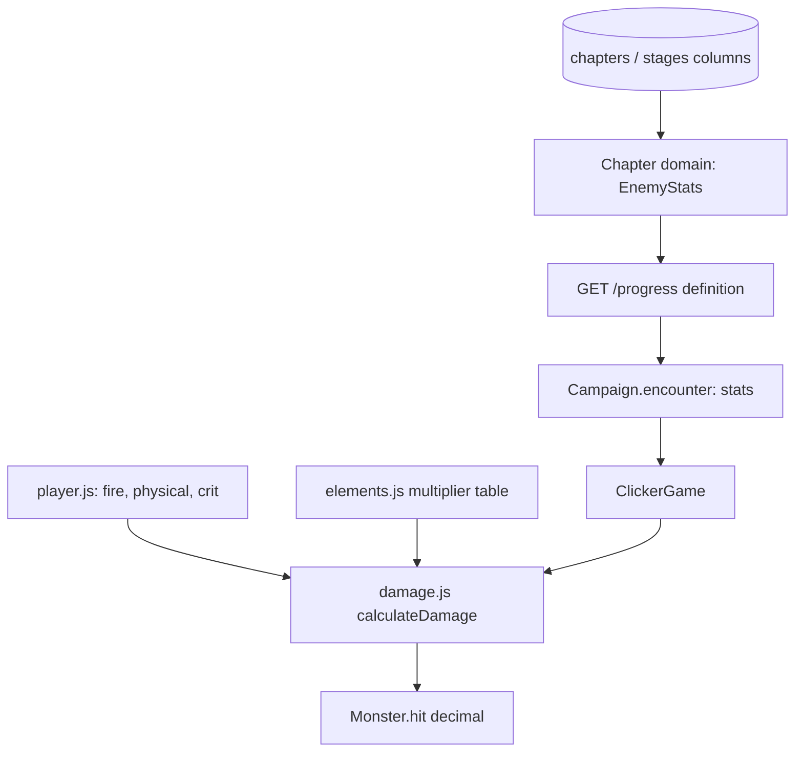

# Elements and Enemy Attributes Design

**Spec**: `.specs/features/elements/spec.md`
**Status**: Approved (user asked to proceed with the implementation)

---

## Architecture Overview

Enemy attributes are definition data, stored next to health and time limits and delivered inside the existing `definition` of `GET /progress` (AD-004). The damage rule is a pure game-domain module (AD-003); the scene only rolls the random number, draws the result and shows the HUD line.

## Code Reuse Analysis

| Component | Location | How to Use |
| --- | --- | --- |
| `StageDefinition`, `ChapterDefinition` | `backend/.../domain/Chapter.kt` | Add `EnemyStats` fields with a default so existing tests keep compiling |
| `StageEntity`, `ChapterEntity` | `backend/.../adapter/repository/ChapterEntities.kt` | Add flat columns with a column default; `ddl-auto: update` adds them to old rows |
| `StageResponse`, `ChapterResponse` | `backend/.../adapter/web/ProgressController.kt` | Add nested stats objects |
| `Campaign.encounter()` | `game/src/domain/campaign/campaign.js` | Add `stats` to the returned encounter |
| `Monster` | `game/src/domain/combat/monster.js` | Carry `stats`; accept decimal damage |
| `createHtml` | `game/src/adapters/phaser/ClickerGame.js` | One more click-through HUD line |

## Components

### `EnemyStats` (backend)
- **Purpose**: element and three percentages of one encounter, validated.
- **Location**: `domain/Chapter.kt` (with `Element` enum)
- **Interfaces**: `EnemyStats(element, physicalDefense 0..90, magicalDefense 0..90, critResistance 0..100)`; `EnemyStats.DEFAULT` = FIRE, 0, 0, 0.

### `elements.js` (game domain)
- **Purpose**: the 5x5 multiplier table.
- **Location**: `game/src/domain/combat/elements.js`
- **Interfaces**: `ELEMENTS`, `elementMultiplier(attacker, defender): number` (throws on an unknown element).

### `damage.js` + `player.js` (game domain)
- **Purpose**: the damage formula and the fixed fire, physical player.
- **Location**: `game/src/domain/combat/`
- **Interfaces**: `PLAYER`, `calculateDamage({ attacker, defender, random }): { damage, critical }`; `formatDamage(n): string`.

## Data Models

Backend columns: `monster_element`, `monster_physical_defense`, `monster_magical_defense`, `monster_crit_resistance` and the same four with `miniboss_` on `stages`; `boss_` on `chapters`. Element is `varchar` with default `'FIRE'`, numbers `integer not null default 0`.

Payload: `stage.monster` and `stage.miniboss`, `definition.boss`, each `{ element, physicalDefense, magicalDefense, critResistance }`.

## Error Handling Strategy

| Error Scenario | Handling | User Impact |
| --- | --- | --- |
| Unknown element stored | `Element.valueOf` throws while loading the chapter | `GET /progress` fails, game shows "Could not load progress" |
| Out-of-range value | `EnemyStats` `require` fails on save and load | Same |
| Payload without stats (old backend) | `Campaign` falls back to `DEFAULT` stats | Monster behaves as fire, no defense |

## Risks & Concerns

| Concern | Location (file:line) | Impact | Mitigation |
| --- | --- | --- | --- |
| Existing local database rows keep the column defaults, so the seed values never reach them | `ChapterSeeder.kt:17` | Local game shows every enemy as fire with no defense | One-time SQL update of the local database at deploy; the seeder stays "never overwrite" |
| Float health could stop at 1e-16 and never die | `monster.js:20` | An unkillable monster | `Monster.hit` rounds health to 6 decimals |
| Critical roll makes existing scene tests random | `ClickerGame.test.js` | Flaky tests | Scene takes `services.random`, tests inject a fixed value |

## Tech Decisions

| Decision | Choice | Rationale |
| --- | --- | --- |
| Random source | Injected `random()` function on the scene services | Deterministic tests without mocking globals |
| Flat columns, no `enemy_stats` table | 12 columns | Same shape as health columns; no join |
