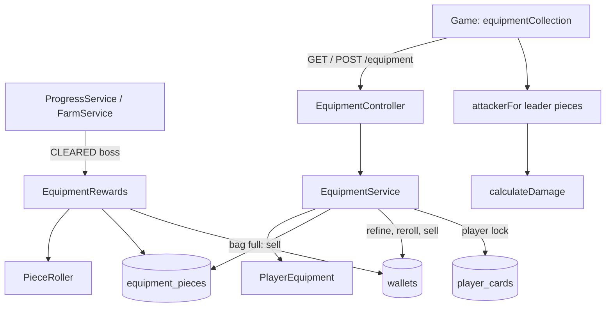

# Equipment Design

**Spec**: `.specs/features/equipment/spec.md`
**Status**: Approved (owner: "Pode seguir com a implementação")

---

## Architecture Overview

Equipment follows the shape of the hero cards (AD-005, ADR 0007): the server rolls every drop inside the report transaction, the game only shows it. Pieces live in their own table, outside the `PlayerCards` aggregate, because a bag of up to 100 pieces with per-piece state does not fit the comma-separated style of the cards. The `player_cards` row is still the **player lock**: every equipment operation takes it first, then the wallet row, so lock order stays `progress` → `player_cards` → `wallets` and there is no cycle (the wallet sync takes only `wallets`).



## Code Reuse Analysis

### Existing Components to Leverage

| Component | Location | How to Use |
| --------- | -------- | ---------- |
| `CardRewards` | `BE/service/CardRewards.kt` | Same role and call sites for `EquipmentRewards`; `ChanceRollerPort` is the only randomness |
| `PlayerCardsRepositoryPort.findForUpdate` | `BE/port/HeroPorts.kt` | The player lock for every equipment operation |
| `WalletRepositoryPort.findForUpdate`, `Wallet.copper` | `BE/port/WalletRepositoryPort.kt`, `BE/domain/Wallet.kt` | Debit and credit copper under the wallet lock; add `Wallet.plus` / `Wallet.minus` |
| `BusinessException` bases, `ApiExceptionHandler` | `BE/domain/BusinessException.kt`, `BE/adapter/web/ApiExceptionHandler.kt` | New `EquipmentRequestException` (400), `EquipmentNotFoundException` (404), `EquipmentConflictException` (409) |
| `HeroNotOwnedException` | `BE/domain/HeroExceptions.kt` | Equipping on a hero the player does not own |
| `ControllableChanceRoller` | `BT/IntegrationTestBase.kt` | Forces drops and rolls in integration tests |
| `heroCollection`, `heroesApi`, `HeroUi`, `bagView` | `GS/application/heroes`, `GS/adapters/http`, `GS/adapters/phaser` | Pattern for the equipment collection, gateway and screen |
| `calculateDamage`, `PLAYER` | `GS/domain/combat/damage.js` | Extended with `armorPierce` and `bossDamage`; `BossCountdown` takes the larger limit |
| `WalletLedger` | `GS/domain/economy/walletLedger.js` | New `setBase` so a refine, reroll or sale updates the displayed wallet |

### Integration Points

| System | Integration Method |
| ------ | ------------------ |
| `POST /progress/outcome`, `POST /farm/outcome` | Responses gain `equipmentDrop` (null omitted) next to `drop` |
| `GET /wallet` | Unchanged; refine, reroll and sale responses carry the new wallet total so the game does not wait for the next sync |
| Hibernate `ddl-auto: update` (ADR 0005) | Creates `equipment_pieces`; no migration tool |
| `DELETE /users` | Also deletes the player's pieces |

---

## Components

### Backend domain (`BE/domain/Equipment.kt`, `EquipmentRules.kt`, `PieceRoller.kt`, `PlayerEquipment.kt`)

- **Purpose**: the item model, its numbers, the roll and the bag/worn-slot rules, all pure.
- **Interfaces**:
  - `enum Slot { WEAPON, ARMOR, RING, AMULET }`, `enum Rarity(affixCount, valueMultiplier, costMultiplier, index)`, `enum AffixType(min, max, weaponAllowed)`
  - `data class Affix(type, base)`; `data class Piece(id, username, slot, rarity, baseClick: Int?, refine, affixes, heroId: String?)` with `value(affix)` (floor of base × (1 + 0.1 × refine)), `clickDamage()` (weapon base × (1 + 0.1 × refine), one decimal), `refineCost()`, `rerollCost`, `sellPrice()`, `refined(): Piece`, `rerolled(index, pickType, rollBase): Piece`
  - `PieceRoller.roll(encounter, rules, chance: () -> Double, id: String): Piece?` (null when the drop chance fails)
  - `PlayerEquipment(username, pieces, capacity)`: `add`, `equip(pieceId, heroId)`, `unequip(pieceId)`, `remove`, `worn(heroId)`
- **Dependencies**: `Encounter`, `ChanceRollerPort` (as a lambda)
- **Reuses**: validation style of `Hero`, `CardDropRates`

### `EquipmentRewards` and `WalletAccess` (`BE/service/`)

- **Purpose**: roll the piece of a won boss under the player lock, store it, or sell it when the bag is full; get the locked wallet, creating it when missing.
- **Interfaces**: `EquipmentRewards.award(username, encounter): EquipmentDrop?`; `WalletAccess.lock(username): Wallet`
- **Reuses**: `CardRewards` call pattern, `WalletService` creation sequence

### `EquipmentService` + use cases + `EquipmentController` (`BE/service/`, `BE/usecase/`, `BE/adapter/web/`)

- **Purpose**: list, equip, unequip, refine, reroll, sell.
- **Routes** (all authenticated, `principal.name`):
  - `GET /equipment` → `{ capacity, pieces: [Piece] }`
  - `POST /equipment/{id}/equip { heroId }` → same body
  - `POST /equipment/{id}/unequip` → same body
  - `POST /equipment/{id}/refine` → `{ equipment, wallet: { gold, silver, copper } }`
  - `POST /equipment/{id}/reroll { affix }` → same
  - `POST /equipment/{id}/sell` → same
- **Piece JSON**: `{ id, slot, rarity, refine, clickDamage (number or null), affixes: [{ type, value }], heroId (or null), refineCost (or null at +10), rerollCost (null below +5), sellPrice }`, values already refined by the server so the game never re-derives them.
- **Drop JSON**: `equipmentDrop` = `{ piece: <piece JSON>, sold }`.

### Persistence (`BE/adapter/repository/EquipmentEntities.kt`, `EquipmentRepository.kt`, port `EquipmentRepositoryPort`)

- **Purpose**: one row per piece in `equipment_pieces(id, username, slot, rarity, base_click, refine, affixes, hero_id)`, `username` indexed; affixes as `TYPE:base` joined by commas (same text style as `wallet_levels.drops`).
- **Interfaces**: `findAll(username)`, `save(piece)`, `delete(id)`, `deleteByUsername(username)`

### Config (`BE/adapter/config/EquipmentConfig.kt`)

- **Purpose**: `app.equipment.*` scalars bind to `EquipmentRules`: `miniboss-rate` 0.25, `chapter-boss-rate` 1.0, `bag-capacity` 100, `reroll-cost` 5000, `refine-base-cost` 500. Tables (affix ranges, rarity weights and multipliers) are constants in `EquipmentRules` with the spec's values; a bad scalar fails startup like `CardConfig`.

### Game (`GS/`)

| Component | Purpose |
| --------- | ------- |
| `domain/combat/damage.js` | `calculateDamage` also reads `attacker.bossDamage` (%), `attacker.armorPierce` (%) and a `boss` flag |
| `domain/equipment/equipment.js` | `wornBy(pieces, heroId)`, `attackerFor(base, pieces)`, `bossTimeBonusMs(pieces)`, labels (rarity, slot, affix), `describeAffix`, `formatCopper` |
| `adapters/http/equipmentApi.js` | The six calls |
| `application/equipment/equipmentCollection.js` | Keeps the pieces, runs the actions, notifies on change, reports the new wallet through `onWallet` |
| `application/economy` (`walletSync.setWallet`) and `WalletLedger.setBase` | Shows the wallet a refine returned |
| `application/campaign/campaignSession.js` | Fires `onEquipmentDrop` when an accepted report carries `equipmentDrop` (farm results pass it through) |
| `adapters/phaser/views/equipmentView.js` | The screen: heroes' slots, bag, per-piece detail with Equipar/Remover/Refinar/Rerrolar/Vender |
| `adapters/phaser/HeroUi.js` | Sixth HUD button "Equipamento" and the notice `Equipamento encontrado: ...` |
| `adapters/phaser/ClickerGame.js`, `composition.js` | Uses `attackerFor(...)`, the boss time bonus, and routes drops and wallet updates |

---

## Data Models

```kotlin
data class Piece(val id: String, val username: String, val slot: Slot, val rarity: Rarity,
                 val baseClick: Int?, val refine: Int, val affixes: List<Affix>, val heroId: String?)
data class Affix(val type: AffixType, val base: Int)
```

**Relationships**: a piece belongs to one username; `heroId` is the hero wearing it (at most one piece per `(username, heroId, slot)`, enforced by `PlayerEquipment` under the player lock; a database partial unique index is not available through `ddl-auto: update`).

## Error Handling Strategy

| Error Scenario | Handling | User Impact |
| -------------- | -------- | ----------- |
| Piece missing or another account's | `EquipmentNotFoundException` 404 `EQUIPMENT_NOT_FOUND` | Panel shows `Não foi possível concluir a ação.` |
| Hero not owned | `HeroNotOwnedException` 409 | same |
| Copper short | `NotEnoughCopperException` 409 `NOT_ENOUGH_COPPER` | buttons disabled by the cost; a race shows the same text |
| `MAX_REFINE`, `REFINE_TOO_LOW`, `NO_AFFIX_LEFT` | `EquipmentConflictException` 409 | same |
| Bad affix index | `InvalidAffixIndexException` 400 `INVALID_AFFIX` | same |
| Equipment fails to load | game keeps the current attacker | panel says `Equipamento indisponível` |
| Drop transaction fails | whole report rolls back (existing behavior) | the report is retried by the queue |

## Risks & Concerns

| Concern | Location | Impact | Mitigation |
| ------- | -------- | ------ | ---------- |
| The server cannot see a click, so a forged client can overstate damage (AD-002) | `ClickerGame.hitMonster` | Equipment raises the value of cheating, not its feasibility | Same accepted limit; drops, refine and sales stay server-side |
| Boss drops reachable only by reported wins | `ProgressService.report`, `FarmService.report` | Farm spam could grind gear | Existing farm spacing (5 s) and 10 chapter-boss wins/day apply to equipment too |
| Bag limit read-then-write | `EquipmentRewards.award` | Two drops could exceed 100 | Both run under the `player_cards` lock |
| Wallet missing for a new player | `WalletAccess` | Sell/refine on a player with no wallet row | `WalletAccess.lock` creates it like `WalletService` |
| `ProgressService` and `FarmService` already long | `BE/service/` | More responsibilities | They only call `EquipmentRewards.award`; the logic lives there |
| `HeroUi` HUD is already five buttons tall | `HeroUi.js`, `index.html` CSS | A sixth button may overflow | T-UI task checks the layout and compresses spacing |

## Tech Decisions

| Decision | Choice | Rationale |
| -------- | ------ | --------- |
| Where pieces live | Own table `equipment_pieces`, not in `PlayerCards` | Per-piece rows, up to 100 per player; the cards row stays small |
| Player lock | `player_cards` row | Already the lock of every card operation; wallet taken second |
| Randomness | `ChanceRollerPort` only | Tests already drive it (`ControllableChanceRoller`) |
| Value rounding | Affix: floor; weapon click damage: one decimal | Keeps percent affixes whole, makes every weapon refine visible (spec EQP-31) |
| Wallet after an action | Response carries the new wallet | The game shows it at once (ledger `setBase`) |
| Tables as constants, scalars as config | `EquipmentRules` | Keeps `application.yaml` small; the spec table is the source |

> **Project-level decision:** recorded as AD-009 in `.specs/STATE.md` (equipment is server-authoritative, pieces are their own aggregate, `player_cards` is the player lock).
