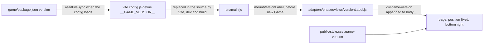

# Game Version Label Design

**Spec**: `.specs/features/game-version/spec.md`
**Status**: Done and accepted by the product owner on 2026-11-18 (`tasks.md` § Acceptance); the owner approved Q1 to Q6 on 2026-11-18 (`469342c`)

---

## Architecture Overview

The version travels from `game/package.json` to one DOM element at build time. Nothing runs at request time and no scene knows about it.

- `vite.config.js` reads `package.json` once per config load (dev server start, `vite build`) and defines `__GAME_VERSION__` as a JSON string. The Worker build (`npm run deploy` → `vite build --mode pages`) and the CI job (`.github/workflows/deploy.yml` job `game`) build from the commit tree, so a Worker shows the version of its commit.
- `main.js` (composition root, AD-003) calls `mountVersionLabel(__GAME_VERSION__)` before `new Game(config)`, so the label is in the page before the first Phaser frame (loading bar included).
- `versionLabel.js` is plain DOM like the other files of `adapters/phaser/views/` (built with `el` of `views/dom.js`, testable in jsdom). It lives in the `phaser` adapter layer because `src/architecture.test.js` only knows the layers `domain`, `application`, `phaser`, `http`, `storage`; a new `adapters/dom/` folder would need a new layer in that test for one file.

### Where it renders: DOM fixed to the viewport, not inside the canvas

| Option | On a 390 px phone | Scene changes | Covers HUD at 1280x720 | Chosen |
| ------ | ----------------- | ------------- | ---------------------- | ------ |
| Phaser text in each scene | Scaled with the canvas (0.38): 12 px becomes about 4.6 px (TD-010) | Every scene (Preloader, Splash, MainMenu, ClickerGame) must draw it | Bottom right of the scene is the battle bar and the `Farm boss` button (`ClickerGame.js` `FARM_TOGGLE = { x: 951, y: 686 }`) | no |
| `scene.add.dom` in each scene | Same scaling (the Phaser DOM container is scaled with the canvas) | Same | Same | no |
| One `position: fixed` element in `document.body` | 12 CSS px whatever the canvas scale | Survives every scene: no scene code | Lies in the letterbox, outside the canvas | **yes** |

### Measured geometry (FIT scale of the 1024x768 scene, `main.js` `scale.mode: Phaser.Scale.FIT`, `autoCenter: CENTER_BOTH`)

| Viewport | Canvas on screen | Label box (12 px tall, about 36 px wide for `v0.4.1`) | What is under it |
| -------- | ---------------- | ---------------------------------------------------- | ---------------- |
| 1280x720 (desktop shots, Playwright `Desktop Chrome`) | 960x720 at x 160 to 1120, scale 0.9375 | right edge x 1272, bottom edge y 716 | the right letterbox (`body` background `--wood-900`), 152 px clear of the canvas |
| 390x844 (phone shots) | 390x292.5 at y 275.75 to 568.25, scale 0.381 | right edge x 382, bottom edge y 840 | the bottom letterbox, about 260 px below the canvas |
| 1024x768 (4:3, no letterbox) | 1024x768 at 0,0, scale 1 | x about 980 to 1016, y 752 to 764 | the canvas strip under the battle bar: `.battle-bar` is 124 px tall centred at scene y 686 (bottom 748, bronze ring to 750), right edge at scene x 1004; on the start screen and the splash, background art only |

The bottom inset is 4 px (not more) so that on a 4:3 viewport the label stays 2 px below the battle bar's ring.

---

## Code Reuse Analysis

### Existing Components to Leverage

| Component | Location | How to Use |
| --------- | -------- | ---------- |
| `el(tag, className, text, attributes)` | `game/src/adapters/phaser/views/dom.js:5` | Builds the label; `testid` becomes `data-testid` |
| Grove tokens | `game/public/style.css :root` (`--font-body`, `--parchment-300`, `--wood-900`) | The label's font and colours (AD-022) |
| `loadEnv` config function | `game/vite.config.js:4` | `define` goes in the object it already returns |
| e2e helpers | `game/e2e/support/game.js` (`openMainMenu`, `skipSplash`, `activeSceneKeys`, `fillCredentials`), `game/e2e/support/fakeBackend.js` (`mockBackend`), `game/e2e/support/coverage.js` (`test`, `expect`) | Reach each screen in the e2e |
| Splash state read | `game/e2e/splash.spec.js:11-22` (`waitForSplash`, `splashState` with `endedAt`) | The click-through scenario |
| Battle start | `game/e2e/combatHud.spec.js:19-33` (`startGame`) | Reach `ClickerGame` |
| Shots helper | `game/ui-review/support/shots.js` (`shot`) | The `ui-artist` review |

### Integration Points

| System | Integration Method |
| ------ | ------------------ |
| Release (`gitops`) | Sets `"version"` in `game/package.json` in the release commit; that commit changes `game/package.json`, a game path, so CI (`deploy.yml` paths) and the watcher (`deploy/lib/changes.mjs:6`) republish the Worker with the new label |
| Vitest | `vitest.config.js` is separate from `vite.config.js`, so `__GAME_VERSION__` is not defined in unit tests; only `main.js` reads it and no unit test imports `main.js` |

---

## Components

### `game/vite.config.js` (changed)

- **Purpose**: Hand the package version to the game at build time (GV-07).
- **Change**: at module top `const { version } = JSON.parse(readFileSync(new URL('./package.json', import.meta.url), 'utf8'));` (import `readFileSync` from `node:fs`; Vite replaces `import.meta.url` in config files with the file's URL), and in the returned object `define: { __GAME_VERSION__: JSON.stringify(version ?? '') }` (a missing `version` becomes the empty string, which adds no label).
- **Reuses**: the existing config function.

### `game/src/adapters/phaser/views/versionLabel.js` (new)

- **Purpose**: Text rule and the one DOM element (GV-01, GV-06, GV-08).
- **Interfaces**:
  - `VERSION_TESTID = 'game-version'`
  - `versionText(version): string | null`: `null` when `version` is not a string or `version.trim()` is empty, else `` `v${version.trim()}` ``.
  - `mountVersionLabel(version): HTMLElement | null`: `null` and no change when `versionText(version)` is `null`; else rewrites the text of an existing `[data-testid="game-version"]` element and returns it, or appends `el('div', 'game-version', text, { testid: VERSION_TESTID })` to `document.body` and returns it.
- **Dependencies**: `./dom` (`el`).

### `game/src/main.js` (changed)

- **Purpose**: Mount the label before the game (GV-01 to GV-05).
- **Change**: import `mountVersionLabel` from `./adapters/phaser/views/versionLabel`; call `mountVersionLabel(__GAME_VERSION__);` on the line before `const game = new Game(config);`.

### `game/public/style.css` (changed)

- **Purpose**: Position and look (GV-09 to GV-13). One new rule at the end of the file, § Visual Spec.

---

## Visual Spec (for `game-dev` and `ui-artist`)

No asset file. The rule, appended at the end of `game/public/style.css` under the comment `/* ══ Game version in the bottom-right corner of the page (spec game-version) ══ */`:

| Property | Value | Why |
| -------- | ----- | --- |
| `position` | `fixed` | Bound to the viewport, outside the scaled canvas |
| `right` | `8px` | Corner inset |
| `bottom` | `4px` | Corner inset; 2 px clear of the battle bar's ring on a 4:3 viewport |
| `z-index` | `10` | Above the canvas and the Phaser DOM container, below `.piece-drag-ghost` (1000) |
| `margin` | `0` | |
| `font-family` | `var(--font-body)` | Figtree (AD-022 body text) |
| `font-weight` | `600` | Thin strokes of 400 vanish at 12 px with opacity |
| `font-size` | `12px` | Small; at least the 11 px floor proposed in TD-010 |
| `line-height` | `12px` | Box exactly 12 px tall |
| `letter-spacing` | `0.04em` (computed `0.48px`) | Digits and dots stay apart at 12 px |
| `color` | `var(--parchment-300)` (`#e6d0a2`, computed `rgb(230, 208, 162)`) | Grove parchment, the colour of light text on wood |
| `opacity` | `0.6` | Discreet: blended over `--wood-900` it is `rgb(149, 132, 102)`, contrast 5.1:1 |
| `text-shadow` | `0 1px 2px var(--wood-900)` (computed `rgb(28, 18, 12) 0px 1px 2px`) | Legible over the forest art on a 4:3 viewport |
| `white-space` | `nowrap` | `v0.10.12` stays one line |
| `pointer-events` | `none` | A click passes to the canvas (GV-13) |
| `user-select` | `none` | A drag across the corner does not select it |

States: one state only; no hover, no focus, no animation, no transition. The label is not focusable.

### Test ids

| Test id | Element |
| ------- | ------- |
| `game-version` | `div.game-version`, the label |

---

## Data Models

None. The only datum is the string `__GAME_VERSION__` (for example `"0.4.1"`).

---

## Error Handling Strategy

| Error Scenario | Handling | User Impact |
| -------------- | -------- | ----------- |
| `package.json` has no `version` | `vite.config.js` defines `__GAME_VERSION__` as `""` (`version ?? ''`); `versionText` returns `null` and no label is added (GV-08) | No label; the game runs |
| `package.json` unreadable or not JSON | `vite.config.js` throws when it loads: the dev server and the build fail at once | The build stops before a Worker is published; nothing reaches players |
| Figtree not loaded yet (Google Fonts) | The `--font-body` fallback `system-ui, sans-serif` draws the label | Same text, system font |

---

## Risks & Concerns

| Risk | Mitigation |
| ---- | ---------- |
| Production shows `v0.0.0` between the first game commit of this feature and the release commit (D12) | Accepted (spec Q6); the release commit sets `0.4.1` and republishes the Worker |
| A viewport slightly wider or taller than 4:3 leaves a letterbox thinner than 12 px, so the label overlaps the canvas edge | It takes no pointer and sits under the battle bar; the `ui-artist` checks the 1024x768 shot |
| An existing e2e test clicks the bottom-right corner of the viewport | `pointer-events: none`: the click reaches what is under the label; T3 runs `splash.spec.js` and `auth.spec.js` as regression |

---

## Tech Decisions

| Decision | Choice | Rationale |
| -------- | ------ | --------- |
| Build constant | Vite `define` `__GAME_VERSION__` read from `package.json` by `readFileSync` | Explicit in the config and testable by calling the config function; an `import ... from '../package.json'` in `main.js` would also work but hides the source in the bundle graph and cannot be checked by a config test |
| Label module layer | `adapters/phaser/views/` | The plain-DOM views already live there; no change to `architecture.test.js` |
| Version bump | `gitops` in the release commit (AD-026, D11) | One owner of the version |
