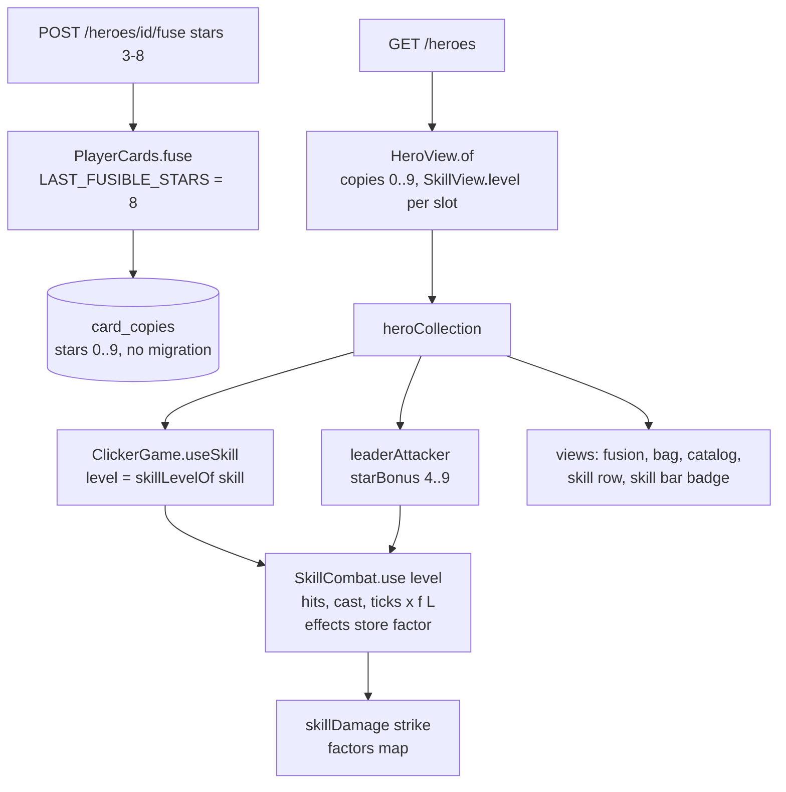

# Hero Ascension Design

**Spec**: `.specs/features/hero-ascension/spec.md`
**Status**: Approved scope (owner decisions of 2026-10-31: cap 9, one skill per star, cards only, drop rates unchanged, purple then gold); D4, D5, D6, D8, D10 to D12 are product owner defaults

---

## Architecture Overview

No new component, endpoint, table or currency. The feature widens three existing ranges and threads one new number (the skill level) from the backend to the damage formula:

1. **Backend**: the stored stars range becomes 0 to 9, the fusion range 0 to 8, and every skill of the heroes payload carries `level = stars < slot ? 0 : 1 + (stars - slot) / 3` (integer division).
2. **Game domain**: the star bonus table gains rows 4 to 9; a new pure module `skillLevel.js` holds the level rules; `SkillCombat.use` takes the level and scales the skill's numbers with `f(L) = 1 + 0.25 x (L - 1)`; `skillDamage.js` reads the strength of each running effect from a `factors` map.
3. **Game views**: Fusão, Mochila, the hero detail, the skill rows and the skill bar show the new stars (purple 4 to 6, gold 7 to 9), the level of each skill and the star power.



---

## Deploy Order (AD-016, rollback safety)

The previous backend throws when it loads a copy above 3 stars (`PlayerCards.kt:24`). A rollback (`./deploy.sh --rollback`, 5 minutes) to a backend that cannot read 4-star copies would break every request of a player who fused one. So the backend ships in two steps (User decision: keep the two-step deploy):

| Step | Task | Backend behaviour | If rolled back from the next step |
| --- | --- | --- | --- |
| A, tolerant read | T1, T2 | Reads and reports copies of 0 to 9 stars and skill `level`; fusion still accepts only 0 to 2 | n/a |
| B, open fusion | T3 | Fusion accepts 0 to 8 | Rolls back to step A, which reads the 4 to 9 star copies already written |

T3 is pushed only after `.deploy-state` shows a commit at or after T2 as `active.commit` (T3 step 1). The watcher deploys only the newest unhandled commit, so pushing T3 right after T2 could skip step A and leave the pre-feature backend as the rollback target. If `publish.sh` does not run, T3 goes ahead and the hand-off says "do not roll back past T2".

The game ships after the backend (Phases 3 to 5). A game deployed before T3 would offer `3★ → 4★` rows that the backend refuses with 400, so the game phases start after T3.

---

## Code Reuse Analysis

### Existing Components to Leverage

| Component | Location | How to Use |
| --- | --- | --- |
| `PlayerCards.fuse`, `MAX_STARS` | `backend/.../domain/PlayerCards.kt:41-72` | Split the cap: `MAX_STARS = 9` bounds the stored copies, new `LAST_FUSIBLE_STARS` bounds the fusion (2 in T1, 8 in T3) |
| `HeroView.of`, `SkillView` | `backend/.../domain/HeroView.kt` | Copies 0 to `MAX_STARS`; `SkillView` gains `level` from a pure `levelOf(stars, slot)` |
| `SkillResponse` | `backend/.../adapter/web/HeroController.kt:17-38` | Gains `level: Int` |
| Fusion row lock | `PlayerCardsRepository.findForUpdate` | Unchanged; covers the race of ASC-02 |
| `STAR_BONUS`, `starBonus` | `game/src/domain/heroes/starBonus.js` | Rows 4 to 9; new `starPowerText` for the hero detail |
| `SkillCombat` | `game/src/domain/skills/skillCombat.js` | `use` takes `level`; effects store `factor`; `factors()` feeds the damage functions |
| `strike`, `clickDamage`, `hitDamage`, `tickDamage` | `game/src/domain/skills/skillDamage.js` | Optional `factors` argument, default `{}` (every factor 1), so every existing test keeps passing |
| `renderSkillRow` | `game/src/adapters/phaser/views/catalogView.js:4-22` | Appends `.skill-level`; the tooltip and the bag detail reuse it, so they get it for free |
| `heroes.onChange` -> `updateSkillBar` | `game/src/adapters/phaser/HeroUi.js:122, 539-544` | Already redraws the bar after a fusion; the badge comes with it (ASC-07 AC 8) |
| `el(tag, className, text, attributes)` | `game/src/adapters/phaser/views/dom.js:5-25` | Sets `data-level` through `attributes` |
| Fake backend | `game/e2e/support/fakeBackend.js:125-136, 566-578` | Copies 0 to 9, `level`, fusion 0 to 8 |

### Integration Points

| System | Integration Method |
| --- | --- |
| `GET /heroes`, `POST /heroes/{id}/fuse` | New `copies` keys `"4"` to `"9"` and new `skills[].level`; old clients ignore them (additive JSON) |
| Database | None: `card_copies.stars` is unconstrained `integer` |
| `hero-team` (not built) | Its spec's star multiplier gains 10, 12, 14, 16, 18, 20 for 4 to 9 stars (D6); it reads `hero.stars` from the same payload |
| Account reset | Leaves `player_cards` and `card_copies` alone (AD-015); ASC-02 AC 12 pins it |

---

## Components

### Backend `PlayerCards` (T1, T3)

- **Purpose**: hold copies of 0 to 9 stars; fuse 3 copies of 0 to `LAST_FUSIBLE_STARS`.
- **Location**: `backend/src/main/kotlin/br/com/woodriver/infinity_grove_ws/domain/PlayerCards.kt`
- **Interfaces**:
  - `const val MAX_STARS = 9` (was 3)
  - `const val LAST_FUSIBLE_STARS = 2` in T1, `8` in T3
  - `fun fuse(heroId: String, stars: Int): PlayerCards` - throws `InvalidFusionException("stars $stars cannot be fused")` when `stars !in 0..LAST_FUSIBLE_STARS`
- **Reuses**: the existing `withCopies`, log line and exceptions.

### Backend `HeroView` / `SkillView` (T2)

- **Purpose**: report copies 0 to 9 and the level of each skill.
- **Location**: `backend/src/main/kotlin/br/com/woodriver/infinity_grove_ws/domain/HeroView.kt`
- **Interfaces**:
  - `data class SkillView(val skill: Skill, val unlocked: Boolean, val level: Int)`
  - `companion object` of `SkillView`: `fun levelOf(stars: Int, slot: Int): Int = if (stars < slot) 0 else 1 + (stars - slot) / 3`
- **Reuses**: `HeroView.of`.

### Game `heroes.js` (T4)

- `MAX_STARS = 9`, `ALL_STARS` 0 to 9, `FUSIBLE_STARS` 0 to 8.
- `ASCENDED_FROM = 4`, `EXALTED_FROM = 7`, `isAscended(stars)` (stars >= 4), `starsClass(stars)`: `''` for 0 to 3, `'is-ascended'` for 4 to 6, `'is-exalted'` for 7 to 9.

### Game `skillLevel.js` (T5, new)

- **Purpose**: the level rules the views and the scene share.
- **Location**: `game/src/domain/skills/skillLevel.js`
- **Interfaces**:
  - `SKILL_LEVEL_STEP_PERCENT = 25`, `MAX_SKILL_LEVEL = 3`
  - `levelFactor(level: number): number` - `1 + 25 x (max(1, level) - 1) / 100`
  - `skillLevelOf(skill): number` - 0 when `!skill?.unlocked`; `skill.level` when it is an integer of 1 or more; 1 otherwise
  - `raisedSkillSlot(stars): number` - the slot a star from 4 to 9 raised: `((stars - 4) % 3) + 1`; 0 below 4
  - `skillLevelText(level): string` - `''` for 0, `Nível 1` for 1, `Nível <L> · +<25 x (L-1)>% de poder` above

### Game `skillDamage.js` (T6)

- **Purpose**: let each running effect carry its strength.
- **Interfaces**: every exported function takes an optional `factors = {}` keyed by effect id (`ventos`, `bencao`, `fumaca`, `brado`, `prisao`); a missing id is factor 1.
  - click bonus % = `50 x f(ventos) + 25 x f(bencao)` (each only while running)
  - physical multiplier under Bênção = `1 + 30 x f(bencao) / 100`
  - magical multiplier under Prisão = `1 + 25 x f(prisao) / 100`
  - critical points under Fumaça = `15 x f(fumaca)`
  - physical defense removed under Brado = `30 x f(brado)`

### Game `SkillCombat` (T7)

- **Interfaces**:
  - `use({ heroId, slot, unlocked, level = 1, attacker, monster, boss })`
  - `factors(): { [effectId]: number }` - factor of each running buff and debuff
  - Effects in `buffs` and `debuffs` carry `factor`; `start(list, id, label, ms, owner, factor = 1)` sets it on a new effect and on a restart.
  - A damage over time stores `percent = skill.ticks.percent x factor` at its cast (and on a restart).
  - The cast stores `factor`; `landCast` uses `skill.cast.hit.percent x factor`.
  - Hits use `percent x factor`; `countdown.extendMs = skill.countdownExtendMs x factor` on a boss.
  - `click`, `use`, `landCast` and `tickHit` pass `factors: this.factors()` to the damage functions.
- **Unchanged**: `cooldownMs`, every `ms`, `stunMs`, `rootMs`, `count`, `maxStacks`, `armorPierce`, `vsDarkness`.

### Game views (T10 to T14)

| View | Change |
| --- | --- |
| `catalogView.renderSkillRow` | Appends `<span class="skill-level" data-level="<L>">` with `skillLevelText(L)` after `.skill-state`, only when `L = skillLevelOf(skill)` is 1 or more |
| `catalogView.renderCatalog`, `renderHeroDetail` | `.hero-stars` gets `starsClass(stars)` when owned; the detail appends `<div class="hero-star-power" data-testid="hero-star-power">` with `starPowerText(stars)` when owned and the text is not empty |
| `bagView.renderBagEntry` | `.hero-stars` gets `starsClass(stars)`; `MAX_STARS` 9 drives `Estrela máxima` |
| `fusionView.renderFusionResult` | Takes `skillName` and `level`; adds ` · <skillName> no nível <L>` when the new stars are 4 or more |
| `HeroUi.fuse` | Finds the answered hero's skill of slot `raisedSkillSlot(stars + 1)` and passes its `name` and `skillLevelOf(skill)` |
| `skillBar.renderSkillBar` | Appends `<span class="skill-level-badge" data-testid="skill-level-<slot>" data-level="<L>">Nv. <L></span>` to an unlocked slot of level 2 or more |

### Visual spec (T14, reviewed by `ui-artist` in T17)

No new asset under `game/public/assets/`. All in `game/public/style.css`. Colours: purple `#7a3fa0` (tier 4 to 6, the EPIC family), gold `#d9a521` with text `#201e1d` and glow `rgb(255 214 90 / 0.6)` (tier 7 to 9, the LEGENDARY frame of `style.css:1919-1924`).

| Selector | Rules | Contrast |
| --- | --- | --- |
| `.hero-stars.is-ascended` | `color: #7a3fa0; font-weight: 800;` | 5.8:1 on `#f5ead8`, 5.2:1 on `#ebddc5` |
| `.hero-stars.is-exalted` | `display: inline-block; width: fit-content; padding: 0 8px; border-radius: 999px; color: #201e1d; background: #d9a521; font-weight: 800; box-shadow: 0 0 6px rgb(255 214 90 / 0.6);` | 7.4:1 |
| `.skill-level` | `display: inline-block; margin-left: 6px; padding: 2px 8px; border-radius: 999px; font-size: 12px; font-weight: 700; color: #7a3fa0; background: #efe4f5;` | 5.6:1 |
| `.skill-level[data-level="3"]` | `color: #201e1d; background: #d9a521;` | 7.4:1 |
| `.skill-level-badge` | `position: absolute; top: 4px; right: 4px; height: 20px; padding: 0 6px; display: grid; place-items: center; font-family: var(--font-heading); font-size: 12px; color: var(--color-bg); background: #7a3fa0; border-radius: 6px; opacity: 0.9; pointer-events: none;` (mirror of `.skill-key` on the left corner, `style.css:1607`) | 5.8:1 |
| `.skill-level-badge[data-level="3"]` | `color: #201e1d; background: #d9a521; opacity: 1;` | 7.4:1 |
| `.hero-star-power` | `font-size: 13px; font-weight: 700; color: var(--color-neutral-800);` | as body text |

States the reviewer checks: a 3-star, a 4-star and a 7-star catalog card side by side (brown text, purple text, gold chip); skill rows at level 1, level 2, level 3 and locked; the skill bar of a 3-star leader (no badge), a 5-star leader (`Nv. 2` on slots 1 and 2, none on 3) and a 9-star leader (three gold `Nv. 3`), with the `Q`, `W`, `E` keys still readable on the left; a hero detail with the star power line wrapping inside the 1fr column; the gold chip inside the bag detail line `Estrelas: 9★`.

---

## Data Models

### `GET /heroes` hero (additions in bold)

```json
{
  "id": "kael", "stars": 5,
  "copies": { "0": 0, "1": 0, "2": 0, "3": 1, "4": 1, "5": 1, "6": 0, "7": 0, "8": 0, "9": 0 },
  "skills": [
    { "slot": 1, "name": "Corte Dimensional", "type": "...", "effect": "...", "cooldownSeconds": 20, "image": "kael_dimensional_cut", "unlocked": true, "level": 2 },
    { "slot": 2, "name": "Investida do Baluarte", "...": "...", "unlocked": true, "level": 2 },
    { "slot": 3, "name": "Brado Aterrador", "...": "...", "unlocked": true, "level": 1 }
  ]
}
```

`copies` keys `"4"` to `"9"` and `skills[].level` (integer 0 to 3) are new. `POST /heroes/{id}/fuse` answers the same hero shape.

---

## Error Handling Strategy

| Error Scenario | Handling | User Impact |
| --- | --- | --- |
| `stars` 9 or more | 400 `INVALID_FUSION` (existing handler) | The game never sends it (no row for 9 stars) |
| Fewer than 3 copies (another tab fused them) | 409 `NOT_ENOUGH_CARDS` | `Não foi possível fundir as cartas.` (existing) |
| Payload of the previous backend (no `level`) | `skillLevelOf` answers 1 for an unlocked skill | Plays as today |
| Fusion answer without the raised skill (malformed) | `renderFusionResult` drops the ` · ... no nível` part | `Nova carta: <nome> <n>★` |
| Rollback past step A | Avoided by the deploy order | none |

---

## Risks & Concerns

| Concern | Location (file:line) | Impact | Mitigation |
| --- | --- | --- | --- |
| The previous backend throws on a stored copy above 3 stars | `backend/.../domain/PlayerCards.kt:24` | A rollback to the pre-feature backend fails every card request of a player with a 4-star copy | Deploy Order: T1/T2 (tolerant read) live before T3 (open fusion) |
| A game still on the previous version gives a 4-star leader no star bonus (`STAR_BONUS[4]` is missing, so `starBonus` answers `NO_BONUS`) | `game/src/domain/heroes/starBonus.js:13` | Only for a player who fused through a new client and plays on an old one during the Worker deploy window | Game phases ship right after the backend; accepted |
| Tests pin the 3-star cap and the four copy keys | `PlayerCardsTest.kt:103-112`, `HeroServiceTest.kt:59-72,96-103,127-134`, `HeroControllerIT.kt:75,121-128`, `bagView.test.js:76-80`, `heroes.test.js` | They fail once the cap moves | Each task names the test to update and its new name (L-054); none is deleted |
| Effect strength was a set of constants read by id | `game/src/domain/skills/skillDamage.js:68-91` | A buff could not carry its level | Optional `factors` map with default 1; every existing call stays valid |
| A recast of a running effect at another level cannot happen with today's cooldowns (Facts) | `skillCatalog.js` | An AC for it would have no reachable test (L-020) | Not an AC; `start` still sets the new factor on a restart, pinned by a unit test that drives `start` directly |
| T9 edits files the owner has uncommitted changes in | `game/src/adapters/phaser/ClickerGame.js`, `ClickerGame.test.js` (git status of 2026-10-31) | Committing T9 would sweep the owner's edits into a feature commit | T9 step 0 checks `git status --porcelain` and stops until the owner commits them |
| Exponential card cost (19 683 blank cards for 9 stars, 729 for 6) | `application.yaml` drop rates | 9 stars is a months-long goal by design | User decision D9: the owner wants a long grind; no balance change in this feature |

---

## Tech Decisions

| Decision | Choice | Rationale |
| --- | --- | --- |
| Where stars above 3 live | The same `card_copies` rows (stars 4 to 9) | One rule for every star; no migration; no version clash with `campaign-chapters` V8 to V10 |
| Who computes the skill level | The backend (`level` in the payload); the game falls back to 1 | Same ownership as `unlocked` (AD-005 direction) and the game still plays against the previous backend |
| Level formula | `stars < slot ? 0 : 1 + (stars - slot) / 3` | One integer expression gives both the unlock (stars 1 to 3) and the one-skill-per-star rise (4 to 9) |
| How a level reaches the damage | A factor stored on each effect plus a `factors` map into `strike` | Additive change; the 63 `skillCombat` tests and the `skillDamage` tests stay valid |
| Durations and cooldowns | Unchanged at every level | D4; keeps every timer test and the cooldown text from the backend correct |
| Star tier colours | Classes `is-ascended` (4 to 6) and `is-exalted` (7 to 9), mutually exclusive; level 3 pills and badges styled by `data-level="3"` | One helper (`starsClass`) for every view; CSS-only tier, no new asset |

> **Project-level decision**: AD-020 in `.specs/STATE.md`.
