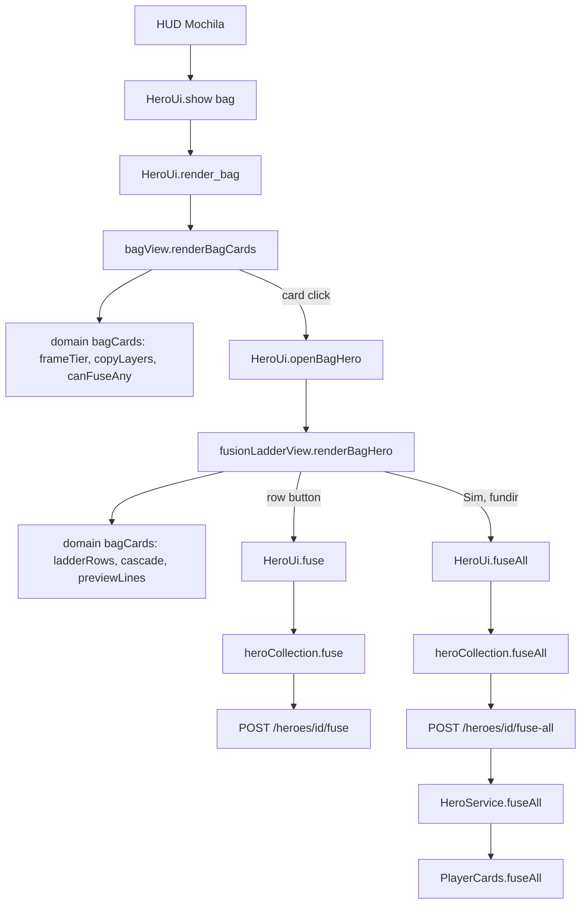

# Hero Bag Cards Design

**Spec**: `.specs/features/hero-bag-cards/spec.md`
**Status**: Draft (waits for the owner's answers to Q1 to Q8)

---

## Architecture Overview

The Mochila screen of `HeroUi` draws a grid of hero cards (`bagView.js`). A click opens the hero detail (`fusionLadderView.js`): the card, the ladder, `Fundir tudo` with its confirmation, the result line and the skill list. The `fusion` screen and its HUD button are deleted. Every number the views show comes from pure functions in a new domain module `domain/heroes/bagCards.js` (AD-003). A row button calls the existing `heroes.fuse(heroId, stars)`; `Fundir tudo` calls a new `heroes.fuseAll(heroId)`, which posts to a new backend endpoint `POST /heroes/{id}/fuse-all` that runs the whole cascade in one transaction under the `player_cards` row lock (AD-005, AD-009 lock style).



### Fundir tudo: bulk endpoint, not a loop

No bulk endpoint exists today (`backend/.../adapter/web/HeroController.kt:96` maps only `POST /heroes/{id}/fuse`). Two ways were weighed:

| Option | Requests for 45/1/2 copies | Requests for 19 683 blank copies | Failure halfway |
| ------ | -------------------------- | -------------------------------- | --------------- |
| A. Game loops over `POST /heroes/{id}/fuse` | 22 | 9 841 | The bag stops at an intermediate state the preview never showed; the game must reload and explain a partial result |
| **B. New `POST /heroes/{id}/fuse-all` (chosen)** | 1 | 1 | Impossible: one transaction, all or nothing |

B is chosen (spec D12). The cascade is computed layer by layer in O(10) arithmetic, never by calling `fuse` 9 841 times. No migration: the endpoint writes `card_copies` rows exactly as the single fusion does (save of `PlayerCards`), so AD-016 is not triggered. The backend tasks land before the game task that calls the endpoint (spec D20); a rollback below this feature turns `Fundir tudo` into the failure path (404 → error line), never a partial fusion.

---

## Code Reuse Analysis

### Existing Components to Leverage

| Component | Location | How to Use |
| --------- | -------- | ---------- |
| `PlayerCards.fuse`, `withCopies`, `FUSION_SIZE`, `MAX_STARS`, `LAST_FUSIBLE_STARS` | `backend/src/main/kotlin/<pkg>/domain/PlayerCards.kt:40-75` | `fuseAll` lives beside `fuse` and uses the same private `withCopies` |
| `HeroConflictException` → 409 | `domain/HeroExceptions.kt:22-30`, `adapter/web/ApiExceptionHandler.kt:71-72` | `NothingToFuseException` extends it; no handler change |
| `HeroService.requireHero`, `load` (row lock `findForUpdate`) | `service/HeroService.kt:58-78` | `fuseAll` reuses both, like `fuse` |
| `HeroView.of`, `HeroResponse.from` | `domain/HeroView.kt:31-46`, `adapter/web/HeroController.kt:43-72` | The `hero` field of the answer |
| `HeroControllerIT` helpers `register`, `give`, `asUser` | `backend/src/test/.../adapter/web/HeroControllerIT.kt:20-55` | The new IT cases |
| `createHeroesApi`, `createHeroCollection.fuse` | `game/src/adapters/http/heroesApi.js:6-12`, `game/src/application/heroes/heroCollection.js:55-64` | `fuseAll` copies their shape |
| `FUSION_SIZE`, `MAX_STARS`, `ASCENDED_FROM`, `EXALTED_FROM`, `copiesOf`, `starsClass` | `game/src/domain/heroes/heroes.js:4-49` | The frame tiers and every count of `bagCards.js` |
| `skillLevelOf`, `raisedSkillSlot` | `game/src/domain/skills/skillLevel.js:13-24` | The raised skills of a cascade; the single-fusion result |
| `el`, `sprite`, `starsText` | `game/src/adapters/phaser/views/dom.js:5-32` | Every node of the new views |
| `renderSkillList` | `game/src/adapters/phaser/views/catalogView.js:39-46` | The skills under the ladder |
| `renderFusionResult` | `game/src/adapters/phaser/views/fusionView.js:37-38` | Kept for the row fusion result |
| `HeroUi.showDetail`, the `view` counter guard | `game/src/adapters/phaser/HeroUi.js:266-271`, `:307-334` | Detail with `Voltar`; late answers draw nothing |
| `.fusion-button` (ember pill), `.fusion-row`, `.fusion-copies`, `.fusion-result`, `.hero-card` art backdrop | `game/public/style.css:136-200`, `:1593-1673`, `:1406-1416` | The ladder rows and the card art keep the Grove recipes (AD-022) |
| Fake backend `fuse` branch | `game/e2e/support/fakeBackend.js:594-605` | The `fuse-all` branch beside it |

### Integration Points

| System | Integration Method |
| ------ | ------------------ |
| Backend API | New route `POST /heroes/{id}/fuse-all`, authenticated by the existing security chain (only the listed `permitAll` routes are open, `SecurityConfig.kt:48-53`) |
| Database | None new: `PlayerCardsRepositoryPort.save` writes `card_copies` as for `fuse` |
| HUD | `SCREENS` loses the `fusion` entry; the rail keeps its CSS |
| Skill bar | `heroes.onChange` already redraws it after any change; `fuseAll` fires `changed()` like `fuse` |

---

## Components

### Backend: `PlayerCards.fuseAll` (domain)

- **Purpose**: The cascade rule on one player's cards.
- **Location**: `backend/src/main/kotlin/br/com/woodriver/infinity_grove_ws/domain/PlayerCards.kt`
- **Interfaces**:
  - `fun fuseAll(heroId: String): FuseAllOutcome` - returns the new cards and the number of fusions; throws `NothingToFuseException` when no layer 0 to 8 holds 3 copies.
  - `data class FuseAllOutcome(val cards: PlayerCards, val fusions: Int)` (same file, top level).
- **Rule**: `carry = 0`; for s in 0..8: `count = copiesOf(heroId, s) + carry`, `made = count / 3`, `fusions += made`, layer s keeps `count - 3 * made`, `carry = made`; layer 9 gets `copiesOf(heroId, 9) + carry`.
- **Reuses**: `withCopies`, `copiesOf`, constants, logger.

### Backend: `NothingToFuseException`

- **Location**: `domain/HeroExceptions.kt`
- `class NothingToFuseException(heroId: String) : HeroConflictException("NOTHING_TO_FUSE", "Hero '$heroId' has no 3 cards of the same stars below 9")`

### Backend: `FuseAllCardsUseCase`, `FuseAllView`, `HeroService.fuseAll`

- **Location**: `usecase/HeroUseCase.kt`, `domain/HeroView.kt`, `service/HeroService.kt`
- **Interfaces**: `fun fuseAll(username: String, heroId: String): FuseAllView`; `data class FuseAllView(val hero: HeroView, val fusions: Int)`.
- **Flow**: `requireHero` (404), `load` (row lock), `fuseAll` (409), `save`, return.

### Backend: `HeroController.fuseAll`

- **Location**: `adapter/web/HeroController.kt`
- **Endpoint**: `POST /heroes/{id}/fuse-all`, no request body read (the game sends `{}`), answer `FuseAllResponse(hero: HeroResponse, fusions: Int)`.

### Game: `heroesApi.fuseAll`, `heroCollection.fuseAll`

- **Location**: `game/src/adapters/http/heroesApi.js`, `game/src/application/heroes/heroCollection.js`
- **Interfaces**: `fuseAll(heroId) -> Promise<{ hero, fusions }>` (api: the response body; collection: replaces the hero, fires `changed()`, resolves with `{ hero, fusions }`).

### Game: `domain/heroes/bagCards.js` (new, pure)

| Function | Returns |
| -------- | ------- |
| `frameTier(stars)` | `'wood'` for 0 to 3, `'silver'` for 4 to 6, `'gold'` for 7 to 9 |
| `copyLayers(hero)` | `[ { stars, copies } ]` for every layer 0 to 9 with copies ≥ 1, ascending |
| `canFuseAny(hero)` | `true` when a layer 0 to 8 holds ≥ 3 copies |
| `chipText({ stars, copies })` | `'0★×45'` |
| `ladderRows(hero)` | `[ { stars, copies, filled, canFuse, isMax } ]`: `copyLayers` plus `{ stars: t + 1, copies: 0 }` when t ≤ 8 and copies(t) ≥ 3; `filled = min(copies, 3)`; `canFuse = stars <= 8 && copies >= 3`; `isMax = stars === 9` |
| `barWidth(filled)` | `'0%'`, `'33.333%'`, `'66.667%'`, `'100%'` |
| `cascade(hero)` | `{ fusions, after: { 0: n, ..., 9: n } }` (same rule as the backend) |
| `layersText(layers)` | `'45×0★ + 1×1★ + 2×2★'` (layers with copies ≥ 1 only) |
| `previewLines(hero)` (replaced `previewText` in T19, D21) | `{ before: 'Antes: 45×0★ + 1×1★ + 2×2★', after: 'Depois: 1×1★ + 1×2★ + 2×3★' }` |
| `fuseAllQuestion(fusions)` | `'Fazer 22 fusões?'`, `'Fazer 1 fusão?'` |
| `raisedSkills(beforeSkills, afterSkills)` | `[ { name, level } ]` in slot order: after level ≥ 2 and > before level (levels through `skillLevelOf`) |
| `fuseAllResultText({ heroName, fusions, stars, raised })` | `'22 fusões. Melhor carta: Kael Raizférrea 3★'` plus `' · <name> no nível <level>'` per raised skill |

### Game: `bagView.js` (rewritten)

- `renderHeroCard(hero, { onSelect = null, testid = `bag-card-${hero.id}` } = {})`: a `button` when `onSelect` is given, a `div` otherwise (the copy inside the detail).
- `renderBagCards(heroes, { onSelect })`: `bag-list` grid of cards, or `bag-empty` `A mochila está vazia.` when `heroes` is empty.
- `renderBag` and `renderBagEntry` are deleted when `HeroUi` switches (T11).

### Game: `fusionLadderView.js` (new)

- `renderBagHero(hero, { busy, pending, confirming, result, onFuse, onFuseAll, onConfirmAll, onDeclineAll })`: `bag-entry-detail` with the card, the ladder, the Fundir tudo bar, the confirmation when `confirming`, the `result` node when given, and the skill list. `pending` (T18, D22) is `null`, a star layer `0` to `8` or `'all'`: the button that sent the running request reads `Fundindo...`; `busy` adds the class `is-busy` to `bag-entry-detail`.
- `renderFuseAllResult({ heroName, fusions, stars, raised })`: `div.fusion-result` `fusion-result` with `fuseAllResultText`.
- `fusionView.js` keeps only `renderFusionResult` after T11 (`renderFusion` is deleted).

### Game: `HeroUi` (state)

New fields: `fusionBusy` (false), `bagHeroId` (null: grid shown), `fuseAllAsking` (false). `show()` and `close()` reset `bagHeroId` and `fuseAllAsking`. Methods `render_bag`, `openBagHero`, `fuse`, `askFuseAll`, `declineFuseAll`, `fuseAll`, `redrawBag` (contracts in tasks T11 and T12).

---

## Layout and Visual Spec (for `game-dev` and `ui-artist`)

The panel `.hero-window` is 920 px wide (`style.css:1323`), 26 px side padding, so the body is 868 px wide; `max-height: 708px`.

### Card grid (`.bag-cards`, testid `bag-list`)

- `display: grid; grid-template-columns: repeat(5, minmax(0, 1fr)); gap: 14px; padding-top: 14px` (room for the star badge above the cards).
- Each card about 162 px wide; target height ≤ 330 px with ten chips, so the grid stays under 400 px and the panel never scrolls.

### Card (`.bag-card`)

| Part | Spec |
| ---- | ---- |
| Box | `position: relative; display: flex; flex-direction: column; align-items: center; padding: 18px 8px 10px; border-radius: 10px; background: var(--parchment-300); font-family: var(--font-body); color: var(--ink-900); cursor: pointer` |
| Art `.bag-card-portrait` | `_sprite.png">` (via `sprite()`), `width: 100%; height: 140px; object-fit: contain; object-position: bottom; padding: 8px 6px 4px; border-radius: 6px; background: radial-gradient(circle at 50% 45%, #5a3d26, #1c120c)` (the `.hero-card img` backdrop) |
| Ribbon `.bag-card-ribbon` | `margin-top: -10px; width: calc(100% + 12px); padding: 4px 14px; text-align: center; font: 700 13px/1.15 var(--font-heading); color: var(--parchment-100); background: linear-gradient(180deg, var(--ember-700) 0%, #7a2e0c 100%); clip-path: polygon(0 0, 100% 0, 95% 50%, 100% 100%, 0 100%, 5% 50%)`; wraps to two lines for long names. T17 (D26): `display: flex; align-items: center; justify-content: center; min-height: calc(2.3em + 8px)` (two lines of 1.15 plus the 4 px padding twice), so a one-line name is centred in a two-line ribbon and the chips of every card start at the same height |
| Star badge `.bag-card-star` | `position: absolute; top: -12px; left: 50%; transform: translateX(-50%); min-width: 40px; height: 24px; padding: 0 8px; display: inline-flex; align-items: center; justify-content: center; border-radius: 999px; font: 700 14px var(--font-heading); background: var(--parchment-100); border: 2px solid var(--card-frame)`; also `.hero-stars` and the AD-020 tier class (`is-ascended` purple text, `is-exalted` gold chip `#d9a521`/`#201e1d`, which overrides the background) |
| Chips `.bag-card-chips` | `display: flex; flex-wrap: wrap; justify-content: center; gap: 4px; margin-top: 8px` |
| Text above the ornaments (T17, finding #1) | `.bag-card-chips, .bag-card-ribbon, .bag-card-missing { position: relative; z-index: 1 }` and `.bag-card-star, .bag-card-fuse { z-index: 2 }` (both stay `position: absolute`): no `::before` or `::after` ornament is ever drawn over text |
| Chip `.bag-card-chip` | `padding: 2px 6px; border-radius: 999px; font: 700 11px var(--font-body); color: var(--parchment-100); background: var(--wood-800)` |
| Fundir badge `.bag-card-fuse` | `position: absolute; top: 6px; right: 6px; padding: 2px 8px; border-radius: 999px; font: 800 11px var(--font-body); color: var(--parchment-100); background: var(--ember-700); box-shadow: 0 0 0 2px var(--parchment-100)`; hidden on the detail card: `.bag-detail .bag-card-fuse { display: none }` (T17, D25) |
| Not owned `.bag-card.is-grey` | `opacity: 0.55; cursor: default`; art `filter: grayscale(1)`; `.bag-card-missing` `margin-top: 8px; font: 700 12px var(--font-body); color: var(--color-neutral-700)` |
| Hover (owned, button) | `box-shadow: var(--card-shadow), 0 0 0 4px var(--gold-400); filter: brightness(1.06)` (T17, finding #2; was the half-transparent `rgb(243 213 138 / 0.5)` ring); no transition, no animation |
| Focus | `.bag-card:focus-visible { outline: 3px solid var(--color-focus); outline-offset: 3px }` |

### Card frames (CSS, no images)

Each frame sets `--card-frame` (used by the badge border) and draws its ornaments with `::before` (`content: ''; position: absolute; inset: -4px; border-radius: 12px; pointer-events: none`). No animation.

| Tier | Stars | Border and shadow | Ornament (`::before` background) |
| ---- | ----- | ----------------- | -------------------------------- |
| `frame-wood` | 0 to 3 | `--card-frame: var(--bronze-500); border: 4px solid #a06a35; --card-shadow: 0 0 0 2px var(--wood-800), inset 0 0 0 1px #d49a5c` (T17, finding #3: warm brown; was `--wood-600` with a `--wood-900` ring, read as black) | Riveted iron corners: four 12x12 px squares `linear-gradient(135deg, #8a8a8a, #3a3a3a)` at the four corners, each with a rivet `radial-gradient(circle, #cfcfcf 0 1.5px, transparent 2px)` drawn on top in the same 12x12 px box (8 layers: the 4 rivets first, then the 4 squares; `background-size: 12px 12px`; `background-position` the four corners twice) |
| `frame-silver` | 4 to 6 | `--card-frame: #c9ced6; border: 4px solid #c9ced6; box-shadow: 0 0 0 2px #7d8590, inset 0 0 0 2px #5f8f4a` | Green vine leaves: four `radial-gradient(circle, #6fa85a 0 5px, transparent 6px)` 14x14 px at the four corners, plus (T17, finding #3) two `radial-gradient(circle, #5f8f4a 0 4px, transparent 5px)` 10x10 px leaves per corner, one along the top or bottom edge and one along the side, 14 px from the corner: positions `left 14px top 0, left 0 top 14px, right 14px top 0, right 0 top 14px, left 14px bottom 0, left 0 bottom 14px, right 14px bottom 0, right 0 bottom 14px` |
| `frame-gold` | 7 to 9 | `--card-frame: #d9a521; border: 4px solid #d9a521; box-shadow: 0 0 0 2px #8a6a12, 0 0 12px rgb(255 214 90 / 0.6), inset 0 0 0 2px #f3d58a` | Runes: `repeating-linear-gradient(90deg, #8a6a12 0 6px, transparent 6px 12px)` as two 3 px strips along the top and bottom inner edges; sparkles: `::after` with three `radial-gradient(circle, #fff6c8 0 2px, transparent 3px)` dots at 18 % / 8 %, 82 % / 14 %, 50 % / 99 % (T17, finding #1: on the frame edge and the portrait; was 18 % / 12 %, 82 % / 20 %, 70 % / 88 %, which fell on the chips) |

**Are image frames needed?** No, not for this feature: the three tiers differ by colour, by ornament shape (iron squares, round leaves, rune strips with sparkles) and by glow, so they read apart at a glance and in grayscale. The owner's reference art (wood with iron corners, silver with green vines, gold with runes and sparkles) is richer than CSS can draw. If the owner wants it, a follow-up asset task adds `game/public/assets/card-frame-wood.png`, `card-frame-silver.png`, `card-frame-gold.png` (9-slice PNG with a transparent centre, 64x64 px slices, the art supplied by the owner) as `border-image` on the same classes; nothing else changes. That task is not part of `tasks.md` and needs the owner's art (Q3).

### Hero detail (`.bag-detail`, testid `bag-entry-detail`)

- `display: grid; grid-template-columns: 180px 1fr; gap: 18px; align-items: start`; `.skill-list` spans `grid-column: 1 / -1`.
- Left: `renderHeroCard(hero)` as a `div` (`cursor: default`, no hover).
- Right: the ladder `.fusion-list` (testid `fusion-list`, `display: flex; flex-direction: column; gap: 6px`), then `.fusion-all-bar` (`display: flex; justify-content: flex-end; margin-top: 10px`) with `Fundir tudo`, then the confirmation, then the result.

### Ladder row (`.fusion-row`)

- `display: grid; grid-template-columns: 48px 1fr 64px 112px; align-items: center; gap: 12px; min-height: 44px; padding: 6px 10px 6px 16px` (keeps the `.fusion-row` inset recipe of `ui-redesign`: `background: var(--parchment-300); border: var(--inset-border); border-radius: var(--radius-md)`).
- `.fusion-name`: `font: 700 16px var(--font-heading)` plus `.hero-stars` tier class (AD-020 colours).
- `.fusion-bar`: `height: 12px; border-radius: 999px; background: var(--wood-800); border: 1px solid var(--bronze-500); overflow: hidden`; `.fusion-bar-fill`: `display: block; height: 100%; background: linear-gradient(90deg, var(--ember-500), var(--gold-400))`, width from `barWidth`.
- `.fusion-copies`: the existing pill (`style.css:1632-1639`), `text-align: center`.
- `.fusion-button`: the existing ember pill; disabled state already styled (`style.css:136-200`).
- A row that can fuse carries `is-ready`: `box-shadow: inset 0 0 0 2px var(--gold-400)`.
- 9★ row `.fusion-row.is-max`: `grid-template-columns: 48px 1fr auto`; `.fusion-max` `font: 600 13px var(--font-body); color: var(--color-neutral-700)`.

### Fundir tudo

- Button `fusion-all`: class `fusion-button fusion-all`, text `Fundir tudo`.
- Confirmation `.fusion-all-confirm` (testid `fusion-all-confirm`): `margin-top: 10px; padding: 12px 16px; border-radius: var(--radius-md); background: var(--parchment-100); border: var(--inset-border); display: flex; flex-direction: column; gap: 8px`. Question `p.fusion-all-question` `font: 700 16px var(--font-heading)`; preview `div.fusion-all-preview` (T19, D21) `display: flex; flex-direction: column; gap: 2px; margin: 0; font: 600 15px var(--font-body)` holding `p.fusion-all-before` `Antes: <before>` and `p.fusion-all-after` `Depois: <after>` (`margin: 0; overflow-wrap: anywhere`; a long side wraps, never overflows); buttons row `.fusion-all-actions` (`display: flex; gap: 8px; justify-content: flex-end`): `Sim, fundir` (class `fusion-button`), `Não` (class `fusion-button is-secondary`, the wood `--btn-bg`).
- Result: the existing `.fusion-result` (`style.css:1663`), placed under the confirmation spot; inside the Mochila `.bag-detail .fusion-result { font-size: 16px; line-height: 1.4; text-wrap: balance }` (T17, finding #5: the 20 px line left a one-word orphan).
- In flight (T18, D22): the button that sent the request reads `Fundindo...`; `.bag-detail.is-busy button:disabled { cursor: progress }`; a button disabled for lack of copies keeps the global `button:disabled { cursor: not-allowed }`.

### Rarity gems (`.piece-gems`, `.piece-gem`)

- Row: `position: absolute; top: -5px; left: 50%; transform: translateX(-50%); display: flex; gap: 5px` (computed `column-gap: 5px`; T7 centred it; T20 widened the gap from 2 px, D23).
- Gem: `width: 10px; height: 10px` (was 7 px), border `1px solid var(--color-neutral-900)`, `transform: rotate(45deg)`, colour `var(--gem)`; the LEGENDARY row of 4 is 55 px wide inside the 60 px tile.

### HUD

Six buttons; the rail CSS is unchanged (`.hero-hud`, `style.css:1079`).

### Test ids

| Test id / selector | Element |
| ------------------ | ------- |
| `bag-list` | the card grid (`div.bag-cards`) |
| `bag-card-<id>` | a card (`button` in the grid, `div` in the detail with testid `bag-detail-card-<id>`) |
| `bag-card-star-<id>` | star badge |
| `bag-card-fuse-<id>` | `Fundir` badge |
| `.bag-card-ribbon`, `.bag-card-chip`, `.bag-card-missing`, `.bag-card-portrait` | parts of a card |
| `bag-entry-detail` | hero detail |
| `fusion-list` | ladder |
| `fusion-row-<id>-<s>` | ladder row; `.fusion-name`, `.fusion-bar`, `.fusion-bar-fill`, `.fusion-copies`, `.fusion-max` |
| `fusion-button-<id>-<s>` | row button |
| `fusion-all` | Fundir tudo |
| `fusion-all-confirm`, `fusion-all-question`, `fusion-all-preview`, `fusion-all-before`, `fusion-all-after`, `fusion-all-yes`, `fusion-all-no` | confirmation |
| `fusion-result` | result line |

---

## Data Models

### `POST /heroes/{id}/fuse-all` response

```json
{
  "hero": {
    "id": "kael", "name": "Kael Raizférrea", "heroClass": "Guerreiro", "element": "FIRE", "leaderBonus": "...", "portrait": "kael_position",
    "chapter": 1, "owned": true, "stars": 3,
    "copies": { "0": 0, "1": 1, "2": 1, "3": 2, "4": 0, "5": 0, "6": 0, "7": 0, "8": 0, "9": 0 },
    "skills": [ { "slot": 1, "name": "Corte Dimensional", "type": "Ataque", "effect": "...", "cooldownSeconds": 20, "image": "kael_dimensional_cut", "unlocked": true, "level": 1 } ]
  },
  "fusions": 22
}
```

`hero` is exactly the object `GET /heroes` answers for that hero (`HeroResponse`); `fusions` is an integer ≥ 1.

---

## Error Handling Strategy

| Error Scenario | Handling | User Impact |
| -------------- | -------- | ----------- |
| `fuse-all` with nothing to fuse (stale screen) | 409 `NOTHING_TO_FUSE`, no change | Error line `Não foi possível fundir as cartas.`, ladder unchanged |
| Unknown hero | 404 `HERO_NOT_FOUND` | Same error line (cannot happen from the screen) |
| Network failure or 5xx during `fuse-all` | Transaction rolled back or never ran | Same error line; nothing changed |
| Backend rolled back below this feature | No route → 404 | Same error line; row buttons still work |
| Two `fuse-all` at once | Row lock serialises; second sees nothing left → 409 | Second tab shows the error line |
| Answer after the panel closed or another screen opened | `view` guard | Nothing drawn |
| Answer after `Voltar` | `redrawBag` draws the grid with the new counts | Grid up to date |
| Row fusion refused (409 `NOT_ENOUGH_CARDS`) | Existing behaviour | Error line, counts unchanged |

---

## Risks & Concerns

| Concern | Location (file:line) | Impact | Mitigation |
| ------- | -------------------- | ------ | ---------- |
| No double-click guard on the old fusion | `game/src/adapters/phaser/HeroUi.js:307` | Two requests per double click | `fusionBusy` lock (BAG-18), unit-tested in T11 and T12 |
| Many existing tests pin the Fusão screen (`hud-fusion`, `bag-entry-*`, `bag-go-fusion`, `fusion-empty`) | `game/e2e/heroes.spec.js:60-145`, `heroAscension.spec.js:40-277`, `uiRedesign.spec.js:280-290,444-449,599-602,627,958,1546,1574,1642,2109`, `HeroUi.test.js:91,201-300,715-724`, `bagView.test.js`, `fusionView.test.js:6-98` | Suites fail between T11 and T14/T15 | Each migration task names every test and keeps every asserted value whose behaviour survives (tasks T11, T14, T15); removed behaviour (separate screen, `is-selected`, `Nenhuma fusão disponível`) is listed |
| `_position.jpg` art is a turnaround sheet on magenta | `game/public/assets/heroes/*_position.jpg` | A magenta card | Use `_sprite.png` (spec D4) |
| Intermediate game commits deploy live (AD-023) | `.github/workflows/deploy.yml` | Players could see a half-built Mochila | New views ship as unused modules first (T8, T9, T10); one task (T11) switches the screen; Fundir tudo (T12) comes after the backend (T1 to T3) |
| `HeroService.fuse` KDoc says "(0 to 2)" | `usecase/HeroUseCase.kt:14` | Misleading doc | T2 fixes the KDoc of `fuse` to "0 to 8" while adding `fuseAll` |
| e2e flake list in STATE Handoff | `.specs/STATE.md` § Handoff | False failures | Gates rerun a failing e2e test alone twice with `--workers=1` |

---

## Tech Decisions

| Decision | Choice | Rationale |
| -------- | ------ | --------- |
| Cascade on server | One endpoint, one transaction | All-or-nothing; 1 request instead of up to 9 841 (spec D12) |
| Request body of `fuse-all` | None read | The hero is in the path; no expected-state guard (spec D13) |
| Cascade math in the game | Same rule in `bagCards.cascade` for the preview only | The result line uses the server's numbers |
| New view module for the detail | `fusionLadderView.js` | `bagView.js` stays the grid; `HeroUi` imports both |
| Card art | `_sprite.png` | `_position.jpg` is unusable (spec D4) |
| Frames | CSS | No asset dependency; image frames optional later |

> Project-level decision recorded as AD-025 in `.specs/STATE.md` (proposed): the Mochila is the only fusion screen and the cascade runs on the server in one request.
