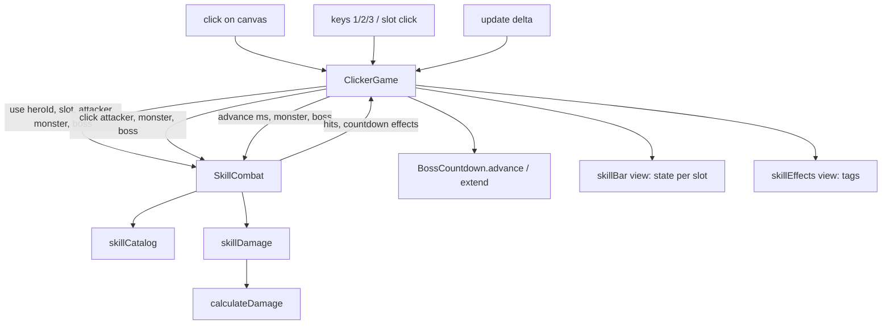

# Hero Skills Design

**Spec**: `.specs/features/hero-skills/spec.md`
**Status**: Draft

---

## Approaches

| # | Approach | Trade-off |
| --- | --- | --- |
| **A (chosen)** | A pure domain module `domain/skills` owns the mechanics table, cooldowns, effects, ticks and the cast; the scene feeds it the frame time (like `BossCountdown`) and applies what it returns | Every number of the spec is unit-tested without Phaser (AD-003); the scene grows only by wiring |
| B | Phaser timers (`time.delayedCall`, `addEvent`) per effect inside `ClickerGame` | Fewer files, but timing rules live in the scene and can only be tested through the scene mock; breaks AD-003 |
| C | Mechanics as structured data in the backend hero catalog | Single source with the descriptions, but needs a migration and API change while combat stays client-side (AD-002); spec says no backend change |

Conforms to AD-002 (combat in the browser), AD-003 (hexagonal game), AD-007 (new text in Portuguese). No decision superseded.

---

## Architecture Overview



`SkillCombat` applies damage to the `Monster` it is given (so a kill stops a second arrow), and returns the hits for the damage numbers. The scene checks `monster.dead` after every `click`, `use` and `advance` and runs the one kill path it already has.

---

## Code Reuse Analysis

| Component | Location | How to Use |
| --- | --- | --- |
| `calculateDamage` | `game/src/domain/combat/damage.js` | Every skill hit and tick goes through it; gains an optional `forceCritical` (Tiro Preciso, ignores crit resistance) |
| `attackerFor` | `game/src/domain/equipment/equipment.js` | Base attacker of the leader; skills scale its `baseDamage` |
| `Monster.hit` | `game/src/domain/combat/monster.js` | Applies skill damage; `dead` stops multi-hit |
| `BossCountdown` | `game/src/domain/campaign/bossCountdown.js` | Gains `extend(ms)` for Carrilhão; the scene advances it by the unfrozen part of the frame |
| `renderSkillBar` | `game/src/adapters/phaser/views/skillBar.js` | Slots gain a click hook and a `refreshSkillBar` that writes state and text |
| `el` | `game/src/adapters/phaser/views/dom.js` | Effect tags |
| `hitMonster` kill branch | `game/src/adapters/phaser/ClickerGame.js:600-614` | Extracted into `afterDamage()` so clicks, skills and ticks share it |
| `this.paused` | `ClickerGame.js` | Pause menu and hero screens; `update` skips `advance` while set |

### Integration Points

| System | Integration Method |
| --- | --- |
| Hero payload (`GET /heroes`) | `leader.id`, `skill.unlocked`, `skill.cooldownSeconds` (ready text) |
| Campaign / farm | Unchanged; kills go through `afterDamage()` |
| Backend | None |

---

## Components

### skillCatalog

- **Purpose**: The Skill Mechanics table as data.
- **Location**: `game/src/domain/skills/skillCatalog.js`
- **Interfaces**:
  - `SKILLS: { [heroId]: { [slot]: SkillDefinition } }`
  - `skillOf(heroId, slot): SkillDefinition | null`
- **Dependencies**: `PHYSICAL`, `MAGICAL` from `damage.js`
- **Reuses**: none

### skillDamage

- **Purpose**: The damage of one click, hit or tick under the running effects.
- **Location**: `game/src/domain/skills/skillDamage.js`
- **Interfaces**:
  - `hitDamage({ attacker, percent, damageType, armorPierce?, forceCritical?, vsDarkness?, buffs, debuffs, defender, random, boss }): { damage, critical }`
  - `tickDamage({ base, element, percent, damageType, buffs, debuffs, defender, boss }): number` (critChance 0)
  - `clickDamage({ attacker, buffs, debuffs, defender, random, boss }): { damage, critical }`
- **Rules**: base x P/100; click bonus (sum of Ventos 50, Bênção 25) on clicks only; x1.3 PHYSICAL under Bênção; +15 crit (cap 100) under Fumaça; defender physicalDefense - 30 (min 0) under Brado; x1.25 MAGICAL under Prisão; x1.5 for Luz Divina vs DARKNESS.
- **Reuses**: `calculateDamage`

### SkillCombat

- **Purpose**: State of skills in one fight scene: cooldowns per (hero, slot), player buffs, monster effects, the cast.
- **Location**: `game/src/domain/skills/skillCombat.js`
- **Interfaces**:
  - `constructor({ random })`
  - `slotState(heroId, slot, unlocked): { state: 'locked'|'ready'|'cooling'|'casting', seconds }`
  - `use({ heroId, slot, unlocked, attacker, monster, boss }): { used, hits: [{damage, critical}], countdown: { extendMs } }`
  - `click({ attacker, monster, boss }): { damage, critical }` (applies the hit)
  - `advance(ms, { monster, boss }): { hits }` (cooldowns, durations, ticks at each whole second, cast end)
  - `countdownMs(ms): number` (part of the frame the boss countdown runs: `max(0, ms - frozenLeft)`; call before `advance`)
  - `effects(): [{ label, seconds, stacks? }]` in start order
- **Rules**: monster effects and the cast are bound to the `Monster` object they started on; when `advance`/`use`/`click` sees another object, a dead one or none, they end (cast lost). Stun/Root freeze only when `boss`. Cooldowns key `heroId:slot`.
- **Reuses**: `skillCatalog`, `skillDamage`

### skillBar (modified)

- **Location**: `game/src/adapters/phaser/views/skillBar.js`
- **Interfaces**:
  - `renderSkillBar(leader, { onUse })` - an unlocked slot calls `onUse(slot)` on click
  - `refreshSkillBar(bar, stateOf)` - sets `data-state`, `is-cooling`/`is-casting` and the text `<n>s` / `<left>s` / `Mirando`; writes only on change

### skillEffects view

- **Location**: `game/src/adapters/phaser/views/skillEffects.js`
- **Interfaces**: `renderEffectTags(effects): Node[]` - `<label> <s>s`, Poison `Bomba de Veneno x<n> <s>s`

### ClickerGame / HeroUi (modified)

- `ClickerGame`: `this.skills = new SkillCombat({ random })`; keys `keydown-ONE/TWO/THREE`; `useSkill(slot)` with the AC 1-4 guards; `hitMonster` uses `skills.click`; `afterDamage()`; `update` always advances skills while not paused, the countdown by `skills.countdownMs(delta)`; effects row DOM under the enemy stats; Carrilhão calls `countdown.extend`.
- `HeroUi.updateSkillBar` passes `onUse` and exposes `refreshSkills(stateOf)`.

---

## Data Models

```js
// SkillDefinition
{
  label: 'Corte Dimensional',
  cooldownMs: 20000,
  damageType: 'PHYSICAL' | 'MAGICAL',
  hits: [ { percent: 1500, armorPierce: 30 } ],      // instant hits, in order
  vsDarkness: 1.5,                                     // Luz Divina only
  castMs: 2000, forceCritical: true,                   // Tiro Preciso only
  buff: { id, durationMs },                            // ventos | bencao | fumaca (on the player)
  debuff: { id, durationMs },                          // brado | prisao | stun (on the monster)
  ticks: { id, percent, count, maxStacks? },           // tempestade | veneno | sangramento
  countdownExtendMs: 4000                              // Carrilhão only
}
```

---

## Error Handling Strategy

| Error Scenario | Handling | User Impact |
| --- | --- | --- |
| Heroes not loaded / no leader | `useSkill` returns at once | Keys do nothing |
| Unknown hero id or slot in catalog | `skillOf` returns null; slot is ignored | Nothing happens |
| Large frame delta (tab in background) | `advance` loops over every whole-second tick crossed | Ticks are not lost |

---

## Risks & Concerns

| Concern | Location (file:line) | Impact | Mitigation |
| --- | --- | --- | --- |
| Fragile code: `ClickerGame` is 781 lines and the kill path lives inside `hitMonster` | `game/src/adapters/phaser/ClickerGame.js:582` | Skills duplicating the kill path would drift | Extract `afterDamage()` once; clicks, skills and ticks call it |
| `update` returns early without a countdown | `ClickerGame.js:453` | Cooldowns would stop between bosses | Advance skills whenever not paused; countdown only when present |
| Ready text from payload, cooldown from catalog | `skillBar.js:17` | Two sources of the same seconds | Catalog test pins the 15 cooldowns equal to `HeroSeed.kt`; ready text keeps the payload |
| Keys 1/2 also label pause options | `ClickerGame.js:42` | Pressing 1 in the pause menu could use a skill | Guard on `this.paused` (edge case of the spec) |

---

## Tech Decisions

| Decision | Choice | Rationale |
| --- | --- | --- |
| Time source | Frame delta through `advance(ms)`, not Phaser timers | Testable, pause for free, matches `BossCountdown` |
| Monster binding | Effects hold the `Monster` object they started on | Every "monster leaves" path ends them without hooks in each path |
| Guaranteed critical | `forceCritical` flag on `calculateDamage` | Ignores crit resistance without faking the roll |
