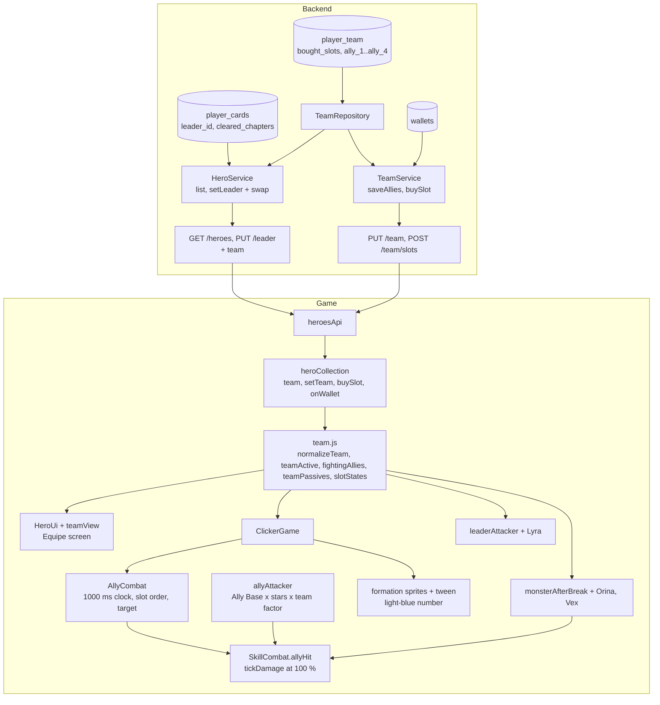

# Hero Team Design

**Spec**: `.specs/features/hero-team/spec.md`
**Status**: Draft (2026-11-19), waiting for the owner's approval and the answers to Q45 and Q46. Written against `main` at `7de3208`.

---

## Architecture Overview

The backend stores who is in the team and what was bought; the game computes every ally hit in the browser (AD-002), through the same strike as every other hit (AD-021).

1. **Backend**: a new domain value `Team` (bought slots and four ally entries) stored in one new table `player_team` (`V12__hero_team.sql`, expand only). `GET /heroes` and `PUT /leader` answer a nested `team`; `PUT /team` saves the allies; `POST /team/slots` buys the next slot with copper. Every change takes the `player_cards` row lock first, then the wallet for a purchase. Nothing else in the schema or the payloads changes.
2. **Game domain**: `team.js` (pure rules: the team payload, when the team is active, the fighting allies, the passives, the slot states), `allyAttacker.js` (the attacker of one ally), `allyCombat.js` (the one-second clock and the slot order), `SkillCombat.allyHit` (the hit itself, through `tickDamage`), and the passives threaded into `leaderAttacker`, `monsterAfterBreak` and `leaderStats`.
3. **Game application and adapters**: `heroesApi` and `heroCollection` carry the team; `teamView.js` renders the Equipe screen; `HeroUi` adds the `Equipe` button and screen; `ClickerGame` lands the ally ticks in `update()`, shows the light-blue number, applies the passives and draws the formation.



### Approaches considered

| Approach | Summary | Verdict |
| --- | --- | --- |
| A. Ally hit as a strike in `SkillCombat` (chosen) | A small `AllyCombat` owns only the clock; each hit calls `SkillCombat.allyHit`, which runs `tickDamage` with the running effects and `statsOf` | One damage path (AD-021), every effect and break applies by construction, the clock is testable alone |
| B. Allies as a permanent damage over time inside `SkillCombat.advance` | Reuse the dot machinery and its time cutting | Exact end-instant semantics, but couples the team to the skill state machine and its effect list; harder for the miniboss-adds target |
| C. A separate ally damage formula | Compute `base x element x defense` in `allyAttacker` | Duplicates `strike`; Prisão, Bênção and Brado would need to be re-applied by hand and could drift (what AD-021 removed) |

---

## Deploy Order and Compatibility (AD-016, AD-023)

- `V12__hero_team.sql` only creates a table. The previous backend (last migration V11) never reads it; its Flyway validation reports V12 as a future migration and starts (`PreviousBackendCompatibilityIT`, `PREVIOUS_LAST_VERSION` becomes 11).
- New response fields are additive: the old game reads `leaderId` and `heroes` of `GET /heroes` and `leaderId` of `PUT /leader`, and ignores `team`.
- The new game against the old backend: `GET /heroes` has no `team`, so `normalizeTeam` gives the locked team, the `Equipe` button stays absent and combat is unchanged. `PUT /team` and `POST /team/slots` are never called without the button.
- Either deploy order is safe; no commit of the feature needs a deploy before the next one. No contract step follows (no column to drop).

---

## Code Reuse Analysis

### Existing Components to Leverage

| Component | Location | How to use |
| --- | --- | --- |
| `PlayerCards`, `BossRecord.hasWon` | `backend/.../domain/PlayerCards.kt`, `BossRecord.kt` | Ownership (`owned`), the leader and `cleared_chapters` for `unlocked` and `openSlots` |
| `PlayerCardsRepositoryPort.findForUpdate` | `backend/.../port/HeroPorts.kt` | The player lock of every team change |
| `WalletAccess.lock`, `Wallet.minus` | `backend/.../service/WalletAccess.kt`, `domain/Wallet.kt` | Charge the slot price; `minus` throws `NotEnoughCopperException` (409 `NOT_ENOUGH_COPPER`) |
| `PlayerAutoClick.upgrade` + `AutoClickLevelMismatchException` + its handler | `domain/AutoClick.kt`, `adapter/web/ApiExceptionHandler.kt` | Pattern of `fromSlots`: ordered checks, a mismatch carrying the stored state in the 409 body |
| `AutoClickEntity` / `AutoClickRepository` | `adapter/repository/AutoClickRepository.kt` | Pattern of a one-row-per-player table, no row = default |
| `CoinsResponse.from(wallet.coins())` | `adapter/web/WalletController.kt` | The `wallet` of the purchase answer |
| `HeroConflictException`, `HeroRequestException`, `HeroNotFoundException`, `HeroNotOwnedException` | `domain/HeroExceptions.kt` | Base types: the existing handlers give 409, 400 and 404 |
| `PreviousBackendCompatibilityIT` | `backend/src/test/.../adapter/repository/` | Raise `PREVIOUS_LAST_VERSION` to 11 |
| `tickDamage` / `strike` | `game/src/domain/skills/skillDamage.js` | The ally hit: never critical, no click bonus, every effect |
| `SkillCombat` (`follow`, `buffIds`, `debuffIds`, `factors`, `statsOf`) | `game/src/domain/skills/skillCombat.js` | `allyHit` reads the same running effects and monster stats as a tick |
| `attackerFor`, `wornBy` | `game/src/domain/equipment/equipment.js` | Ally Base, armor pierce and boss damage from the ally's pieces |
| `leaderAttacker`, `addBonuses` | `game/src/domain/combat/leaderAttacker.js`, `domain/talents/talents.js` | Lyra's +10 critical chance as one more bonus |
| `monsterAfterBreak` | `game/src/domain/talents/talents.js` | Orina and Vex as extra break points |
| `formatDamage` | `game/src/domain/combat/damage.js` | Every shown number of the feature |
| `leaderBonusText`, `starsText`, `sprite`, `el` | `domain/heroes/leaderBonus.js`, `adapters/phaser/views/dom.js` | Leader card text, stars, pictures, DOM |
| `.fusion-button`, `.fusion-button.is-secondary`, `.fusion-all-confirm` | `game/public/style.css` | Dialog and action buttons, dialog box recipe |
| `HeroUi.show`, `setError`, `view` counter | `game/src/adapters/phaser/HeroUi.js` | Screen life cycle, stale answers ignored, error line |
| `equipmentCollection.onWallet` → `ClickerGame.receiveWallet` | `application/equipment/equipmentCollection.js`, `ClickerGame.js` | Same wiring for the purchase wallet |
| `createScene` harness | `game/src/adapters/phaser/ClickerGame.test.js:84` | Scene unit tests (images, texts, tweens) |
| `mockBackend` | `game/e2e/support/fakeBackend.js:236` | e2e state: `cards.cleared`, `wallets`, `progress.chapter`, new `team` option |

### Integration Points

| System | Integration method |
| --- | --- |
| `GET /heroes` | `HeroesView` gains `team: TeamView`; `HeroesResponse` gains `team: TeamResponse` |
| `PUT /leader` | `SetLeaderUseCase.setLeader` returns `LeaderChange(leaderId, team)`; the team swaps in the same transaction |
| Wallet | `POST /team/slots` takes the price under the wallet row lock after the cards lock |
| Account reset | Untouched: `AccountResetService` never reads or writes `player_team` |
| User deletion | `player_team.username` references `users` on delete cascade |
| Game combat loop | `ClickerGame.update` calls `allyFrame(delta)` before `skills.advance` |
| Campaign chapter | `ClickerGame` reads `this.session.mapPosition()` for `teamActive`; `showEncounter` reloads the heroes when `this.session.chapter` changes |

---

## Components

### Backend `Team` (domain)

- **Purpose**: The bought ally slots of one player and the hero in each, with every rule of a purchase, a save and a leader change.
- **Location**: `backend/src/main/kotlin/br/com/woodriver/infinity_grove_ws/domain/Team.kt`
- **Interfaces**:
  - `data class Team(val boughtSlots: Int = 0, val allies: List<String?> = EMPTY_ALLIES)`; `init` requires `boughtSlots in 0..4`, `allies.size == 4`, `null` at every index from `boughtSlots`, no id twice.
  - `fun buy(username: String, fromSlots: Int, bosses: BossRecord): Team` - checks in order: `fromSlots < 0` → `InvalidTeamSlotRequestException`; `fromSlots != boughtSlots` → `TeamSlotMismatchException(TeamView.of(this, bosses), fromSlots)`; `boughtSlots == 4` → `TeamSlotsMaxException`; `boughtSlots >= openSlots(bosses)` → `TeamSlotLockedException`; returns `copy(boughtSlots = boughtSlots + 1)`. The price check happens in the service (wallet).
  - `fun withAllies(allies: List<String?>, cards: PlayerCards, known: (String) -> Boolean): Team` - `allies` already has 4 entries (the controller checks the shape); checks in order: a hero twice or `cards.leaderId` → `InvalidTeamException`; an id with `known(id) == false` → `HeroNotFoundException(id)`; `!unlocked(cards.bosses)` → `TeamLockedException`; an id at an index `>= boughtSlots` → `TeamSlotNotBoughtException(index + 1)`; an id with `!cards.owned(id)` → `HeroNotOwnedException(id)`; returns `copy(allies = allies)`.
  - `fun afterLeaderChange(oldLeaderId: String, newLeaderId: String): Team` - the index of `newLeaderId` in `allies` takes `oldLeaderId`; no index (or the same id) returns `this`.
  - `companion object`: `MAX_ALLIES = 4`, `SLOT_PRICES = listOf(10_000L, 20_000L, 30_000L, 40_000L)`, `SLOT_CHAPTERS = listOf(5, 6, 7, 8)`, `EMPTY_ALLIES = listOf<String?>(null, null, null, null)`, `fun unlocked(bosses: BossRecord) = bosses.hasWon(5)`, `fun openSlots(bosses: BossRecord) = SLOT_CHAPTERS.count { bosses.hasWon(it) }`.
  - `data class TeamView(val unlocked: Boolean, val openSlots: Int, val boughtSlots: Int, val slotPrices: List<Long>, val allies: List<String?>)` with `companion object { fun of(team: Team, bosses: BossRecord) }`.
  - `data class LeaderChange(val leaderId: String, val team: TeamView)`.
- **Dependencies**: `BossRecord`, the exceptions below, SLF4J (INFO on a purchase and a save, WARN on each refusal, L-007).
- **Reuses**: the ordered-check style of `PlayerAutoClick.upgrade`.

### Backend team exceptions (domain)

- **Location**: `backend/.../domain/TeamExceptions.kt`
- **Interfaces** (codes are the API contract):
  - `class InvalidTeamException(reason: String) : HeroRequestException("INVALID_TEAM", ...)` → 400
  - `class InvalidTeamSlotRequestException(reason: String) : HeroRequestException("INVALID_TEAM_SLOT_REQUEST", ...)` → 400
  - `class TeamLockedException : HeroConflictException("TEAM_LOCKED", ...)` → 409
  - `class TeamSlotNotBoughtException(slot: Int) : HeroConflictException("TEAM_SLOT_NOT_BOUGHT", ...)` → 409
  - `class TeamSlotLockedException : HeroConflictException("TEAM_SLOT_LOCKED", ...)` → 409
  - `class TeamSlotsMaxException : HeroConflictException("TEAM_SLOTS_MAX", ...)` → 409
  - `class TeamSlotMismatchException(val current: TeamView, sent: Int) : HeroConflictException("TEAM_SLOT_MISMATCH", ...)` → 409, with a dedicated handler that adds `team` (`TeamResponse.from(e.current)`)
- **Reuses**: the existing handlers of `HeroRequestException` (400) and `HeroConflictException` (409).

### Backend persistence (port, adapter, migration)

- **Port**: `backend/.../port/TeamPorts.kt` - `interface TeamRepositoryPort { fun find(username: String): Team; fun save(username: String, team: Team) }`. `find` of a player with no row returns `Team()`.
- **Adapter**: `backend/.../adapter/repository/TeamRepository.kt` - `@Entity @Table(name = "player_team") class TeamEntity(username, boughtSlots, ally1, ally2, ally3, ally4)`, `interface JpaTeamRepository : JpaRepository<TeamEntity, String>`, `@Repository class TeamRepository : TeamRepositoryPort` (`save` writes the whole row; one row per player, so a swap is one update).
- **Migration**: `backend/src/main/resources/db/migration/V12__hero_team.sql`:

```sql
-- The ally slots a player bought and the hero in each (spec hero-team). A player with no row bought no slot and has no ally.
-- Expand only (AD-016): the previous backend never reads this table.
create table player_team (
    username     varchar(255) not null primary key references users (username) on delete cascade,
    bought_slots integer      not null check (bought_slots between 0 and 4),
    ally_1       varchar(255) references heroes (id) on delete restrict,
    ally_2       varchar(255) references heroes (id) on delete restrict,
    ally_3       varchar(255) references heroes (id) on delete restrict,
    ally_4       varchar(255) references heroes (id) on delete restrict,
    constraint player_team_ally_1_bought check (ally_1 is null or bought_slots >= 1),
    constraint player_team_ally_2_bought check (ally_2 is null or bought_slots >= 2),
    constraint player_team_ally_3_bought check (ally_3 is null or bought_slots >= 3),
    constraint player_team_ally_4_bought check (ally_4 is null or bought_slots >= 4),
    constraint player_team_allies_distinct check (
        ally_1 <> ally_2 and ally_1 <> ally_3 and ally_1 <> ally_4
        and ally_2 <> ally_3 and ally_2 <> ally_4 and ally_3 <> ally_4
    )
);
```

  A comparison with a `null` is `null`, which a `check` accepts, so the distinct check only refuses two equal heroes.
- **Fake**: `InMemoryTeamRepository` in `backend/src/test/.../Fakes.kt`.

### Backend `HeroService` and `TeamService` (service)

- `HeroService(heroRepository, playerCardsRepository, userRepository, teamRepository)`:
  - `list` returns `HeroesView(leaderId, heroes, TeamView.of(teamRepository.find(username), cards.bosses))`.
  - `setLeader` locks the cards, `withLeader(heroId)`, `team.afterLeaderChange(old, new)`, saves both, returns `LeaderChange`.
- `TeamService(playerCardsRepository, teamRepository, heroRepository, userRepository, walletAccess)` implements `SaveTeamUseCase` and `BuyTeamSlotUseCase`:
  - `saveAllies(username, allies): LeaderChange` - user check, cards lock, `teamRepository.find(username).withAllies(allies, cards, heroRepository::existsById)`, save, INFO log.
  - `buySlot(username, fromSlots): SlotPurchase(team: TeamView, wallet: Wallet)` - user check, cards lock, `bought = team.buy(username, fromSlots, cards.bosses)`, then `price = Team.SLOT_PRICES[fromSlots]` (safe: `buy` passed, so `fromSlots` equals the old `boughtSlots`, below 4), then `walletAccess.lock(username).minus(price)`, save team, save wallet. Any exception rolls the transaction back, so a refusal changes nothing.
- Lock order: `player_cards` (findForUpdate) then `wallets` (WalletAccess.lock), as AD-009.

### Backend web (`TeamController`, `HeroController`, handler)

- `TeamResponse(unlocked, openSlots, boughtSlots, slotPrices: List<Long>, allies: List<String?>)` with `from(view: TeamView)`, in `TeamController.kt`.
- `PUT /team` body `{ "allies": [4 entries] }` → 200 `TeamSaveResponse(leaderId, team)`. The controller parses: `body["allies"]` must be a `List<*>` of size 4 whose entries are `String` or `null`, else `InvalidTeamException`.
- `POST /team/slots` body `{ "fromSlots": int }` → 200 `TeamPurchaseResponse(team, wallet: CoinsResponse)`. `body["fromSlots"] as? Int ?: throw InvalidTeamSlotRequestException(...)`.
- `HeroesResponse` gains `team: TeamResponse`; `LeaderResponse` gains `team: TeamResponse`.
- `ApiExceptionHandler.teamSlotMismatch(e: TeamSlotMismatchException)` = 409 with `setProperty("team", TeamResponse.from(e.current))`.

### Game `team.js` (domain)

- **Location**: `game/src/domain/heroes/team.js`
- **Interfaces**:
  - `TEAM_FIRST_CHAPTER = 5`, `ALLY_SLOTS = [ 1, 2, 3, 4 ]`, `COPPER_PER_GOLD = 10000`
  - `LOCKED_TEAM` = `{ unlocked: false, openSlots: 0, boughtSlots: 0, slotPrices: [ 10000, 20000, 30000, 40000 ], allies: [ null, null, null, null ] }` (frozen)
  - `normalizeTeam(payload) -> team`: the payload when valid, else `LOCKED_TEAM`. Valid: an object; `unlocked` boolean; `openSlots` and `boughtSlots` integers 0 to 4; `slotPrices` an array of 4 positive integers; `allies` an array of 4 entries each a string or `null`.
  - `teamActive(position) -> boolean`: `position` is `{ chapter, completed }` or null; `completed === true || chapter >= 5`; null → false.
  - `fightingAllies({ team, heroes, leaderId, active }) -> [ { slot, hero } ]`: `[]` when `!active`; otherwise the entries of `team.allies` at indexes below `team.boughtSlots` that are not null, not `leaderId` and found in `heroes`, in slot order (slot = index + 1).
  - `PASSIVES` (spec Passive Table), `passiveOf(heroId) -> { name, text } | null`, `passiveLine(heroId) -> '<name>: <text>' | ''`.
  - `NO_PASSIVES = { bossTimeMs: 0, critChance: 0, defenseBreak: 0, critResistBreak: 0, allyFactor: 1 }` (frozen); `teamPassives(heroIds) -> { bossTimeMs, critChance, defenseBreak, critResistBreak, allyFactor }`: kael 5000 ms, lyra 10, orina 15, vex 15, seraphine 1.25.
  - `slotStates(team) -> [ { slot, state, heroId, priceGold, chapter } ]` for slots 1 to 4: `filled` (bought, hero), `empty` (bought, null), `buyable` (`slot === boughtSlots + 1 && slot <= openSlots`), `waiting` (`slot <= openSlots`, not buyable, not bought), `locked` (`slot > openSlots`); `priceGold = slotPrices[slot - 1] / 10000`; `chapter = 4 + slot`.
  - `availableHeroes({ team, heroes, leaderId }) -> heroes`: owned heroes that are not the leader and not in `team.allies` at a bought index, catalog order.

### Game `allyAttacker.js` (domain)

- **Location**: `game/src/domain/combat/allyAttacker.js`
- **Interfaces**:
  - `ALLY_STAR_MULTIPLIER = [ 2, 4, 6, 8, 10, 12, 14, 16, 18, 20 ]`; `allyStarMultiplier(stars) -> number` (an index outside 0 to 9 reads 2).
  - `allyAttacker({ ally, pieces = [], leaderElement, allyFactor = 1 }) -> attacker`: `worn = attackerFor({ ...PLAYER, element: leaderElement }, pieces)`; returns `{ element: leaderElement, baseDamage: worn.baseDamage * allyStarMultiplier(ally.stars) * allyFactor, critChance: 0, critMultiplier: 1, armorPierce: worn.armorPierce ?? 0, bossDamage: worn.bossDamage ?? 0 }`.
  - `allyDamagePerSecond({ ally, pieces = [], allyFactor = 1 }) -> number`: `allyAttacker({ ally, pieces, leaderElement: 'FIRE', allyFactor }).baseDamage`.

### Game `AllyCombat` (domain)

- **Location**: `game/src/domain/combat/allyCombat.js`
- **Purpose**: The one-second clock of the team and the slot order of a tick; it holds no damage rule.
- **Interfaces**:
  - `ALLY_TICK_MS = 1000`
  - `class AllyCombat { constructor(); advance(ms, { monster, allies, hit, target = () => monster }) -> { ticks } }`
    - `monster`: the monster of the encounter (null or dead: no hit, the clock goes back to 1000 ms). A different monster than the last call restarts the clock at 1000 ms.
    - `allies`: `[ { slot, attacker } ]` in slot order. Empty: no hit, the clock goes back to 1000 ms.
    - `hit(attacker, target) -> damage`: lands one hit (the scene passes `skills.allyHit`).
    - `target()`: the monster the next hit lands on; read before every hit; a null or dead target ends the tick.
    - Returns `{ ticks: [ { slots: [ ...slots that landed ], damage: sum } ] }`; one entry per elapsed 1000 ms with at least one landed hit; several ticks when `ms` spans several seconds.
- **Reuses**: the `follow` idea of `SkillCombat`.

### Game `SkillCombat.allyHit` (domain)

- **Location**: `game/src/domain/skills/skillCombat.js` (new method)
- `allyHit({ attacker, monster, boss }) -> { damage, critical: false }`: `this.follow(monster)`; `damage = tickDamage({ attacker, percent: 100, buffs: this.buffIds(), debuffs: this.debuffIds(), defender: this.statsOf(monster), boss, factors: this.factors() })`; `monster.hit(damage)`.

### Game passives in the builders (domain)

- `leaderAttacker({ leader, pieces = [], talents = null, passives = NO_PASSIVES })`: the bonus becomes `addBonuses(addBonuses(starBonus(stars), talentAttackerBonus(talents)), { clickDamageFlat: 0, clickDamagePct: 0, critChance: passives.critChance ?? 0, critDamagePct: 0 })`.
- `monsterAfterBreak(stats, talents, passives = {})`: `defense: max(0, defenseOf(stats) - PHYSICAL_BREAK - (passives.defenseBreak ?? 0))`, `critResistance: max(0, critResistance - CRIT_RESIST_BREAK - (passives.critResistBreak ?? 0))`.
- `leaderStats({ leader, pieces = [], talents = null, passives = NO_PASSIVES })`: passes `passives` to `leaderAttacker`; adds `passives.bossTimeMs / 1000` to both time lines, `passives.defenseBreak` to `Quebra de defesa`, `passives.critResistBreak` to `Quebra de resistência a crítico`.

### Game `heroesApi` and `heroCollection` (adapter, application)

- `heroesApi.setTeam(allies) -> { leaderId, team }` (`PUT /team` `{ allies }`); `heroesApi.buySlot(fromSlots) -> { team, wallet }` (`POST /team/slots` `{ fromSlots }`); `setLeader` unchanged (now resolves with `team` too).
- `heroCollection`: `team() -> team` (`normalizeTeam` of the last payload, `LOCKED_TEAM` before the load); `setTeam(allies)` stores `leaderId` and `team` of the answer, fires `onChange`; `buySlot(fromSlots)` stores `team`, fires the wallet listeners with `wallet`, fires `onChange`, resolves with `{ team, wallet }`; `onWallet(listener)`; `setLeader` also stores `team` when the answer has it; `load` stores `normalizeTeam(payload.team)`.

### Game `teamView.js` (adapter view) and its CSS

- **Location**: `game/src/adapters/phaser/views/teamView.js`, rules in `game/public/style.css` (section `/* ══ Equipe ══ */`)
- `renderTeam(model, handlers) -> HTMLElement` (`div.team-screen`, `data-testid="team-screen"`), with `model = { leader, slots, selected, available, teamDps, active, busy, asking, notice, flashSlot, walletCopper }` and `handlers = { onSlot(slot), onPick(heroId), onRemove(), onMakeLeader(), onConfirmBuy(), onCancelBuy() }`. The view builds the blocks of the spec "Equipe Screen Layout"; it computes nothing of the game (the model holds every text value).
- `teamModel({ team, heroes, leaderId, pieces, position, selected, busy, asking, notice, flashSlot, walletCopper })` in the same file builds the model from domain functions, so `HeroUi` only stores state.

### Game `HeroUi` (adapter)

- `SCREENS` gains `{ id: 'team', label: 'Equipe', title: 'Equipe' }` right after `leader`; `ICONS.team` is the Lucide `swords` icon. The button is created in the constructor but inserted into the rail only while `heroes.team().unlocked` (after `hud-leader`) and removed otherwise, on every `heroes.onChange`.
- New state: `teamSelected` (slot or null), `teamBusy`, `teamAsking` (slot or null), `teamNotice` (text or null), `teamFlash` (slot or null). `show()` resets all five.
- `show('team')` loads the heroes and the equipment (like Equipamento); `render_team()` renders `renderTeam(teamModel(...), handlers)`.
- Flows: select; pick (put in selected or first empty bought slot → `heroes.setTeam`); remove; make leader (`heroes.setLeader`); ask, cancel and confirm purchase (`heroes.buySlot`); every request sets `teamBusy`, re-renders, and on failure calls `setError(...)` and `heroes.load()`.
- `leaderStatsFor()` passes the active passives (`activePassives`, below) to `leaderStats`.
- A helper in `team.js`: `activePassives({ team, heroes, leaderId, position }) -> passives` = `teamPassives(fightingAllies({ team, heroes, leaderId, active: teamActive(position) }).map(({ hero }) => hero.id))`.

### Game `ClickerGame` (adapter)

- Combat: `this.allies = new AllyCombat()` in `create`; `fightingAllies()`, `passives()`, `allyAttackers()`, `allyFrame(delta)`, `showAllyDamage(damage)`; `update` runs `allyFrame(delta)` right after `this.showCombo()` and before `this.skills.countdownMs(delta)`; the kill and the health bar follow the same `alive` check as ticks. `statsOf` of `SkillCombat`, `showEnemyStats`, `refreshEnemyStats` and `leaderAttacker()` pass `this.passives()`; the countdown adds `this.passives().bossTimeMs`. `heroes.onChange` also refreshes the enemy line; `heroes.onWallet` calls `receiveWallet`; `showEncounter` reloads the heroes when `this.session.chapter` differs from the chapter of the last encounter (not on the first one).
- Field: `showCharacter()` draws the formation (spec Allies on the Field) from `fightingAllies()`; `this.allySprites` (Map slot → image); `moveAlly(slot)` tweens the sprite; `showEncounter` calls `showCharacter()` so a change of `teamActive` redraws at the next encounter.

---

## Data Models

### Team payload (game and API)

```typescript
interface Team {
  unlocked: boolean        // cleared_chapters holds 5
  openSlots: number        // 0..4, chapters 5..8 in cleared_chapters
  boughtSlots: number      // 0..4
  slotPrices: number[]     // [10000, 20000, 30000, 40000], copper
  allies: (string | null)[] // 4 entries, index 0 = ally slot 1
}
```

### API answers

```typescript
// GET /heroes
interface HeroesPayload { leaderId: string; heroes: Hero[]; team: Team }
// PUT /leader and PUT /team
interface LeaderPayload { leaderId: string; team: Team }
// POST /team/slots
interface PurchasePayload { team: Team; wallet: { gold: number; silver: number; copper: number } }
// 409 TEAM_SLOT_MISMATCH (ProblemDetail)
interface MismatchProblem { status: 409; code: 'TEAM_SLOT_MISMATCH'; detail: string; team: Team }
```

### Passives (game)

```typescript
interface Passives { bossTimeMs: 0 | 5000; critChance: 0 | 10; defenseBreak: 0 | 15; critResistBreak: 0 | 15; allyFactor: 1 | 1.25 }
```

### Table `player_team`

| Column | Type | Rule |
| --- | --- | --- |
| `username` | varchar(255) PK | references `users` on delete cascade |
| `bought_slots` | integer not null | 0 to 4 |
| `ally_1` .. `ally_4` | varchar(255) null | references `heroes` on delete restrict; `ally_n` only when `bought_slots >= n`; no two equal |

---

## Error Handling Strategy

| Error scenario | Handling | User impact |
| --- | --- | --- |
| `PUT /team` refused (400, 404, 409) | Nothing stored; the game shows `Não foi possível salvar a equipe.` and reloads the heroes | The panel shows the stored team again |
| `PUT /leader` refused or offline | Same as above (the Equipe screen); the Líder screen keeps `Não foi possível trocar o líder.` | Leader unchanged |
| `POST /team/slots` refused (409 mismatch, locked, max, copper) or offline | Nothing charged; the game shows `Não foi possível comprar a vaga.`, closes the dialog and reloads the heroes | The panel shows the stored slots |
| Double click on `Comprar` | `Comprar` disabled after the first press; a second request with the same `fromSlots` answers 409 `TEAM_SLOT_MISMATCH` | Pays once |
| `GET /heroes` without `team` (old backend) or with an invalid `team` | `normalizeTeam` gives `LOCKED_TEAM` | No `Equipe` button, combat as today |
| Heroes or equipment not loaded | No fighting ally, no passive; ally pieces count as none until the equipment loads | The leader fights alone until the load |
| Equipe closed while a request runs | The answer updates the collection and the wallet; no render (stale `view`); `show()` clears the busy flag | Reopening shows the stored team, controls enabled |

---

## Risks & Concerns

| Concern | Location (file:line) | Impact | Mitigation |
| --- | --- | --- | --- |
| `ClickerGame.js` is 1420 lines and `update` already runs the combo, the auto click, the skills and the countdown | `game/src/adapters/phaser/ClickerGame.js:859` | A wrong order can double a kill or skip the health bar | The ally logic sits in `AllyCombat` (pure) and one `allyFrame` method; the scene task pins the order and the single kill path with tests (L-035) |
| The rail grows to seven buttons for team players | `HeroUi.js:18` (`HUD`), `style.css:1074` | Rail overlapping the battle bar or the wallet | The button is absent while locked; e2e pins the rail bottom above y 624 (spec AC 2) and the ui-artist checks the shot |
| Tests that count `.hero-hud button` | `game/e2e/equipment.spec.js:45` | Fail if the hidden button stayed in the DOM | Absent from the DOM while locked, so the count stays 6 for those players |
| A long frame (e2e `update(0, 2500)`) spans several ticks | `allyCombat.js` | Missed or merged ticks | `advance` loops per 1000 ms; edge case "2500 ms lands two ticks" has its own test |
| `PUT /leader` now writes two rows | `HeroService.setLeader` | A half-written swap | Same transaction under the `player_cards` lock; IT checks both after a swap |
| Allies are weak on high-defense bosses under one damage (defense 50 to 80) | spec Q46 | Players may find slots poor value late | Owner question Q46; armor pierce, breaks and Erosão already lower the defense; balance is not tested (as AD-019) |
| Line numbers in tasks drift | `tasks.md` | A smaller model edits the wrong line | Every edit is located by quoted text or test name; the line is only a hint |

---

## Tech Decisions (only non-obvious ones)

| Decision | Choice | Rationale |
| --- | --- | --- |
| Storage shape | One row per player with `ally_1` to `ally_4` | A swap is one update; no unique-key ordering problem of row-per-slot writes; check constraints keep the slot and distinct rules in SQL |
| Where the ally hit is computed | `SkillCombat.allyHit` over `tickDamage` | One damage path (AD-021); effects and breaks apply by construction |
| Clock owner | `AllyCombat`, separate from `SkillCombat` | Keeps the skill state machine unchanged; gives `miniboss-adds` its `target` seam |
| Order inside a frame | Allies before `skills.advance` | An effect ending in the frame still counts for the ally hit, as for ticks (L-108) |
| Team payload | One nested `team` object | Reused by `GET /heroes`, `PUT /leader`, `PUT /team`, `POST /team/slots` and the 409 body |
| Opening of new slots in the game | Reload the heroes when the campaign chapter changes at the next encounter | The chapter 5 to 8 boss wins move the chapter; no change to the campaign session |

> No new project-level decision: the feature conforms to AD-002, AD-003, AD-007, AD-009, AD-010, AD-011, AD-012, AD-016, AD-018 (revised), AD-021 and AD-022. `STATE.md` AD-018 records the revision.
