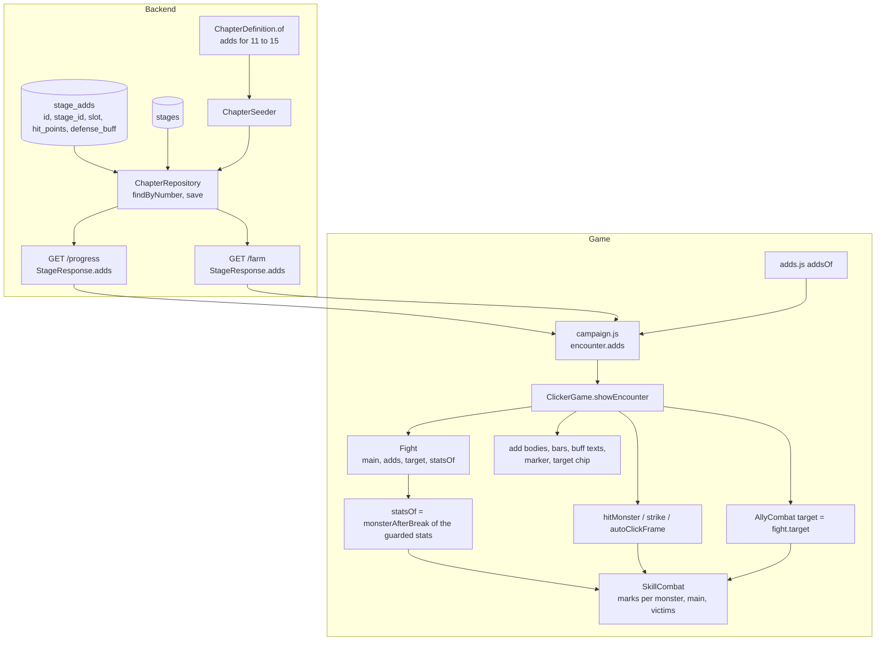

# Miniboss Adds Design

**Spec**: `.specs/features/miniboss-adds/spec.md`
**Status**: Draft (2026-11-19), waiting for the owner's approval and the answers to Q47 to Q52. Written against `main` at `3e8ff62` on the recommended defaults.

---

## Architecture Overview

The backend stores the adds of each stage as catalog data and answers them in the stage payload; the game builds a fight of several monsters, keeps a target and lands every hit through the one damage (AD-021).

1. **Backend**: a domain value `StageAdd(health, defenseBuff)` and `StageDefinition.adds` (0 to 2), seeded by `ChapterDefinition.of` for chapters 11 to 15. A new table `stage_adds` (`V13__miniboss_adds.sql`, expand only) holds them; the migration fills the stored chapters 11 to 15, `ChapterRepository.save` writes them for a new database. `StageResponse` gains `adds`, which reaches both `GET /progress` and `GET /farm` (same `ChapterResponse`). No route, lock or outcome rule changes.
2. **Game domain**: `adds.js` reads the `adds` of a stage; `Fight` (`fight.js`) is the live group of one encounter: the main monster, its adds, the target and the guarded defense. `campaign.js` puts `adds` on every encounter. `SkillCombat` keeps debuffs and damage over time per monster, follows the main monster of the fight, and lands skills, ticks and the aimed shot on every living monster in the order adds then main.
3. **Game adapter**: `ClickerGame` creates a `Fight` per encounter, draws the adds, the marker and the target chip, routes the click, the auto click, the allies (`AllyCombat` `target()`), the skills and the ticks to the right monster, and handles add deaths without touching the kill path of the miniboss.



### Approaches considered

| Approach | Summary | Verdict |
| --- | --- | --- |
| A. One `Fight` group + per-monster effects in `SkillCombat` (chosen) | The scene keeps one main `Monster` (`this.monster`, unchanged meaning) and a `Fight` beside it; `SkillCombat` stores effects in a `Map` keyed by monster and follows the main monster | Every existing single-monster call keeps its meaning (`monster` = the main one); the kill path, the countdown and the reports stay on `this.monster`; effects of one monster never clear another's |
| B. One `SkillCombat` per monster | A combat per add and one for the miniboss | Cooldowns and player buffs are shared and would need syncing; skills would be "used" three times |
| C. Adds as a separate scene object outside the combat | Adds hit only by clicks, skills computed apart | Duplicates the damage path (what AD-021 removed) and breaks Q23 |

For the data: a table (chosen) keeps the adds tunable in the database like every other stage number (AD-010); a code rule computed at answer time would need no migration but could not be tuned and would put catalog numbers in the controller.

---

## Deploy Order and Compatibility (AD-016, AD-023)

- `V13__miniboss_adds.sql` creates `stage_adds` and inserts rows for the stored stages of chapters 11 to 15 only. The previous backend (last migration V12) never reads the table; `ddl-auto: validate` ignores unknown tables, and its Flyway validation reports V13 as a future migration and starts (`PreviousBackendCompatibilityIT`, `PREVIOUS_LAST_VERSION` becomes 12).
- On a new database V13 runs before `ChapterSeeder` (Flyway runs at boot, the seeder is an `ApplicationRunner`), finds no stage and inserts nothing; the seeder then saves chapters 11 to 15 with their adds through `ChapterRepository.save`.
- The new response field is additive: the old game ignores `adds` (chapters 11 to 15 play as today). The new game against the old backend finds no `adds` and plays as today (`addsOf` gives `[]`).
- Either deploy order is safe; no contract step follows.

---

## Code Reuse Analysis

### Existing Components to Leverage

| Component | Location | How to use |
| --- | --- | --- |
| `StageDefinition`, `ChapterDefinition.of`, `EnemyStats.MAX_DEFENSE` | `backend/.../domain/Chapter.kt` | Add `adds`; seed chapters 11 to 15; the buff bound 90 |
| `StageEntity.idOf` and the string-id pattern | `backend/.../adapter/repository/ChapterEntities.kt:130` | `StageAddEntity` id `"<chapter>/<stage>/<slot>"` |
| `ChapterRepository.findByNumber`, `save` | `backend/.../adapter/repository/ChapterRepository.kt:25`, `:37` | Read and write the adds with the stages |
| `StageResponse.from` | `backend/.../adapter/web/ProgressController.kt:56` | Add `adds` (also reaches `FarmController`) |
| Migration ITs | `UnifiedDamageMigrationIT.kt` (re-run the SQL with `jdbc.execute`), `SchemaConstraintsIT.kt` | Pattern of `StageAddsMigrationIT` |
| `PreviousBackendCompatibilityIT` | `backend/src/test/.../adapter/repository/` | `PREVIOUS_LAST_VERSION = 12` |
| `Monster` | `game/src/domain/combat/monster.js` | Every add is a `Monster` (health, `dead`, `hit`) |
| `defenseOf`, `DEFAULT_STATS` | `game/src/domain/combat/monster.js` | The guarded defense reads the one defense |
| `monsterAfterBreak` | `game/src/domain/talents/talents.js` | Applied to the guarded stats, so breaks come after the cap |
| `SkillCombat` (`follow`, `start`, `startDot`, `factors`, `tickHit`, `landCast`) | `game/src/domain/skills/skillCombat.js` | Same machinery, with the effects keyed by monster |
| `AllyCombat` `target` seam | `game/src/domain/combat/allyCombat.js:18` | The scene passes `target: () => this.currentTarget()` |
| `healthText`, `formatDamage` | `monster.js`, `damage.js` | Target chip and every number |
| `afterDamage`, `fadeOutMonster`, `DEATH` | `ClickerGame.js:1296`, `:1516`, `:45` | The miniboss kill path is unchanged; adds fade with `DEATH.fadeDuration` |
| `createScene` harness | `game/src/adapters/phaser/ClickerGame.test.js:92` | Scene tests; gains `add.triangle` and `destroy`/`setDepth` on rectangles |
| `startTeam`, `freeze`, `advance` e2e helpers | `game/e2e/heroTeamCombat.spec.js:27-80` | Pattern of the adds e2e helpers (loop asleep, L-112) |

### Integration Points

| System | Integration method |
| --- | --- |
| Progress and farm payloads | `definition.stages[].adds` (additive field) |
| Campaign domain | `Campaign.encounter()` and `farmEncounterOf` add `adds` to every encounter (`[]` for phases, chapter bosses and stages without adds) |
| Scene combat loop | `showEncounter` builds `this.fight`; `statsOf` of `SkillCombat` reads `this.fight.statsOf(monster)`; `update` passes the living adds to `skills.advance` and `target` to `allies.advance` |
| Ally clock | `AllyCombat` keeps `monster` = the miniboss, so the clock restarts only for a new encounter (`hero-team` seam 1) |
| Kill path and reports | Unchanged: only `this.monster` (the miniboss) drops coins, runs `clearEncounter` and moves the campaign |

---

## Components

### Backend `StageAdd` and `StageDefinition.adds` (domain)

- **Location**: `backend/src/main/kotlin/br/com/woodriver/infinity_grove_ws/domain/Chapter.kt`
- **Interfaces**:
  - `data class StageAdd(val health: Long, val defenseBuff: Int)`; `init`: `health >= 1` ("add health $health must be at least 1"), `defenseBuff in 0..EnemyStats.MAX_DEFENSE` ("add defense-buff $defenseBuff must be between 0 and 90").
  - `StageDefinition` gains a last parameter `val adds: List<StageAdd> = emptyList()`; `init` adds `require(adds.size <= MAX_ADDS) { "Stage $number: at most $MAX_ADDS adds, got ${adds.size}" }`; `companion object { const val MAX_ADDS = 2 }`.
  - `ChapterDefinition.of(number)`: each stage gets `adds = addsOf(number, monsterHealth)`; `private val ADD_BUFFS = mapOf(11 to 30, 12 to 35, 13 to 40, 14 to 45, 15 to 50)`, `private const val ADDS_PER_MINIBOSS = 2`, `private const val ADD_HEALTH_FACTOR = 3`; `fun addsOf(number: Int, monsterHealth: Long): List<StageAdd>` = `ADD_BUFFS[number]?.let { buff -> List(ADDS_PER_MINIBOSS) { StageAdd(monsterHealth * ADD_HEALTH_FACTOR, buff) } } ?: emptyList()` (public, read by tests).

### Backend persistence (entity, repository, migration)

- **Entity**: `StageAddEntity` in `ChapterEntities.kt`: `@Entity @Table(name = "stage_adds", uniqueConstraints = [UniqueConstraint(name = "uk_stage_adds_stage_slot", columnNames = ["stage_id", "slot"])])`, fields `id: String` (`@Id`, `"<chapter>/<stage>/<slot>"`), `stageId: String`, `slot: Int`, `hitPoints: Long`, `defenseBuff: Int`; `fun toDomain() = StageAdd(hitPoints, defenseBuff)`; `companion object { fun idOf(chapter: Int, stage: Int, slot: Int) = "$chapter/$stage/$slot"; fun from(chapter: Int, stage: Int, slot: Int, add: StageAdd) }`.
- `StageEntity.toDomain(enemies, adds: List<StageAdd> = emptyList())` passes `adds`.
- **Repository**: `interface JpaStageAddRepository : JpaRepository<StageAddEntity, String> { fun findAllByStageIdIn(stageIds: Collection<String>): List<StageAddEntity> }` in `ChapterRepository.kt`. `findByNumber` reads the adds of the chapter's stages, groups them by `stageId`, sorts by `slot`. `save` deletes the existing add rows of every stage of the chapter (`deleteAll(findAllByStageIdIn(ids))`) after saving the stages, then saves one row per add with `slot = index + 1`.
- **Migration** `backend/src/main/resources/db/migration/V13__miniboss_adds.sql`:

```sql
-- The adds of a miniboss (spec miniboss-adds): 0 to 2 per stage, each with its health and the points it adds to the miniboss's defense.
-- Expand only (AD-016): the previous backend never reads this table. Stages of chapters 1 to 10 have no row. Every statement can run
-- again (StageAddsMigrationIT re-runs the file).
create table if not exists stage_adds (
    id           varchar(255) primary key,
    stage_id     varchar(255) not null references stages (id) on delete restrict,
    slot         integer      not null check (slot between 1 and 2),
    hit_points   bigint       not null check (hit_points >= 1),
    defense_buff integer      not null check (defense_buff between 0 and 90),
    constraint uk_stage_adds_stage_slot unique (stage_id, slot)
);

create index if not exists idx_stage_adds_stage on stage_adds (stage_id);

-- ChapterSeeder never overwrites a stored chapter, so the stored stages of chapters 11 to 15 get their two adds here: health 3 times the
-- phase monster health the stage holds now, the buff of the chapter. A new database has no stage yet; the seeder writes its adds.
insert into stage_adds (id, stage_id, slot, hit_points, defense_buff)
select s.id || '/' || a.slot, s.id, a.slot, 3 * s.monster_hit_points, b.buff
  from stages s
  join (values (11, 30), (12, 35), (13, 40), (14, 45), (15, 50)) as b (chapter, buff) on b.chapter = s.chapter
 cross join (values (1), (2)) as a (slot)
 where s.monster_hit_points is not null
on conflict (id) do nothing;
```

- **Fake**: `InMemoryChapterRepository` (`backend/src/test/.../Fakes.kt:157`) stores domain objects, so it needs no change.

### Backend web

- `data class AddResponse(val health: Long, val defenseBuff: Int)` with `from(add: StageAdd)` in `ProgressController.kt`; `StageResponse` gains `val adds: List<AddResponse>` (last field), filled by `stage.adds.map(AddResponse::from)`.

### Game `adds.js` (domain)

- **Location**: `game/src/domain/combat/adds.js`
- **Interfaces**:
  - `MAX_ADDS = 2`, `MAX_ADD_BUFF = 90`.
  - `addsOf(stage) -> [ { health, defenseBuff, stats } ]`: `stage.adds` when it is an array, else `[]`; keeps the entries with `typeof health === 'number' && Number.isFinite(health) && health >= 1` and `Number.isInteger(defenseBuff) && defenseBuff >= 0 && defenseBuff <= 90`; the first `MAX_ADDS`; each gets `stats: stage.monster ?? DEFAULT_STATS`. A missing `stage` gives `[]`.

### Game `Fight` (domain)

- **Location**: `game/src/domain/combat/fight.js`
- **Purpose**: the monsters of one encounter: the main monster, its adds in slot order, the target and the guarded stats. Pure JavaScript.
- **Interfaces**:
  - `MAX_GUARDED_DEFENSE = 90`, `MAIN_NAME = 'Miniboss'`, `addName(slot) -> 'Lacaio <slot>'`.
  - `guardedDefense(defense, bonus) -> number`: `bonus > 0 ? Math.min(defense + bonus, 90) : defense`.
  - `class Fight { constructor(main, adds = []) }`: `this.main = main`; `this.adds = adds.map((add, index) => ({ slot: index + 1, name: addName(index + 1), defenseBuff: add.defenseBuff, monster: new Monster(add.health, null, add.stats ?? DEFAULT_STATS) }))`; `this.chosen = main`.
  - `get hasAdds()`: `this.adds.length > 0`.
  - `livingAdds()`: the add entries whose monster is not dead, in slot order.
  - `livingAddMonsters()`: their monsters.
  - `get target()`: `this.chosen` while it is not dead; otherwise sets `this.chosen = this.main` and returns `this.main` (also when the main is dead).
  - `choose(monster) -> boolean`: true and `this.chosen = monster` when `monster` is the main or the monster of a living add; false otherwise (nothing changes).
  - `addOf(monster) -> add entry | null`; `nameOf(monster) -> 'Miniboss' | 'Lacaio <n>' | null`.
  - `defenseBonus()`: the sum of `defenseBuff` of the living adds.
  - `statsOf(monster)`: the main with `defenseBonus() > 0` → `{ ...main.stats, defense: guardedDefense(defenseOf(main.stats), defenseBonus()) }`; the main with no bonus → `main.stats` (the same object); any other monster → `monster.stats`.

### Game `campaign.js` (domain)

- `Campaign.encounter()`: the PHASE and CHAPTER_BOSS objects gain `adds: []`; the MINIBOSS object gains `adds: addsOf(stage)`.
- `farmEncounterOf(definition, boss)`: the MINIBOSS branch sets `adds = addsOf(stageDefinition)`, the CHAPTER_BOSS branch `adds = []`; the returned object gains `adds`.

### Game `SkillCombat` (domain)

- **Location**: `game/src/domain/skills/skillCombat.js`
- **State**: `this.debuffs` and `this.dots` become `this.marks = new Map()` (`Monster` → `{ debuffs: [], dots: [] }`); `this.target` becomes `this.main` (the main monster of the fight). `this.cast` and `this.freezeMs` belong to the fight.
- **Interfaces** (every new parameter has a default that gives today's single-monster behaviour):
  - `follow(main)`: another main, a dead one or none clears every mark, the cast and the freeze; then `this.main = main alive ? main : null`; then deletes the marks of every dead monster.
  - `marksOf(monster)` (creates), `debuffsOf(monster)`, `dotsOf(monster)` (read, `[]` when none).
  - `debuffIds(monster = this.main)`, `factors(monster = this.main)` (buffs plus that monster's debuffs).
  - `startDot(monster, skill, attacker, owner = {}, factor = 1)` (new first parameter).
  - `effectsWithOwner(focus = this.main)`: buffs plus `focus`'s debuffs and dots, sorted by `seq`; `effects()` unchanged.
  - `click({ attacker, monster, main = monster, boss, multiplier = 1, forceCritical = false })` and `allyHit({ attacker, monster, main = monster, boss })`: `follow(main)`, then the hit on `monster` with `monster`'s debuffs and factors.
  - `use({ heroId, slot, unlocked, level = 1, attacker, monster, adds = [], boss })` → `{ used, hits, targets, countdown }`: victims = living `adds` (not `monster`) in the given order, then `monster`; buff once; debuff on every victim; every hit of the skill on each victim in turn (a dead victim takes no more hits); damage over time on every victim still alive; cast once; freeze once. `targets[i]` is the `Monster` that `hits[i]` landed on. `NO_USE` gains `targets: []`.
  - `advance(ms, { monster = null, adds = [], boss = false } = {})` → `{ hits, targets }`: same time cutting over the effects of every mark; at each step the dots of each victim tick in victim order while the victim and the main live; the cast lands on every living victim (`landCast(victims, boss)` returns `{ hits, targets }`); after each step `follow(monster)`.
  - `tickHit(dot, monster, boss)`: `monster`'s debuffs and factors.

### Game `ClickerGame` (adapter)

- **Constants** (spec § Fight Layout):

```js
const ADD_SIZE = { width: 110, height: 125 };
const ADD_BOXES = { 1: { x: 480, y: 360 }, 2: { x: 480, y: 540 } };
const ADD_BAR = { width: 100, height: 8, gap: 10 };
const ADD_BUFF_FONT = { fontFamily: 'Figtree', fontStyle: '700', fontSize: 12, color: '#ffffff', stroke: '#2a1408', strokeThickness: 3 };
const TARGET_MARKER = { width: 16, height: 10, color: 0xffd24a, depth: 0.9, gap: 6, addGap: 21 };
const ADD_ALLY_TEXT_OFFSET = 40;
```

- **State**: `this.fight` (`Fight` or null), `this.addParts` (`Map` slot → `{ body, back, fill, label }`), `this.marker` (triangle or null).
- **Methods** (new): `showAdds()`, `clearAdds()`, `fadeOutAdds()`, `settleAdds()`, `updateAddBars()`, `addBarTop(slot)`, `placeMarker()`, `showTargetChip()`, `currentTarget()`, `livingAddMonsters()`, `chooseTarget(monster)`, `addAt(pointer)`, `onMiniboss(pointer)`, `centreXOf(monster)`, `numberYOf(monster)`, `allyNumberXOf(monster)`, `statsFor(monster)`.
- **Changed**: `create` (`statsOf` reads `statsFor`; new state), `showEncounter` (builds the fight and the adds; the enemy line through `refreshEnemyStats`), `refreshEnemyStats` (the target's stats and the chip), `clearEnemyStats` (also the chip), `updateHealthBar` (also the add bars and the chip), `afterDamage` (settles adds; fades the living adds before the miniboss fade), `bossTimedOut` and `completeChapter` (clear the adds at once), `hitMonster`, `strike(x, monster = this.currentTarget())`, `autoClickFrame`, `allyFrame` (`target`, numbers per target), `update` (`adds` to `skills.advance`, numbers per target, one `afterDamage` call), `useSkill` (`adds`, numbers per target, `afterDamage` always), `refreshSkillUi` (`effectsWithOwner(this.currentTarget())`), `showDamage(damage, x, critical = false, style = null, y = this.damageTextY)`.
- `ENEMY_STATS_HTML` gains `<div class="target-chip" data-testid="target-chip"></div>` as its first child; `style.css` gains `.target-chip` and `.target-chip:empty { display: none; }` next to `.weak-chip`.

---

## Data Models

### Stage payload (API and game)

```typescript
interface Add { health: number /* 64-bit integer, >= 1 */; defenseBuff: number /* integer 0..90 */ }
interface Stage {
  number: number; phasesPerStage: number; monsterHealth: number; minibossHealth: number; minibossTimeLimitMs: number;
  monster: Enemy; miniboss: Enemy; monsterDropRuleId: number; minibossDropRuleId: number;
  adds: Add[] // 0..2, slot order; [] for chapters 1 to 10
}
```

Example, chapter 11 stage 1: `"adds": [ { "health": 1966080, "defenseBuff": 30 }, { "health": 1966080, "defenseBuff": 30 } ]`.

### Encounter (game)

```typescript
interface Encounter { kind; stage; phase; health; stats; dropRuleId; timeLimitMs; label; boss?; adds: { health: number; defenseBuff: number; stats: Enemy }[] }
```

### Table `stage_adds`

| Column | Type | Rule |
| --- | --- | --- |
| `id` | varchar(255) PK | `"<chapter>/<stage>/<slot>"` |
| `stage_id` | varchar(255) not null | references `stages (id)` on delete restrict (AD-010) |
| `slot` | integer not null | 1 to 2; unique with `stage_id` |
| `hit_points` | bigint not null | at least 1 |
| `defense_buff` | integer not null | 0 to 90 |

---

## Error Handling Strategy

| Error scenario | Handling | User impact |
| --- | --- | --- |
| A stage of the payload has no `adds` (old backend) or not a list | `addsOf` gives `[]` | The miniboss fights alone, as today |
| An add entry out of bounds | Skipped by `addsOf`; the database checks refuse it at write time | The fight has fewer adds |
| A stored stage with 3 add rows (impossible: `slot` 1 to 2) | The check constraint refuses the insert | - |
| A database row edited to a bad buff | The check constraint refuses the update | - |
| The scene receives an encounter while old adds stand (409 realign, farm start or leave) | `showEncounter` calls `clearAdds()` first | Old adds vanish at once |
| A click while paused or while a hero screen is open | `hitMonster` returns first, as today | Nothing changes |

---

## Risks & Concerns

| Concern | Location (file:line) | Impact | Mitigation |
| --- | --- | --- | --- |
| `SkillCombat` refactor touches every skill path; 105 domain tests pin today's single-monster numbers | `game/src/domain/skills/skillCombat.js`, `skillCombat.test.js` | A regression in a fight with one monster | Every new parameter defaults to today's behaviour; T8 and T9 keep the whole existing file passing unchanged (spec Damage skills AC 10) and add the multi-monster cases apart |
| Hits returned as `{ damage, critical }` are compared with `toEqual` in 30+ tests | `skillCombat.test.js:23` and on | Adding a `monster` field would break them | A parallel `targets` list, same length as `hits` |
| `ClickerGame.js` is 1557 lines and its kill path is shared by clicks, skills, ticks and allies | `ClickerGame.js:1296` `afterDamage` | A double kill or a missed add death | One `afterDamage` call after any damage; add deaths in `settleAdds`, the miniboss kill path unchanged; scene tests pin one `CLEARED` per win (L-035) |
| The `advance` helper of the scene tests picks the last 500 ms fade tween | `ClickerGame.test.js:1131` | An add fade added after the miniboss fade would be picked instead | `afterDamage` fades the living adds before calling `fadeOutMonster` |
| The scene tests count 3 rectangles at start | `ClickerGame.test.js:231` | Adds created at `create` would break it | Add parts are created in `showEncounter` only for an encounter with adds |
| Encounter objects compared with `toEqual` | `campaign.test.js:94`, `:192`, `:205`, `:257`, `:270` | `adds: []` breaks them | T7 names these five tests and adds `adds: []` to their expected objects, nothing else |
| The miniboss marker (y 265 to 275) sits where its damage numbers start (y 273, rising to 233) | `ClickerGame.js:196` | The marker is half covered while numbers fly | Depth 0.9 under the numbers (depth 1); the ui-artist checks the shot (T16) |
| Lacaio 2 (x 425 to 535, y to 602.5) beside the enemy box (x 440 to 900, y 556 to 636) | `style.css:527` `.hud-enemy` | A long enemy chip row reaching x 535 would touch Lacaio 2 | The rows are centred on x 670 and the enemy chips row starts below y 602.5; T14 pins that no row of the enemy box intersects Lacaio 2's body and the ui-artist checks it |
| `ChapterRepositoryIT.clean()` deletes the stages of chapter 90 | `ChapterRepositoryIT.kt:56` | With `stage_adds` restricting the stage, the clean fails once adds exist | T2 deletes the add rows of chapter 90 first in `clean()` |
| Balance is not tested | spec Q47, Q48 | Minibosses of chapters 13 to 15 may be too hard | Owner questions; numbers live in the database and can be tuned |
| Line numbers in tasks drift | `tasks.md` | A smaller model edits the wrong line | Every edit is located by quoted text or test name; the line is only a hint |

---

## Tech Decisions (only non-obvious ones)

| Decision | Choice | Rationale |
| --- | --- | --- |
| Adds storage | New table `stage_adds`, one row per add, string id like `stages` | Tunable catalog data (AD-010); expand only (AD-016); no composite JPA key |
| Seed of stored chapters | `V13` inserts from `stages` | `ChapterSeeder` never overwrites stored chapters |
| Max adds | 2 in data, game and database | The layout has two places (Q38) |
| Fight model | `Fight` beside `this.monster`, which stays the main monster | Every report, countdown and kill path keeps reading `this.monster` |
| Effects | Keyed by monster inside `SkillCombat`; player buffs, cooldowns, cast and freeze stay fight-wide | One add's death or a target switch must not clear another monster's effects |
| Hit order | Adds in slot order, then the main | Q50; an add kill drops its buff for the following miniboss hit |
| Hit positions | Parallel `targets` list | Keeps the `{ damage, critical }` shape every test pins |

> **Project-level decision:** recorded as **AD-027** in `.specs/STATE.md` (fights of several monsters, the `Fight` group, per-monster effects in `SkillCombat`, the guarded defense, `stage_adds` and `V13`). Conforms to AD-002, AD-003, AD-004, AD-007, AD-010, AD-016, AD-018 (seams), AD-019, AD-021, AD-022 and AD-024.
