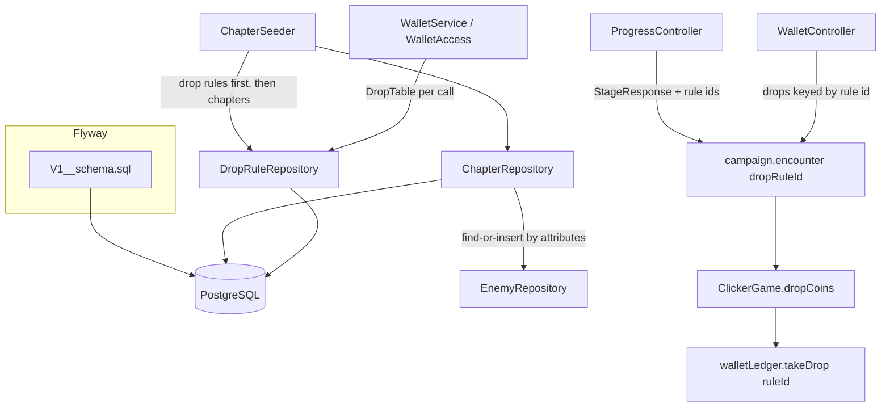

# Normalized Schema Design

**Spec**: `.specs/features/normalized-schema/spec.md`
**Status**: Approved

---

## Architecture Overview

The schema moves from Hibernate (`ddl-auto: update`) to one Flyway migration, `V1__schema.sql`, which declares every table, foreign key, unique and `CHECK` constraint. Hibernate only validates (`ddl-auto: validate`). Entities keep the codebase's style: plain id columns, with the repository assembling the domain object (no `@ManyToOne`). The foreign keys live in SQL, where the database enforces them.

Two catalogs are added: `enemies` and `drop_rules`. The domain does not see enemy ids. A stage still carries `EnemyStats` values, and `ChapterRepository` resolves them to `enemies` rows (find or insert) when saving and joins them when reading. Drop rules are visible to the domain, because the wallet and the game key queues by rule id. `DropRule.level` becomes `DropRule.id`, and the `DropTable` is read from `drop_rules` on each wallet operation instead of being a yaml bean.



---

## Code Reuse Analysis

### Existing Components to Leverage

| Component | Location | How to Use |
| --------- | -------- | ---------- |
| `DropRule`, `DropTable` | `backend/.../domain/DropTable.kt` | Keep; rename `level` → `id`. Validation stays (the `CHECK` constraints mirror it). |
| `LevelDrops` | `backend/.../domain/LevelDrops.kt` | Rename to `DropQueue`, `level` → `ruleId`; the queue and allowance rules are unchanged. |
| `Wallet.refreshed/credit/open` | `backend/.../domain/Wallet.kt` | Unchanged logic, keyed by rule id; `levels` → `queues`. |
| `insert ... on conflict do nothing` pattern | `WalletRepository`, `ProgressRepository` | Reused for `enemies` find-or-insert (`on conflict (element, physical_defense, magical_defense, crit_resistance) do nothing`, then select). |
| Seed-never-overwrite pattern | `ChapterSeeder`, `HeroSeeder` | `ChapterSeeder` seeds the missing drop rules by id before the chapters. |
| `ChapterDefinition.of(n)` | `backend/.../domain/Chapter.kt` | Stays the seed source; also sets the three drop rule ids. New `ChapterDefinition.dropRules(n)` returns chapter n's 3 seed rules. |
| `IntegrationTestBase` + Testcontainers | `backend/src/test/.../IntegrationTestBase.kt` | Flyway runs on the container automatically; FK tests are new `*IT` classes on the same base. |
| `walletLedger` keyed by string | `game/src/domain/economy/walletLedger.js` | Unchanged: keys are already opaque strings, so a rule id works as a level did. |
| `campaign.encounter()` | `game/src/domain/campaign/campaign.js` | Adds `dropRuleId` to each encounter it builds. |

### Integration Points

| System | Integration Method |
| ------ | ------------------ |
| PostgreSQL (docker `postgres:16`, tests `postgres:17`) | Flyway runs `V1` on startup; the local volume is recreated once (`docker compose down -v`) because Flyway refuses a non-empty schema without history |
| `GET /progress`, `/farm` | `StageResponse` gains `monsterDropRuleId`, `minibossDropRuleId`; `ChapterResponse` gains `bossDropRuleId` |
| `GET /wallet`, `POST /wallet/sync` | Same JSON shape; keys are rule ids; error code `WALLET_UNKNOWN_DROP_RULE` |
| Game e2e fake backend | `game/e2e/support/fakeBackend.js` serves rule ids in the definition and keys `drops` by them |

---

## Components

### Flyway migration

- **Purpose**: The single source of the schema.
- **Location**: `backend/src/main/resources/db/migration/V1__schema.sql`; `build.gradle.kts` adds `org.springframework.boot:spring-boot-starter-flyway` and `org.flywaydb:flyway-database-postgresql` (versions from the Boot BOM); `application.yaml` sets `ddl-auto: validate` and drops `app.wallet`.
- **Dependencies**: none.
- **Reuses**: Every current entity mapping for the tables that do not change (column names, types and lengths copied from the entities so `validate` passes).

### EnemyEntity + JpaEnemyRepository

- **Purpose**: One row per distinct enemy attribute set.
- **Location**: `backend/.../adapter/repository/ChapterEntities.kt`, `ChapterRepository.kt`
- **Interfaces**:
  - `insertIfAbsent(element, physicalDefense, magicalDefense, critResistance): Int` (native, `on conflict do nothing`)
  - `findByElementAndPhysicalDefenseAndMagicalDefenseAndCritResistance(...): EnemyEntity?`
- **Reuses**: `statsOf` in `ChapterEntities.kt` becomes `EnemyEntity.toDomain()`.

### StageEntity / ChapterEntity (reshaped)

- **Purpose**: Stage and chapter numbers plus references.
- **Changes**: the 8 + 4 attribute columns and their `columnDefinition` defaults are removed. Added: `monster_enemy_id`, `miniboss_enemy_id`, `monster_drop_rule_id`, `miniboss_drop_rule_id`, and on the chapter `boss_enemy_id`, `boss_drop_rule_id`. `toDomain` takes an `enemies: Map<Long, EnemyStats>`.
- **Keys**: the `stages.id` `"chapter/number"` string stays, plus `unique (chapter, number)` as the target of the `progress` FK.

### ChapterRepository (reshaped)

- **Purpose**: Assembles `ChapterDefinition` from chapter, stages and enemies; resolves `EnemyStats` to ids when saving.
- **Interfaces** (port unchanged): `findByNumber`, `existsByNumber`, `save`.
- **Reuses**: find-or-insert pattern.

### DropRuleEntity + DropRuleRepository + `DropRuleRepositoryPort`

- **Purpose**: Persist and read drop rules.
- **Location**: `backend/.../adapter/repository/DropRuleRepository.kt`, `backend/.../port/DropRuleRepositoryPort.kt`
- **Interfaces**:
  - `findAll(): DropTable` - every rule, ordered by id.
  - `existsById(id: Int): Boolean`
  - `save(rule: DropRule)`
- **Dependencies**: JPA.

### Wallet persistence (renamed)

- `WalletLevelEntity` → `WalletDropQueueEntity` (`wallet_drop_queues`: `id "username/ruleId"`, `username`, `drop_rule_id`, `drops`, `allowance`, `allowance_updated_at`); `JpaWalletLevelRepository` → `JpaWalletDropQueueRepository`.

### WalletService / WalletAccess

- **Change**: the injected `DropTable` bean is replaced by `DropRuleRepositoryPort`; `val table = dropRules.findAll()` at the start of each operation, so a rule tuned in the database applies on the next request.
- `WalletConfig` keeps only the `DropRollerPort` bean; `WalletProperties`, `DropRuleProperties` and `WalletConfigTest` are removed.

### ChapterSeeder

- **Change**: for chapters 1..5, first saves each rule of `ChapterDefinition.dropRules(n)` whose id is missing, then the chapter when missing.

### Domain changes

- `StageDefinition` + `monsterDropRuleId: Int`, `minibossDropRuleId: Int`; `ChapterDefinition` + `bossDropRuleId: Int`. Both default to `1`, so the many test fixtures that build them by hand keep compiling.
- `ChapterDefinition.dropRules(c)` = `DropRule(3c-2, c, 5c, 1500)`, `DropRule(3c-1, 5c, 15c, 1500)`, `DropRule(3c, 20c, 50c, 1500)`; `of(c)` references those ids.
- `UnknownLevelException` → `UnknownDropRuleException` (`WALLET_UNKNOWN_DROP_RULE`, "Drop rule '<id>' is unknown").

### Game

- `campaign.encounter()` returns `dropRuleId`: `stage.monsterDropRuleId` (phase), `stage.minibossDropRuleId` (miniboss), `definition.bossDropRuleId` (chapter boss), `null` for a farm encounter.
- `Monster(maxHealth, dropRuleId = null, stats)` replaces `level`; `ClickerGame` builds it with `encounter.dropRuleId` and calls `takeDrop(this.monster.dropRuleId)`.
- `walletLedger.takeDrop(null)` returns `null` (no queue under the key `"null"`), which covers AC 11.

---

## Data Models

```sql
create table drop_rules (
    id               integer primary key,               -- chosen by the seed / operator (was the level)
    min_copper       integer not null check (min_copper >= 1),
    max_copper       integer not null,
    kill_interval_ms bigint  not null check (kill_interval_ms >= 1),
    check (max_copper >= min_copper)
);

create table enemies (
    id               bigint generated by default as identity primary key,
    element          varchar(32) not null check (element in ('FIRE','WATER','NATURE','LIGHT','DARKNESS')),
    physical_defense integer not null check (physical_defense between 0 and 90),
    magical_defense  integer not null check (magical_defense between 0 and 90),
    crit_resistance  integer not null check (crit_resistance between 0 and 100),
    unique (element, physical_defense, magical_defense, crit_resistance)
);

create table chapters (
    number             integer primary key,
    boss_health        integer not null,
    boss_time_limit_ms bigint  not null,
    boss_enemy_id      bigint  not null references enemies (id) on delete restrict,
    boss_drop_rule_id  integer not null references drop_rules (id) on delete restrict
);

create table stages (
    id                     varchar(255) primary key,     -- "chapter/number"
    chapter                integer not null references chapters (number) on delete restrict,
    number                 integer not null,
    phases_per_stage       integer not null,
    monster_health         integer not null,
    miniboss_health        integer not null,
    miniboss_time_limit_ms bigint  not null,
    monster_enemy_id       bigint  not null references enemies (id) on delete restrict,
    miniboss_enemy_id      bigint  not null references enemies (id) on delete restrict,
    monster_drop_rule_id   integer not null references drop_rules (id) on delete restrict,
    miniboss_drop_rule_id  integer not null references drop_rules (id) on delete restrict,
    unique (chapter, number)
);

create table wallet_drop_queues (
    id                   varchar(255) primary key,       -- "username/ruleId"
    username             varchar(255) not null references users (username) on delete cascade,
    drop_rule_id         integer not null references drop_rules (id) on delete restrict,
    drops                varchar(512) not null,
    allowance            integer not null,
    allowance_updated_at bigint  not null
);
```

The unchanged tables (`users`, `refresh_tokens`, `wallets`, `progress`, `heroes`, `hero_skills`, `player_cards`, `card_copies`, `equipment_pieces`) are created with their current columns plus these FKs:

| Column | References | On delete |
| ------ | ---------- | --------- |
| `refresh_tokens.username`, `wallets.username`, `progress.username`, `player_cards.username`, `card_copies.username`, `equipment_pieces.username` | `users(username)` | cascade |
| `hero_skills.hero_id`, `card_copies.hero_id`, `equipment_pieces.hero_id` (nullable), `player_cards.leader_id` | `heroes(id)` | restrict |
| `progress(chapter, stage)` | `stages(chapter, number)` | restrict |

Indexes: the existing `idx_*` indexes are kept; `wallet_drop_queues(username)` gets `idx_wallet_drop_queues_username`. PostgreSQL does not index FK columns automatically. Catalog FK columns get no index: the catalogs are tiny and are never deleted.

---

## Error Handling Strategy

| Error Scenario | Handling | User Impact |
| -------------- | -------- | ----------- |
| Entity and schema disagree | Hibernate `validate` aborts startup | Backend does not start; caught by every `*IT` |
| Old non-empty local database | Flyway aborts ("non-empty schema without history") | Developer runs `docker compose down -v` once (documented in `backend/readme.md`) |
| Sync names an unknown rule | `UnknownDropRuleException` → 400 `WALLET_UNKNOWN_DROP_RULE`, nothing credited | Game keeps the kills and retries (existing behavior) |
| FK violation from application code | Propagates as `DataIntegrityViolationException` → 500 | Should never happen; it is a bug signal, not a flow |
| Encounter without a drop rule (farm, missing queue) | `takeDrop` returns null | No coins for that kill |

---

## Risks & Concerns

| Concern | Location (file:line) | Impact | Mitigation |
| ------- | -------------------- | ------ | ---------- |
| Seeders run as `ApplicationRunner` after the web server starts; a request in the first moments could reach empty catalogs | `adapter/config/ChapterSeeder.kt:12`, `HeroSeeder.kt:11` | With FKs, registering before heroes are seeded now fails (FK on `leader_id`) instead of writing an orphan | Accepted: local single-user startup. The FK turns silent corruption into a visible error |
| `validate` is strict about types: `varchar` vs `text`, `integer` vs `bigint` | every entity | Startup failure if the SQL drifts from an entity | One task creates the SQL by reading each entity; the whole `*IT` suite is its gate |
| Renaming `LevelDrops`/`level` touches many tests | `domain/LevelDrops.kt`, 12 test files | Large diff, risk of weakening tests during the rename | Rename only (no behavior change), in its own task; assertions keep their values |
| Comma-separated columns remain (`cleared_chapters`, `drops`, `affixes`) | `PlayerCardsEntities.kt:26`, `WalletEntities.kt:39`, `PieceEntity.kt:31` | Not normalized | Out of scope (spec); no FK-relevant data inside them |
| `stages.id` string duplicates `(chapter, number)` | `ChapterEntities.kt:70` | Mild redundancy | Kept for consistency with `hero_skills`, `card_copies`, `wallet_drop_queues`; the unique constraint guarantees agreement |
| Docker uses PostgreSQL 16, tests use 17 | `backend/docker-compose.yml:3`, `IntegrationTestBase.kt:32` | A 17-only SQL feature would pass tests and fail locally | `V1` uses only SQL available in 16 (identity columns, checks, FKs) |

---

## Tech Decisions (only non-obvious ones)

| Decision | Choice | Rationale |
| -------- | ------ | --------- |
| FK mapping in JPA | Plain id columns; FKs only in SQL | Matches every entity in the codebase; no lazy loading or cascade surprises. Alternative: `@ManyToOne` was rejected as a new pattern for no gain |
| Seeding | Kotlin seeders (not SQL inserts in a migration) | Seed values are computed and unit-tested in `ChapterDefinition.of`; migrations stay schema-only. Alternative: `V2__seed.sql` was rejected because the formulas would be duplicated in SQL |
| Drop rule ids | Explicit integers chosen by the seed (`3c-2`, `3c-1`, `3c`), no identity | The id is the key the game and the wallet use, like the level was; the operator picks the id when adding a rule by SQL |
| Enemy ids | Identity; the domain never sees them | Enemies are deduplicated by attributes, and the API exposes attributes, not ids |
| Drop table lifetime | Read from the database on each wallet operation | 15 small rows; tuning applies without a restart, the same promise as stage tuning (ADR 0006) |
| Renames | `LevelDrops` → `DropQueue`, `wallet_levels` → `wallet_drop_queues`, `DropRule.level` → `id` | "Level" no longer exists anywhere in the game |

> Project-level: **AD-010** - Flyway owns the schema (`V1__schema.sql` onward, `ddl-auto: validate`); every reference is a SQL foreign key, with entities holding plain id columns. Recorded in `.specs/STATE.md` and `backend/docs/adr/0009-normalized-schema.md`.
