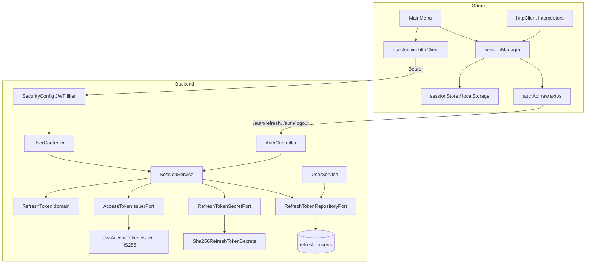

# Persistent Session Design

**Spec**: `.specs/features/persistent-session/spec.md`
**Status**: Draft

---

## Architecture Overview

Backend keeps the existing hexagonal layout (`adapter` → `usecase`/`port` → `service` → `domain`). Session logic is a new `SessionService` that issues and rotates tokens; HTTP concerns (Bearer verification, 401 body) live in `adapter/security`. The game gets a small `auth` module (store + manager) that `httpClient` calls through two injected hooks, so there is no import cycle.



Flow of a protected call with an expired access token: `httpClient` sends Bearer → backend 401 → response interceptor asks `sessionManager.refresh()` (single in-flight promise) → `POST /auth/refresh` rotates the pair → stored → original request retried once.

---

## Code Reuse Analysis

### Existing Components to Leverage

| Component | Location | How to Use |
| --- | --- | --- |
| `BusinessException` hierarchy + `ApiExceptionHandler` | `backend/.../domain/BusinessException.kt`, `adapter/web/ApiExceptionHandler.kt` | Add `InvalidRefreshTokenException` (401, `AUTH_INVALID_REFRESH_TOKEN`) per ADR 0003 |
| `PasswordHasherPort` / `BCryptPasswordHasher` | `port/`, `adapter/security/` | Pattern for the new ports and adapters in `adapter/security` |
| `Fakes.kt` (`FakePasswordHasher`, `InMemoryUserRepository`) | `backend/src/test/...` | Extend with in-memory refresh-token repo, fake issuer, fake secrets |
| `IntegrationTestBase` + `UserControllerIT` | `backend/src/test/...` | Reuse Testcontainers setup; add helper to obtain a Bearer token |
| `httpClient` + `ApiError` | `game/src/api/` | Add auth interceptors; `ApiError.status === 0` identifies network failures (SESS-08) |
| `MainMenu` DOM form pattern, `showMessage` | `game/src/scenes/MainMenu.js` | Add restore flow, Logout button, logo scale |
| `fakeBackend.js`, `game.js` e2e helpers | `game/e2e/support/` | Extend with `/auth/*`, tokens, 401 on missing/expired Bearer |

### Integration Points

| System | Integration Method |
| --- | --- |
| Postgres | New table `refresh_tokens` created by Hibernate `ddl-auto: update` (no migration tool in repo) |
| Vite dev proxy | `/api/auth/**` already covered by the `/api` → backend rewrite |
| `start.sh` | Exports a dev-only `JWT_SECRET` default so `bootRun` starts |

---

## Components

### SessionService (backend)

- **Purpose**: Issue a token pair for a user, rotate it on refresh, revoke on logout.
- **Location**: `backend/.../service/SessionService.kt`
- **Interfaces** (`usecase/SessionUseCase.kt`):
  - `StartSessionUseCase.start(user: User): AuthTokens`
  - `RefreshSessionUseCase.refresh(rawRefreshToken: String): AuthTokens`
  - `EndSessionUseCase.end(rawRefreshToken: String)`
- **Dependencies**: `AccessTokenIssuerPort`, `RefreshTokenSecretPort`, `RefreshTokenRepositoryPort`, `UserRepositoryPort`
- **Reuses**: `UserService` transaction/logging style

### RefreshToken (domain)

- **Purpose**: Owns the lifetime rules: usable only if not revoked and `now < expiresAt`.
- **Location**: `backend/.../domain/RefreshToken.kt`
- **Interfaces**:
  - `RefreshToken.issue(username, secrets, now): IssuedRefreshToken` (raw value + entity)
  - `isUsableAt(now): Boolean`, `revoke(): RefreshToken`
  - constants `TTL_MS = 30 days`
- **Dependencies**: `RefreshTokenSecretPort`

### Ports (`port/SessionPorts.kt`)

- `AccessTokenIssuerPort.issue(username, now): AccessToken(value, expiresAt)` (TTL 24 h owned by the adapter's properties)
- `RefreshTokenSecretPort.generate(): String`, `hash(raw): String`
- `RefreshTokenRepositoryPort.save`, `findByHash`, `revokeAllByUsername`, `deleteAllByUsername`

### Security adapters (`adapter/security`)

- `SecurityProperties` - `@ConfigurationProperties("app.security")`: `jwtSecret` (≥ 32 bytes), `accessTokenTtl` default `24h`. Startup fails when the secret is short or missing (SESS-12).
- `JwtAccessTokenIssuer` - `NimbusJwtEncoder` with HS256, `sub` = username, `iat`, `exp`.
- `Sha256RefreshTokenSecrets` - `SecureRandom` 32 bytes → Base64URL; SHA-256 hex hash.
- `SecurityConfig` - stateless chain, CSRF off, `POST /users`, `POST /users/login`, `POST /auth/refresh`, `POST /auth/logout` permitted, everything else authenticated; `oauth2ResourceServer { jwt }` with `NimbusJwtDecoder.withSecretKey(key).macAlgorithm(HS256)`; custom `AuthenticationEntryPoint` writes ProblemDetail `{status:401, detail, code:"AUTH_UNAUTHENTICATED"}`.

### Persistence (`adapter/repository`)

- `RefreshTokenEntity` (`refresh_tokens`: `token_hash` PK, `username` indexed, `expires_at`, `revoked`).
- `RefreshTokenRepository` implements `RefreshTokenRepositoryPort` over `JpaRefreshTokenRepository`.

### Web (`adapter/web`)

- `UserController`: `POST /users` (201) and `POST /users/login` return `AuthResponse`.
- `AuthController`: `POST /auth/refresh` → `AuthResponse`, `POST /auth/logout` → 204.
- `AuthResponse(user: UserResponse, accessToken, refreshToken, accessTokenExpiresAt, refreshTokenExpiresAt)`.

### sessionStore (game)

- **Purpose**: Persist and validate the session in `localStorage`, with in-memory fallback.
- **Location**: `game/src/auth/sessionStore.js`
- **Interfaces**: `load(): Session | null` (drops invalid JSON / missing fields), `save(session)`, `clear()`, `fromAuthResponse(res): Session`.
- **Session shape**: `{ user, accessToken, refreshToken, accessTokenExpiresAt, refreshTokenExpiresAt }`.

### authApi (game)

- **Location**: `game/src/api/authApi.js`
- Own axios instance (same config, no auth interceptors) so refresh cannot recurse: `refresh(refreshToken)`, `logout(refreshToken)`; errors through `ApiError.from`.

### sessionManager (game)

- **Location**: `game/src/auth/sessionManager.js`
- **Interfaces**:
  - `start(authResponse)` - save + keep in memory
  - `restore(now?): Promise<{status:'active', user} | {status:'none'} | {status:'offline', message}>` - covers SESS-03/04/07/08/09/10
  - `refresh(): Promise<string>` - single-flight; on 401 clears session; rejects with `ApiError`
  - `accessToken(): string | null`
  - `logout(): Promise<void>` - best-effort `authApi.logout`, always clears (SESS-15)
- **Dependencies**: `sessionStore`, `authApi`

### httpClient interceptors (game)

- Request: attach `Authorization: Bearer` when `sessionManager.accessToken()` exists and `config.skipAuth` is not set.
- Response: on `status 401`, request carried our Bearer, not yet retried → `await sessionManager.refresh()`, retry once. Otherwise reject with `ApiError`.
- `userApi.login` / `signUp` pass `skipAuth: true`, so a wrong-password 401 never triggers a refresh.

### MainMenu (game)

- `create()`: logo `setScale(400 / logo.width)`, tween to `y = 150`; if registry has `user` show welcome; else `await sessionManager.restore()` → welcome / form / form + error.
- Login/sign-up success calls `sessionManager.start(response)` then sets registry `user = response.user`.
- Welcome state adds a "Logout" button (own DOM element, normal pointer events, `name="logout"`) at y = 640; click → `sessionManager.logout()` → clear registry, destroy welcome, show form.

---

## Data Models

```kotlin
data class RefreshToken(
    val tokenHash: String,
    val username: String,
    val expiresAt: Long,   // epoch ms
    val revoked: Boolean,
)

data class AuthTokens(
    val user: User,
    val accessToken: String,
    val accessTokenExpiresAt: Long,
    val refreshToken: String,
    val refreshTokenExpiresAt: Long,
)
```

**Relationships**: `RefreshToken.username` references `users.username` logically; no FK (matches existing schema style), cleanup is done by `UserService.delete`.

---

## Error Handling Strategy

| Error Scenario | Handling | User Impact |
| --- | --- | --- |
| Refresh token unknown / expired / revoked / user gone | `InvalidRefreshTokenException` → 401 `AUTH_INVALID_REFRESH_TOKEN` | Game clears session, login form |
| Missing / bad / expired Bearer | Entry point → 401 `AUTH_UNAUTHENTICATED` | Game refreshes once, else login form |
| Blank `refreshToken` in body | `require` → 400 | Not reachable from the game |
| Backend down during restore | `restore()` returns `offline`; storage kept | Login form + "Cannot reach the server. Try again later." |
| Backend down during logout | Swallowed | Local session cleared, login form |
| `localStorage` throws | In-memory fallback | Session lasts until page unload |

---

## Risks & Concerns

| Concern | Location (file:line) | Impact | Mitigation |
| --- | --- | --- | --- |
| Security: refresh token in `localStorage` is readable by any injected script | `game/src/auth/sessionStore.js` (new) | XSS steals a 30-day credential | Accepted by user; rotation + revocation bound the damage; no `innerHTML` with user data (MainMenu uses `textContent`) |
| Security: all `/users/**` currently unauthenticated, including delete | `UserController.kt:60-75` | Anyone can delete users | Fixed by SecurityConfig (T14); per-user authorization stays out of scope |
| Security: login reveals whether a username exists | `UserService.kt:73-75` | Username enumeration | Pre-existing, documented in ADR 0003; unchanged |
| Tech debt: `UserService` uses `System.currentTimeMillis()` directly | `UserService.kt:36,76` | Hard to test expiry deterministically | `SessionService` takes `now` from an injected `java.time.Clock`-backed lambda; `UserService` untouched |
| Test gap: no auth tests exist; ITs call protected routes anonymously | `UserControllerIT.kt` | ITs fail once SecurityConfig lands | T14 adds a token helper in `IntegrationTestBase` and updates the ITs in the same commit |
| Fragile: `MainMenu` mixes DOM building and flow in one class | `MainMenu.js:56-110` | More branches raise bug risk | Session logic lives in `sessionManager`; MainMenu only renders states |
| Fragile: Spring Boot 4 / Security 7 starter names unverified | `backend/build.gradle.kts` | Build may fail | T14 resolves dependencies first; Context7 confirmed `NimbusJwtDecoder.withSecretKey` and the Kotlin DSL; starter artifact names to verify during T14 |
| Two tabs refreshing at once | `sessionManager.refresh` | Second tab gets 401 → login form | Logged as assumption; single-flight inside a tab only |

---

## Tech Decisions (only non-obvious ones)

| Decision | Choice | Rationale |
| --- | --- | --- |
| Access token | Stateless JWT (HS256) | No DB hit per request; 24 h expiry makes revocation lag acceptable |
| Refresh token | Opaque random, hashed in DB | Revocable; leak of DB gives no usable token |
| Login/sign-up wiring | Controller calls `loginUser.login` then `startSession.start(user)` | Keeps `UserService` free of token concerns; two transactions, acceptable |
| 401 on `/users/login` | Excluded from refresh via `skipAuth` | Wrong password must not trigger refresh/retry loops |
| Property for tests | `@SpringBootTest(properties = ["app.security.jwt-secret=..."])` | Avoids a test `application.yaml` that would shadow the main one |
| Dev secret | `start.sh` exports `JWT_SECRET` default | `application.yaml` itself has no default (SESS-12) |

> Project-level: AD-001 (stateless JWT access + rotating opaque refresh, localStorage on the game) recorded in `.specs/STATE.md`.
