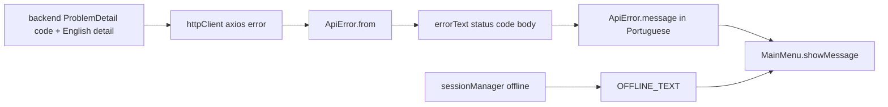

# Portuguese Text Design

**Spec**: `.specs/features/portuguese-text/spec.md`
**Status**: Approved by the owner on 2026-11-26 (recommended defaults)

Paths: `main/` = `backend/src/main/kotlin/br/com/woodriver/infinity_grove_ws/`, `test/` = `backend/src/test/kotlin/br/com/woodriver/infinity_grove_ws/`.

---

## Architecture Overview

No new layer: each English string is replaced where it lives (Q1). One new pure module in the application layer turns a failed request into the Portuguese line the player reads, by the backend `code` (Q2, AD-032). The backend adds one code.



| Area | File | Strings (spec § Inventory) |
| --- | --- | --- |
| Error lines | `game/src/application/errorText.js` (new), `ApiError.js`, `session/sessionManager.js` | I11 to I18 |
| Main menu | `game/src/adapters/phaser/MainMenu.js`, `game/index.html` | I1 to I10, I34 |
| Stage plate | `game/src/domain/campaign/campaign.js` | I19 to I21 |
| Enemy chip | `game/src/adapters/phaser/ClickerGame.js` `showEnemyStats` | I26 |
| Wallet, timer, messages | `ClickerGame.js` `COINS`, `showCountdown`, `LOAD_FAILED_TEXT`, `COMPLETED_TEXT` | I22 to I25 |
| Pause menu, farm switch | `ClickerGame.js` `PAUSE_MENU_HTML`, `FARM_TOGGLE_HTML` | I27 to I33 |
| Short-password code | `main/domain/BusinessException.kt`, `main/domain/User.kt`, `main/adapter/web/ApiExceptionHandler.kt` | I17 |

AD-003 holds: `errorText.js` is pure and imports nothing; `ApiError.js` (application) imports it; no adapter is imported inward.

---

## Components

### `game/src/application/errorText.js` (new, T2)

```js
//  The Portuguese line the player reads for a failed request (spec portuguese-text, AD-032): chosen by the backend `code`, never the
//  backend's English `detail`. Pure JavaScript.
export const OFFLINE_TEXT = 'Não foi possível falar com o servidor. Tente de novo mais tarde.';
export const SETUP_FAILED_TEXT = 'O pedido falhou.';
export const SHORT_PASSWORD_TEXT = 'A senha é muito curta.';

const SESSION_EXPIRED_TEXT = 'Sua sessão expirou. Entre de novo.';
const CODE_TEXTS = Object.freeze({
    USER_ALREADY_EXISTS: 'Esse nome de usuário já existe.',
    LOGIN_USER_NOT_FOUND: 'Usuário não encontrado.',
    LOGIN_INVALID_PASSWORD: 'Senha incorreta.',
    AUTH_INVALID_REFRESH_TOKEN: SESSION_EXPIRED_TEXT,
    AUTH_UNAUTHENTICATED: SESSION_EXPIRED_TEXT
});

//  `status` the HTTP status of the answer, `code` its ProblemDetail code (or null), `body` the answer (or null)
export const errorText = ({ status, code = null, body = null }) =>
{
    if (code === 'USER_PASSWORD_TOO_SHORT')
    {
        return Number.isInteger(body?.minLength) ? `A senha precisa ter pelo menos ${body.minLength} caracteres.` : SHORT_PASSWORD_TEXT;
    }

    return CODE_TEXTS[code] ?? `O pedido falhou (erro ${status}).`;
};
```

### `ApiError.from` (T2)

```js
static from (error)
{
    if (error.response)
    {
        const { status, data } = error.response;
        const code = data?.code ?? null;
        const body = data ?? null;

        return new ApiError(errorText({ status, code, body }), { status, code, body });
    }

    if (error.request)
    {
        return new ApiError(OFFLINE_TEXT);
    }

    return new ApiError(SETUP_FAILED_TEXT);
}
```

`status`, `code` and `body` keep their values (every caller that branches on `code` or `status` is unchanged); only `message` changes. `sessionManager.js:94`: `message: error?.message ?? OFFLINE_TEXT`. `sessionManager.js:28` `new ApiError('No active session', { status: 401 })` stays (Q8: a 401 leads to the sign-in form, the text is never shown).

### Backend short-password code (T1)

`main/domain/BusinessException.kt`, after `InvalidPasswordException`:

```kotlin
/** A password shorter than [minLength] (spec portuguese-text): status 400, with [minLength] in the answer so the game can say the number. */
class PasswordTooShortException(
    val minLength: Int,
) : BusinessException("USER_PASSWORD_TOO_SHORT", "Password must have at least $minLength characters")
```

`main/domain/User.kt` `validatePassword`:

```kotlin
private fun validatePassword(rawPassword: String) {
    if (rawPassword.length < MIN_PASSWORD_LENGTH) {
        throw PasswordTooShortException(MIN_PASSWORD_LENGTH)
    }
}
```

`main/adapter/web/ApiExceptionHandler.kt`, next to the other user handlers:

```kotlin
@ExceptionHandler(PasswordTooShortException::class)
fun passwordTooShort(e: PasswordTooShortException) = problem(HttpStatus.BAD_REQUEST, e).apply { setProperty("minLength", e.minLength) }
```

Spring picks the most specific `@ExceptionHandler`, so the generic `BusinessException` handler (422) never sees it. The answer: `{ "type": "about:blank", "title": "Bad Request", "status": 400, "detail": "Password must have at least 8 characters", "instance": "/users", "code": "USER_PASSWORD_TOO_SHORT", "minLength": 8 }`.

### Main menu (T3)

`FORM_HTML`: `placeholder="Usuário"`, `placeholder="Senha"`, `<button type="button" name="login">Entrar</button>`, `<button type="button" name="signup">Criar conta</button>` (the `name` attributes stay: the code finds the buttons by name). Constants at the top of `MainMenu.js`, used by the handlers:

```js
const EMPTY_FIELDS_TEXT = 'Informe usuário e senha';
const signedInText = (username) => `Bem-vindo de volta, ${username}!`;
const signedUpText = (username) => `Conta criada, ${username}!`;
const welcomeText = (username) => `Olá, ${username}!`;
```

`WELCOME_HTML`: `<p class="welcome-start">Clique para jogar!${PLAY_ICON}</p>`. `LOGOUT_HTML`: `${LOGOUT_ICON}Sair`. `game/index.html`: `<html lang="pt-BR">`.

### Stage plate (T4)

`campaign.js` `encounter()`: `` `Estágio ${this.stage}/${this.stageCount}  Fase ${this.phase}/${stage.phasesPerStage}` ``, `` `Estágio ${this.stage}/${this.stageCount}  Miniboss` ``, `'Chefe do capítulo'`. `stageLabel.js` keeps its regex (it matches the Portuguese ` (Capítulo <n>)` tag of farm labels).

### Scene texts (T5, T6, T7)

```js
//  T5, showEnemyStats: the element chip names the element in Portuguese (ELEMENT_LABELS, already imported)
const name = ELEMENT_LABELS[element];

//  T6
const COINS = [ [ 'gold', 'Ouro' ], [ 'silver', 'Prata' ], [ 'copper', 'Cobre' ] ];
const LOAD_FAILED_TEXT = 'Não foi possível carregar o progresso';
const COMPLETED_TEXT = 'Capítulo concluído!';
//  showCountdown
const text = `Tempo: ${this.countdown.seconds}s`;

//  T7
const FARM_TOGGLE_HTML = '<div class="hud-box hud-farm"><label class="farm-toggle"><input type="checkbox"> Farmar chefe</label></div>';
const PAUSE_MENU_HTML = '<div class="pause-menu" hidden><div class="pause-card">'
    + '<div class="pause-title">Pausado</div>'
    + '<div class="pause-options">'
    + '<button class="pause-continue">1. Continuar</button>'
    + '<button class="pause-leave">2. Sair da luta</button>'
    //  the lines between stay as they are
    + '<div class="pause-question">Sair da luta? Isso conta como derrota.</div>'
    + '<button class="pause-confirm-yes">Sim, sair</button>'
    + '<button class="pause-confirm-no">Não, ficar</button>'
```

The comment of `refreshWalletText` (`"Gold: 2  Silver: 14  Copper: 37"`) becomes `"Ouro: 2  Prata: 14  Cobre: 37"`; the comment of `showEnemyStats` (`"Water  Defesa 10%  Seu crítico: 28%"`) becomes `"Água  Defesa 10%  Seu crítico: 28%"`.

---

## Test Text Mapping (T8)

Exact replacements inside string literals of `game/e2e/**` and `game/ui-review/**`. A row applies only to the assertion or locator text named; the English `detail` strings of `game/e2e/support/fakeBackend.js` stay (they prove the game ignores them).

| # | Find (in a test string) | Replace |
| --- | --- | --- |
| M1 | `Welcome back, ` | `Bem-vindo de volta, ` |
| M2 | `Account created, ` | `Conta criada, ` |
| M3 | `Hello, ` (welcome title) | `Olá, ` |
| M4 | `Click to Start!` | `Clique para jogar!` |
| M5 | `Enter username and password` | `Informe usuário e senha` |
| M6 | `{ name: 'Login' }` / `{ name: 'Sign up' }` / `{ name: 'Logout' }` | `{ name: 'Entrar', exact: true }` / `{ name: 'Criar conta', exact: true }` / `{ name: 'Sair', exact: true }` |
| M7 | `Cannot reach the server. Try again later.` (in an assertion) | `Não foi possível falar com o servidor. Tente de novo mais tarde.` |
| M8 | `"User 'yan' already exists"` (in an assertion) | `'Esse nome de usuário já existe.'` |
| M9 | `'Password is invalid'` (in an assertion) | `'Senha incorreta.'` |
| M10 | `"User 'ghost' does not exist"` (in an assertion) | `'Usuário não encontrado.'` |
| H1 | `Stage <s>/<n>  Phase <p>/<m>` | `Estágio <s>/<n>  Fase <p>/<m>` |
| H2 | `Stage <s>/<n>  Miniboss` | `Estágio <s>/<n>  Miniboss` |
| H3 | `Chapter Boss` | `Chefe do capítulo` |
| H4 | `Time: <n>` (also a regex `/Time: \d+/`) | `Tempo: <n>s` (`/Tempo: \d+s/`) |
| H5 | `Gold: <g> Silver: <s> Copper: <c>` | `Ouro: <g> Prata: <s> Cobre: <c>` |
| H6 | the element word at the start of an enemy line text: `Fire  `, `Water  `, `Nature  `, `Light  `, `Darkness  ` | `Fogo  `, `Água  `, `Natureza  `, `Luz  `, `Escuridão  ` |
| H7 | `Could not load progress` | `Não foi possível carregar o progresso` |
| H8 | `Chapter complete!` | `Capítulo concluído!` |
| H9 | `Farm boss` | `Farmar chefe` |
| H10 | `Paused`, `1. Continue`, `2. Leave fight`, `Leave the fight? It counts as failed.`, `Yes, leave`, `No, stay` | `Pausado`, `1. Continuar`, `2. Sair da luta`, `Sair da luta? Isso conta como derrota.`, `Sim, sair`, `Não, ficar` |

Files with matches on 2026-11-26 (`git grep -l -F` over `game/e2e game/ui-review`): M1 in 43 e2e files, `e2e/support/affixFight.js` and 15 `ui-review/*.shots.js`; M2, M5, M8, M9, M10 in `e2e/auth.spec.js`; M3 in `auth.spec.js`, `session.spec.js`, `wake.spec.js`; M4 in `uiRedesign.spec.js`; M6 in `e2e/support/game.js` and `ui-review/uiRedesign.shots.js`; M7 in `auth.spec.js`, `session.spec.js`, `wake.spec.js`; H1/H2 in `bossMap`, `campaignChapters`, `drops`, `earlyGameRebalance`, `farm`, `heroTeamField`, `minibossAdds`, `minibossAddsSkills`, `stages`; H3 in `stages`; H4 in `bossReplayChapters`, `earlyGameRebalance`, `farm`, `heroTeamPassives`, `minibossAdds`, `stages`, `talentTreeReworkCombat`, `talents`, `uiRedesign`; H5 in `blackAwarenessStaff`, `bulkSell`, `drops`, `equipment`, `heroTeam`, `heroTeamCombat`; H6 in `elements`, `minibossAdds`, `minibossAddsSkills`, `minibossAddsTarget`, `uiRedesign`, `unifiedDamage`, `ui-review/unifiedDamage.shots.js`; H7 in `uiRedesign`; H8 in `campaignChapters`, `farm`, `monsterAffixes`, `stages`; H9 in `farm`, `uiRedesign`; H10 in `heroes`, `farm`, `uiRedesign`, `ui-review/uiRedesign.shots.js`. The lists drift: run the grep again before editing.

---

## Layout

| Element | Today | After | Check (ui review, T11) |
| --- | --- | --- | --- |
| Start prompt `.welcome-start` | `Click to Start!` + icon in a 320 px pill, Cinzel 700 22 px | `Clique para jogar!` + icon, same pill | One line, nothing clipped, the icon inside the pill |
| Stage plate `.stage-hud` | `Stage 10/10  Phase 8/8` | `Estágio 10/10  Fase 8/8` (1 character longer) | `placeBossTimer` keeps the timer at least 12 px right of the plate |
| Boss timer `.boss-timer` | `Time: 45` | `Tempo: 45s` | The ring around the text; one line |
| Element chip | `Darkness` | `Escuridão` | One line; chips of the enemy line do not wrap |
| Farm switch label | `Farm boss`, 12 px 700 | `Farmar chefe` | One line under the 56 px switch, inside the battle bar |
| Pause menu | `2. Leave fight`, `No, stay` | `2. Sair da luta`, `Não, ficar` | Buttons keep one line inside the card |
| Message line `.auth-message` | `Cannot reach the server. Try again later.` | `Não foi possível falar com o servidor. Tente de novo mais tarde.` (longest, 64 characters) | Wraps inside the oval column on desktop, nothing clipped |

---

## Error Handling Strategy

| Error Scenario | Handling | User Impact |
| --- | --- | --- |
| A code the game does not know | `O pedido falhou (erro <status>).` | A generic Portuguese line instead of an English `detail` |
| `USER_PASSWORD_TOO_SHORT` from an old backend (no code yet: 400 only) | `O pedido falhou (erro 400).` | Until T1 is deployed |
| No answer | `OFFLINE_TEXT` | Same meaning as today, in Portuguese |

---

## Risks & Concerns

| Concern | Location (file:line) | Impact | Mitigation |
| --- | --- | --- | --- |
| 43 e2e files assert `Welcome back, yan!` in their own start helper | `game/e2e/*.spec.js` | A typo breaks a whole file | Scripted exact replacement (M1); T8 runs every changed file |
| `getByRole('button', { name: 'Sair' })` is a substring match by default | `game/e2e/support/game.js:44` | Could match `2. Sair da luta` or `Sim, sair` if both are visible | M6 adds `exact: true` |
| Tests build `ApiError` fixtures with the old English message | 12 unit files (`Cannot reach ...`) | None: they construct their own errors; no assertion reads the constant | Left as fixtures; PT-06 AC 2 covers I3 to I10 and I19 to I33 only |
| The live Worker shows the backend `detail` | Until the game of T2 is published | English error lines until then | Additive backend change (Q10) |
| `ui-redesign` UIR-15 AC 6 names the prompt text | `game/e2e/uiRedesign.spec.js` (prompt style case) | Its text assertion changes | M4; the style values of the pill stay |

---

## Tech Decisions (only non-obvious ones)

| Decision | Choice | Rationale |
| --- | --- | --- |
| Where the error line is chosen | `ApiError.from` through `errorText` | One place; every screen that shows `error.message` gets Portuguese |
| Element chip text | `ELEMENT_LABELS` | Same names as the Elementos panel and `Fraco: <elemento>` |
| Project-level rule | AD-032 in `STATE.md` | Every future player-visible backend error needs a code and a line in `errorText.js` |
