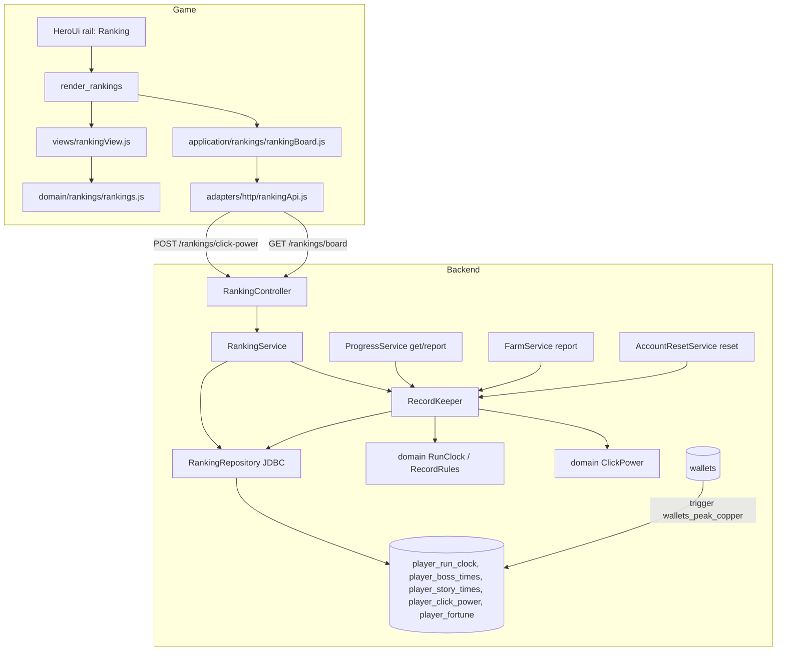

# Rankings Design

**Spec**: `.specs/features/rankings/spec.md`
**Status**: Draft (waits for the owner's answers to spec Q1 to Q14)

---

## Architecture Overview

The backend owns every ranking value. Records are written as side effects of requests it already handles, in the same transaction; the game only reads the boards and pokes the click power.



Flow of one boss time: the last miniboss `CLEARED` -> `ProgressService.report` saves the progress -> `RecordKeeper.onOutcome` sees `next.position.encounter == CHAPTER_BOSS` and saves `boss_reached_at = now`. The boss `CLEARED` -> `onOutcome` measures `now - boss_reached_at`, applies the 1 000 ms floor, upserts `player_boss_times` keeping the smaller value, stops the clock, and (chapter 15) measures the story time; then it computes the click power.

---

## Code Reuse Analysis

### Existing Components to Leverage

| Component | Location | How to Use |
| --- | --- | --- |
| `Clock` bean, `MutableClock` fake | `InfinityGroveWsApplication.kt:14`, `test/Fakes.kt:106` | `RecordKeeper` reads `clock.millis()`; tests move time by hand |
| `Progress`, `ProgressPosition`, `Encounter`, `Outcome` | `domain/Progress.kt` | Inputs of the clock rules |
| `Piece.clickDamage()`, `Piece.value(affix)`, `PlayerEquipment.worn` | `domain/Equipment.kt:117-120` | Refined numbers of the power |
| `PlayerCards.starsOf`, `leaderId` | `domain/PlayerCards.kt:41` | Stars and leader |
| `TalentCatalog.find(id).baseId / valueAt` | `domain/Talents.kt:49, 124` | Talent values by base id |
| `Team.boughtSlots`, `Team.allies` | `domain/Team.kt:9` | The allies |
| `ResetRepositoryPort.count`, `UserRepositoryPort.findByUsername` | `port/ResetRepositoryPort.kt`, `port/UserRepositoryPort.kt` | Run start fallback |
| `ChapterRepositoryPort.findByNumber` | `port/ProgressPorts.kt:18` | Story floor |
| `JdbcTemplate` adapter pattern | `adapter/repository/JdbcDatabaseHealth.kt` | `RankingRepository` uses `NamedParameterJdbcTemplate` (native upserts, no entity) |
| Controller parsing pattern | `adapter/web/FarmController.kt:89` (`parseQueryChapter`) | `chapter` query parsing |
| `BusinessException` + `ApiExceptionHandler` | `domain/BusinessException.kt`, `adapter/web/ApiExceptionHandler.kt` | Two new codes |
| `PreviousBackendCompatibilityIT` | `test/adapter/repository/PreviousBackendCompatibilityIT.kt:234` | V20 release case |
| `formatShort`, `formatDamage` | `game/src/domain/combat/numberFormat.js`, `damage.js:42` | Value formats |
| `leaderAttacker`, `allyDamagePerClick`, `teamPassives` | `game/src/domain/combat/*.js`, `domain/heroes/team.js` | Parity test only |
| Farm chapter chips CSS (`.farm-chapters`, `.farm-chapter`, `.is-current`) | `game/public/style.css:3190-3258`, `views/farmView.js:58` | Same look for the boss chapter row |
| Coin discs (`.coin`, `.coin-gold/silver/copper`, `.sr-only`) | `game/public/style.css:258-290`, `ClickerGame.refreshWalletText` | Fortune value and the top 3 position discs |
| `.hero-empty` | `style.css:1493` | Empty board |
| Generation pattern of `farmSession` | `application/farm/farmSession.js:13` | Late answers ignored |
| `mockBackend` | `game/e2e/support/fakeBackend.js:275` | New `rankings` option |

### Integration Points

| System | Integration Method |
| --- | --- |
| `ProgressService` | New last constructor parameter `records: RecordKeeping`; `get` calls `onProgressLoaded`, `report` calls `onOutcome` after the progress is saved and the boss rewards are paid |
| `FarmService` | Last parameter `records: RecordKeeping`; `report` calls `onFarmWin` after a `CLEARED` win is saved |
| `AccountResetService` | Last parameter `records: RecordKeeping`; `reset` calls `onReset` after the legacy is saved |
| Database | `V21__rankings.sql`: five tables, indexes, trigger on `wallets`; JDBC reads and upserts |
| Game rail | Seventh `SCREENS` entry `rankings`; `HeroUi` gets an optional `rankings` collaborator |
| Composition | `rankingApi`, `createRankingBoard` in `composition.js` services; `ClickerGame` passes `this.rankings` and `mapPosition` already exists |

---

## Components

### `RankingBoard`, `RunClock`, `RecordRules` (backend domain)

- **Purpose**: The four board ids and the pure rules of the clocks and floors.
- **Location**: `backend/src/main/kotlin/br/com/woodriver/infinity_grove_ws/domain/Rankings.kt`
- **Interfaces**: see tasks T2 (full Kotlin contract).
- **Reuses**: `Progress`, `ProgressPosition`, `Encounter`, `Outcome`, `ChapterDefinition`.

### `ClickPower` (backend domain)

- **Purpose**: The power formula of spec § Click power.
- **Location**: `domain/ClickPower.kt`
- **Interfaces**: `ClickPower.of(input: ClickPowerInput): Double`, `ClickPower.talentValue(levels, baseId): Int`, `ClickPower.teamActive(progress): Boolean` (T3).
- **Reuses**: `Piece`, `Slot`, `AffixType`, `TalentCatalog`.

### `RankingRepositoryPort` / `RankingRepository`

- **Purpose**: Clock rows, record upserts that keep the better value, top 10 and own position per board.
- **Location**: `port/RankingRepositoryPort.kt`, `adapter/repository/RankingRepository.kt`
- **Interfaces**: T4.
- **Reuses**: `NamedParameterJdbcTemplate` (auto-configured by Spring Boot with the JPA starter).

### `RecordKeeping` / `RecordKeeper`

- **Purpose**: Turns the events of progress, farm and reset into clock moves and records.
- **Location**: `usecase/RecordKeeping.kt` (interface), `service/RecordKeeper.kt` (`@Component`)
- **Interfaces**: `onProgressLoaded`, `onOutcome`, `onFarmWin`, `onReset`, `recordClickPower` (T5).
- **Dependencies**: `RankingRepositoryPort`, `UserRepositoryPort`, `ResetRepositoryPort`, `ChapterRepositoryPort`, `PlayerCardsRepositoryPort`, `EquipmentRepositoryPort`, `TeamRepositoryPort`, `TalentRepositoryPort`, `Clock`.

### `RankingService` / `RankingController`

- **Purpose**: `GET /rankings/{board}` and `POST /rankings/click-power`.
- **Location**: `service/RankingService.kt`, `usecase/RankingUseCase.kt`, `adapter/web/RankingController.kt`
- **Interfaces**: T9, T10.

### Game modules

| Module | Location | Purpose |
| --- | --- | --- |
| `rankings.js` | `game/src/domain/rankings/rankings.js` | `BOARDS` (id, name, subtitle, valueLabel, chaptered), `formatDuration`, `formatRankingValue`, `rankingRows` |
| `rankingApi.js` | `game/src/adapters/http/rankingApi.js` | `get(board, chapter)`, `recordClickPower()` |
| `rankingBoard.js` | `game/src/application/rankings/rankingBoard.js` | Selected board and chapter, last page, `open`, `select`, `cancel` with a generation |
| `rankingView.js` | `game/src/adapters/phaser/views/rankingView.js` | `renderRanking(model, handlers)` DOM |
| `HeroUi.js` | existing | Rail button, `show('rankings')`, `render_rankings` |

---

## Data Models

### Database (`V21__rankings.sql`)

| Table | Columns | Keys and checks |
| --- | --- | --- |
| `player_run_clock` | `username varchar(255)`, `run_started_at bigint null`, `boss_reached_at bigint null` | PK `username`, FK users cascade |
| `player_boss_times` | `username varchar(255)`, `chapter integer`, `best_ms bigint`, `achieved_at bigint` | PK (`username`, `chapter`), FK cascade, `chapter between 1 and 15`, `best_ms >= 0`; index (`chapter`, `best_ms`, `achieved_at`) |
| `player_story_times` | `username varchar(255)`, `best_ms bigint`, `achieved_at bigint` | PK `username`, FK cascade, `best_ms >= 0`; index (`best_ms`, `achieved_at`) |
| `player_click_power` | `username varchar(255)`, `best_power double precision`, `achieved_at bigint` | PK `username`, FK cascade, `best_power > 0`; index (`best_power desc`, `achieved_at`) |
| `player_fortune` | `username varchar(255)`, `peak_copper bigint`, `achieved_at bigint` | PK `username`, FK cascade, `peak_copper >= 0`; index (`peak_copper desc`, `achieved_at`) |

Trigger `wallets_peak_copper` (after insert or update of `copper` on `wallets`, for each row) runs `record_peak_copper()`, an upsert into `player_fortune` that keeps the larger value. Separate tables per record keep the trigger's row locks apart from the rows `RecordKeeper` writes, so no lock order between `wallets` and the records can cross.

### Kotlin (summary; full contracts in tasks)

```kotlin
enum class RankingBoard(val id: String, val lowerIsBetter: Boolean) { BOSS_TIME, STORY_TIME, CLICK_POWER, FORTUNE }
data class RunClock(val username: String, val runStartedAt: Long? = null, val bossReachedAt: Long? = null)
data class RankingEntry(val position: Int, val username: String, val value: Double)
data class RankingMe(val position: Int, val username: String, val value: Double)
data class RankingPage(val board: RankingBoard, val chapter: Int?, val entries: List<RankingEntry>, val me: RankingMe?)
data class ClickPowerResult(val value: Double?, val best: Double?)
```

### API

```
GET /rankings/{board}?chapter=<1..15 for boss-time>
200 { "board": "boss-time", "chapter": 3, "entries": [ { "position": 1, "username": "ana", "value": 12345 } ], "me": { "position": 27, "username": "yan", "value": 40000 } | null }
404 RANKING_NOT_FOUND | 400 INVALID_RANKING_REQUEST | 401

POST /rankings/click-power   (no body)
200 { "value": 41.0 | null, "best": 41.0 | null }
```

`value` is a JSON integer (`Long`) for boss-time, story-time and fortune and a JSON number (`Double`) for click-power.

---

## Error Handling Strategy

| Error Scenario | Handling | User Impact |
| --- | --- | --- |
| Unknown board | 404 `RANKING_NOT_FOUND` | None (the game sends only the four ids) |
| Bad boss chapter | 400 `INVALID_RANKING_REQUEST` | None |
| Record below a floor | Not stored, `warn` log with username, board, ms | The forged value is not ranked |
| Record writer throws (database) | The report's transaction rolls back like any other write of it | The report fails as today on a database error; covered by tests so it does not happen on valid data |
| `GET /rankings` fails or 404 (old backend) | Game shows `Não foi possível carregar.` | Screen empty, rest of the game unchanged |
| `POST /rankings/click-power` fails | Game ignores it and loads the board | Power may be one boss win stale |
| Late answer after a tab switch or close | Generation check drops it | No flicker of the wrong board |

---

## Risks & Concerns

| Concern | Location (file:line) | Impact | Mitigation |
| --- | --- | --- | --- |
| Security: usernames become public, and login has no throttle | `adapter/security/SecurityConfig.kt:48`, `service/UserService.kt:85` | Guessing passwords of listed names gets easier | Spec Q1 asks the owner; bcrypt and the 8-character minimum stay; a login throttle is a follow-up debt (TD-015 in STATE) |
| Cheating: forged clients reach the floors | AD-002, AD-004 | A cheater can tie 1.0 s boss times and a 22:45 story | Floors refuse anything faster than physically possible; § Operations lets the owner delete rows; real fix is server combat (out of scope) |
| Dual rules: the click power formula lives in the game and in Kotlin | `game/src/domain/combat/leaderAttacker.js`, `allyAttacker.js`, `domain/ClickPower.kt` | A later damage change in the game drifts the ranking | One fixture file (`backend/src/test/resources/ranking/click-power-cases.json`) is asserted by a JUnit test (T3) and a Vitest test (T17); a change on one side fails the other's suite |
| Fragile: `ProgressService.report` is the hottest endpoint; the hook adds work | `service/ProgressService.kt:45` | Extra queries per report | Phase reports touch only the clock row when the position moves to/from the boss; the power (4 reads) runs only on miniboss and boss wins |
| Trigger in a shared table: a bug in `record_peak_copper()` fails every wallet write, the previous backend's too | `wallets` (`V1__schema.sql:98`) | Wallet sync breaks | T1 migration IT writes wallets through SQL (insert, update up, update down) on the migrated schema; the function is plain SQL inside plpgsql with no lookup but the upsert |
| Clock restarts on `GET /progress` let a forged client shorten a boss time | `ProgressService.get` | Same as any forged report | Bounded by the 1 000 ms floor |
| Report queue: two reports sent back to back (retry after a network error) shrink a measured boss time | `game/src/application/campaign/campaignSession.js` | A real record can be a little faster than the fight | Accepted; the floor refuses the extreme; documented in AD-037 |
| Test gap: `ClickerGame.test.js` builds the scene with a services mock | `game/src/adapters/phaser/ClickerGame.test.js:56` | A missing `createRankingBoard` breaks every scene test | T16 adds it to the mock |
| Test gap: six-button pins in e2e and unit tests | `HeroUi.test.js:95, 3118, 3126`, `e2e/equipment.spec.js:45`, `e2e/heroBagCards.spec.js:408`, `e2e/heroTeam.spec.js:82, 88` | Red CI after the seventh button | T15 re-pins the unit tests, T19 the e2e files |

---

## Operations

Remove a player from every board (owner, by SQL on the production database): `delete from player_boss_times where username = '<name>'; delete from player_story_times where username = '<name>'; delete from player_click_power where username = '<name>'; delete from player_fortune where username = '<name>';`. The next record of that player comes back by the normal rules.

---

## Tech Decisions

| Decision | Choice | Rationale |
| --- | --- | --- |
| Who measures | The backend clock and stored state only | The client is untrusted (AD-002) |
| Where records are written | Inside the transactions of `ProgressService`, `FarmService`, `AccountResetService` through one `RecordKeeping` port | No new client request; the progress row lock orders the clock writes |
| Fortune | Database trigger | Catches every credit path and the previous backend during a deploy |
| Repository | `NamedParameterJdbcTemplate`, no JPA entity | Native upserts with a `where` that keeps the better value are one statement; no projection pitfalls |
| Value type in the API | `Number` (`Long` or `Double`) | Exact integers for ms and copper |
| Top N | 10 | Fits the window |
| UI home | Seventh rail button | AD-037 |

Project-level decision: AD-037 in `.specs/STATE.md` (proposed).
