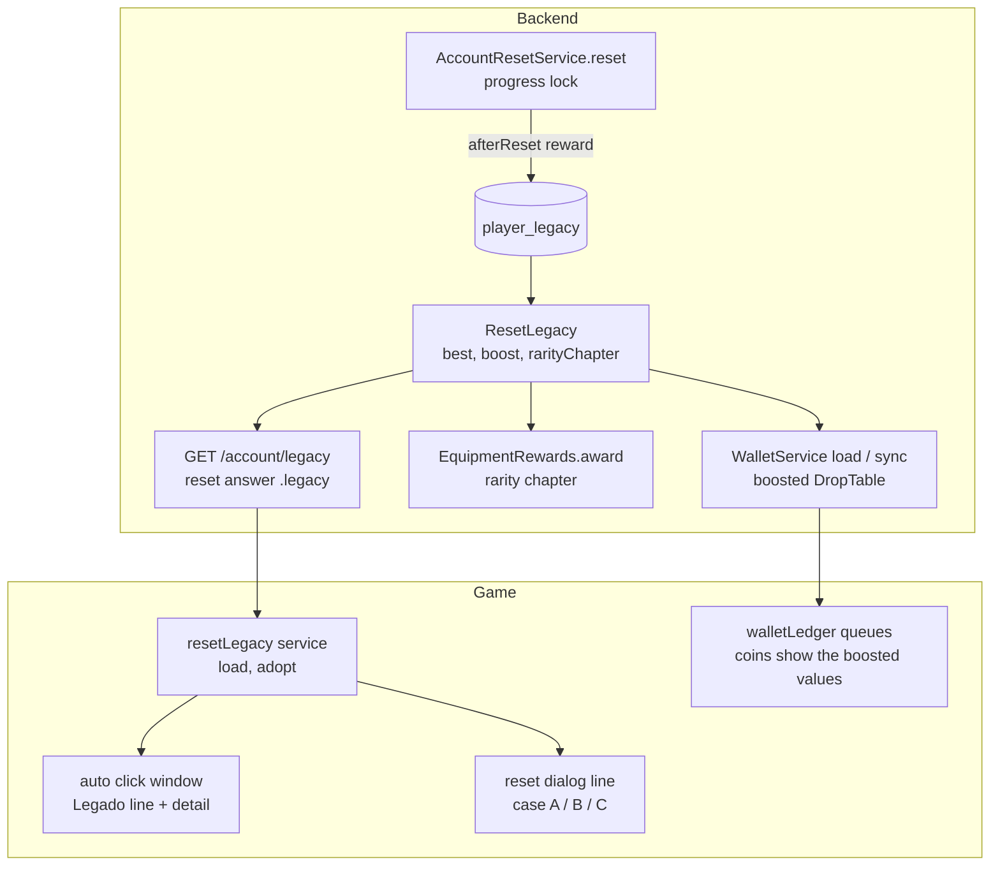

# Reset Legacy Drops Design

**Spec**: `.specs/features/reset-legacy-drops/spec.md`
**Status**: Approved by the owner on 2026-11-25 (decisions 1 and 2, Q1 to Q7 with the recommended defaults, the magnitude of the Legacy Table). Written against `main` at `23b01b2`; assumes `early-game-rebalance` lands first (migration V18).

---

## Architecture Overview

1. **Domain (backend)**: a value `ResetLegacy(username, percents: Map<Int, Int>)` holds the rules: `afterReset(chapter)`, `best()`, `boost(table: DropTable)` and `rarityChapter(chapter, chance)`. Pure, no Spring.
2. **Storage**: `player_legacy` (`V18__reset_legacy.sql`, expand only), `LegacyRepositoryPort` with a JPA adapter.
3. **Writers and readers**: `AccountResetService.reset` saves `legacy.afterReset(reward)` in its transaction; `WalletService` boosts the drop table with the player's legacy before it refreshes or credits queues; `EquipmentRewards.award` passes `legacy.rarityChapter(chapter, chance)` to `PieceRoller.roll`.
4. **API**: `GET /account/legacy` and `legacy` on the reset answer (`LegacyResponse`).
5. **Game**: a domain module for the texts, the HTTP call, a small application service holding the legacy, and two views (the line in the auto click window, the line in the reset dialog).



### Approaches considered

| Approach | Summary | Verdict |
| --- | --- | --- |
| A. Boosted range per player (chosen) | Each rule's range widens by `floor(L x legacy range / 100)`; the queue rolls in it | No change to `DropQueue`, `Wallet.credit`, the sync contract or the game ledger; the shown coins are the credited coins (AD-002); expected value is the owner's formula |
| B. A second legacy roll added at credit time | Credit `queued + L% x roll(legacy rule)` | The game would show coins the server does not credit, or the queue format would change |
| C. A per-player copy of the drop rules in the database | Store boosted rules | Duplicates the catalog per player; tuning a rule would miss them |

The boosted range is one uniform roll instead of the sum of two rolls: same expected value, a wider spread at the edges. Accepted: the player sees ranges, not distributions.

---

## Deploy Order and Compatibility (AD-016, AD-023)

- `V18__reset_legacy.sql` creates one table; the previous backend never maps it (`ddl-auto: validate` ignores it) and its Flyway sees V18 as a future migration. If this feature ships before `early-game-rebalance`, the task takes the next free version and the compatibility test counts follow.
- The reset answer gains `legacy` (additive); the old game ignores it. The new game against the old backend gets 404 on `GET /account/legacy` and shows nothing.
- Wallet queues of a player with legacy hold values above the seeded maximum. A rollback to the previous backend re-rolls them on the next load (`DropQueue.refreshed` rejects values outside the plain range): the player loses the legacy until the new backend is back, nothing breaks.

---

## Code Reuse Analysis

| Component | Location | How to Use |
| --- | --- | --- |
| `ResetRepositoryPort` + `ResetRepository` + `player_resets` | `main/port/ResetRepositoryPort.kt`, `main/adapter/repository/` (search `player_resets`), `V7__player_resets.sql` | Pattern of the port, the JPA adapter and the cascade to `users` |
| `AccountReset.reward` | `main/domain/AccountReset.kt:15` | The chapter the reset counts is the reward |
| `ChapterDefinition.coinFactor` | `main/domain/Chapter.kt:141` | Weight of the best choice |
| `DropTable`, `DropRule` | `main/domain/DropTable.kt` | `boost` returns a new `DropTable` of new `DropRule`s, same ids and intervals |
| `PieceRoller.roll(..., chapter)` | `main/domain/PieceRoller.kt:37` | Called with the rarity chapter; no change inside |
| `AccountResetController` | `main/adapter/web/AccountResetController.kt` | Add the GET and the `legacy` field |
| `resetView.js`, `ClickerGame.showAutoClick`, `showResetDialog` | `game/src/adapters/phaser/views/resetView.js`, `ClickerGame.js:323`, `:430` | Add the two lines |
| `createAccountReset` | `game/src/application/accountReset/accountReset.js` | The reset answer's `legacy` goes to the legacy service |
| fake backend `/account/reset` | `game/e2e/support/fakeBackend.js:456-481` | Add `legacy` state, `GET /account/legacy` and the answer field |

---

## Components

### `ResetLegacy` (new, `main/domain/ResetLegacy.kt`)

```kotlin
data class LegacyChapter(val chapter: Int, val percent: Int)

data class ResetLegacy(val username: String, val percents: Map<Int, Int> = emptyMap()) {
    // init: every key 1..ChapterOrder.MAX_CHAPTER, every value 50 or 100
    fun afterReset(chapter: Int): ResetLegacy               // percents[chapter] = min(100, (percents[chapter] ?: 0) + 50)
    fun best(): LegacyChapter?                              // max by percent x ChapterDefinition.coinFactor(chapter), then chapter
    fun boost(table: DropTable): DropTable                  // spec Legacy Rules, Copper
    fun rarityChapter(chapter: Int, chance: () -> Double): Int  // spec Legacy Rules, Pieces; reads chance only when best > chapter
    fun chapters(): List<LegacyChapter>                     // ascending by chapter
    companion object { const val STEP = 50; const val MAX_PERCENT = 100; const val SEEDED_RULES = 45 }
}
```

### Storage

- `V18__reset_legacy.sql`: `create table if not exists player_legacy (username varchar(255) not null references users (username) on delete cascade, chapter integer not null check (chapter between 1 and 15), percent integer not null check (percent in (50, 100)), primary key (username, chapter));`
- `LegacyRepositoryPort { fun find(username: String): ResetLegacy; fun save(legacy: ResetLegacy) }` (`save` upserts every chapter of the value; chapters are never removed).
- `PlayerLegacyEntity` with an `@IdClass` or `@EmbeddedId` (`username`, `chapter`), `JpaPlayerLegacyRepository.findAllByUsername`.

### Services

- `AccountResetService.reset`: after `resetRepository.save`, `legacyRepository.save(legacyRepository.find(username).afterReset(reward))`; `ResetResult` gains `legacy: ResetLegacy`; the log line gains `legacyChapter` and `legacyPercent`.
- `LegacyService : GetLegacyUseCase { fun legacy(username: String): LegacyView }` where `LegacyView(legacy, afterReset: AfterReset?)`, `AfterReset(chapter, percent, best)`; `afterReset` uses `AccountReset.reward(progress)` of the stored progress (with the next chapter opened like the reset does) and `legacy.afterReset(reward)`; null when the reward is null.
- `WalletService.load` and `sync`: `val table = legacyRepository.find(username).boost(dropRules.findAll())`; `dropTable()` unchanged.
- `EquipmentRewards.award`: `val rarityChapter = legacyRepository.find(username).rarityChapter(chapter, chanceRoller::roll)`; `PieceRoller.roll(encounter, rules, username, ids.next(), chanceRoller::roll, rarityChapter)`.

### API (`AccountResetController.kt`)

```kotlin
data class LegacyChapterResponse(val chapter: Int, val percent: Int)
data class AfterResetResponse(val chapter: Int, val percent: Int, val best: LegacyChapterResponse?)
data class LegacyResponse(val chapters: List<LegacyChapterResponse>, val best: LegacyChapterResponse?, val afterReset: AfterResetResponse?)
```

`GET /account/legacy` -> 200 `LegacyResponse`. `ResetResponse` gains `legacy: LegacyResponse` (with `afterReset` of the new progress, chapter 1: `null`).

```json
{ "chapters": [ { "chapter": 5, "percent": 100 }, { "chapter": 10, "percent": 50 } ],
  "best": { "chapter": 10, "percent": 50 },
  "afterReset": { "chapter": 12, "percent": 50, "best": { "chapter": 12, "percent": 50 } } }
```

### Game

- `game/src/domain/campaign/resetLegacy.js`: `legacyOf(payload)` (null for a malformed payload), `legacyLineText(legacy)`, `legacyDetailText(legacy)`, `resetLegacyText(legacy)` (cases C, A, B; null when `afterReset` is null).
- `game/src/adapters/http/accountResetApi.js`: `legacy: async () => (await httpClient.get('/account/legacy')).data`.
- `game/src/application/accountReset/resetLegacy.js`: `createResetLegacy({ gateway })` with `load()` (keeps the last good value; a failure leaves `null`), `adopt(payload)`, `state()`.
- `accountReset.js`: after a successful reset, `legacy.adopt(answer.legacy)` (new port `legacy`).
- `resetView.js`: `renderLegacyLine(legacy)` -> `[div.legacy-line (data-testid legacy-line), div.legacy-detail (data-testid legacy-detail)]`; `renderResetDialog({ ..., legacyText })` adds `div.reset-legacy` (data-testid reset-legacy) after the question when `legacyText` is not null.
- `ClickerGame`: loads the legacy when it loads the auto click state; `showAutoClick` puts the legacy line before the reset button when the legacy loaded; `showResetDialog` passes `resetLegacyText(this.legacy.state())`.

### Layout

- Auto click window (`.auto-click-popover`, 240 px wide, 13 px text, `--ink-900` on parchment): the legacy line `div.legacy-line` Figtree 700 13 px `--ink-900`; the detail `div.legacy-detail` Figtree 400 12 px, color `--ink-600`, line-height 1.35, both full width (`grid-column: 1 / -1`), placed right before `Resetar conta`.
- Reset dialog (`.reset-card`, 420 px): `div.reset-legacy` Figtree 700 15 px, color `--ember-800`, line-height 1.4, between the question and the buttons.

---

## Error Handling Strategy

| Error Scenario | Handling | User Impact |
| --- | --- | --- |
| `GET /account/legacy` fails or 404 | The service keeps `null`; no line is drawn | Reset works as today |
| A refused reset | Same transaction: no legacy row is written | Nothing changes |
| A stored legacy row out of bounds | Database check refuses it; domain `require` fails the load | Operator error surfaces like any bad row |
| Rollback of the backend | Old backend re-rolls the boosted queues to plain ranges | Legacy paused until the new backend returns |

---

## Risks & Concerns

| Concern | Location (file:line) | Impact | Mitigation |
| --- | --- | --- | --- |
| A new chance read in the piece roll | `service/EquipmentRewards.kt` `award` | Scripted-chance tests could shift | The read happens only when `best > chapter`; tests without legacy keep their order (spec Pieces AC 3) |
| Copper inflation | `domain/DropTable.kt` | Chapter 1 pays up to 353x after two resets at 15; refine and slot prices may become cheap | Intended by the owner; the Legacy Table shows the numbers; prices are tunable |
| `Int` copper range | `DropRule.minCopper/maxCopper: Int` | Largest boosted max: rule 45 (24 640) + 100 % of itself = 49 280, far under `Int.MAX_VALUE` | None needed |
| `early-game-rebalance` migration numbers | `db/migration` | Version clash if both ship in another order | T2 takes the next free version and updates the compatibility counts |

---

## Tech Decisions

| Decision | Choice | Rationale |
| --- | --- | --- |
| Best by copper value | `L x coinFactor(c)` | The owner's definition; one best drives both copper and pieces |
| Range boost instead of a second roll | Uniform roll in the widened range | Keeps AD-002 (shown coins = credited coins) with no contract change |
| Preview on the backend | `afterReset` in the payload | The game types no `coinFactor` (AD-011) |

> **Project-level decision:** AD-031 in `.specs/STATE.md` (proposed).
