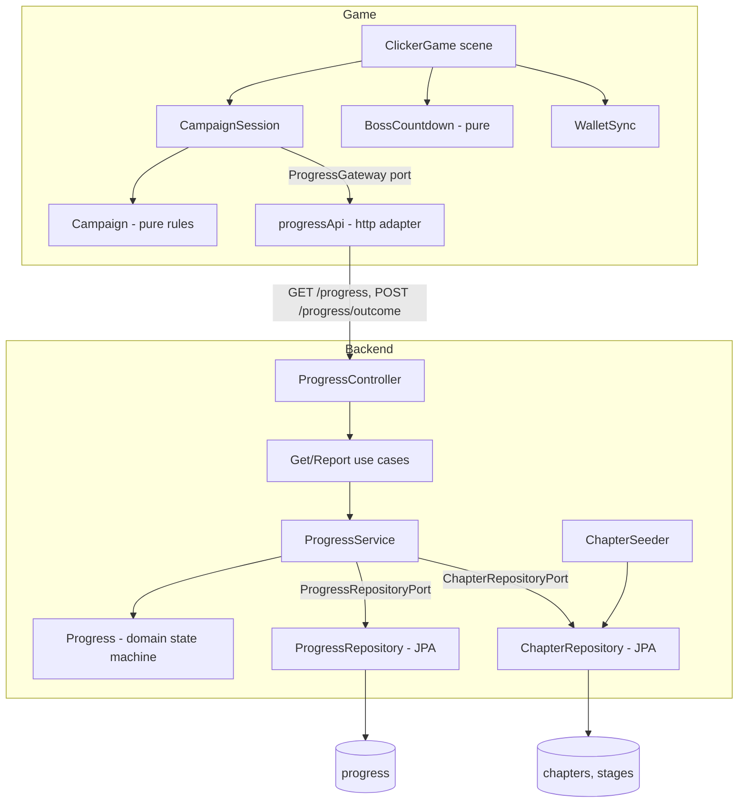

# Stages Design

**Spec**: `.specs/features/stages/spec.md`
**Status**: Implemented

Conforms to `AD-001` (JWT session; progress endpoints sit behind the existing chain) and `AD-002` (combat runs in the browser; the server guards transitions, not timers). Adds `AD-003` and `AD-004` to `.specs/STATE.md`.

---

## Architecture Overview

Two decisions shape everything:

1. **The server owns the state machine; the game mirrors it.** The game reports `CLEARED` or `FAILED` from the position it is leaving. The server derives the destination from the stored position and the stored chapter definition and refuses a report that does not match. The game also computes the destination locally so play never waits (STG-24); the server's answer, including the `409` body, is the correction.
2. **Hexagonal on both sides** (backend layout already is; game per ADR 0007). Rules sit in pure domain objects, orchestration in services that receive ports, I/O in adapters.

Approaches considered (same scope, different shape): **(A, chosen)** server state machine + outcome reports + optimistic local mirror. **(B)** The game sends the destination position and the server validates the jump: more client freedom, more server checks, and every new rule needs both sides to agree on a destination. **(C)** Wait for the server before each spawn: no duplicated rules, but a round trip between every phase and no play offline, which STG-25 forbids.



### Transition table (the whole state machine)

| Stored position                      | `CLEARED`                                   | `FAILED`                      |
| ------------------------------------ | ------------------------------------------- | ----------------------------- |
| `PHASE` p < `phasesPerStage`         | `PHASE` p + 1, same stage                   | 409 (not a boss)              |
| `PHASE` last phase                   | `MINIBOSS`, same stage                      | 409                           |
| `MINIBOSS`, stage < stage count      | `PHASE` 1 of stage + 1                      | `PHASE` `phasesPerStage`, same stage |
| `MINIBOSS`, last stage               | `CHAPTER_BOSS`                              | `PHASE` `phasesPerStage` of the last stage |
| `CHAPTER_BOSS`                       | `completed` = true                          | `PHASE` `phasesPerStage` of the last stage |
| `completed`                          | 409                                         | 409                           |

"Phase 5" in the spec is the stage's last phase, `phasesPerStage`, 5 in the seed. A reported position that differs from the stored one is 409 in every row.

---

## Code Reuse Analysis

### Existing Components to Leverage

| Component                         | Location                                                        | How to Use                                                                                      |
| --------------------------------- | --------------------------------------------------------------- | ----------------------------------------------------------------------------------------------- |
| `WalletService` load/lock/create  | `backend/.../service/WalletService.kt`                          | Same shape: user check, `findForUpdate`, `createIfAbsent` + re-read, domain call, `save`        |
| `WalletRepository` + Jpa repos    | `backend/.../adapter/repository/WalletRepository.kt`            | Same pattern: `PESSIMISTIC_WRITE` lookup, native `insert ... on conflict do nothing`            |
| `WalletController` body parsing   | `backend/.../adapter/web/WalletController.kt`                   | Same manual `Map<String, Any?>` parsing, because Jackson 3 + strict errors as `BusinessException` |
| `BusinessException` + handler     | `backend/.../domain/BusinessException.kt`, `adapter/web/ApiExceptionHandler.kt` | Add `ProgressRequestException` (400) and `ProgressConflictException` (409)       |
| `Fakes.kt`, `IntegrationTestBase` | `backend/src/test/...`                                          | Add in-memory repositories; clean the new tables in `setUpRestAssured`                          |
| `WalletLedger` idea               | `game/src/economy/walletLedger.js`                              | Same style: pure class mirroring server state, unit-tested                                      |
| `ClickerGame` death/respawn flow  | `game/src/scenes/ClickerGame.js`                                | Keep fade + respawn delay; swap fixed 10-health `Monster` for per-encounter health            |
| `fakeBackend`                     | `game/e2e/support/fakeBackend.js`                               | Add `/progress` routes and a `progress` store with the same transition table                    |

### Integration Points

| System        | Integration Method                                                                                          |
| ------------- | ----------------------------------------------------------------------------------------------------------- |
| Auth          | `/progress/**` falls under `anyRequest authenticated`; `Principal.name` is the player (no change to `SecurityConfig`) |
| Database      | Tables `chapters`, `stages`, `progress` via Hibernate `ddl-auto: update`, as for `wallets`                  |
| Drops         | Unchanged: every monster is level 1; `WalletSync.takeDrop(1)` runs on every kill, bosses included          |
| Vite / worker | `/api` already proxied; no change                                                                           |

---

## Components

### Backend

#### `Chapter.kt` (domain)
- **Purpose**: The stage rules as data.
- **Interfaces**:
  - `StageDefinition(number, phasesPerStage, monsterHealth, minibossHealth, minibossTimeLimitMs)` - validates all positive.
  - `ChapterDefinition(number, bossHealth, bossTimeLimitMs, stages)` - validates stages are 1..n with no gap.
  - `ChapterDefinition.stage(n): StageDefinition`, `val stageCount`.
  - `ChapterDefinition.first(): ChapterDefinition` - the seed of the Assumptions table.
- **Dependencies**: none.

#### `Progress.kt` (domain)
- **Purpose**: A player's position and its transitions.
- **Interfaces**:
  - `enum Encounter { PHASE, MINIBOSS, CHAPTER_BOSS }`, `enum Outcome { CLEARED, FAILED }`
  - `ProgressPosition(chapter, stage, encounter, phase)`
  - `Progress(username, position, completed)`; `Progress.start(username)` (chapter 1, stage 1, `PHASE`, 1)
  - `Progress.report(reported: ProgressPosition, outcome: Outcome, chapter: ChapterDefinition): Progress` - applies the transition table or throws `ProgressConflictException(view)`.
  - `Progress.view(chapter): ProgressView` where `ProgressView(progress, chapter)`.
- **Dependencies**: `ChapterDefinition`, SLF4J.

#### Exceptions (`BusinessException.kt`)
- `ProgressRequestException` (base, 400): `InvalidOutcomeException` (`PROGRESS_INVALID_OUTCOME`).
- `ProgressConflictException(view)` (`PROGRESS_CONFLICT`, 409) carries the `ProgressView` the handler puts in the body.
- `ChapterNotFoundException` (`CHAPTER_NOT_FOUND`, falls to the existing 422 `BusinessException` mapping).

#### Ports and use cases
- `port/ProgressPorts.kt`: `ProgressRepositoryPort { findForUpdate, createIfAbsent, save, deleteByUsername }`, `ChapterRepositoryPort { findByNumber, existsByNumber, save }`.
- `usecase/ProgressUseCase.kt`: `GetProgressUseCase.get(username): ProgressView`, `ReportOutcomeUseCase.report(username, position, outcome): ProgressView`.

#### `ProgressService` (service)
- **Purpose**: Orchestrates user check, lock, create, domain call, save. `@Transactional`.
- **Dependencies**: both repository ports, `UserRepositoryPort`, `Clock` not needed.
- **Reuses**: the `WalletService.load` pattern.

#### Persistence adapters (`adapter/repository`)
- `ProgressEntities.kt`: `ChapterEntity(number, bossHealth, bossTimeLimitMs)`, `StageEntity(id "chapter/number", chapter, number, phasesPerStage, monsterHealth, minibossHealth, minibossTimeLimitMs)`, `ProgressEntity(username, chapter, stage, encounter, phase, completed)` with `toDomain`/`from`.
- `ProgressRepository.kt`: `JpaChapterRepository`, `JpaStageRepository`, `JpaProgressRepository` + `ProgressRepository : ProgressRepositoryPort`, `ChapterRepository : ChapterRepositoryPort`.

#### `ChapterSeeder` (adapter/config)
- `ApplicationRunner` that saves `ChapterDefinition.first()` when `existsByNumber(1)` is false. Never overwrites, so edits in the database survive restarts.

#### `ProgressController` (adapter/web)
- `GET /progress`, `POST /progress/outcome`. Response `ProgressResponse`:
```json
{ "chapter": 1, "stage": 3, "encounter": "PHASE", "phase": 2, "completed": false,
  "definition": { "bossHealth": 300, "bossTimeLimitMs": 60000,
    "stages": [ { "number": 1, "phasesPerStage": 5, "monsterHealth": 10,
                  "minibossHealth": 50, "minibossTimeLimitMs": 30000 } ] } }
```
- Request: `{ "chapter": 1, "stage": 3, "encounter": "PHASE", "phase": 2, "outcome": "CLEARED" }`. Anything else is 400 `PROGRESS_INVALID_OUTCOME`.
- 409 body is a `ProblemDetail` with `code: PROGRESS_CONFLICT` and `progress: <ProgressResponse>`.

### Game (target shape of ADR 0007)

| Component | Location | Role |
| --------- | -------- | ---- |
| `Campaign` | `src/domain/campaign/campaign.js` | Pure. `Campaign.fromProgress(payload)`; `encounter()` -> `{ kind, stage, phase, health, timeLimitMs, label }`; `cleared()` / `failed()` return the next `Campaign` (same table as the server); `completed`; `position()` for reports. |
| `BossCountdown` | `src/domain/campaign/bossCountdown.js` | Pure. `new BossCountdown(limitMs)`; `advance(ms)`; `seconds` (ceil); `expired`. |
| `Monster` | `src/domain/combat/monster.js` | Existing; constructed with the encounter's health. |
| `CampaignSession` | `src/application/campaign/campaignSession.js` | `createCampaignSession({ gateway })`: `load()`, `encounter()`, `clear()`, `fail()`, `flush()`, `flushOnExit()`, `onRealign(callback)`. Owns the ordered report queue, one in flight, 409 handling. |
| `ProgressGateway` port | JSDoc in `campaignSession.js` | `get(): Promise<ProgressPayload>`, `report(position, outcome): Promise<ProgressPayload>`; a 409 rejects with an `ApiError` whose `status` is 409 and `body.progress` is the payload. |
| `progressApi` | `src/adapters/http/progressApi.js` | Implements the gateway over `httpClient`. |
| `WalletSync` | `src/application/wallet/walletSync.js` | Extracted from the scene (ADR 0007). |
| `ClickerGame` | `src/adapters/phaser/ClickerGame.js` | Draws, forwards clicks, runs the 10 s tick, shows HUD, countdown, completion text. |

HUD is real HTML like the wallet text (ADR 0006): `.stage-hud` (position), `.boss-timer` (countdown, hidden outside boss fights), `.stage-message` ("Could not load progress", completion). Monster size/colour stay.

---

## Data Models

```kotlin
data class StageDefinition(number: Int, phasesPerStage: Int, monsterHealth: Int, minibossHealth: Int, minibossTimeLimitMs: Long)
data class ChapterDefinition(number: Int, bossHealth: Int, bossTimeLimitMs: Long, stages: List<StageDefinition>)
data class ProgressPosition(chapter: Int, stage: Int, encounter: Encounter, phase: Int)
data class Progress(username: String, position: ProgressPosition, completed: Boolean)
```

Tables: `chapters(number pk, boss_health, boss_time_limit_ms)`, `stages(id pk, chapter, number, phases_per_stage, monster_health, miniboss_health, miniboss_time_limit_ms)`, `progress(username pk, chapter, stage, encounter, phase, completed)`. `phase` is 1 outside `PHASE` encounters so equality checks stay exact.

Seed: stage n has `monsterHealth = 10 + (n - 1)`, `minibossHealth = 5 × monsterHealth`, miniboss limit 30 000 ms, 5 phases; chapter boss 300 health, 60 000 ms.

---

## Error Handling Strategy

| Error Scenario                               | Handling                                                              | User Impact                                           |
| -------------------------------------------- | --------------------------------------------------------------------- | ----------------------------------------------------- |
| Report position differs / completed / `FAILED` on `PHASE` | `ProgressConflictException` -> 409 + stored progress          | Game realigns and respawns at the stored position     |
| Malformed outcome body                       | `InvalidOutcomeException` -> 400 `PROGRESS_INVALID_OUTCOME`           | None (a bug); report stays queued and retries         |
| Token missing/expired                        | Existing 401; `httpClient` refreshes and retries once                 | Invisible                                             |
| User deleted but token valid                 | `UserNotFoundException` -> 404, no progress row                       | Report fails and retries each tick                    |
| Chapter row missing                          | `ChapterNotFoundException` -> 422                                     | Game shows "Could not load progress"                  |
| Network/5xx on `GET /progress`               | Scene shows message, retries at each tick                             | No monster until it loads                             |
| Network/5xx on a report                      | Report stays at queue head, retried at the next tick                  | None; play continues                                  |

---

## Risks & Concerns

| Concern | Location (file:line) | Impact | Mitigation |
| ------- | -------------------- | ------ | ---------- |
| `ClickerGame` mixes rendering, wallet sync policy and I/O | `game/src/scenes/ClickerGame.js:48-160` | Stage logic added here would pass 400 lines and need Phaser to test | Extract `WalletSync` first (T13) then build stages on the thin scene |
| `sessionManager` -> `authApi` and `httpClient` -> `sessionManager` cycle held by a comment | `game/src/auth/sessionManager.js:1-8`, `game/src/api/httpClient.js:4` | Fragile import order | Inject ports (T11-T12); ADR 0007 |
| Scene test is 773 lines tied to module mocks | `game/src/scenes/ClickerGame.test.js:1-30` | Refactor churn | Keep every assertion; only change how dependencies are supplied |
| Transition rules exist on server and client | `Progress.kt`, `campaign.js` | Drift would cause 409 loops | Same table in both tests; e2e fake backend implements the table a third time but is only a stand-in; server stays authoritative |
| Client-owned timers can be bypassed | `ClickerGame.js` | A client can claim a boss kill | Accepted by AD-002; recorded in Consequences of the ADR |
| `findForUpdate` row only exists after first `GET` | `WalletService.load` pattern | Two first reports race on creation | `createIfAbsent` with `on conflict do nothing`, then locked re-read |
| `ddl-auto: update` creates tables silently | `application.yaml:11` | No migration history | Same as wallet tables (ADR 0005); out of scope here |
| `fakeBackend.js` grows another store | `game/e2e/support/fakeBackend.js` | Test-double drift | Single `progressOf` helper, transition table copied from this design |

---

## Tech Decisions (only non-obvious ones)

| Decision                         | Choice                                                              | Rationale                                                                            |
| -------------------------------- | ------------------------------------------------------------------- | ------------------------------------------------------------------------------------ |
| Whole chapter in every answer    | 10 stage rows (~1 KB) with each progress response                   | Lets the game advance and draw the HUD offline from one payload                      |
| `phase` is 1 outside `PHASE`     | Normalised so a reported position compares with plain equality      | No special cases for boss rows                                                       |
| Seeder never overwrites          | Insert only when chapter 1 is absent                                | Database edits to tune health/time survive restarts                                   |
| `409` body shape                 | `ProblemDetail` + `progress` property                               | Reuses the error format; the game needs one parse path for 409                       |
| Tick shared with the wallet      | Both services flush from the existing 10 s scene timer              | No new timer; at most 2 requests per tick                                             |
