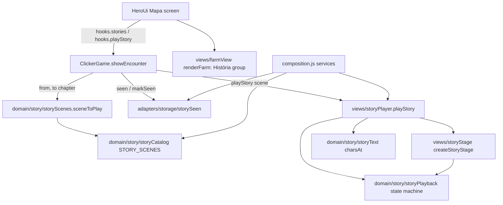

# Story Scenes Design

**Spec**: `.specs/features/story-scenes/spec.md`
**Status**: Draft (waiting for the owner's answers to Q1 to Q14 of the spec; written with the recommended defaults)

Visual and behavioural reference: `.specs/features/story-scenes/design-reference.dc.html` (owner's Claude Design page). It is not code to paste: its `class Component extends DCLogic` is split below into a pure domain (text timing, state machine, catalog rules), a storage adapter and two DOM views, as AD-003 asks.

---

## Architecture Overview

Game only. No backend change, no Flyway migration (AD-016 not triggered).



- **Trigger** (`ClickerGame`): every time it shows an encounter, it asks the domain which unseen scene the move from the previous encounter's chapter (`from`) to the new one (`to`) opens. `from` is `null` on the first encounter of the scene; `to` is `null` when the campaign is completed.
- **Hold**: `ClickerGame.playStory(scene)` sets `paused`, `time.paused` and `tweens.paused`, awaits `services.playStory(scene)` (a promise that resolves when the overlay closes) and restores the three.
- **Player** (`storyPlayer.js`): owns the audio, the clock, `requestAnimationFrame`, the auto-advance timer, the keyboard and the scale. It drives the pure state machine (`storyPlayback.js`) and paints through `storyStage.js`.
- **Mapa**: `HeroUi.render_farm` passes the replayable scenes (`hooks.stories()`) to `renderFarm`, whose `História` chips call `hooks.playStory(id)`.

---

## Code Reuse Analysis

### Existing Components to Leverage

| Component | Location | How to Use |
| --------- | -------- | ---------- |
| Per-browser flag in localStorage | `game/src/adapters/storage/autoClickPreference.js` | Same shape for `storySeen.js`: a `storage` getter read on every call, every access in `try/catch` |
| Memory fallback when storage fails | `game/src/adapters/storage/sessionStore.js:34-80` | Keep the list in memory when a write throws |
| Services through the registry | `game/src/composition.js` `services`, `ClickerGame.create` (`services.autoClickPreference`) | Add `storySeen`, `storyScenes`, `playStory`; tests inject stubs |
| DOM element helper | `game/src/adapters/phaser/views/dom.js` `el(tag, className, text, attributes)` (`testid` becomes `data-testid`) | Build the stage and the Mapa chips |
| A view mounted in `document.body`, outside the scaled canvas | `game/src/adapters/phaser/views/versionLabel.js`, AD-026 | The overlay is fixed to the viewport the same way |
| Fight hold flags | `ClickerGame.pauseFight` (`:735-750`): `paused`, `time.paused`, `tweens.paused` | Same three flags, without the pause menu |
| Chapter change seam | `ClickerGame.showEncounter` (`:838-855`, `encounterChapter`) | `from` = `this.encounterChapter` before it is overwritten |
| Mapa chapter chips | `game/src/adapters/phaser/views/farmView.js` `renderChapters`, `style.css` `.farm-chapter` (`:3084-3132`) | The `História` chips reuse the chip look |
| Shared e2e fixture | `game/e2e/support/coverage.js` (`test = base.extend`) | Add the `storySeen` option that seeds `["prologue"]` |
| Screenshot helper | `game/ui-review/support/shots.js` `shot()` | The `ui-artist` shots |

### Integration Points

| System | Integration Method |
| ------ | ------------------ |
| Campaign session | Reads `session.chapter` and `session.completed` in `showEncounter`; no change to `campaignSession.js` |
| HeroUi | Two new optional hooks `stories()` and `playStory(id)`; label and title `Mapa` |
| Version label (AD-026) | Overlay `z-index: 9` stays under `.game-version` (`z-index: 10`) |
| Phaser keyboard | The player stops the Escape `keydown` at `document`, so Phaser's window listener never sees it; `ClickerGame.escape` also returns while `storyOpen` |
| Backend | None |

---

## Components

### `storyText.js` (domain)

- **Purpose**: The text of a line and how much of it shows at a time.
- **Location**: `game/src/domain/story/storyText.js`
- **Interfaces**:
  - `lineText(line): string` - the cue texts joined by one space.
  - `charsAt(line, t: number): number` - characters shown at `t` seconds (spec P1 Watching AC 3).
- **Dependencies**: none.

```js
export const lineText = (line) => line.cues.map((cue) => cue[2]).join(' ');

export const charsAt = (line, t) =>
{
    let shown = 0;

    for (let i = 0; i < line.cues.length; i++)
    {
        const [ start, end, text ] = line.cues[i];
        //  every cue but the last also brings the space that joins it to the next one
        const length = text.length + (i < line.cues.length - 1 ? 1 : 0);

        if (t >= end)
        {
            shown += length;
        }
        else if (t > start)
        {
            shown += Math.floor(length * (t - start) / (end - start));
            break;
        }
        else
        {
            break;
        }
    }

    return Math.min(shown, lineText(line).length);
};
```

### `storyPlayback.js` (domain)

- **Purpose**: The state machine of a scene, the labels, the dots, the look and the stage scale. Pure, no timers.
- **Location**: `game/src/domain/story/storyPlayback.js`
- **State**: `{ phase: 'title' | 'line' | 'end' | 'done', index: number, complete: boolean }`.
- **Interfaces**:
  - `STORY_STAGE = { width: 1280, height: 720 }`
  - `AUTO_ADVANCE_MS = 1200`
  - `startStory(scene)`: `{ phase: 'title', index: 0, complete: false }` when `scene.title`, else `{ phase: 'line', index: 0, complete: false }`.
  - `advanceStory(scene, state)` (a click on `story-hit`, or the auto-advance on a complete line):
    - `title` → `{ phase: 'line', index: 0, complete: false }`
    - `line`, `complete: false` → `{ ...state, complete: true }`
    - `line`, `complete: true` → `{ phase: 'line', index: index + 1, complete: false }` while `index + 1 < lines.length`; else `{ phase: 'end', index, complete: false }` when `scene.end`; else `{ phase: 'done', index, complete: false }`
    - `end` → `{ phase: 'done', index, complete: false }`; `done` → the same state
  - `endLine(state)` (audio ended or the clock reached the duration): `line` and not complete → `{ ...state, complete: true }`; any other state unchanged.
  - `skipStory(state)`: `{ ...state, phase: 'done' }`.
  - `hitLabel(state)`: `title` `Começar a história`; `line` typing `Mostrar fala completa`; `line` complete `Próxima fala`; `end` `Continuar`; `done` `''`.
  - `progressDots(scene, state): boolean[]`: one per line; `phase === 'line'` → `i <= state.index`; any other phase → every `false`.
  - `sceneLook(scene, state, t): { backdrop: string, tints: string[] }`: `title`, `end` and `done` → `{ backdrop: 'forest', tints: [ 'dark' ] }`; `line` → `{ backdrop: line.backdrop, tints: line.tints.filter((tint) => line.tintAt?.[tint] === undefined || state.complete || t >= line.tintAt[tint]) }`.
  - `storyScale(width, height)`: `Math.min(width / 1280, height / 720)`.
- **Dependencies**: none.

### `storyScenes.js` (domain)

- **Purpose**: The catalog rules: validation, which scene a chapter move opens, which scenes the Mapa lists.
- **Location**: `game/src/domain/story/storyScenes.js`
- **Interfaces**:
  - `LINE_KINDS = [ 'narrator', 'voice', 'character' ]`, `TINTS = [ 'dark', 'red', 'gold', 'voice' ]`, `TRIGGERS = [ 'chapter-start', 'chapter-boss' ]`, `MOTIONS = [ 'drift', 'pan', 'still' ]`
  - `validateScene(scene, backdrops): string[]` - every broken rule of § Validation rules, in rule order; `[]` when valid.
  - `validateCatalog(scenes, backdrops): string[]` - the backdrop rules, then each scene's errors, then the duplicate rules.
  - `sceneToPlay(scenes, { from, to, seen }): scene | null`:
    - `from === null && to !== null` → the scene with `trigger.kind === 'chapter-start' && trigger.chapter === to`
    - `from !== null && (to === from + 1 || to === null)` → the scene with `trigger.kind === 'chapter-boss' && trigger.chapter === from`
    - anything else → `null`; a found scene whose `id` is in `seen` → `null`
  - `replayableScenes(scenes, seen): scene[]` - `chapter-start` scenes and the `chapter-boss` scenes whose id is in `seen`, in catalog order.
- **Dependencies**: none.

### `storyCatalog.js` (domain data)

- **Purpose**: The story content. The only file a content feature edits (plus `game/public/assets/story/`).
- **Location**: `game/src/domain/story/storyCatalog.js`
- **Interfaces**: `STORY_BACKDROPS`, `STORY_SCENES`, `storyScene(id): scene | null`.

### `storySeen.js` (storage adapter)

- **Purpose**: The seen list in localStorage key `infinity-grove.story-seen`.
- **Location**: `game/src/adapters/storage/storySeen.js`
- **Interfaces**:
  - `createStorySeen(storage = () => globalThis.localStorage): { seen(): string[], markSeen(id: string): void }`
  - `storySeen` - the instance the composition root hands out.
- **Rules**: `seen()` returns a new array each call. A missing key reads as the memory list (`[]` at first). A value that `JSON.parse` rejects, or that is not an array, reads as `[]`; non-string entries are dropped. `markSeen(id)` appends `id` when absent (order kept), stores the list in memory, then writes `JSON.stringify(list)`; a throwing read or write is caught.

### `storyStage.js` (phaser adapter view)

- **Purpose**: Builds the overlay DOM once and repaints it from a snapshot. Never rebuilds the backdrops or the bar, so their CSS animations run uninterrupted; rebuilds the content only when `phase` or `index` changes, so the portrait entrance and the box rise play once per line.
- **Location**: `game/src/adapters/phaser/views/storyStage.js`
- **Interfaces**:
  - `createStoryStage({ scene, backdrops, onHit, onSkip, onMute }): { root: HTMLElement, hit: HTMLButtonElement, stage: HTMLElement, update(snapshot): void }`
  - `snapshot = { state, shown: number, t: number, muted: boolean }`
- **DOM** (§ DOM structure).

### `storyPlayer.js` (phaser adapter controller)

- **Purpose**: Plays one scene in the overlay and resolves when it closes.
- **Location**: `game/src/adapters/phaser/views/storyPlayer.js`
- **Interfaces**:
  - `playStory(scene, options = {}): Promise<void>` with `options`: `root` (default `document.body`), `backdrops` (default `STORY_BACKDROPS`), `createAudio` (default `(src) => new Audio(src)`), `now` (default `() => performance.now()`), `requestFrame` (default `(callback) => requestAnimationFrame(callback)`), `cancelFrame` (default `(id) => cancelAnimationFrame(id)`), `setTimer` (default `(callback, ms) => setTimeout(callback, ms)`), `clearTimer` (default `(id) => clearTimeout(id)`), `viewport` (default `() => ({ width: window.innerWidth, height: window.innerHeight })`), `window` (default `globalThis.window`, for the `resize` listener).
  - `storyMuted(): boolean` and `setStoryMuted(on: boolean): void` - the module-level mute choice (D13); tests reset it with `setStoryMuted(false)`.
- **Behaviour**:
  1. Open: remember `document.activeElement`; `createStoryStage`; append `root` of the stage to `options.root`; set `stage.style.setProperty('--story-scale', String(storyScale(viewport().width, viewport().height)))`; add a `resize` listener on `options.window` that sets it again; add a `keydown` listener on `options.root.ownerDocument`; create one audio per line (`audio.preload = 'auto'`, `audio.muted = storyMuted()`); `state = startStory(scene)`; paint; focus `hit`; when `state.phase === 'line'`, `playLine()`.
  2. `playLine()`: stop the frame and the timer; pause every audio; `useClock = false`; `clockStart = now()`; for the current audio: `currentTime = 0`, `onended = () => finishLine(true)`, `onerror = () => fallBack()`; call `play()` inside `try` (a throw calls `fallBack()`); when it returns a promise, `.catch(() => fallBack())`; request a frame of `tick`.
  3. `fallBack()`: when `useClock` is `false`: `useClock = true`, `clockStart = now()`.
  4. `tick()`: `t = useClock ? (now() - clockStart) / 1000 : audio.currentTime`; when `useClock && t >= line.duration`, `finishLine(true)` and stop; else paint with `shown = charsAt(line, t)` and request the next frame.
  5. `finishLine(auto)`: cancel the frame; pause the audio; `state = endLine(state)`; paint with the full length and `t = line.duration`; when `auto`, `timer = setTimer(next, AUTO_ADVANCE_MS)`.
  6. `next()`: clear the timer; `state = advanceStory(scene, state)`; `line` → `playLine()`; `end` → pause every audio and paint; `done` → `close()`.
  7. Hit (click on `story-hit`): `title` → `state = advanceStory(...)`, `playLine()`; `line` typing → `finishLine(false)`; `line` complete → `next()`; `end` → `close()`.
  8. Skip (click on `story-skip`) and Escape (`event.key === 'Escape'`: `preventDefault()`, `stopPropagation()`) → `close()`.
  9. Mute: `setStoryMuted(!storyMuted())`; every audio `muted = storyMuted()`; paint.
  10. `close()` (runs once): cancel the frame; clear the timer; pause every audio and set its `onended` and `onerror` to `null`; remove the `resize` and `keydown` listeners; remove the overlay; focus the remembered element when it is still in the document; resolve.
- **Reuses**: `storyText`, `storyPlayback`, `storyStage`, `STORY_BACKDROPS`.

### `ClickerGame` (changes)

- `create()`: `this.storySeen = services.storySeen;`, `this.storyScenes = services.storyScenes;`, `this.playStoryView = services.playStory;`, `this.storyOpen = false;` (before `createHeroUi()`).
- `showEncounter(encounter)`: read `const from = this.encounterChapter;` first. On `!encounter`: `this.completeChapter(); this.playUnseenStory(from, null); return;`. At the end of the method (after the encounter is drawn): `this.playUnseenStory(from, this.session.chapter);`.
- `playUnseenStory(from, to)`: `const scene = sceneToPlay(this.storyScenes, { from, to, seen: this.storySeen.seen() });` when a scene comes back, `this.storySeen.markSeen(scene.id)` then `this.playStory(scene)`.
- `async playStory(scene)`: return when `!scene || this.storyOpen`; `this.storyOpen = true`; `const held = !this.paused`; when `held`, set `paused`, `time.paused`, `tweens.paused` to `true`; `try { await this.playStoryView(scene); } finally { this.storyOpen = false; when held, set the three to false }`.
- `escape()`: first line `if (this.storyOpen) { return; }`.
- `createHeroUi()`: add the hooks `stories: () => replayableScenes(this.storyScenes, this.storySeen.seen())` and `playStory: (id) => this.playStory(this.storyScenes.find((scene) => scene.id === id) ?? null)`.

### `HeroUi` and `farmView` (changes)

- `SCREENS` farm entry: `{ id: 'farm', label: 'Mapa', title: 'Mapa' }`.
- Constructor: destructure `stories` and `playStory` with the other hooks and keep them in `this.hooks`.
- `render_farm`: pass `stories: this.hooks.stories?.() ?? []` and `onStory: (id) => this.hooks.playStory?.(id)` to `renderFarm`. The panel stays open.
- `renderFarm(..., { stories = [], onStory = () => {} })`: when `stories.length >= 1`, append right after the `h3.farm-map-title`:

```
div.farm-story [data-testid=farm-story][role=group][aria-label=História]
  span.farm-story-label  "História"
  button.farm-story-chip [type=button][data-testid=story-replay-<id>][aria-label="Assistir <label>"]  "<label>"   (one per scene, click: onStory(id))
```

---

## Data Model

### Scene format (`storyCatalog.js`)

```js
//  A backdrop: the image (path under game/public) and its slow motion
STORY_BACKDROPS = {
    forest: { image: 'assets/story/bg-forest.png', motion: 'drift' },   // drift: 40 s scale 1 -> 1.08
    map: { image: 'assets/story/bg-map.jpg', motion: 'pan' }            // pan: 14 s scale 1.05 -> 1.1
};

scene = {
    id: 'prologue',                    // lowercase letters, digits, dashes; the seen list stores it. Chapter scenes: 'chapter-<n>'
    label: 'Prólogo',                  // the Mapa chip text
    trigger: { kind: 'chapter-start' | 'chapter-boss', chapter: 1 },
    title: { logo: 'assets/story/logo.png', kicker: '...', cta: '...' },   // optional; logo optional
    end: { kicker: '...', title: '...', subtitle: '...', cta: '...' },      // optional
    lines: [
        {
            kind: 'narrator' | 'voice' | 'character',
            speaker: 'Narrador',       // the name plate (voice, character); narrator lines keep it for the record and show no plate
            portrait: 'assets/story/portrait-<id>.png',   // character lines only
            backdrop: 'forest',        // a key of STORY_BACKDROPS
            tints: [ 'dark', 'red' ],  // any of dark, red, gold, voice; [] for none
            tintAt: { red: 6.1 },      // optional: a tint of `tints` that turns on at this second of the line
            audio: 'assets/story/prologue-03.mp4',
            duration: 7.47,            // seconds; the clock fallback ends the line here
            cues: [ [ 0.05, 2.28, 'Do fundo da terra subiu um rumor.' ], ... ]   // [start s, end s, text]
        }
    ]
};
```

A chapter scene added later: `{ id: 'chapter-1', label: 'Capítulo 1', trigger: { kind: 'chapter-boss', chapter: 1 }, lines: [...] }`, with its files in `game/public/assets/story/`. A new backdrop is one more `STORY_BACKDROPS` entry; tints are a fixed set of CSS classes.

### Validation rules (`validateScene`, exact messages)

`<id>` is the scene id (or `?` when it is not a string); `<n>` is the 1-based line number; `<m>` the 1-based cue number.

1. `id` is a string matching `/^[a-z0-9-]+$/`, else `<id>: id must be lowercase letters, digits and dashes`.
2. `label` is a non-empty string, else `<id>: label is missing`.
3. `trigger.kind` is in `TRIGGERS` and `trigger.chapter` is an integer of at least 1, else `<id>: trigger must be chapter-start or chapter-boss with a chapter of at least 1`.
4. `title`, when present, has non-empty string `kicker` and `cta`, else `<id>: title needs kicker and cta`.
5. `end`, when present, has non-empty string `kicker`, `title`, `subtitle` and `cta`, else `<id>: end needs kicker, title, subtitle and cta`.
6. `lines` is an array of at least 1, else `<id>: a scene needs at least one line` (and no line rule runs).
7. Per line: `kind` in `LINE_KINDS`, else `<id> line <n>: kind must be narrator, voice or character`.
8. `voice` and `character` lines have a non-empty string `speaker`, else `<id> line <n>: speaker is missing`.
9. `character` lines have a non-empty string `portrait`, else `<id> line <n>: a character line needs a portrait`.
10. `backdrop` is a key of `backdrops`, else `<id> line <n>: unknown backdrop <backdrop>`.
11. `tints` is an array; each entry in `TINTS`, else `<id> line <n>: unknown tint <tint>` (one message per unknown tint).
12. Each key of `tintAt` is in the line's `tints`, else `<id> line <n>: tintAt names a tint the line does not use: <tint>`.
13. `audio` is a non-empty string, else `<id> line <n>: audio is missing`.
14. `duration` is a number above 0, else `<id> line <n>: duration must be above 0`.
15. `cues` is an array of at least 1, else `<id> line <n>: a line needs at least one cue`.
16. Each cue is `[start, end, text]` with `0 <= start < end <= duration`, `start >=` the previous cue's `end`, and a non-empty string `text`, else `<id> line <n> cue <m>: cues must be in order, inside the duration and carry text`.

`validateCatalog(scenes, backdrops)` adds, before the scene errors, for each backdrop entry: `backdrop <key>: image is missing` (no non-empty string `image`) and `backdrop <key>: motion must be drift, pan or still`; and after them `duplicate scene id <id>` (once per repeated id) and `two scenes share the trigger <kind> <chapter>` (once per repeated pair).

### Prologue data (verbatim from the design's `IG_LINES`)

```js
export const STORY_SCENES = [
    {
        id: 'prologue',
        label: 'Prólogo',
        trigger: { kind: 'chapter-start', chapter: 1 },
        title: { logo: 'assets/story/logo.png', kicker: 'Ato 1 — Bosque Desperto · Prólogo', cta: 'Clique para começar' },
        end: { kicker: 'Fim do Prólogo', title: 'Ato 1 — Bosque Desperto', subtitle: 'Capítulo 1', cta: 'Clique para continuar' },
        lines: [
            {
                kind: 'narrator', speaker: 'Narrador', backdrop: 'forest', tints: [], audio: 'assets/story/prologue-01.mp4', duration: 12.36,
                cues: [ [ 0.05, 3.51, 'Eldora sempre respirou pela Grande Árvore.' ], [ 4.11, 6.73, 'Suas raízes bebem do fundo do mundo,' ],
                    [ 7.25, 9.65, 'e sua seiva corre por cada folha,' ], [ 10.0, 10.7, 'cada rio,' ], [ 11.15, 12.2, 'cada criatura.' ] ]
            },
            {
                kind: 'narrator', speaker: 'Narrador', backdrop: 'forest', tints: [ 'dark' ], audio: 'assets/story/prologue-02.mp4', duration: 3.47,
                cues: [ [ 0.05, 2.23, 'Até a noite em que as raízes' ], [ 2.6, 3.4, 'tremeram.' ] ]
            },
            {
                kind: 'narrator', speaker: 'Narrador', backdrop: 'forest', tints: [ 'dark', 'red' ], tintAt: { red: 6.1 }, audio: 'assets/story/prologue-03.mp4', duration: 7.47,
                cues: [ [ 0.05, 2.28, 'Do fundo da terra subiu um rumor.' ], [ 2.98, 5.24, 'E os animais do bosque abriram os olhos...' ], [ 6.23, 7.3, 'Vermelhos.' ] ]
            },
            {
                kind: 'narrator', speaker: 'Narrador', backdrop: 'map', tints: [ 'gold' ], audio: 'assets/story/prologue-04.mp4', duration: 6.11,
                cues: [ [ 0.05, 1.53, 'A Árvore despertou.' ], [ 2.08, 3.66, 'E, entre milhares,' ], [ 4.06, 6.0, 'escolheu cinco guardiões.' ] ]
            },
            {
                kind: 'voice', speaker: 'A Voz', backdrop: 'forest', tints: [ 'dark', 'voice' ], audio: 'assets/story/prologue-05.mp4', duration: 4.05,
                cues: [ [ 0.05, 1.03, 'Criança...' ], [ 1.39, 2.04, 'venha.' ], [ 2.57, 3.9, 'Eu preciso de você.' ] ]
            },
            {
                kind: 'character', speaker: 'Seraphine', portrait: 'assets/story/portrait-seraphine.png', backdrop: 'forest', tints: [], audio: 'assets/story/prologue-06.mp4', duration: 6.35,
                cues: [ [ 0.05, 1.46, 'Vocês também ouviram?' ], [ 2.1, 3.4, 'Ela está nos chamando.' ], [ 4.02, 4.82, 'A Árvore...' ], [ 5.19, 6.2, 'está com medo.' ] ]
            }
        ]
    }
];
```

The design's `scene` values map as: `forest` → backdrop `forest`, no tint; `dark` → `forest` + `dark`; `red` (with `redAt`) → `forest` + `dark` + `red` with `tintAt.red`; `map` → `map` + `gold`; `voice` → `forest` + `dark` + `voice` (the design turns `dark` on for `dark`, `red` and `voice`). Text lengths: 138, 38, 87, 64, 37, 71 characters.

---

## DOM structure (`createStoryStage`)

```
div.story-overlay [data-testid=story-overlay][role=dialog][aria-modal=true][aria-label="História: <scene.label>"]
  button.story-hit [type=button][data-testid=story-hit][aria-label=<hitLabel(state)>]           (covers the overlay, letterbox included)
  div.story-stage [data-testid=story-stage]  style --story-scale
    div.story-backdrop.is-<motion> [data-backdrop=<key>] style background-image: url("<image>")   one per STORY_BACKDROPS entry; .is-on on the look's backdrop
    div.story-tint.is-dark / .is-red / .is-gold / .is-voice                                       .is-on on the look's tints
    span.story-mote.is-m0 ... span.story-mote.is-m13                                              14 motes
    div.story-vignette
    div.story-content                                                                             rebuilt when phase or index changes
      title:     div.story-center > img.story-logo [src=title.logo][alt=Infinity Grove] (only when title.logo) + p.story-kicker + p.story-cta
      narrator:  div.story-narr-scrim + p.story-narr [data-testid=story-text] > span.story-shown + span.story-ghost
                 + div.story-next.is-narr [hidden unless complete] > chevron svg (28x18)
      voice:     div.story-orb [data-testid=story-orb]
                 + div.story-box.is-voice > span.story-name [data-testid=story-speaker] + p.story-line.is-italic [data-testid=story-text] > shown + ghost
                   + div.story-next [hidden unless complete] > chevron svg (22x14)
      character: img.story-portrait [data-testid=story-portrait][src=portrait][alt=speaker]
                 + div.story-box.is-character > span.story-name [data-testid=story-speaker] + p.story-line [data-testid=story-text] > shown + ghost + div.story-next
      end:       div.story-center.is-end > p.story-kicker + h1.story-endtitle + p.story-endsub + p.story-cta
    div.story-ui
      div.story-dots [aria-hidden=true][hidden outside a line] > span.story-dot (.is-on) x lines.length
      button.story-skip [type=button][data-testid=story-skip]  "Pular"
      button.story-mute [type=button][data-testid=story-mute][aria-label=Silenciar|Ativar som][aria-pressed=false|true] > speaker svg (20x20)
```

`update({ state, shown, t, muted })`: toggles `.is-on` on backdrops (`sceneLook`) and tints; rebuilds `.story-content` when `${state.phase}:${state.index}` differs from the last paint; sets `.story-shown` to `lineText(line).slice(0, shown)` and `.story-ghost` to the rest; `.story-next.hidden = !state.complete`; `hit` aria-label `hitLabel(state)`; dots `.is-on` from `progressDots` and `hidden` unless `phase === 'line'`; mute aria-label `Ativar som` and `aria-pressed="true"` when muted, else `Silenciar` and `false`, with the muted or unmuted icon. The SVG paths are the design's (`design-reference.dc.html:101`, `:112`, `:149-152`).

---

## Stylesheet (`game/public/style.css`, appended at the end)

Copied from the design (`design-reference.dc.html:14-73`) with the `story-` prefix. Values are exact.

```css
/* Story scenes (spec story-scenes): a 1280x720 stage scaled to the viewport, over the whole page */
.story-overlay { position: fixed; inset: 0; z-index: 9; overflow: hidden; background: #05090a; }
.story-hit { position: absolute; inset: 0; z-index: 1; width: 100%; height: 100%; margin: 0; padding: 0; border: 0; background: transparent; cursor: pointer; }
.story-hit:focus-visible { outline: 3px solid #f3dc95; outline-offset: -6px; }
.story-stage { position: absolute; left: 50%; top: 50%; z-index: 2; width: 1280px; height: 720px; overflow: hidden; transform: translate(-50%, -50%) scale(var(--story-scale, 1)); transform-origin: center; pointer-events: none; font-family: "Cormorant Garamond", Georgia, serif; color: #f4ecd4; }
.story-backdrop { position: absolute; inset: -4%; background-size: cover; background-position: center; opacity: 0; transition: opacity 1.4s ease; }
.story-backdrop.is-on { opacity: 1; }
.story-backdrop.is-drift { animation: storyDrift 40s ease-in-out infinite alternate; }
.story-backdrop.is-pan { animation: storyPan 14s ease-in-out infinite alternate; }
.story-tint { position: absolute; inset: 0; opacity: 0; transition: opacity 1.2s ease; }
.story-tint.is-on { opacity: 1; }
.story-tint.is-dark { background: rgba(2, 6, 6, 0.55); }
.story-tint.is-red { background: radial-gradient(ellipse at 50% 55%, rgba(120, 0, 0, 0) 20%, rgba(140, 10, 10, 0.55) 75%, rgba(60, 0, 0, 0.85) 100%); animation: storyPulse 1.6s ease-in-out infinite; }
.story-tint.is-gold { background: radial-gradient(ellipse at 50% 40%, rgba(255, 214, 120, 0.28), rgba(0, 0, 0, 0) 60%); }
.story-tint.is-voice { background: radial-gradient(ellipse at 50% 30%, rgba(150, 255, 190, 0.22), rgba(0, 0, 0, 0) 55%); }
.story-vignette { position: absolute; inset: 0; background: radial-gradient(ellipse at center, rgba(0, 0, 0, 0) 45%, rgba(0, 0, 0, 0.7) 100%); }
.story-mote { position: absolute; width: 5px; height: 5px; border-radius: 50%; background: #fff2a8; box-shadow: 0 0 10px 3px rgba(255, 236, 140, 0.7); animation: storyFloat 9s ease-in-out infinite; }
.story-mote.is-m0 { left: 608px; top: 480px; animation-delay: 1.04s; animation-duration: 8.46s; }
.story-mote.is-m1 { left: 550px; top: 453px; animation-delay: 0.71s; animation-duration: 12.27s; }
.story-mote.is-m2 { left: 731px; top: 405px; animation-delay: 2.56s; animation-duration: 11.69s; }
.story-mote.is-m3 { left: 815px; top: 238px; animation-delay: 4.49s; animation-duration: 8.41s; }
.story-mote.is-m4 { left: 833px; top: 279px; animation-delay: 5.04s; animation-duration: 9.92s; }
.story-mote.is-m5 { left: 218px; top: 225px; animation-delay: 8.45s; animation-duration: 12.82s; }
.story-mote.is-m6 { left: 150px; top: 422px; animation-delay: 8.6s; animation-duration: 8.13s; }
.story-mote.is-m7 { left: 520px; top: 475px; animation-delay: 6.05s; animation-duration: 8.68s; }
.story-mote.is-m8 { left: 211px; top: 693px; animation-delay: 4.01s; animation-duration: 8.4s; }
.story-mote.is-m9 { left: 678px; top: 365px; animation-delay: 1.38s; animation-duration: 11.64s; }
.story-mote.is-m10 { left: 436px; top: 375px; animation-delay: 0.72s; animation-duration: 12.56s; }
.story-mote.is-m11 { left: 296px; top: 642px; animation-delay: 4.24s; animation-duration: 8.42s; }
.story-mote.is-m12 { left: 748px; top: 401px; animation-delay: 6.83s; animation-duration: 10.92s; }
.story-mote.is-m13 { left: 169px; top: 312px; animation-delay: 4.05s; animation-duration: 7.54s; }
.story-ghost { color: transparent; text-shadow: none; }
.story-narr-scrim { position: absolute; left: 50%; top: 50%; width: 1200px; height: 420px; transform: translate(-50%, -50%); background: radial-gradient(ellipse at center, rgba(0, 0, 0, 0.6), rgba(0, 0, 0, 0) 70%); }
.story-narr { position: absolute; left: 50%; top: 50%; width: 940px; margin: 0; transform: translate(-50%, -50%); text-align: center; font-size: 38px; line-height: 1.45; font-style: italic; font-weight: 500; text-shadow: 0 2px 18px rgba(0, 0, 0, 0.95), 0 0 4px rgba(0, 0, 0, 0.9); }
.story-box { position: absolute; bottom: 40px; box-sizing: border-box; padding: 34px 40px 30px; font-size: 32px; line-height: 1.4; font-weight: 500; background: linear-gradient(180deg, rgba(14, 26, 20, 0.92), rgba(8, 16, 12, 0.95)); border: 2px solid #c9a95a; border-radius: 14px; box-shadow: 0 0 0 4px rgba(10, 18, 14, 0.8), 0 0 0 5px rgba(201, 169, 90, 0.45), 0 18px 40px rgba(0, 0, 0, 0.6); animation: storyRise 0.5s ease both; }
.story-box.is-voice { left: 210px; width: 860px; min-height: 160px; }
.story-box.is-character { left: 330px; width: 900px; min-height: 170px; }
.story-line { margin: 0; }
.story-line.is-italic { font-style: italic; }
.story-name { position: absolute; top: -24px; left: 32px; padding: 8px 22px; font-family: "Cinzel", Georgia, serif; font-weight: 700; font-size: 20px; letter-spacing: 0.12em; color: #1b1406; background: linear-gradient(180deg, #f3dc95, #c9a24c); border: 1px solid #fff0bf; border-radius: 8px; box-shadow: 0 4px 12px rgba(0, 0, 0, 0.5); }
.story-next { position: absolute; right: 22px; bottom: 14px; animation: storyBob 1s ease-in-out infinite; }
.story-next.is-narr { left: 50%; right: auto; bottom: 120px; margin-left: -14px; }
.story-portrait { position: absolute; left: 70px; bottom: 0; height: 560px; filter: drop-shadow(0 0 22px rgba(255, 226, 150, 0.45)); animation: storyEnter 0.8s ease both; }
.story-orb { position: absolute; left: 50%; top: 150px; width: 150px; height: 150px; margin-left: -75px; border-radius: 50%; background: radial-gradient(circle at 50% 50%, #ffffff 0%, #c9ffd9 18%, rgba(110, 230, 160, 0.55) 45%, rgba(60, 180, 120, 0) 72%); animation: storyBreath 2.6s ease-in-out infinite; }
.story-center { position: absolute; inset: 0; display: flex; flex-direction: column; align-items: center; justify-content: center; gap: 18px; text-align: center; }
.story-logo { width: 620px; filter: drop-shadow(0 10px 30px rgba(0, 0, 0, 0.6)); animation: storyRise 1.2s ease both; }
.story-kicker { margin: 0; font-family: "Cinzel", Georgia, serif; font-weight: 500; letter-spacing: 0.3em; font-size: 16px; color: #e9d9a6; text-transform: uppercase; text-shadow: 0 2px 8px #000; }
.story-cta { margin: 18px 0 0; font-family: "Cinzel", Georgia, serif; font-weight: 500; letter-spacing: 0.18em; font-size: 18px; color: #fff3cc; text-shadow: 0 0 12px rgba(255, 220, 140, 0.8), 0 2px 6px #000; animation: storyBlink 1.8s ease-in-out infinite; }
.story-center.is-end .story-cta { margin-top: 26px; }
.story-endtitle { margin: 0; font-family: "Cinzel", Georgia, serif; font-weight: 700; font-size: 56px; letter-spacing: 0.06em; color: #f3dc95; text-shadow: 0 4px 24px rgba(0, 0, 0, 0.9); }
.story-endsub { margin: 0; font-size: 30px; font-style: italic; text-shadow: 0 2px 12px #000; }
.story-ui { position: absolute; top: 22px; right: 24px; display: flex; align-items: center; gap: 16px; pointer-events: auto; }
.story-dots { display: flex; align-items: center; gap: 8px; }
.story-dots[hidden] { display: none; }
.story-dot { width: 10px; height: 10px; box-sizing: border-box; border-radius: 50%; background: rgba(244, 236, 212, 0.25); border: 1px solid rgba(244, 236, 212, 0.5); }
.story-dot.is-on { background: #f3dc95; border-color: #f3dc95; box-shadow: 0 0 8px rgba(243, 220, 149, 0.8); }
.story-skip, .story-mute { height: 44px; color: #f3dc95; background: rgba(8, 16, 12, 0.6); border: 1px solid rgba(243, 220, 149, 0.6); cursor: pointer; }
.story-skip { padding: 0 18px; border-radius: 22px; font-family: "Cinzel", Georgia, serif; font-weight: 700; font-size: 16px; letter-spacing: 0.12em; }
.story-mute { width: 44px; padding: 0; border-radius: 50%; display: flex; align-items: center; justify-content: center; }
.story-skip:hover, .story-mute:hover { background: rgba(30, 50, 38, 0.8); }
.story-skip:focus-visible, .story-mute:focus-visible { outline: 3px solid #f3dc95; outline-offset: 2px; }
@keyframes storyDrift { from { transform: scale(1) translate(0, 0); } to { transform: scale(1.08) translate(-1.5%, -1%); } }
@keyframes storyPan { from { transform: scale(1.05) translate(1.5%, 0); } to { transform: scale(1.1) translate(-2%, -1%); } }
@keyframes storyPulse { 0%, 100% { opacity: 0.85; } 50% { opacity: 1; } }
@keyframes storyFloat { 0% { transform: translate(0, 0); opacity: 0; } 20% { opacity: 1; } 80% { opacity: 0.8; } 100% { transform: translate(30px, -90px); opacity: 0; } }
@keyframes storyRise { from { opacity: 0; transform: translateY(16px); } to { opacity: 1; transform: translateY(0); } }
@keyframes storyEnter { from { opacity: 0; transform: translateX(-40px); } to { opacity: 1; transform: translateX(0); } }
@keyframes storyBreath { 0%, 100% { transform: scale(0.92); opacity: 0.85; } 50% { transform: scale(1.08); opacity: 1; } }
@keyframes storyBob { 0%, 100% { transform: translateY(0); } 50% { transform: translateY(5px); } }
@keyframes storyBlink { 0%, 100% { opacity: 0.45; } 50% { opacity: 1; } }
/* Reduced motion (spec D16): no animation or transition in the scene, no motes; the typing follows the voice and stays */
@media (prefers-reduced-motion: reduce) {
    .story-overlay, .story-overlay * { animation: none !important; transition: none !important; }
    .story-mote { display: none; }
}
```

Mapa group (next to the `.farm-chapter` rules):

```css
/* Mapa: the scenes the player may watch again, at the top right, level with the map title (spec story-scenes) */
.farm-screen { position: relative; }
.farm-story { position: absolute; top: 0; right: 0; display: flex; align-items: center; gap: 6px; }
.farm-story-chip { padding: 0 14px 3px; }
```

and add `.farm-story-label` to the selector of `.farm-chapters-label`, and `.farm-story-chip` to the selectors of `.farm-chapter`, `.farm-chapter:hover:not(:disabled)`, `.farm-chapter:active:not(:disabled)` and `.farm-chapter:focus-visible` (same look as the chapter chips: 32 px wood pill, bronze border, Cinzel 700 15 px `--parchment-100`). The `.farm-map-title` box is about 30 px tall (22 px Cinzel, normal line height; not measured) and a chip is 32 px tall, so with `top: 0` the group centre (16 px) sits within the 4 px of spec STORY-26 of the title centre; if the e2e of T15 measures more, set `.farm-story { top: <title centre - 16>px; }` in that task's fix.

Fonts (`game/index.html:9`): the `family` list becomes `family=Cinzel:wght@500;700&family=Cormorant+Garamond:ital,wght@0,500;0,600;1,500;1,600&family=Figtree:wght@400;600;700;800&display=swap`.

---

## Error Handling Strategy

| Error Scenario | Handling | User Impact |
| -------------- | -------- | ----------- |
| Audio `play()` rejects (autoplay policy, unsupported codec) | `fallBack()`: clock from that moment | Silent line, text types on time, auto-advance |
| Audio file missing (`error`) | `fallBack()` | Same |
| Audio download stalls (no `error`, `currentTime` stays 0) | Nothing | The text waits; a click shows the line and goes on |
| An image missing | Nothing (CSS background or `img` shows empty) | Dark stage with the text |
| localStorage throws or holds garbage | Memory list; garbage reads as `[]` | Prologue once per page load |
| Second scene request while one is open | `ClickerGame.playStory` returns | None |
| Scene closes while `ClickerGame` was already paused | `held` is `false`, nothing restored | The pause menu stays |

---

## Risks & Concerns

| Concern | Location (file:line) | Impact | Mitigation |
| ------- | -------------------- | ------ | ---------- |
| Every chapter 1 e2e test would open the overlay over the canvas | `game/e2e/support/coverage.js:10` (41 specs import it) | The whole e2e suite fails | T1 (first task) seeds `["prologue"]` before every page load by default; story specs opt out with `test.use({ storySeen: false })` |
| `ui-review/*.shots.js` of earlier features use `@playwright/test` directly | `game/ui-review/support/shots.js` | A rerun of an old shots file at chapter 1 would capture the overlay | Each future shots file seeds the key (`page.addInitScript`); noted in T18. No old shots file is rerun by this feature |
| Phaser reads keys from a window listener and processes them on its next step | Phaser 3.80 KeyboardManager (`game/package.json`: `phaser ^3.80.1`) | An Escape that closed the scene could still reach `ClickerGame.escape` after `storyOpen` became `false` and open the pause menu or close the Mapa | The player stops propagation of Escape at `document` (window never sees it) and `escape()` returns while `storyOpen`; e2e T14 and T15 press Escape and assert no pause menu and the Mapa still open. I have not checked the Phaser source for the queue; the e2e decides |
| Playwright's bundled Chromium may not decode AAC | `game/public/assets/story/*.mp4` (AAC, `ffprobe`) | e2e audio may always take the clock fallback | The e2e asserts click behaviour that holds either way; the fallback scenario forces `play()` to reject; real audio is the `ui-artist`'s and the owner's manual check. Not verified which way the bundled build goes |
| Unit tests of `ClickerGame` build the scene with a `services` object that has no story services | `game/src/adapters/phaser/ClickerGame.test.js:36-48` | 6 500 lines of tests break | T13 adds `storySeen` (list `['prologue']`), `storyScenes` (the real catalog) and `playStory` stubs to the shared `services` object |
| `farmView.test.js` pins the children order of the Mapa screen | `game/src/adapters/phaser/views/farmView.test.js:227-228` | A wrapper row would break them | The `História` group is added only when `stories.length >= 1` and is absolutely positioned; with no stories the children are unchanged |
| The Mapa panel is already near its 708 px height | `game/public/style.css:1351-1361` | A new row would add a scrollbar | The group sits in the title line (absolute top right) |
| Low-resolution portrait | `game/public/assets/story/portrait-seraphine.png` (118x300) | Blurry at 560 px | D19: ships, `ui-artist` judges, owner art later |
| Large map backdrop | `game/public/assets/story/bg-map.jpg` (945 KB, 2730x1536) | Slower first show of line 4 on a slow link | Loaded only when the overlay opens; the 1.4 s cross-fade hides the load; a smaller file is owner art |
| Typing at 60 fps rewrites two text nodes per frame | `storyStage.update` | Negligible | `update` touches only `.story-shown` and `.story-ghost` when `shown` changed |

---

## Tech Decisions (only non-obvious ones)

| Decision | Choice | Rationale |
| -------- | ------ | --------- |
| Overlay outside Phaser | A fixed DOM overlay in `document.body`, not a Phaser scene or `scene.add.dom` | The stage must scale to the viewport, not to the 1024x768 canvas (AD-026 precedent), and the design is HTML+CSS |
| Hit button covers the overlay | `story-hit` is a sibling under the stage, the stage takes no pointer, only `.story-ui` does | A transformed stage creates its own stacking context, so a hit button inside it could not sit under the bar and over the content; this way a tap on the letterbox also advances |
| Seen marked at open | `markSeen` before the title card | One write; a reload mid-scene does not replay (D3) |
| Data as a JS module | `storyCatalog.js`, not JSON fetched at runtime | No loading state; `npm test` validates it; a content feature edits one file |
| `chapter-boss` trigger in `showEncounter` | `from` / `to` chapters | One seam for advance, completion, reset and load, testable in `ClickerGame.test.js` |
| Fonts | Cinzel 500/700 and Cormorant Garamond only inside the overlay | Recorded as AD-036 (proposed), extending AD-022 |
