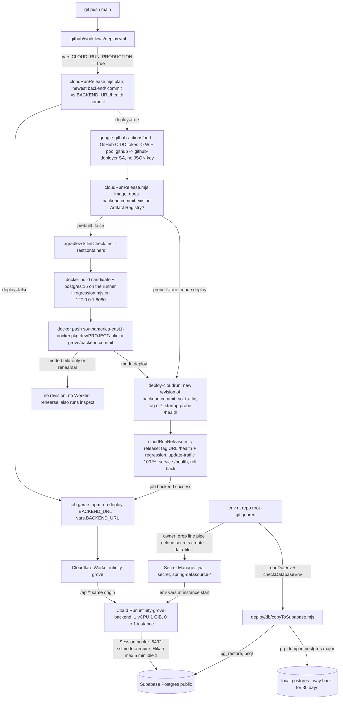

# Supabase Postgres Design

**Spec**: `.specs/features/supabase-postgres/spec.md`
**Status**: Draft, revision 3 (backend on Google Cloud Run; awaiting owner approval and answers Q9 to Q15)

Sources read on 2026-11-16 for this revision: Cloud Run pricing, container runtime contract, health checks, CPU and startup CPU boost, request timeout, maximum instances, rollouts and traffic migration, secrets, `gcloud run deploy` and `gcloud run services update-traffic` references, deterministic URLs, instance autoscaling; Artifact Registry pricing and cleanup policies; Secret Manager pricing; VPC network pricing (internet data transfer); Cloud Billing budgets; gcloud CLI install; the READMEs and `action.yml` of `google-github-actions/auth@v3` and `google-github-actions/deploy-cloudrun@v3`. Anything not found there is marked "uncertain".

---

## Architecture Overview

Production leaves the owner's machine in one cutover. The backend image is the same `backend/Dockerfile`; it runs as the Cloud Run service `infinity-grove-backend` in `southamerica-east1` and reaches the Supabase Session pooler of `sa-east-1` over IPv4. A GitHub Actions workflow replaces the watcher: it tests the backend, runs the API regression on a throwaway database, signs in to Google Cloud with Workload Identity Federation, pushes the tested image to Artifact Registry, creates a revision **with no traffic** and a tag, checks `/health` and runs the regression on the tag URL, moves 100 % of the traffic to it, checks the service URL and moves the traffic back on failure. Then it publishes the game Worker with `BACKEND_URL` set to the service URL.

The local blue-green stack (`publish.sh`, watcher, Traefik, Dozzle, the slots on the local `postgres`) is untouched until the cutover and then stays only as the way back for 30 days (TD-005). The local slots never read Supabase: `backend/docker-compose.yml` keeps setting their datasource to the compose `postgres`.



### Ordering of a push that changes backend and game

Job `game` has `needs: backend` and runs only when `backend` succeeded. Nothing waits on `game`, and `backend` never waits on the Worker, so there is no cycle. The Worker is built from the run's whole tree every time, so a game change held back by a failed backend ships with the next run that passes (the watcher's `gameHeld` rule, without state). GitHub keeps only the newest pending run of the `production` group and cancels the older pending one; nothing is lost, because `plan` compares the newest `backend/` commit with the `commit` that `/health` answers, not the diff of the push.

### Modes of a run and the prebuilt image

A push runs in mode `deploy`; a run by hand chooses `mode`: `deploy`, `build-only` or `rehearsal`. Every mode starts the same way: `plan` picks the target (the newest commit of `backend/` on `main`), the job signs in with WIF, and `cloudRunRelease.mjs image <target>` asks Artifact Registry for `backend:<target>` (`gcloud artifacts docker images describe`).

- Tag found (`prebuilt=true`): the tests, the build, the runner regression and the push are skipped. An image only reaches the registry under a commit tag after the tests and the runner regression of that commit passed, and only the workflow pushes, so the tag is the proof that the gates ran.
- Tag missing, or any gcloud error (`prebuilt=false`): the job runs the tests, builds, runs the runner regression and pushes. A false "missing" only costs a rebuild.
- Then `build-only` stops; `rehearsal` runs `inspect` and stops; `deploy` creates the revision and runs `release`, and only `deploy` lets the `game` job run.

The tag looked up is always the newest `backend/` commit at run time, never `latest`, so a prebuilt image can only be deployed for the exact commit it was built from. If `backend/` changes after the prebuild (O15), the window run finds no tag for the new commit and builds it, which makes the window longer by the build time (measured in O15) but never ships the old image. The cleanup policy cannot remove the prebuilt image first: the delete rule only reaches versions older than 30 days that are not among the 3 newest, O15 runs at most 7 days before the window, and a run for the same commit pushes nothing new (it finds the tag). Artifact Registry's immutable tags are not used, because they also stop the cleanup policy from deleting tagged images (Artifact Registry cleanup policy page).

### A deploy, step by step

1. `deploy-cloudrun` runs `gcloud run deploy infinity-grove-backend --image ...:<commit> --no-traffic --tag c-<7> ...`. Cloud Run checks that every referenced secret exists and that the runtime service account may read it, then (with the default `--deploy-health-check`) starts one instance of the new revision and waits for its startup probe on `/health`. Flyway runs during that boot, on the production database, while the previous revision keeps serving. A revision that never passes the probe fails the step; it gets no traffic.
2. `release` reads `status.traffic` of the service (`gcloud run services describe --format json`): the revision with the tag `c-<7>` and its tag URL `https://c-<7>---infinity-grove-backend-<project number>.southamerica-east1.run.app`, and the revision that holds 100 % (the previous one).
3. `release` asks `<tag URL>/health` (90 s) for the target commit, then runs `deploy/regression.mjs` against the tag URL. This is the regression against production: same image, same secrets, same database, no player traffic yet. A failure removes the tag (an old revision must not stay reachable) and leaves the traffic where it was.
4. `release` runs `gcloud run services update-traffic --to-revisions <new>=100 --clear-tags`, then asks `<BACKEND_URL>/health` for the target commit. If that check fails, it routes 100 % back to the previous revision.

`--no-traffic` pins the traffic to the revision that was latest before the deploy (`gcloud run deploy` reference), so the previous revision keeps exactly its share until step 4. The previous image stays in Artifact Registry (the cleanup policy keeps the 3 newest), so step 4 and a by-hand rollback never need an image that was deleted.

### Connection budget

Supabase Free: Session pooler pool size 15. In session mode each client connection holds one server connection until it closes.

| Client | Connections | When |
| --- | --- | --- |
| The instance of the serving revision (Hikari `maximum-pool-size: 5`, `minimum-idle: 1`; Flyway borrows from the same pool) | 1 idle, at most 5 | while an instance lives (up to 15 idle minutes after the last request) |
| The instance of the new tagged revision (`--max-instances=1` on the revision) | at most 5 | from the deploy until the old instance scales in |
| `copyToSupabase.mjs` (`psql`, one at a time) | 1 | cutover only, before any `spring-datasource-*` secret exists (0 from Cloud Run) |
| Supabase dashboard SQL editor | 1 | by hand |
| **Peak of a deploy** | **11** | below 15 |

`--max=1` caps the serving revision of the service at one instance; a tagged revision with 0 % does not count toward the service-level maximum (Cloud Run "Maximum instances": "Tagged revisions are started, but only count toward the service-level maximum instances if they are a part of a traffic split"), so the candidate has its own revision cap of 1. Cloud Run says the maximum "can be exceeded for a brief period due to circumstances such as traffic spikes"; a third instance during a deploy would reach 15 connections in the worst case (risk table). The candidate of the workflow talks to its own `postgres:16` on the runner, never to Supabase; the regression talks only HTTP.

### Cold start

`--min-instances=0` (Q9): after up to 15 idle minutes Cloud Run removes the instance (Cloud Run "About instance autoscaling"). The next request starts a new one: the JVM boots with 2 vCPU (`--cpu-boost` gives 2 vCPU to a 1 vCPU instance during startup and for 10 s after), Spring connects to the pooler and runs the seeders. A request waits in Cloud Run's queue up to 3.5 times the average startup time of the service, at least 10 s (container runtime contract), and the request timeout `--timeout=120` includes the startup. The start screen covers it: one `GET /api/health` with a 60 s timeout before the session restore, and a notice after 2 s. Because `/health` runs `select 1`, that call also replaces Hikari connections that died while the instance sat idle with its CPU throttled (request-based billing gives CPU only while a request runs), before the first game call with its 10 s timeout.

### Cost

Request-based billing (the default): an instance is billed only while it starts, while it shuts down and while at least one request runs, rounded up to 100 ms. The free tier is per billing account and month, "applied as a spending based discount using Tier 1 pricing": 180,000 vCPU-s (worth US$ 4.32), 360,000 GiB-s (US$ 0.90) and 2 million requests. `southamerica-east1` is **Tier 2**: active vCPU-s US$ 0.0000336, active GiB-s US$ 0.0000035, requests US$ 0.40 per million. So in São Paulo the free tier covers about 128,500 vCPU-s and 257,000 GiB-s a month. Probes are billed for CPU and memory but not as requests (health checks page).

Assumed traffic (no measurement exists; the owner's watcher had no counter): 10 players, 1 hour a day each, about 6 API calls a minute while playing.

| Item | Monthly use | Free allowance | Cost |
| --- | --- | --- | --- |
| Requests | 10 x 30 x 60 x 6 = 108,000 | 2,000,000 | US$ 0 |
| vCPU-seconds | requests 108,000 x 0.1 s = 10,800; cold starts 300 x (25 s + 10 s) x 2 vCPU = 21,000; deploys 60 x 70 = 4,200; probes about 1,800; total about 38,000 | about 128,500 (São Paulo) | US$ 0 |
| GiB-seconds | 10,800 + 300 x 25 + 60 x 25 + 1,800 = about 21,600 | about 257,000 | US$ 0 |
| Artifact Registry storage | 3 images kept; the JRE layers are the same in each, so roughly 0.2 to 0.5 GiB (to be measured with `gcloud artifacts docker images list ... --include-tags` after the first push) | 0.5 GiB | US$ 0 (US$ 0.10 per GiB-month above it) |
| Secret Manager | 4 active versions; 4 accesses per instance start, about 1,500 | 6 versions, 10,000 accesses | US$ 0 |
| Internet data transfer out (Premium Tier) | responses to the Cloudflare edge in Brazil (about 4 KB each) and Supabase traffic in AWS São Paulo (about 2 KB per request): about 0.65 GiB, all "to South America" | none (the 1 GiB free covers North America, Europe and Asia destinations, not South America) | about US$ 0.12 (US$ 0.19 per GiB) |
| Cloud Logging | well under 1 GiB | 50 GiB | US$ 0 |
| GitHub Actions | the repository is public | free on standard runners | US$ 0 |
| **Total** | | | **about US$ 0.12 a month** |

**Does it stay at US$ 0?** Compute, requests, images and secrets do, with about 3 times headroom on vCPU-seconds (cold starts dominate). Network egress does not: South America has no free allowance, so a few cents a month is expected. A new Google Cloud account's US$ 300 trial credit covers that for its first 90 days. With `--min-instances=1` (Q9 alternative) the idle instance alone costs 2,628,000 s x (US$ 0.0000035 + US$ 0.0000035) = US$ 18.40 a month before the free-tier discount. The budget of O12 mails at 10 %, 50 % and 100 % of 5 units of the account currency; it does not stop the service. The free tier is shared by every project on the same billing account.

---

## Code Reuse Analysis

### Existing Components to Leverage

| Component | Location | How to Use |
| --- | --- | --- |
| `run` (spawnSync wrapper, merges `env` into `process.env`, `shell` option for `.cmd` on Windows) | `deploy/lib/run.mjs:4` | The default `exec` of `cloudRunRelease.mjs` and of the copy CLI |
| Fake `exec` pattern (records calls, answers by command) | `deploy/lib/slots.test.mjs:9`, `deploy/lib/backendDeploy.test.mjs:31` | `cloudRunRelease.test.mjs`, `deploy/db/*.test.mjs` |
| CLI entry guard `import.meta.url === pathToFileURL(process.argv[1]).href` | `deploy/watcher.mjs` (bottom), `deploy/deploy.mjs` | `cloudRunRelease.mjs`, `copyToSupabase.mjs` |
| Text checks of a config file | `deploy/lib/secrets.test.mjs` (reads tracked files) | `workflow.test.mjs` |
| API regression suite (12 checks, throwaway user deleted at the end) | `deploy/regression.mjs:27` (`runSuite`), CLI at `:177` | Run by the workflow on the candidate and by `release` on the tag URL |
| Game paths the watcher shipped | `deploy/lib/changes.mjs:2` (`GAME_DIRS`, `GAME_FILES`) | The `paths:` filter of the workflow (same list, tests excluded by construction) |
| Worker publish (`vite build --mode pages` + `wrangler deploy --var BACKEND_URL:<url>`) | `game/scripts/deploy.mjs` | Job `game` runs `npm run deploy` unchanged |
| Same-origin `/api` proxy | `game/worker/index.js` | Unchanged; only `BACKEND_URL` changes. No CORS needed. |
| Public route list | `backend/.../adapter/security/SecurityConfig.kt:47` | One more `authorize(HttpMethod.GET, "/health", permitAll)` |
| Port + adapter + fake pattern | `backend/.../port/*Ports.kt`, `backend/src/test/kotlin/.../Fakes.kt` | `DatabaseHealthPort`, `JdbcDatabaseHealth`, a fake in the controller test |
| `IntegrationTestBase` + `@ServiceConnection` | `backend/src/test/kotlin/br/com/woodriver/infinity_grove_ws/IntegrationTestBase.kt:30` | `HealthIT`, `DatabasePoolConfigIT`, `TestDatabaseIsolationIT` |
| Security IT helpers | `backend/src/test/kotlin/br/com/woodriver/infinity_grove_ws/adapter/web/SecurityIT.kt:34` (`assertUnauthenticated`) | Two new tests in the same class |
| http adapter shape `createXApi(httpClient)` | `game/src/adapters/http/userApi.js` | `game/src/adapters/http/healthApi.js` |
| Composition root `services` | `game/src/composition.js:50` | New key `backend` |
| MainMenu restore flow and message slot | `game/src/adapters/phaser/MainMenu.js:123` (`restoreSession`), `:290` (`showMessage`) | The wake call goes first in `restoreSession` |
| e2e fake backend | `game/e2e/support/fakeBackend.js:228` (`mockBackend`), `:904` (`serverDown`) | `/api/health` route and option `healthDelayMs` |
| Review screenshots | `game/ui-review/support/shots.js` (`shot`), `game/ui-review/heroAscension.shots.js` (`watch`, `report`) | `game/ui-review/supabasePostgres.shots.js` |

### Integration Points

| System | Integration Method |
| --- | --- |
| Google Cloud Run | Service `infinity-grove-backend` in `southamerica-east1`, created by the owner with a placeholder image (O10), then deployed by `google-github-actions/deploy-cloudrun@v3`; traffic moved by `gcloud run services update-traffic` in `release` |
| Artifact Registry | Docker repository `infinity-grove` in `southamerica-east1`; images `southamerica-east1-docker.pkg.dev/<project>/infinity-grove/backend:<40-hex commit>`; cleanup policy `deploy/cloudrun/artifact-cleanup.json` |
| Secret Manager | `jwt-secret` and `spring-datasource-{url,username,password}`, automatic replication, read by the runtime service account at instance start |
| Workload Identity Federation | Pool `github`, OIDC provider `infinity-grove-phaser` (issuer `https://token.actions.githubusercontent.com`), service account `github-deployer` |
| Supabase | Session pooler only. No SDK, no keys, no Data API. |
| GitHub Actions | `.github/workflows/deploy.yml`; variables `GCP_PROJECT_ID`, `GCP_WIF_PROVIDER`, `GCP_DEPLOY_SA`, `GCP_RUNTIME_SA`, `BACKEND_URL`, `CLOUD_RUN_PRODUCTION`; secrets `CLOUDFLARE_API_TOKEN`, `CLOUDFLARE_ACCOUNT_ID` |
| Cloudflare Workers | `wrangler deploy` authenticated by `CLOUDFLARE_API_TOKEN` and `CLOUDFLARE_ACCOUNT_ID` (Cloudflare docs, "Workers > CI/CD > GitHub Actions") |
| Flyway | Unchanged, runs at boot. After the copy, `flyway_schema_history` holds V1 to V10 with their checksums, so the first revision validates and applies nothing. |

---

## Components

### `deploy/lib/dotenv.mjs` (T1, done) and `deploy/lib/databaseEnv.mjs` (T2, done)

Unchanged. The pooler host regex is `^aws-\d+-[a-z0-9-]+\.pooler\.supabase\.com$` (`deploy/lib/databaseEnv.mjs:87`), so `aws-1-sa-east-1` is accepted; no fix task is needed. `loadDatabaseEnv` keeps its tests and has no production caller now.

### Health check (T4)

- **Purpose**: Tell the Cloud Run probes and the workflow that this process and its database answer, and which commit runs.
- **Location**: `backend/src/main/kotlin/br/com/woodriver/infinity_grove_ws/port/HealthPorts.kt`, `adapter/repository/JdbcDatabaseHealth.kt`, `adapter/web/HealthController.kt`
- **Interfaces**:
  - `interface DatabaseHealthPort { fun reachable(): Boolean }`
  - `JdbcDatabaseHealth(jdbc: JdbcTemplate)`: `select 1` equals 1 → `true`; any `DataAccessException` → `false`
  - `GET /health` → 200 `HealthResponse("UP", commit)` or 503 `HealthResponse("DOWN", commit)`; `commit` is `app.commit` = `${APP_COMMIT:unknown}`
- **Why a port**: the controller stays testable without a database (fake port), as the other web adapters depend on use cases and ports.

### Pool and port (T5)

`spring.datasource.hikari.maximum-pool-size: 5`, `minimum-idle: 1`, and `server.port: ${PORT:8080}`. Spring Boot reads `SERVER_PORT`, not `PORT`; Cloud Run injects `PORT` (8080 unless `--port` says otherwise) and sends requests there, so the line makes the container follow the runtime contract. Without `PORT` (compose slots, `bootRun`) the port stays 8080.

### `deploy/cloudrun/cloudRunRelease.mjs` (T7, T8)

- **Purpose**: The decisions of the workflow that need code: what to deploy (`plan`), what the service looks like (`inspect`), and the check, the traffic switch and the way back of a revision (`release`).
- **Interfaces**: `SERVICE`, `REGION`, `HEALTH_TIMEOUT_MS`, `USAGE`, `DESCRIBE_ERROR`, `DESCRIBE_ARGS`, `isCommit(value)`, `short(commit)`, `revisionTag(commit)`, `healthCommit(fetch, baseUrl)`, `githubOutput(path)`, `parseTraffic(text)`, `describeService(exec, root)`, `trafficArgs(...flags)`, `MISSING_IMAGE`, `imageArgs(image, commit)`, `plan(deps)`, `inspect(deps)`, `imageCheck(deps, target)`, `release(deps, target)`, `main(args, deps)`. `deps = { exec, fetch, root, log, output, backendUrl, image }`; `image` is the env `IMAGE` of the workflow (`southamerica-east1-docker.pkg.dev/<project>/infinity-grove/backend`).
- **Dependencies**: `node:fs` (`appendFileSync`), `node:path`, `node:url`, `../lib/run.mjs`. Every `gcloud` call passes `shell: process.platform === 'win32'`, because the Windows gcloud is a `.cmd` (the same reason `run` has the option).

### `.github/workflows/deploy.yml` and `deploy/cloudrun/artifact-cleanup.json` (T9)

Exact text in T9. Two jobs (`backend`, `game`), one concurrency group, every job gated by `vars.CLOUD_RUN_PRODUCTION`, a manual `mode` input (`deploy`, `build-only`, `rehearsal`; a push is `deploy`), the image lookup before the tests so a prebuilt image skips tests, build and push, `permissions: id-token: write` on the backend job only. The cleanup policy is versioned so the owner applies the reviewed file (O6).

### Game wake-up (T10, T11)

- `game/src/adapters/http/healthApi.js`: `WAKE_TIMEOUT_MS = 60000`; `createHealthApi(httpClient)` → `{ wake(): Promise<boolean> }`. One `httpClient.get('/health', { skipAuth: true, timeout: WAKE_TIMEOUT_MS })`; `true` on 2xx, `false` on any error; never rejects.
- `game/src/composition.js`: `export const healthApi = createHealthApi(httpClient)`; `services.backend = healthApi`.
- `MainMenu.restoreSession`: `...` → `await this.backend.wake()` with a 2 s timer that shows `Acordando o servidor, aguarde...` → `...` → `session.restore()` as today.

### Copy tool (T14 to T17)

Unchanged from revision 1 (`deploy/db/pgTools.mjs`, `snapshot.mjs`, `copyToSupabase.mjs`), except the hint for a stopped local Postgres: `docker compose -f backend/docker-compose.yml up -d --wait postgres` (no `local-db` profile any more).

### `publish.sh` guard (T22, after the cutover)

A `--way-back` flag is required; without it the script prints the Cloud Run message and exits 1 before anything starts.

---

## Data Models

### Repo-root `.env` (gitignored; input of the copy and of `gcloud secrets create`)

```
SPRING_DATASOURCE_URL=jdbc:postgresql://aws-1-sa-east-1.pooler.supabase.com:5432/postgres?sslmode=require
SPRING_DATASOURCE_USERNAME=postgres.jnqlrdnwwqslihncszej
SPRING_DATASOURCE_PASSWORD=<24 letters and digits>
```

### Secret Manager (created by the owner only)

| Secret | Env var in the container | Created | Value |
| --- | --- | --- | --- |
| `jwt-secret` | `JWT_SECRET` | before the window (O9) | `openssl rand -base64 48` (64 characters; it may differ from the local one, spec Assumptions) |
| `spring-datasource-url` | `SPRING_DATASOURCE_URL` | runbook step 8, only after `Verificação OK` | the `.env` URL (no password in it) |
| `spring-datasource-username` | `SPRING_DATASOURCE_USERNAME` | runbook step 8 | `postgres.jnqlrdnwwqslihncszej` |
| `spring-datasource-password` | `SPRING_DATASOURCE_PASSWORD` | runbook step 8 | the `.env` password |

The deploy references `<secret>:latest`. Env-var secrets are resolved when an instance starts (Cloud Run "Configure secrets"), so a new version reaches the next instance without a deploy, and a wrong new version breaks the next cold start of the serving revision too (risk table). Replacing a value: add the new version, check the site, then `gcloud secrets versions destroy <old> --secret <name>` so the free 6 active versions are not exceeded (disabled versions still count as active).

### Cloud Run environment (not secret)

| Name | Set by | Value |
| --- | --- | --- |
| `APP_COMMIT` | `env_vars` of `deploy-cloudrun` | the 40-hex commit of the image; `/health` answers it |
| `JAVA_TOOL_OPTIONS` | `env_vars` of `deploy-cloudrun` | `-XX:MaxRAMPercentage=60` |
| `PORT` | Cloud Run (reserved, never set by us) | `8080` (`--port=8080`) |

### GitHub repository settings (set by the owner only)

| Kind | Name | Value |
| --- | --- | --- |
| Variable | `GCP_PROJECT_ID` | the project ID of O4 (Q14) |
| Variable | `GCP_WIF_PROVIDER` | `projects/<project number>/locations/global/workloadIdentityPools/github/providers/infinity-grove-phaser` |
| Variable | `GCP_DEPLOY_SA` | `github-deployer@<project id>.iam.gserviceaccount.com` |
| Variable | `GCP_RUNTIME_SA` | `infinity-grove-run@<project id>.iam.gserviceaccount.com` |
| Variable | `BACKEND_URL` | the service URL printed by O10, `https://infinity-grove-backend-<project number>.southamerica-east1.run.app` (the deterministic URL format of Cloud Run) |
| Variable | `CLOUD_RUN_PRODUCTION` | `true` from the cutover on; `false` before it and on way back B |
| Secret | `CLOUDFLARE_API_TOKEN` | Cloudflare dashboard > Account API tokens > Create Token > "Edit Cloudflare Workers", scoped to the owner's account |
| Secret | `CLOUDFLARE_ACCOUNT_ID` | Cloudflare account ID |

None of the variables is a credential: WIF trades the run's short-lived GitHub OIDC token for a short-lived Google token, and only runs of this repository on `refs/heads/main` are admitted (O8).

### Images

`southamerica-east1-docker.pkg.dev/<project id>/infinity-grove/backend:<40-hex commit>`. The tested candidate is the image deployed, whether it was built in the same run or by an earlier `build-only` or `rehearsal` run of the same commit (O15). No `latest` tag exists. A revision keeps the image it was created with, so routing traffic back to it needs no lookup.

---

## Owner steps (in order; the owner types every secret and changes every IAM, billing and GitHub setting)

Run from Git Bash at the repository root unless a step says PowerShell or a dashboard. Every Git Bash session first sets:

```bash
export PROJECT_ID=infinity-grove-prod            # Q14; the ID is global, add a suffix if it is taken
export REGION=southamerica-east1
export SERVICE=infinity-grove-backend
export REPO=woodriveer/infinity-grove-phaser
export PROJECT_NUMBER=$(gcloud projects describe "$PROJECT_ID" --format="value(projectNumber)")   # after O4
export BILLING_ACCOUNT=<the ACCOUNT_ID that gcloud billing accounts list prints>                   # after O4
```

**Who runs what.** Owner only: every command below that creates, links, enables, grants, sets or deletes something, and anything about billing, IAM, secrets, GitHub settings or Fly. An agent may run, once the owner is logged in with gcloud, only these read-only checks: `gcloud --version`, `gcloud auth list`, `gcloud config list`, `gcloud services list --enabled --format="value(config.name)"`, `gcloud artifacts repositories describe infinity-grove --location "$REGION"`, `gcloud artifacts docker images list "southamerica-east1-docker.pkg.dev/$PROJECT_ID/infinity-grove/backend" --include-tags`, `gcloud iam service-accounts list`, `gcloud iam workload-identity-pools providers describe infinity-grove-phaser --location=global --workload-identity-pool=github`, `gcloud secrets list --format="value(name)"` (names only; never `gcloud secrets versions access`), `gcloud run services describe "$SERVICE" --region "$REGION"`, `gcloud run services get-iam-policy "$SERVICE" --region "$REGION"`, `gcloud run revisions list --service "$SERVICE" --region "$REGION"`, `gcloud run services logs read "$SERVICE" --region "$REGION" --limit 200`, `gcloud billing budgets list --billing-account "$BILLING_ACCOUNT"`, `node deploy/cloudrun/cloudRunRelease.mjs inspect`, `gh variable list`, `gh secret list` (names only), `gh run list`, `gh run watch`, `git ls-remote --heads origin flyio-new-files`.

Before the window (any day, in this order):

- **O1 Fly cleanup.** Fly dashboard > app `infinity-grove-phaser` > Settings > Delete app (or, if flyctl is installed and logged in, `fly apps destroy infinity-grove-phaser --yes`). This removes its machine, its secrets (whose datasource used the wrong `aws-0` host, so it never reached Supabase; `public` has 0 tables) and the GitHub launch deploy that built commits without tests. Then `git push origin --delete flyio-new-files`. Optional: GitHub > Settings > Applications > Installed GitHub Apps > Fly.io > remove access to this repository. Check (agent): `git ls-remote --heads origin flyio-new-files` prints nothing (M14).
- **O2 Install the gcloud CLI** (PowerShell, from the gcloud install page):

  ```powershell
  (New-Object Net.WebClient).DownloadFile("https://dl.google.com/dl/cloudsdk/channels/rapid/GoogleCloudSDKInstaller.exe", "$env:Temp\GoogleCloudSDKInstaller.exe")
  & $env:Temp\GoogleCloudSDKInstaller.exe
  ```

  Keep "Install Bundled Python" checked; at the end uncheck "start the Google Cloud CLI shell". Open a new Git Bash: `gcloud --version` prints the SDK version. If Git Bash does not find `gcloud`, call `gcloud.cmd` instead in every command (uncertain: not stated by the install page).
- **O3 Log in.** `gcloud auth login` (opens the browser).
- **O4 Billing account and project.** Console > Billing > Create account (the card is entered in the console; the CLI cannot create a billing account). Then:

  ```bash
  gcloud projects create "$PROJECT_ID" --name="Infinity Grove"
  gcloud billing accounts list
  gcloud billing projects link "$PROJECT_ID" --billing-account="$BILLING_ACCOUNT"
  gcloud config set project "$PROJECT_ID"
  gcloud config set run/region "$REGION"
  ```

- **O5 Enable the APIs.**

  ```bash
  gcloud services enable run.googleapis.com artifactregistry.googleapis.com secretmanager.googleapis.com iamcredentials.googleapis.com sts.googleapis.com iam.googleapis.com billingbudgets.googleapis.com
  ```

- **O6 Artifact Registry** (the second command needs T9 on `main`):

  ```bash
  gcloud artifacts repositories create infinity-grove --repository-format=docker --location="$REGION" --description="Backend images of the Deploy workflow"
  gcloud artifacts repositories set-cleanup-policies infinity-grove --location="$REGION" --policy=deploy/cloudrun/artifact-cleanup.json --no-dry-run
  ```

- **O7 Service accounts and roles.**

  ```bash
  gcloud iam service-accounts create infinity-grove-run --display-name="Cloud Run runtime of infinity-grove-backend"
  gcloud iam service-accounts create github-deployer --display-name="Deploy workflow of woodriveer/infinity-grove-phaser"
  gcloud projects add-iam-policy-binding "$PROJECT_ID" --member="serviceAccount:infinity-grove-run@$PROJECT_ID.iam.gserviceaccount.com" --role="roles/secretmanager.secretAccessor" --condition=None
  gcloud projects add-iam-policy-binding "$PROJECT_ID" --member="serviceAccount:github-deployer@$PROJECT_ID.iam.gserviceaccount.com" --role="roles/run.admin" --condition=None
  gcloud artifacts repositories add-iam-policy-binding infinity-grove --location="$REGION" --member="serviceAccount:github-deployer@$PROJECT_ID.iam.gserviceaccount.com" --role="roles/artifactregistry.writer"
  gcloud iam service-accounts add-iam-policy-binding "infinity-grove-run@$PROJECT_ID.iam.gserviceaccount.com" --member="serviceAccount:github-deployer@$PROJECT_ID.iam.gserviceaccount.com" --role="roles/iam.serviceAccountUser"
  ```

  `roles/run.admin` and Service Account User on the runtime identity are the roles the `deploy-cloudrun` README asks for; the deployer needs no Secret Manager role, because Cloud Run checks the runtime account's access.
- **O8 Workload Identity Federation.**

  ```bash
  gcloud iam workload-identity-pools create github --location=global --display-name="GitHub Actions"
  gcloud iam workload-identity-pools providers create-oidc infinity-grove-phaser --location=global --workload-identity-pool=github \
    --display-name="woodriveer/infinity-grove-phaser" --issuer-uri="https://token.actions.githubusercontent.com" \
    --attribute-mapping="google.subject=assertion.sub,attribute.repository=assertion.repository,attribute.ref=assertion.ref" \
    --attribute-condition="assertion.repository == '$REPO' && assertion.ref == 'refs/heads/main'"
  gcloud iam service-accounts add-iam-policy-binding "github-deployer@$PROJECT_ID.iam.gserviceaccount.com" --role="roles/iam.workloadIdentityUser" \
    --member="principalSet://iam.googleapis.com/projects/$PROJECT_NUMBER/locations/global/workloadIdentityPools/github/attribute.repository/$REPO"
  gcloud iam workload-identity-pools providers describe infinity-grove-phaser --location=global --workload-identity-pool=github --format="value(name)"
  ```

  The last line prints the value of `GCP_WIF_PROVIDER`. No `gcloud iam service-accounts keys create` is ever run (spec US-6 AC 12).
- **O9 The JWT secret** (the value is generated and piped; it never shows):

  ```bash
  openssl rand -base64 48 | tr -d '\n' | gcloud secrets create jwt-secret --replication-policy=automatic --data-file=-
  ```

  Never create any `spring-datasource-*` secret before runbook step 8 (spec US-6 AC 9).
- **O10 The service, with Google's sample image.** `--no-traffic` needs an existing service, and the sample image proves the public URL before any backend image exists:

  ```bash
  gcloud run deploy "$SERVICE" --image=us-docker.pkg.dev/cloudrun/container/hello --region="$REGION" --allow-unauthenticated \
    --service-account="infinity-grove-run@$PROJECT_ID.iam.gserviceaccount.com" --max=1 --max-instances=1 --min-instances=0
  gcloud run deploy "$SERVICE" --image=us-docker.pkg.dev/cloudrun/container/hello --region="$REGION" --revision-suffix=probe --no-traffic --tag=probe
  gcloud run services describe "$SERVICE" --region="$REGION" --format="value(status.url)"
  ```

  The second deploy creates a tagged revision without traffic, which the rehearsal's `inspect` must list (M9); the promotion of the cutover clears the tag. The last line prints the value of `BACKEND_URL`. If `--allow-unauthenticated` fails with a policy error, the Google account belongs to an organization that restricts `allUsers` (uncertain for this account); stop and report.
- **O11 GitHub variables and secrets.**

  ```bash
  gh variable set GCP_PROJECT_ID --body "$PROJECT_ID"
  gh variable set GCP_WIF_PROVIDER --body "projects/$PROJECT_NUMBER/locations/global/workloadIdentityPools/github/providers/infinity-grove-phaser"
  gh variable set GCP_DEPLOY_SA --body "github-deployer@$PROJECT_ID.iam.gserviceaccount.com"
  gh variable set GCP_RUNTIME_SA --body "infinity-grove-run@$PROJECT_ID.iam.gserviceaccount.com"
  gh variable set BACKEND_URL --body "<the URL printed by O10>"
  gh variable set CLOUD_RUN_PRODUCTION --body false
  gh secret set CLOUDFLARE_API_TOKEN
  gh secret set CLOUDFLARE_ACCOUNT_ID
  ```

  `gh secret set <name>` asks for the value without echo.
- **O12 Budget alert** (Q15; without a currency suffix the amount is in the billing account's currency):

  ```bash
  gcloud billing budgets create --billing-account="$BILLING_ACCOUNT" --display-name=infinity-grove --budget-amount=5 \
    --filter-projects="projects/$PROJECT_ID" --threshold-rule=percent=0.1 --threshold-rule=percent=0.5 --threshold-rule=percent=1.0
  ```

- **O13** Supabase Dashboard > Integrations > Data API: turn **Enable Data API** off (Q5).
- **O14 Rehearsal.** `gh workflow run deploy.yml --ref main -f mode=rehearsal`, then `gh run watch`. It must end green, and the step "Read the Cloud Run service" must print `Tráfego: infinity-grove-backend-00001-<x>` and `Tag probe: infinity-grove-backend-probe https://probe---infinity-grove-backend-<project number>.southamerica-east1.run.app` (M9).
- **O15 Prebuild the image that goes live** (at most 7 days before the window, after the last commit of `backend/` of this feature; from then on no commit touches `backend/` until the window):

  ```bash
  gh workflow run deploy.yml --ref main -f mode=build-only
  gh run watch
  git fetch origin
  TARGET=$(git log -1 --format=%H origin/main -- backend)
  gcloud artifacts docker images list "southamerica-east1-docker.pkg.dev/$PROJECT_ID/infinity-grove/backend" --include-tags --format="value(tags)" | grep -c "$TARGET"
  ```

  The run ends green and its step "Look for the image of this commit" prints either `Imagem <7> não está no Artifact Registry; ...` (then tests, build, regression and push ran) or `Imagem <7> já está no Artifact Registry; ...` (the rehearsal of the same commit already pushed it). The last command prints `1` (M15). Write down how long the steps from "Backend tests" to "Push" took in the run that built the image (`gh run view <id>`): that is what a rebuild adds to the window. Only the first two lines are owner commands; an agent may run the last three (read-only).

---

## Cutover runbook (T20)

Run from Git Bash at the repository root of `C:\Users\Internal.IT\Developer\infinity-grove-phaser`, with the session variables of "Owner steps" set.

The window is the time the site is offline: from step 3 to step 12, about 15 minutes with the prebuilt image. The estimates are not measured (no step has run yet); T20 records the real times for the report.

| Step | What | Estimate |
| --- | --- | --- |
| 1, 2 | Checks and the account (before the window; the site is still up) | 3 min |
| 3 to 5 | Stop `publish.sh`, remove the slots, local `postgres` up | 1.5 min |
| 6 | `check` (images pulled in step 1) | 1 min |
| 7 | `copy`: dump, restore over the internet, `verify` (the database has a few players) | 3 min |
| 8, 9 | Three secrets, the variable, the dispatch | 1.5 min |
| 10 | The run with the prebuilt image: queue and checkout (1), plan, sign-in and `image` (0.5), revision and JVM boot to the startup probe (1.5), `/health`, regression and switch on the tag (1), job `game`: `npm install`, build, `wrangler deploy` (2) | 6 min |
| 11, 12 | `curl` and the account on the site | 1.5 min |
| **3 to 12** | **Site offline** | **about 14.5 min** |
| 10, rebuilt | Only when `backend/` changed after O15: plus tests, build, runner regression and push | plus the time recorded in O15 (expected about 10 min, not measured) |

**Before the window** (the site is still up):

1. Every commit of this feature is on `origin/main` (`git fetch origin && git status -sb`), and O1 to O15 are done. `gcloud secrets list --format="value(name)"` prints only `jwt-secret`. The prebuilt image is still the one for `main` (agent, read-only):

   ```bash
   TARGET=$(git log -1 --format=%H origin/main -- backend)
   gcloud artifacts docker images list "southamerica-east1-docker.pkg.dev/$PROJECT_ID/infinity-grove/backend" --include-tags --format="value(tags)" | grep -c "$TARGET"
   docker pull postgres:17
   ```

   The `grep` prints `1`. If it prints `0`, `backend/` changed after O15 (or the image is gone): the owner either runs O15 again now and repeats this step, or goes on and accepts that step 10 also builds the image, so the window grows by the build time recorded in O15. The way-back triggers do not change. `docker pull` saves the image download from step 6 (the copy tool runs `postgres:17` for the version probe and `postgres:<Supabase major>` for the rest).
2. Log in to the game with one existing account. Write down its chapter, stage and copper.

**In the window:**

3. Ctrl+C in the `publish.sh` terminal. The watcher, the tunnel, the proxy, Dozzle and the slots stop; the site goes offline. Note the time.
4. `docker ps -a --filter name=infinity-grove-backend- --format '{{.Names}} {{.State}}'`, then `docker rm <each name listed>`.
5. `docker compose -f backend/docker-compose.yml up -d --wait postgres`.
6. `node deploy/db/copyToSupabase.mjs check`. **Go/no-go 1**: the output ends with `Pronto para copiar`.
7. `node deploy/db/copyToSupabase.mjs copy`. **Go/no-go 2**: the output ends with `Verificação OK: <t> tabela(s), <n> linha(s)` and includes `Permissões do Data API: 0 OK`.
8. Owner, the three datasource secrets from `.env` (the values go through the pipe only):

   ```bash
   for name in URL USERNAME PASSWORD; do
     grep "^SPRING_DATASOURCE_${name}=" .env | cut -d= -f2- | tr -d '\r\n' \
       | gcloud secrets create "spring-datasource-${name,,}" --replication-policy=automatic --data-file=-
   done
   gcloud secrets list --format="value(name)"
   ```

   The list shows `jwt-secret`, `spring-datasource-password`, `spring-datasource-url`, `spring-datasource-username`.
9. Owner: `gh variable set CLOUD_RUN_PRODUCTION --body true`, then `gh workflow run deploy.yml --ref main -f mode=deploy`.
10. `gh run watch`: the step "Look for the image of this commit" prints `Imagem <7> já está no Artifact Registry; testes, build, regressão e push não rodam de novo` (the tests, build and push steps show as skipped), so this run only deploys that image; job `backend` ends with `Backend <7> no ar no Cloud Run (<revision>)`; job `game` ends green. **Go/no-go 3.** If it printed `Imagem <7> não está no Artifact Registry; ...` instead, the run builds first; that is not a failure, only a longer window.
11. `curl -s "<BACKEND_URL>/health"` prints `{"status":"UP","commit":"<git log -1 --format=%H -- backend>"}`.
12. Open `https://infinity-grove.yan-tapajos.workers.dev/`, log in with the account of step 2: same chapter, stage and copper. Note the time: step 3 to here is the window for the report.
13. `node deploy/cloudrun/cloudRunRelease.mjs inspect` prints `Tráfego: <the revision of step 10>` and no `Tag` line.
14. The checks of T21.

**Way back A (step 6 or 7 failed; no datasource secret exists, Cloud Run never reached Supabase):** `./publish.sh`. The local stack reads only the local `postgres`. If step 7 failed after the restore (`Verificação FALHOU`), empty the Supabase `public` schema in the SQL editor before a new try:

```sql
do $$ declare t text; begin
  for t in select tablename from pg_tables where schemaname = 'public' loop
    execute format('drop table public.%I cascade', t);
  end loop;
end $$;
```

**Way back B (step 8 to 13 failed):** `gh variable set CLOUD_RUN_PRODUCTION --body false`; `./publish.sh` (before T22) or `./publish.sh --way-back` (after T22). It republishes the Worker to the new tunnel, so players reach the local stack again, and no player request reaches Cloud Run. Writes made on Supabase since step 10 are not in the local database (spec Q3); write that in the report.

**After:** never run `docker compose down -v` on this machine for 30 days. Keep `backups/infinity_grove-*.dump`.

---

## Rollback and logs on Cloud Run

- Automatic: `release` never moves traffic to a revision that failed `/health` or the regression on its tag URL, and moves it back to the previous revision when the service URL does not answer the new commit after the switch.
- By hand: `gcloud run revisions list --service infinity-grove-backend --region southamerica-east1` lists the revisions (newest first, with the image of each); `gcloud run services update-traffic infinity-grove-backend --region southamerica-east1 --to-revisions <revision>=100` sends all traffic to one. Only the 3 newest images are kept (cleanup policy), so a rollback further back than the third image is not guaranteed. A rollback does not undo a migration (AD-016).
- Logs: `gcloud run services logs read infinity-grove-backend --region southamerica-east1 --limit 200` (default freshness 1 day), and Console > Cloud Run > `infinity-grove-backend` > Logs, or Logs Explorer with `resource.type="cloud_run_revision" AND resource.labels.service_name="infinity-grove-backend"`. Dozzle shows only the local containers.

## What happens to the local tooling

| Item | Before the cutover | After the cutover |
| --- | --- | --- |
| `publish.sh` | Production, unchanged | Way back only; T22 requires `--way-back`. Removed by TD-005. |
| `deploy/watcher.mjs`, `deploy/deploy.mjs`, `deploy/lib/{backendDeploy,proxy,slots,previous,regressionRun,state,workerPublish,changes}.mjs` | Production, unchanged | Run only inside a way-back `publish.sh`. TD-005. |
| `./deploy.sh --rollback` | Local slots | Local slots only; the Cloud Run rollback is above |
| `deploy/regression.mjs` | Watcher gate | Workflow gate (candidate on the runner) and production check (`release`, on the tag URL) |
| Dozzle (`localhost:8888`), Traefik, the compose `deploy` profile | Production | Way back only; logs are `gcloud run services logs read`. TD-005. |
| Compose `postgres` and `pgadmin` | Production database | Source of the copy, local development, way-back database for 30 days |
| `start.sh` | Local dev | Unchanged |

---

## Error Handling Strategy

| Error Scenario | Handling | User Impact |
| --- | --- | --- |
| Backend tests or candidate regression fail in the workflow | The job stops before the push; Cloud Run is untouched; job `game` does not run | None; the serving revision keeps serving |
| `backend/` changed after the prebuild (O15) | `image` finds no tag for the new commit; the run tests, builds and pushes it before the deploy | During the cutover: the window grows by the build time; otherwise none |
| `gcloud artifacts docker images describe` fails for another reason (permission, network) | Counted as a missing image; the run rebuilds; a real permission problem then fails the push | A longer run |
| A deploy runs before the `spring-datasource-*` secrets exist | Cloud Run refuses the deploy in its secret check; no instance starts | None |
| New revision fails the startup probe (boot, Flyway, wrong secret, out of memory) | `deploy-cloudrun` fails; the revision has no traffic; `release` does not run | None. A migration that ran is not undone (AD-016). |
| New revision passes the probe but fails `/health` or the regression on its tag URL | `release` removes the tag and exits 1; traffic stays on the previous revision | None. The regression's throwaway user may remain if the suite died halfway. |
| The service URL does not answer the new commit after the switch | `release` routes 100 % back to the previous revision | Players are on the new revision for the length of one `/health` call (at most 90 s) |
| `/health` does not answer during `plan` | `live=none`, the deploy goes on | None; `release` reads the previous revision from the traffic, not from `plan` |
| Service scaled to zero when a player opens the site | Cloud Run starts an instance and holds the request in its queue; the start screen waits up to 60 s with a notice after 2 s | `Acordando o servidor, aguarde...`, then the form |
| Supabase down while the service runs | `/health` answers 503; the liveness probe restarts the instance after 3 failures; requests fail | Errors until Supabase returns; no fallback |
| Pooler client limit reached | Hikari waits `connection-timeout` (30 s default), then the request fails | Slow or failed requests; the 11-connection peak stays below 15 |
| Cloudflare token invalid | Job `game` fails; the Worker keeps the previous version | The new game version waits for the next green run |
| Restore fails mid-way | `--single-transaction` rolls back; `public` stays empty | None; way back A |

---

## Risks & Concerns

| Concern | Location (file:line) | Impact | Mitigation |
| --- | --- | --- | --- |
| A datasource secret exists before the copy and a revision boots on the empty Supabase | Secret Manager `spring-datasource-*`; Flyway at boot | Flyway creates the schema in Supabase; the copy `check` then refuses (`já tem <n> tabelas`) | The secrets are created only at runbook step 8 (spec US-6 AC 9), step 1 checks the list, and every deploy before then fails the secret check. The copy refuses a non-empty `public`, and way back A has the cleanup SQL. |
| `latest` secret versions are read at every instance start | `secrets:` of T9 | A wrong new version breaks the next cold start of the serving revision, not only the next deploy | The owner adds a version only with the site watched, and reverts by adding the old value as a new version (or `gcloud secrets versions disable` the bad one, after which `latest` is the previous enabled version) |
| Cloud Run may exceed the maximum instances briefly | Cloud Run "Maximum instances" page | A third instance during a deploy under a spike takes the pool to 15 | `--max=1`, `--max-instances=1`, `--concurrency=80`, `minimum-idle: 1` keep the real peak near 11; Hikari's 30 s `connection-timeout` turns an overflow into a slow request, not a crash. M6 measures. |
| The liveness probe depends on the database | `--liveness-probe` on `/health` (T9) | During a Supabase outage instances restart every 3 minutes, which does not help and adds cold starts | `failureThreshold=3` with `periodSeconds=60`; accepted because the owner asked for liveness on `/health` and it also recovers a stuck pool |
| JVM startup on 1 vCPU (2 with the boost) | `backend/Dockerfile` (`java -jar`), seeders at boot, Flyway validation over the internet | A boot longer than the 185 s of the startup probe fails every deploy | The 4-minute start limit of Cloud Run leaves room to raise `failureThreshold`; the first deploy of the rehearsal-free path is the cutover, so T20 records the boot time from the logs (M3) |
| The shape of `gcloud run services describe --format json` | `parseTraffic` (T7) | `release` cannot find the tag and stops before the switch | Written against the Knative serving v1 `status.traffic` fields (`revisionName`, `percent`, `tag`, `url`) that gcloud prints; the rehearsal's `inspect` proves it on the real service, with the `probe` tag of O10, before the window (M9) |
| `--no-traffic` on a service that does not exist yet | `gcloud run deploy` | The first workflow deploy would fail | O10 creates the service with Google's sample image first (from memory that gcloud refuses `--no-traffic` on creation; uncertain, but O10 makes it moot) |
| Network egress is not free to South America | VPC network pricing, "to South America" | A few cents a month instead of US$ 0 | Budget alert (O12); cost table above |
| Tagged revisions stay reachable at their tag URL | Cloud Run traffic tags | An old revision with old code keeps answering on the production database | `release` removes the tag on every failure and runs `--clear-tags` at the switch; spec US-9 AC 8 checks no tag is left |
| The cleanup policy deletes an image a revision still needs | `deploy/cloudrun/artifact-cleanup.json` | A cold start of that revision fails | The keep rule (3 newest) wins over the delete rule; the serving revision is always the newest or the one before |
| gcloud from Git Bash on Windows | owner steps, `cloudRunRelease.mjs inspect` | Commands not found or quoting differences | `shell: process.platform === 'win32'` for gcloud in the script; O2 says to use `gcloud.cmd` if needed (uncertain) |
| An organization policy may forbid `allUsers` | O10 `--allow-unauthenticated` | The service cannot be public | Only if the Google account is in a Workspace organization (uncertain); O10 says stop and report |
| The Worker forwards with `new Request(target, request)` | `game/worker/index.js:13` | If the original `Host` header reached Cloud Run, it would answer 404 | Cloudflare sets the host from the target URL (it worked with the tunnel host); M4 and M5 prove it on production |
| The candidate regression runs on an empty database, not on production data | workflow T9 | A migration that breaks only real data passes the first gate | The regression on the tag URL runs on production before any traffic (RUN-04) |
| The production regression writes a throwaway user to Supabase | `deploy/regression.mjs:27` | A failed run can leave one `regression-<commit>-<hex>` user | Same as the watcher today (Q11) |
| `publish.sh` started by habit after the cutover | `CLAUDE.md` "Deploy", `.claude/agents/gitops.md:15` | The Worker points back to the tunnel and the local database: players split between two databases | T22 guard; the new `CLAUDE.md` and `gitops` wording below; way back B says to set `CLOUD_RUN_PRODUCTION=false` first |
| The local `JWT_SECRET` defaults to a public dev value | `publish.sh:104` | Today's production tokens are signed with a known secret | The Cloud Run `JWT_SECRET` is the owner's random value; after the cutover old access tokens fail and the game refreshes (spec Assumptions) |
| `package-lock.json` is gitignored | `deploy/lib/workerPublish.mjs` comment | `npm install` in job `game` resolves versions at run time | Same as the watcher today; out of scope |
| A prebuilt image older than `main` reaches production | `image` (T7), the workflow (T9) | An untested or wrong backend goes live | Impossible by construction: the lookup and the deploy use the tag of the newest `backend/` commit at run time, never `latest`. Runbook step 1 checks the tag before the window; a missing tag only means a rebuild. |
| The cleanup policy deletes the prebuilt image before the window | `deploy/cloudrun/artifact-cleanup.json` | The window run rebuilds (longer window) | The delete rule reaches only versions older than 30 days outside the 3 newest; O15 runs at most 7 days before; runbook step 1 re-checks |
| The workflow cannot run before it is on `main` | `.github/workflows/deploy.yml` | YAML mistakes show up late | Text tests (T9) and the rehearsal run (O14, M9) before the window |
| The auth action writes `gha-creds-*.json` into the workspace | `google-github-actions/auth` README, "Prerequisites" | A later step could ship the short-lived credential | `.gitignore` gains `gha-creds-*.json` (T9); the image is built from `backend/` before the login, and the Worker job never logs in |
| Pre-existing deploy test failures on this machine (`deploy/regression.test.mjs` "the CLI exits 0 when every check passes", "the CLI exits 1 when a check fails", child node exits `3221226505`) | `deploy/regression.test.mjs:421` | A full deploy gate would fail for a reason that is not this feature | The deploy gate accepts exactly these 2 failures (tasks, Gate Check Commands); baseline measured 2026-11-16: `# tests 165`, `# pass 163`, `# fail 2` |
| Hikari pool 5 under the integration tests (widest concurrency test: 4 threads plus the test thread) | `backend/src/test/kotlin/br/com/woodriver/infinity_grove_ws/adapter/repository/ProgressRepositoryIT.kt:68` | A test needing more than 5 connections would wait 30 s and fail | The full backend gate of T5 is the proof; if it fails there, T5 stops and reports |
| Data API exposes `public` tables | Supabase default privileges | Anyone with the publishable key could read `users` and `refresh_tokens` | REVOKE before and after the restore (T17), `verify` requires `Permissões do Data API: 0 OK`, Data API off (O13, M7) |

---

## Tech Decisions (only non-obvious ones)

| Decision | Choice | Rationale |
| --- | --- | --- |
| Host | Cloud Run, `southamerica-east1`, request-based billing | Owner's choice; next to Supabase `sa-east-1`; scale to zero fits the free tier (Cost) |
| Who deploys | GitHub Actions with `google-github-actions/auth@v3` (WIF), `setup-gcloud@v3` and `deploy-cloudrun@v3` | No long-lived key; the same backend gate and regression the watcher ran |
| Release | Revision with `no_traffic` and a tag, `/health` and the regression on the tag URL, then `update-traffic --to-revisions <new>=100 --clear-tags` | A failing revision never takes traffic; the previous one serves until the switch, and going back is one traffic command |
| Flyway | At boot, during the deploy health check | Same as the local slots; AD-016 expand/contract keeps the previous revision working |
| Image | Build once on the runner, test it, push it, deploy it by tag; a later run of the same commit reuses it | The image that passed the regression is the one that runs; the commit is the tag; the prebuild (O15) takes the build out of the window |
| What to deploy | Newest commit of `backend/` vs `/health` `commit` | Idempotent and safe when GitHub drops a pending run |
| Worker | Published by every green run | Same order guarantee as the watcher, no state file |
| Scale | `--min-instances=0`, `--max=1`, `--max-instances=1`, `--concurrency=80` | Free tier and the 15-connection pooler |
| Size | 1 vCPU, 1 GiB, `--cpu-boost`, `MaxRAMPercentage=60`, `--timeout=120` | A Spring Boot JVM with headroom; faster cold start; the timeout covers startup plus the request |
| Secrets | Secret Manager env vars at `latest`; datasource secrets only after the copy | Nothing in the repository or in GitHub; the absence of the datasource secrets is the guard that keeps Flyway off the empty Supabase |
| Health | Public `GET /health` with `select 1` and the commit; startup and liveness probes on it | The probes and the workflow need the same answer; the wake call warms the pool |
| Game wait | One call, 60 s, notice after 2 s | No new screen; the server-down case stays fast |
| Way back | Local stack for 30 days behind `--way-back` | The local database is the only copy older than the cutover besides the dump |

> **Project-level decision:** AD-023 in `.specs/STATE.md` (proposed, revision 3). It supersedes, from the cutover on, the deploy mechanism of AD-016 (its expand/contract rule stays).

---

## CLAUDE.md "Deploy" section (orchestrator applies after the cutover)

Suggested replacement of the whole section:

> - The backend runs on Google Cloud Run (service `infinity-grove-backend`, region `southamerica-east1`, URL in the GitHub variable `BACKEND_URL`) on the Supabase Postgres of project `jnqlrdnwwqslihncszej`. The game Worker at `https://infinity-grove.yan-tapajos.workers.dev/` proxies `/api` to it. The site does not depend on this machine.
> - Every push to `main` that changes `backend/**`, the game, `deploy/cloudrun/**`, `deploy/regression.mjs` or the workflow runs `.github/workflows/deploy.yml`: backend tests, the regression on a throwaway database, the image pushed to Artifact Registry, a new revision with no traffic, `/health` and the regression on its tag URL, then 100 % of the traffic and a check of the service URL with an automatic way back; then the Worker. A failing revision never takes traffic. Only the tree of a commit is deployed.
> - A run already finds the image of a commit in Artifact Registry when an earlier run of that commit pushed it, and then skips the tests, the build and the push. `gh workflow run deploy.yml --ref main -f mode=build-only` prebuilds the image of the newest `backend/` commit without deploying.
> - Every Flyway migration must keep the previous backend working (expand/contract, AD-016): a failed revision or a traffic rollback does not undo it.
> - Secrets live in Secret Manager (`jwt-secret`, `spring-datasource-*`) and in the GitHub repository secrets (Cloudflare); the workflow signs in with Workload Identity Federation, no key. Only the owner creates or changes them. Never commit, print or type one, and never run `gcloud secrets versions access`.
> - Rollback: `gcloud run revisions list --service infinity-grove-backend --region southamerica-east1`, then `gcloud run services update-traffic infinity-grove-backend --region southamerica-east1 --to-revisions <revision>=100`. Logs: `gcloud run services logs read infinity-grove-backend --region southamerica-east1 --limit 200`.
> - After finishing a feature (Verifier PASS, everything pushed), check that the Deploy workflow run of the last commit is green and that `<BACKEND_URL>/health` answers the newest `backend/` commit. If the run failed or `CLOUD_RUN_PRODUCTION` is not `true`, report that the deploy is pending.
> - `./publish.sh --way-back` (local blue-green stack, tunnel, watcher) is only the way back of spec `supabase-postgres` until 30 days after the cutover; set the GitHub variable `CLOUD_RUN_PRODUCTION` to `false` first.

## `gitops` agent production checks (orchestrator applies to `.claude/agents/gitops.md` after the cutover)

Suggested replacement of steps 3 and 4 and of the closing reminder:

> 3. **Deploy**: after the push, follow the Deploy workflow run of the commit (`gh run list --workflow deploy.yml --limit 1`, `gh run watch <id>`). Backend commits go through tests, the candidate regression, a revision without traffic, `/health` and the regression on its tag URL, the traffic switch and the service check; every green run republishes the Worker. If the run fails, report **deploy pendente** with the failing step; never re-run it with the regression skipped.
> 4. **Validate in production**: `curl -s "$(gh variable get BACKEND_URL)/health"` answers `UP` with the newest `backend/` commit, and `node deploy/cloudrun/cloudRunRelease.mjs inspect` shows one revision with 100 % and no tag. Open `https://infinity-grove.yan-tapajos.workers.dev/` with Claude in Chrome, play the feature's main path from the spec, check the console and network. Logs: `gcloud run services logs read infinity-grove-backend --region southamerica-east1 --limit 200` (or Logs Explorer). A broken production backend is rolled back with `gcloud run services update-traffic ... --to-revisions <previous>=100` (CLAUDE.md "Deploy"), then reported.
>
> Closing line: `Deploy: live (cloud run <7-char commit> <revision>, worker <7-char commit>) | deploy pendente - <reason>`. Drop the reminder that the site is live only while `publish.sh` runs.
