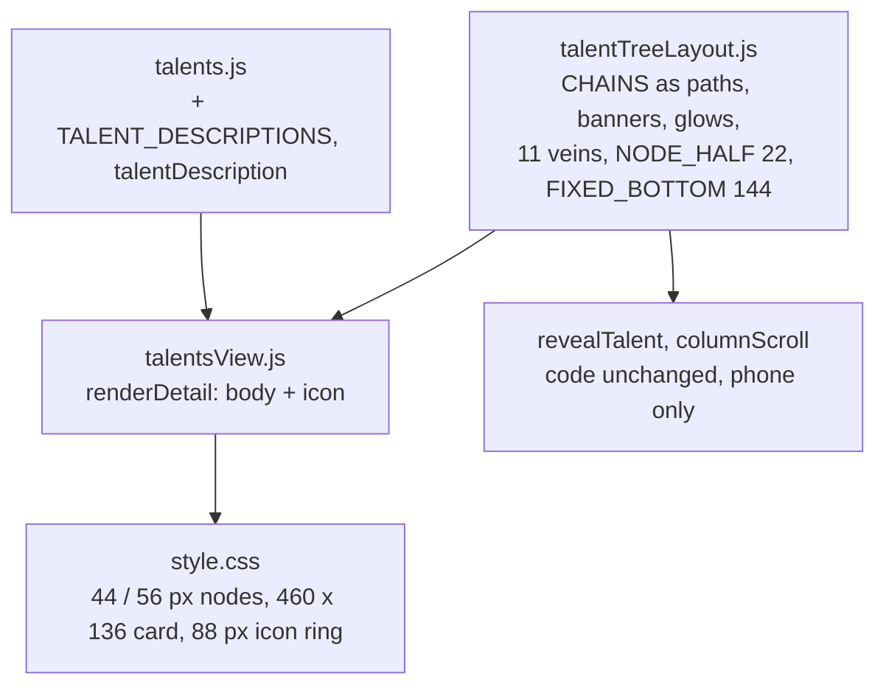

# Talent Tree Branches Design

**Spec**: `.specs/features/talent-tree-branches/spec.md`
**Status**: Draft (waiting for the owner's approval with the spec and the answers to Q1 to Q6)
**Pictures**: `owner-sketch.webp` (the owner's annotated screenshot of 2026-11-24), `layout-target.png` (the coordinates below drawn on `talent-tree-bg.jpg` at 1024 x 576: node circles 44 px with the grade, the level chip, the grade 1 caption boxes, the banners, the fixed parts and the fallback veins; drawn by the product owner with a script, not by the game)

---

## Architecture Overview

No new module and no backend change. Four game files change, each in its existing layer (AD-003):

1. **Domain** `game/src/domain/talents/talents.js`: the 10 description texts and `talentDescription(talent)`.
2. **Layout data** `game/src/adapters/phaser/views/talentTreeLayout.js`: every chain becomes an explicit path of three points (no more `rise`), new banner and glow coordinates, one more fallback vein (`COMBO` → `COMBO_FURY`), and the size constants of the smaller nodes and the taller card.
3. **View** `game/src/adapters/phaser/views/talentsView.js`: `renderDetail` gains a text column, the description and the icon.
4. **Stylesheet** `game/public/style.css`: node and mark sizes, the card grid and its icon ring.



### Approaches considered (paths)

| Approach | Verdict |
| -------- | ------- |
| **A. One explicit list of three points per chain (chosen)** | Each node sits exactly where the painting has its bough; a smaller model edits numbers, not formulas; the unit tests pin the table |
| B. A start point and a step vector per branch (a sheared grid) | Compact, and the POWER band was found this way (start (53, 49.5), chain step (+8.5, -5.5), grade step (+2.5, -12.5)), but TIME, BREAK and COMBO follow curved boughs that no single step fits |
| C. SVG paths traced on the boughs with nodes at fractions of their length | Exact on curves, but adds path math to the view for 28 fixed points |

---

## Code Reuse Analysis

| Component | Location | How to Use |
| --------- | -------- | ---------- |
| `NODE_POSITIONS`, `VEINS`, `BANNER_POSITIONS`, `BRANCH_GLOWS` | `talentTreeLayout.js:15-44` | Same exports and shapes; only the values and the way `CHAINS` is written change |
| `renderNode` | `talentsView.js:100-144` | Unchanged; the sizes come from CSS |
| `renderDetail` | `talentsView.js:147-185` | Restructured: body column + icon; every existing element and test id kept |
| `iconWithFallback(name, glyph, className, fallbackName)` | `game/src/adapters/phaser/views/dom.js` | The card icon, with the same arguments as the node icon (`talentsView.js:124`) |
| `GLYPHS` | `talentsView.js:12` | The card icon fallback |
| `talentIconName`, `BRANCH_TITLES` | `game/src/domain/talents/talents.js:110`, `:60` | The card icon file; the descriptions sit next to the titles |
| `--branch`, `--branch-ink` on `[data-branch]` | `game/public/style.css:2381-2384` | The card already carries `data-branch`, so its icon ring reads `--branch` |
| `revealTalent`, `columnScroll`, `keepBetween` | `talentsView.js:257-322` | Unchanged code; the new constants change their numbers (phone only) |

---

## Components

### Descriptions (`talents.js`)

```js
//  What each talent does, in the player's words (spec talent-tree-branches P1 Card AC 1): one text per talent, the same for its three grades.
//  No catalog number here (AD-011): the effect line shows the value.
export const TALENT_DESCRIPTIONS = Object.freeze({ MINIBOSS_TIME: '...', /* the 10 texts of the spec table, exactly */ });

//  The description of `talent` (by `baseId`, or `id` when there is none), or null when the talent has none (a talent of a newer backend)
export const talentDescription = (talent) => TALENT_DESCRIPTIONS[talent.baseId ?? talent.id] ?? null;
```

### Layout map (`talentTreeLayout.js`)

`CHAINS` lists, for each graded talent in catalog order, its grade 1, 2 and 3 points. `NODE_POSITIONS` maps grade 1 to `<id>` and grade N to `<id>_G<N>`. Fúria crescente stays a separate entry.

| Chain | Branch | Grade 1 (% = board px), distance to fork | Grade 2 | Grade 3 |
| ----- | ------ | ---------------------------------------- | ------- | ------- |
| `MINIBOSS_TIME` | TIME | (43.5, 58) = (445.44, 334.08) px, 66.6 | (33, 43.5) = (337.92, 250.56) px, 193.1 | (20, 40) = (204.8, 230.4) px, 324.2 |
| `BOSS_DAMAGE` | TIME | (35.5, 60.5) = (363.52, 348.48) px, 149.2 | (28.5, 55) = (291.84, 316.8) px, 220.8 | (16.5, 52.5) = (168.96, 302.4) px, 344.5 |
| `PHYSICAL_BREAK` | BREAK | (40.5, 40.5) = (414.72, 233.28) px, 140.1 | (34.5, 29) = (353.28, 167.04) px, 230.4 | (28, 18) = (286.72, 103.68) px, 322.2 |
| `ARMOR_PIERCE` | BREAK | (47, 33) = (481.28, 190.08) px, 147.2 | (43, 22) = (440.32, 126.72) px, 219.4 | (38, 11) = (389.12, 63.36) px, 297.3 |
| `CLICK_DAMAGE` | POWER | (53, 49.5) = (542.72, 285.12) px, 57.8 | (55.5, 37) = (568.32, 213.12) px, 133.4 | (58, 24.5) = (593.92, 141.12) px, 209.6 |
| `CLICK_FLAT_DAMAGE` | POWER | (61.5, 44) = (629.76, 253.44) px, 142.7 | (64, 31.5) = (655.36, 181.44) px, 209.4 | (66.5, 19) = (680.96, 109.44) px, 281.1 |
| `CRIT_CHANCE` | POWER | (70, 38.5) = (716.8, 221.76) px, 233.6 | (72.5, 26) = (742.4, 149.76) px, 295.1 | (75, 13.5) = (768, 77.76) px, 362.3 |
| `CRIT_DAMAGE` | POWER | (78.5, 33) = (803.84, 190.08) px, 325.4 | (81, 20.5) = (829.44, 118.08) px, 384.0 | (83.5, 8) = (855.04, 46.08) px, 447.9 |
| `COMBO` | COMBO | (60, 61) = (614.4, 351.36) px, 103.8 | (69.5, 56) = (711.68, 322.56) px, 200.0 | (86, 42) = (880.64, 241.92) px, 380.0 |
| `COMBO_FURY` (large) | COMBO | (76, 62) = (778.24, 357.12) px, 267.2 | | |

Distances are from the trunk fork `TRUNK.fork` (50, 58) = (512, 334.08) px. Where the paths sit on the painting: the cyan vein leaves the trunk low (x 41 to 45 %, y 60 to 70 %) and runs left along the cyan bough at y 45 to 48 %; the red vein starts on the trunk at (45.5, 42) and climbs the main red limb to (40, 21), with a side limb to (31, 22); the gold vein starts on the trunk at (53, 46) and climbs into the gold crown (x 50 to 85 %, y 0 to 30 %); the purple vein runs down the right arc of the trunk (x 55 to 60 %, y 46 to 75 %) and right along the purple bough to its tip at (88, 51), with the low purple foliage at x 76 to 84 %, y 53 to 62 %.

| Banner | x | y | | Glow ellipse | cx | cy | rx | ry |
| ------ | - | - | - | ------------ | -- | -- | -- | -- |
| `TIME` | 13.5 | 30 | | `TIME` | 29 | 52 | 18 | 17 |
| `BREAK` | 24 | 6 | | `BREAK` | 38 | 27 | 14 | 21 |
| `POWER` | 66.5 | 3.5 | | `POWER` | 68 | 28 | 19 | 24 |
| `COMBO` | 88 | 58 | | `COMBO` | 71 | 58 | 18 | 17 |

`TRUNK` is unchanged: base (50, 100), fork (50, 58). `VEINS` (11 polylines, in this order): `[ TRUNK.base, TRUNK.fork ]`; for each chain of `CHAINS` `[ TRUNK.fork, grade 1, grade 2, grade 3 ]`; then `[ NODE_POSITIONS.COMBO, NODE_POSITIONS.COMBO_FURY ]`. The rendered `points` strings, in order:

```
50,100 50,58
50,58 43.5,58 33,43.5 20,40
50,58 35.5,60.5 28.5,55 16.5,52.5
50,58 40.5,40.5 34.5,29 28,18
50,58 47,33 43,22 38,11
50,58 53,49.5 55.5,37 58,24.5
50,58 61.5,44 64,31.5 66.5,19
50,58 70,38.5 72.5,26 75,13.5
50,58 78.5,33 81,20.5 83.5,8
50,58 60,61 69.5,56 86,42
60,61 76,62
```

Constants (px of the unzoomed board):

| Constant | Old | New | Why |
| -------- | --- | --- | --- |
| `NODE_HALF` | 30 | 22 | Node 44 px |
| `LARGE_NODE_HALF` | 44 | 28 | Fúria crescente 56 px |
| `SEAL_HEIGHT` | 8 | 7 | The lock sticks 7 px above its node (the seal 6 px) |
| `FIXED_BOTTOM` | 136 | 144 | Card 136 px + 8 px from the bottom |
| `FIXED_TOP`, `PLAQUE_SPAN`, `FECHAR_FROM`, `FECHAR_ROOM`, `CAPTION_HALF`, `CAPTION_ROOM`, `REVEAL_MARGIN`, `TREE_SIZE`, `TREE_IMAGE`, `LARGE_NODES` | | unchanged | |

**Clearances** (checked by the product owner on the desktop board with a script that draws `layout-target.png`; footprint of a node = its box grown 8 px left and up for the seal or lock, 4 px right for the badge, 8 px down for the chip; caption = 80 px wide, from 9 px under the node, 30 px tall, 45 px for `Limite de dano do combo`; measured line counts with Figtree 700 12 px: 2 lines for 8 labels, 1 for `Dano crítico`, 3 for `Limite de dano do combo`): no footprint, caption or banner intersects another, the title plaque (x 416 to 608, y 0 to 76), Fechar (x 884 to 1024, y 0 to 60), the card (x 282 to 742, y 432 to 576), the medallion (x 0 to 280, y 508 to 576) or the reset button (x 780 to 1024, y 508 to 576). The tightest spots: the `COMBO` caption ends at y 427.4, 4.6 px above the card; the `ARMOR_PIERCE` grade 3 footprint ends at x 415.1, 0.9 px left of the plaque; `PHYSICAL_BREAK` grade 1 ends at x 440.7 and the `ARMOR_PIERCE` caption starts at x 441.3; the `CRIT_CHANCE` caption ends at y 282.8 and `COMBO_G2` starts at y 292.6.

### Detail card (`talentsView.js` `renderDetail`)

DOM with a selected talent (children in this order; `GLYPHS` and `iconWithFallback` as the nodes use them):

```
div.talent-detail                       testid talent-detail, data-branch = talent.branch
  div.talent-detail-body                testid talent-detail-body
    strong.talent-detail-name           testid talent-detail-name, talentFullName(t)
    div.talent-detail-stats
      div.talent-level                  testid talent-level-<ID>, `Nível ${level}/${maxLevel}`
      div.talent-effect                 testid talent-effect-<ID>, `Efeito: ${describeTalentEffect(t)}`
    [description not null] p.talent-detail-description   testid talent-description-<ID>, talentDescription(t)
    then exactly one of (unchanged): div.talent-lock | div.talent-max | button.talent-upgrade
  div.talent-detail-icon                testid talent-detail-icon
    iconWithFallback(talentIconName(baseId, grade), GLYPHS[t.branch], 'talent-detail-art', grade > 1 ? talentIconName(baseId) : null)
```

With nothing selected (or the selected id not in the list) the card holds only `p.talent-detail-empty` (unchanged): no body, no icon.

### Stylesheet (`style.css`)

Node rules (replace the values in the existing rules):

```css
.talent-node { ... width: 44px; height: 44px; ... }
.talent-node.is-large { width: 56px; height: 56px; }
.talent-node .talent-node-icon { ... width: 28px; height: 28px; ... }
.talent-node.is-large .talent-node-icon { width: 36px; height: 36px; }
.talent-node .talent-node-lock { position: absolute; top: -7px; left: -7px; width: 20px; height: 20px; font-size: 12px; }
.talent-node[data-state="maxed"]::after,
.talent-node[data-state="available"]::after { ... top: -6px; left: -6px; ... width: 18px; height: 18px; ... }
.talent-node[data-state="maxed"]::after { ... font-size: 11px; ... }
.talent-node[data-state="available"]::after { ... font-size: 14px; ... }
.talent-node-grade { ... width: 18px; height: 18px; font-size: 10px; ... }
```

Card rules (replace `.talent-detail` and add the rest after `.talent-detail-empty`):

```css
.talent-detail { position: absolute; left: 50%; bottom: 8px; z-index: 2; display: grid; grid-template-columns: minmax(0, 1fr) 88px; column-gap: 12px; align-items: center; box-sizing: border-box; width: 460px; height: 136px; padding: 10px 14px 10px 20px; font-size: 13px; color: var(--ink-900); background: var(--parchment-100); border: 2px solid var(--wood-600); border-radius: var(--radius-lg); box-shadow: inset 4px 0 0 var(--branch, var(--bronze-500)), 0 6px 18px rgb(0 0 0 / 0.45); transform: translateX(-50%); }
.talent-detail-body { display: flex; flex-direction: column; gap: 3px; min-width: 0; max-height: 112px; overflow: hidden; }
.talent-detail-stats { display: flex; gap: 12px; line-height: 17px; white-space: nowrap; }
.talent-detail-description { margin: 0; font-family: var(--font-body); font-size: 12px; line-height: 15px; color: var(--ink-900); }
.talent-detail-empty { grid-column: 1 / -1; }
.talent-detail-icon { position: relative; display: grid; place-items: center; box-sizing: border-box; width: 88px; height: 88px; background: radial-gradient(circle, var(--wood-700) 0 58%, var(--wood-900) 60%); border: 3px solid var(--branch); border-radius: 50%; box-shadow: 0 0 0 2px var(--wood-900), 0 0 14px 4px var(--branch); }
.talent-detail-icon .talent-detail-art { width: 64px; height: 64px; }
.talent-detail-icon .icon-fallback { font-size: 34px; color: var(--parchment-100); background: none; border-radius: 50%; }
```

Height budget of the body (112 px inside the 136 px card): name 20 + stats 17 + description 30 (2 lines at most, measured at 322 px for all 10 texts) + action 27 (button) or 15 (lock text, 1 line at 322 px) + 3 gaps of 3 = 103 px at most.

---

## Error Handling Strategy

| Error Scenario | Handling | User Impact |
| -------------- | -------- | ----------- |
| Talent without a description (newer backend) | `talentDescription` returns null, no description element | The card shows name, level, effect, action |
| Card icon file missing | `iconWithFallback`: grade 1 file, then the branch glyph | Glyph in the ring |
| `COMBO_FURY` missing (older backend) | No node; the veins are static | One dashed vein ends where no node is (fallback art only) |

---

## Test impact (existing tests)

| File | Test (line today) | Change |
| ---- | ----------------- | ------ |
| `game/src/adapters/phaser/views/talentTreeLayout.test.js` | whole file | Rewritten by T3 (cases in `tasks.md`) |
| `game/src/adapters/phaser/views/talentsView.test.js` | `centres each node on its map coordinates` (`:62`) | `CLICK_DAMAGE` `53%`, `49.5%`; `COMBO_FURY` `76%`, `62%`; `MINIBOSS_TIME` `43.5%`, `58%` (T3) |
| same | `draws the four banners ...` (`:227`) | `talent-branch-POWER` `66.5%`, `3.5%` (T3) |
| same | `gives each lit layer its ellipse and its opacity` (`:234`) | `talent-lit-TIME` `29%`, `52%`, `18%`, `17%` (T3) |
| same | `draws the trunk and 9 veins` (`:243`) | renamed, 11 polylines, first `50,100 50,58`, last `60,61 76,62` (T3) |
| same | `revealTalent` block (`:346-447`) | re-pinned with the values of T3 (computed with the new layout) |
| same | `the detail card` block (`:143-224`) | kept; new cases added by T4 |
| `game/e2e/talentTreeRework.spec.js` | `draws 28 nodes at their map coordinates, Fúria crescente bigger` (`:120`) | sizes 44 and 56 (T2); `CLICK_DAMAGE` centre (542.72, 285.12) (T3) |
| same | `captions grade 1 nodes and badges grades 2 and 3` (`:141`) | badge `font-size` `10px` (T2) |
| same | `opens a 1024 x 576 window with the tree, the plaques and the empty card` (`:78`) | card width 460 (T5) |
| same | `on a 390 x 844 phone the tree is zoomed twice, opens centred and keeps the scroll` (`:500`) | card width 460 at `:521` only (T5) |
| same | every other test, `on a phone the selected Fúria crescente ends above the detail card` included | must pass unchanged |
| `game/e2e/talents.spec.js`, `game/e2e/uiRedesign.spec.js`, `game/e2e/unifiedDamage.spec.js`, `game/e2e/talentTreeReworkCombat.spec.js` | tests that open Talentos, click nodes, read the card or the BREAK DOM order | must pass unchanged (they read test ids, colours and DOM order, not positions) |
| `game/src/adapters/phaser/HeroUi.test.js` | Talentos cases (`:1491` scroll case included) | must pass unchanged |

---

## Risks & Concerns

| Concern | Location | Impact | Mitigation |
| ------- | -------- | ------ | ---------- |
| The paths are an interpretation of the owner's arrows | spec Q1 | The owner may want TIME along the roots | `layout-target.png` goes to the owner with the spec; a different path is a change of `CHAINS` values only |
| Captions sit 1 to 5 px from their neighbours in a few places | design § Clearances | A font fallback (Figtree not loaded) can wrap a caption to one more line | The e2e no-overlap test runs with the real fonts of the page; the `ui-artist` checks the real art shot |
| `columnScroll` assumes a vertical column | `talentsView.js:269` | On a phone, a slanted chain is revealed by the selected node's x only | Phone out of scope (D7); its tests keep passing with the new numbers |
| `CRIT_DAMAGE` grade 1 sits on the edge of the violet foliage | (78.5, 33) | Reads slightly into the COMBO colour | Kept clear of every node; the `ui-artist` judges it on the real art shot; moving it is a value change |
| Line numbers quoted here drift | all | A smaller model edits the wrong line | Tasks quote the text to find |

---

## Tech Decisions

| Decision | Choice | Rationale |
| -------- | ------ | --------- |
| Path data | Explicit points per chain | Boughs are curves; one table is the single source the tests pin |
| Description owner | Game domain constant | Texts only, no catalog number (AD-011); Portuguese player text (AD-007) |
| Card icon | CSS ring over the node art | No new art file; the ring takes the branch colour from the existing `--branch` |
| Level and effect | One row | Keeps the card at 136 px so the board keeps its room |

**Project-level decision:** none (spec D10).
