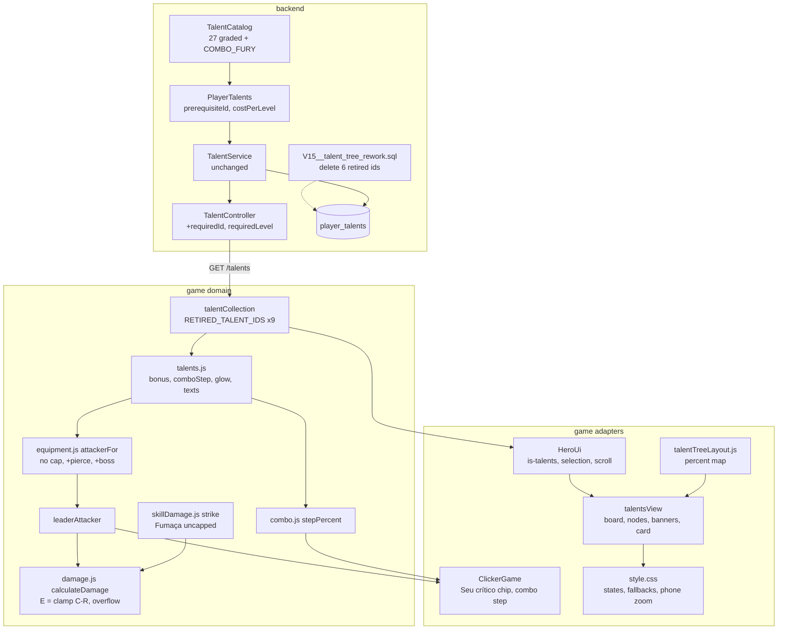

# Talent Tree Rework Design

**Spec**: `.specs/features/talent-tree-rework/spec.md`
**Status**: Draft (waiting for the owner's approval with the spec)

---

## Architecture Overview

Three independent slices share one catalog change:

1. **Catalog (backend, server-authoritative, AD-011)**: `TalentCatalog` swaps two grade 1 rows (`BOSS_TIME` to `BOSS_DAMAGE`, `CRIT_RESIST_BREAK` to `ARMOR_PIERCE`) and gains one single talent (`COMBO_FURY`) with an explicit prerequisite and cost. `TalentResponse` answers the prerequisite (`requiredId`, `requiredLevel`). `V15__talent_tree_rework.sql` deletes the levels of the six retired ids (data only, expand/contract safe, AD-016).
2. **Combat rules (game domain, pure)**: `calculateDamage` gets the subtractive critical chance and the overflow; `attackerFor` stops capping the chance and takes armor pierce and boss damage bonuses; the talent effects feed those bonuses; the combo step reads `COMBO_FURY`.
3. **Tree screen (game adapters)**: `talentsView` draws a painted board from a percent layout map (`talentTreeLayout.js`, the `mapLayout.js` pattern of Rever chefes), `HeroUi` keeps the selection and the scroll, `style.css` draws every state and every fallback.



### Approaches considered (tree screen)

| Approach | Verdict |
| -------- | ------- |
| **A. HTML nodes over a painted background, percent layout map (chosen)** | The owner's proposal; the Rever chefes map already works this way (`farmView.js` + `mapLayout.js`, `is-fallback`), testable in jsdom and Playwright with the existing test ids |
| B. Draw the tree inside Phaser (sprites, tweens) | Loses the DOM test ids, the jsdom tests and the panel the other screens share; the panel is DOM since `characters` |
| C. One inline SVG with the veins and nodes | Cleaner masks, but the painted art would have to be traced as paths and every node re-done in SVG; no gain over A for a static layout |

---

## Code Reuse Analysis

### Existing Components to Leverage

| Component | Location | How to Use |
| --------- | -------- | ---------- |
| `TalentDefinition`, `TalentCatalog`, `PlayerTalents` | `backend/.../domain/Talents.kt` | Extend with `requires` and `costFactor`; `unlocked` reads one prerequisite id |
| `PlayerTalents.fromStored` | `Talents.kt:233` | Already drops ids outside the catalog (unified-damage); covers rows of retired ids written late |
| `V11__unified_damage.sql` + `UnifiedDamageMigrationIT` | `backend/src/main/resources/db/migration/`, `backend/src/test/.../adapter/repository/` | Same delete-and-refund pattern and test shape for `V15` |
| `TalentResponse` / `TalentsResponse.from` | `backend/.../adapter/web/TalentController.kt:22` | Two more fields |
| `calculateDamage` | `game/src/domain/combat/damage.js:16` | Swap the critical line; keep `forceCritical`, `armorPierce`, `bossDamage`, `darknessDamagePct` |
| `attackerFor` | `game/src/domain/equipment/equipment.js:66` | Drop the cap, add two bonus fields |
| `talentValue`, `talentAttackerBonus`, `addBonuses`, `monsterAfterBreak`, `talentTimeBonusMs`, `describeTalentEffect`, `talentIconName` | `game/src/domain/talents/talents.js` | Extend; new pure helpers live in the same file |
| `Combo` | `game/src/domain/combat/combo.js` | One more field `stepPercent` |
| `RETIRED_TALENT_IDS` | `game/src/application/talents/talentCollection.js:8` | Six more ids |
| `iconWithFallback`, `el` | `game/src/adapters/phaser/views/dom.js` | Node icons and the lock glyph |
| Map layout and `is-fallback` | `game/src/adapters/phaser/views/mapLayout.js`, `farmView.js:91-98`, `style.css:3119-3160` | Pattern for `talentTreeLayout.js`, the board image error and the dashed veins |
| Branch colours | `style.css:2387-2390` | Same `--branch` / `--branch-ink` values, moved to a selector on `[data-branch]` inside the screen |
| `HeroUi.render_talents`, `upgradeTalent`, `resetTalents`, `showTalentPoints` | `game/src/adapters/phaser/HeroUi.js:989-1066`, `:1196` | Keep the flows; pass selection and keep the scroll |

### Integration Points

| System | Integration Method |
| ------ | ------------------ |
| `GET /talents`, `POST /talents/{id}/upgrade`, `POST /talents/reset` | Same routes; each talent gains `requiredId` and `requiredLevel` (null serialized) |
| `player_talents` | `V15` deletes rows of six ids; no schema change |
| Battle HUD enemy line | `ClickerGame.showEnemyStats` writes the third chip from `leaderAttacker()` and the target stats |
| e2e fake backend | `game/e2e/support/fakeBackend.js` mirrors the new catalog (test-engineer) |

---

## Components

### Backend catalog (`Talents.kt`)

- **Purpose**: The 28 talents, their prerequisites and their price.
- **Location**: `backend/src/main/kotlin/br/com/woodriver/infinity_grove_ws/domain/Talents.kt`
- **Interfaces**:
  - `data class TalentDefinition(..., val requires: String? = null, val costFactor: Int? = null)`; `init` adds `require(requires == null || grade == 1)` and `require(costFactor == null || costFactor >= 1)`.
  - `val prerequisiteId: String?` = `requires ?: previousGradeId`.
  - `fun costPerLevel(rules: TalentRules): Int` = `rules.costPerLevel * (costFactor ?: grade)`.
  - `PlayerTalents.unlocked(definition)` = prerequisite null or `level(prerequisite) >= TalentCatalog.find(prerequisite).maxLevel`.
  - `TalentCatalog.all` = the 27 graded talents (grade 1 block, grade 2 block, grade 3 block, as today) + `singles` (`COMBO_FURY`).
- **Dependencies**: none new.
- **Reuses**: `previousGradeId`, `valueAt`, `requireSeenLevel` (already reads `maxLevel`, so `fromLevel` 0 to 4 for Fúria).

### Talent response (`TalentController.kt`)

- **Purpose**: Tell the game what opens a talent.
- **Interfaces**: `TalentResponse` gains `val requiredId: String?` and `val requiredLevel: Int?` (last two fields); `requiredId = it.prerequisiteId`, `requiredLevel = it.prerequisiteId?.let { id -> TalentCatalog.find(id).maxLevel }`.

### Migration (`V15__talent_tree_rework.sql`)

- **Purpose**: Refund the retired talents.
- **Body**: one `delete from player_talents where talent_id in ('BOSS_TIME', 'BOSS_TIME_G2', 'BOSS_TIME_G3', 'CRIT_RESIST_BREAK', 'CRIT_RESIST_BREAK_G2', 'CRIT_RESIST_BREAK_G3');` with the comment block of `V11`.

### Critical rule (`damage.js`)

- **Interfaces**:
  - `effectiveCritChance(critChance, critResistance): number` = `Math.min(100, Math.max(0, critChance - critResistance))`.
  - `critOverflow(critChance, critResistance): number` = `Math.max(0, critChance - critResistance - 100)`.
  - `calculateDamage` reads `R = defender.critResistance ?? 0`, `critical = forceCritical || random() * 100 < effectiveCritChance(C, R)`, critical factor `attacker.critMultiplier + critOverflow(C, R) / 100`.

### Attacker bonuses (`equipment.js`, `talents.js`, `skillDamage.js`)

- `attackerFor(base, pieces, { clickDamageFlat, clickDamagePct, critChance, critDamagePct, armorPierce = 0, bossDamage = 0 })`: no cap on `critChance`; `armorPierce = sumOf(pieces, 'ARMOR_PIERCE_PCT') + armorPierce`; `bossDamage = sumOf(pieces, 'BOSS_DAMAGE_PCT') + bossDamage`; the early `return base` also needs both new numbers at 0.
- `talentAttackerBonus(talents)` adds `armorPierce: talentValue(talents, 'ARMOR_PIERCE')` and `bossDamage: talentValue(talents, 'BOSS_DAMAGE')`; `addBonuses` adds both (`?? 0`). `leaderAttacker` needs no change: its team bonus has neither field and `addBonuses` reads them as 0.
- `skillDamage.strike`: `critChance: critChance ?? attacker.critChance + (fumaça ? 15 x factor : 0)` (no `Math.min`).

### Talent helpers (`talents.js`)

- `monsterAfterBreak` reads `PHYSICAL_BREAK` and the passives only (no `CRIT_RESIST_BREAK`).
- `talentTimeBonusMs` gives `MINIBOSS_TIME` to a miniboss (and a farm miniboss) and 0 to everything else.
- `talentComboStep(talents)` = `COMBO_STEP_PERCENT + talentValue(talents, 'COMBO_FURY')`.
- `BRANCH_TITLES.TIME = 'Caça aos chefes'`; `ICON_NAMES` gains `BOSS_DAMAGE: 'boss-damage'`, `ARMOR_PIERCE: 'armor-pierce'`, `COMBO_FURY: 'combo-fury'` and drops the two retired ids.
- `describeTalentEffect` handles unit `combo-step`: `+${COMBO_STEP_PERCENT + value}% por clique`.
- `talentFullName(talent)`, `talentLockText(talent, talents)`, `branchGlow(talents, branch)` (contracts in `tasks.md` T9).

### Combo (`combo.js`)

- `new Combo(maxPercent = 0, stepPercent = COMBO_STEP_PERCENT)`; `bonus` = `Math.min(this.maxPercent, this.streak * this.stepPercent)`. `ClickerGame` sets `stepPercent` next to `maxPercent` before every click and every HUD refresh.

### Layout map (`talentTreeLayout.js`)

- **Purpose**: Where everything sits on the 1024 x 576 board, in percent (origin top left). Provisional until the art arrives (D14).
- **Exports**: `TREE_SIZE`, `TREE_IMAGE`, `NODE_POSITIONS`, `LARGE_NODES`, `BANNER_POSITIONS`, `BRANCH_GLOWS`, `TRUNK`, `VEINS` (values in § Layout map).

### Tree view (`talentsView.js`)

- **Interfaces**:
  - `renderTalents(talents, points, { busy = false, selectedId = null, onSelect, onUpgrade, onReset }): HTMLElement` (DOM in `tasks.md` T14).
  - `talentScrollOf(screen): { left, top } | null` and `placeTalentScroll(screen, previous): void`.
  - `renderTalentsUnavailable()` and `UNAVAILABLE_TEXT` unchanged.
- **Reuses**: `iconWithFallback`, `el`, the layout map, the talent helpers.

### Panel (`HeroUi.js`)

- Toggles `is-talents` on `.hero-window` in `show(screen)` and removes it in `close()`.
- Keeps `talentSelected` (cleared by `show`), passes it to `renderTalents`, `selectTalent(id)` re-renders.
- Reads the scroll of the old screen before each `render_talents` and restores it after, or centres it on the first render.
- Adds the close button art `` inside `hero-close`; an `error` removes it.

### Battle HUD (`ClickerGame.js`)

- `showEnemyStats(stats)`: the `crit` chip text becomes `Seu crítico: ${one(effectiveCritChance(this.leaderAttacker().critChance, stats.critResistance ?? 0))}%`.
- `this.equipment.onChange(() => this.refreshEnemyStats())` next to the talents listener (`:193`); the heroes listener (`:590`) already covers the leader and the team (`setTeam` fires `changed()`).
- `strike()` and `showCombo()` set `this.combo.stepPercent = talentComboStep(this.talents.talents())`.

---

## Data Models

### `GET /talents` talent entry (one of 28)

```json
{
  "id": "COMBO_FURY",
  "branch": "COMBO",
  "label": "Fúria crescente",
  "unit": "combo-step",
  "perLevel": 1,
  "maxLevel": 4,
  "level": 0,
  "value": 0,
  "nextCost": 2,
  "grade": 1,
  "baseId": "COMBO_FURY",
  "unlocked": false,
  "requiredId": "COMBO",
  "requiredLevel": 10
}
```

| Index | id | branch | label | unit | perLevel | maxLevel | requiredId | requiredLevel | cost/level |
| ----- | -- | ------ | ----- | ---- | -------- | -------- | ---------- | ------------- | ---------- |
| 0 / 9 / 18 | `MINIBOSS_TIME` / `_G2` / `_G3` | TIME | Tempo do miniboss | s | 2 / 4 / 6 | 10 | null / `MINIBOSS_TIME` / `MINIBOSS_TIME_G2` | null / 10 / 10 | 1 / 2 / 3 |
| 1 / 10 / 19 | `BOSS_DAMAGE` / `_G2` / `_G3` | TIME | Dano contra chefes | % | 2 / 4 / 6 | 10 | same pattern | same | 1 / 2 / 3 |
| 2 / 11 / 20 | `PHYSICAL_BREAK` / ... | BREAK | Quebra de defesa | points | 1 / 2 / 3 | 10 | same pattern | same | 1 / 2 / 3 |
| 3 / 12 / 21 | `ARMOR_PIERCE` / ... | BREAK | Perfuração de armadura | % | 1 / 2 / 3 | 10 | same pattern | same | 1 / 2 / 3 |
| 4 / 13 / 22 | `CLICK_DAMAGE` / ... | POWER | Dano de clique (%) | % | 5 / 10 / 15 | 10 | same pattern | same | 1 / 2 / 3 |
| 5 / 14 / 23 | `CRIT_CHANCE` / ... | POWER | Chance de crítico | points | 1 / 2 / 3 | 10 | same pattern | same | 1 / 2 / 3 |
| 6 / 15 / 24 | `CRIT_DAMAGE` / ... | POWER | Dano crítico | % | 5 / 10 / 15 | 10 | same pattern | same | 1 / 2 / 3 |
| 7 / 16 / 25 | `COMBO` / ... | COMBO | Limite de dano do combo | % | 5 / 10 / 15 | 10 | same pattern | same | 1 / 2 / 3 |
| 8 / 17 / 26 | `CLICK_FLAT_DAMAGE` / ... | POWER | Dano direto de clique | dmg | 2 / 4 / 6 (first level 1 / 2 / 3) | 10 | same pattern | same | 1 / 2 / 3 |
| 27 | `COMBO_FURY` | COMBO | Fúria crescente | combo-step | 1 | 4 | `COMBO` | 10 | 2 |

### Layout map (`talentTreeLayout.js`, percent of the 1024 x 576 board, 16:9)

The four boughs of the prompt draft (spec D23): far left `TIME`, upper left `BREAK`, upper right `POWER`, far right `COMBO`. Each chain is a column, grade 1 lowest (nearest the trunk). The upper boughs use rows y 46 / 33 / 20 (grade 1 / 2 / 3); the far boughs sit lower, rows y 66 / 53 / 40.

| Talent chain | Bough | x | Grade 1 / 2 / 3 y |
| ------------ | ----- | - | ----------------- |
| `MINIBOSS_TIME` | far left | 6 | 66 / 53 / 40 |
| `BOSS_DAMAGE` | far left | 15 | 66 / 53 / 40 |
| `PHYSICAL_BREAK` | upper left | 26 | 46 / 33 / 20 |
| `ARMOR_PIERCE` | upper left | 35 | 46 / 33 / 20 |
| `CLICK_DAMAGE` | upper right | 55 | 46 / 33 / 20 |
| `CLICK_FLAT_DAMAGE` | upper right | 63.5 | 46 / 33 / 20 |
| `CRIT_CHANCE` | upper right | 72 | 46 / 33 / 20 |
| `CRIT_DAMAGE` | upper right | 80.5 | 46 / 33 / 20 |
| `COMBO` | far right | 94 | 66 / 53 / 40 |
| `COMBO_FURY` (large) | far right | 85 | 72 |

| Banner | x | y | | Glow ellipse | cx | cy | rx | ry |
| ------ | - | - | - | ------------ | -- | -- | -- | -- |
| `TIME` | 10.5 | 29 | | `TIME` | 10.5 | 53 | 10 | 20 |
| `BREAK` | 30.5 | 11 | | `BREAK` | 30.5 | 33 | 10 | 20 |
| `POWER` | 68 | 11 | | `POWER` | 68 | 33 | 18 | 20 |
| `COMBO` | 91 | 29 | | `COMBO` | 90 | 58 | 9 | 24 |

Trunk: from (50, 100) to the fork (50, 58). Veins (fallback SVG polylines, viewBox `0 0 100 100`, `preserveAspectRatio="none"`): the trunk, and for each of the 9 chains `fork → grade 1 → grade 2 → grade 3`; the COMBO chain passes through `COMBO_FURY`: `fork → COMBO_FURY → COMBO → COMBO_G2 → COMBO_G3`.

Fixed overlays (window px, outside the board, never zoomed): title plaque 192 x 64 at top 6 centred (x 416 to 608); close button 120 x 40 at top 8, right 8; medallion (56 x 56 art + text pill) at left 12, bottom 12; reset button (56 x 56 art + text pill) at right 12, bottom 12; detail card 380 wide, min-height 112, at bottom 8 centred (x 322 to 702), in the clearing of the painting.

Clearances checked on the fallback layout (node 60, chip 16, caption 80 wide and 2 lines of 15 px): columns of one row are at least 8.5 % (87 px) apart; rows are 13 % (75 px) apart, so a chip ends 7 px above the next node; the banners (140 x 34) end at y 80 px above the grade 3 row of the upper boughs (top 85 px) and at y 184 px above the grade 3 row of the far boughs (top 200 px); the title plaque (x 416 to 608) clears the `BREAK` banner (x 242 to 382) and the `POWER` banner (x 626 to 766); Fúria crescente (x 826 to 914, y 371 to 498 with chip and caption) clears the `CRIT_DAMAGE` grade 1 caption (ends at y 334), the `COMBO` grade 1 node (x 932) and the reset button (top 508); the detail card (x 322 to 702, top at most y 456) has no node, chip or caption below y 334 in its span.

---

## Error Handling Strategy

| Error Scenario | Handling | User Impact |
| -------------- | -------- | ----------- |
| Upgrade of a retired id | 404 `TALENT_NOT_FOUND` (catalog lookup) | `Não foi possível melhorar o talento.` (a current game never sends it) |
| `COMBO_FURY` before `COMBO` 10 | 409 `TALENT_LOCKED`, then the tree reloads | `Não foi possível melhorar o talento.`; the node stays locked |
| Retired row written by the previous backend | `fromStored` ignores and logs it | Points available; nothing shown |
| Older backend (no new talents, retired ids present) | `RETIRED_TALENT_IDS` drops them; missing nodes are not drawn | Empty spots on the tree until the deploy ends |
| Missing art file | `` `error` adds the fallback class and removes the image; JPG layers have a gradient under them | CSS plaques, rings and glyphs |
| Talents load fails | Existing `Talentos indisponíveis` | Unchanged |

---

## Risks & Concerns

| Concern | Location (file:line) | Impact | Mitigation |
| ------- | -------------------- | ------ | ---------- |
| Many tests pin the old multiplicative critical rule, the 100 cap or the `Crit res` chip text | `damage.test.js:64`, `equipment.test.js:27,69`, `leaderAttacker.test.js:46,79,114`, `leaderStats.test.js:59`, `skillDamage.test.js:80,86`, `ClickerGame.test.js` (18 `Crit res` lines, `:5547`), 8 e2e files (19 lines) | A task's gate fails on tests it did not mean to touch | Each task lists the tests it must re-pin with the new values (tasks T4 to T7, T12, T18); a test is re-pinned only with a value the spec defines |
| The chapter boss loses up to 180 s of talent time (30 + 60 + 90 s for a full `BOSS_TIME` chain) | `talents.js:43` | Some players fail chapter bosses they used to beat | Owner decision; the refunded points buy up to +120 % boss damage; recorded in AD-029 trade-off |
| Deploy window: the previous backend still sells `BOSS_TIME` and `CRIT_RESIST_BREAK` levels after `V15`, which the new backend ignores | `Talents.kt:233` | A few free points for a few minutes | Same accepted trade-off as AD-021 |
| Old game + new backend: `COMBO_FURY` shows in the old column screen with the effect text `+1 pontos` | `talentsView.js:83` (old) | Cosmetic, minutes (the workflow publishes the Worker right after the backend, AD-023) | Accepted (D21) |
| `HeroUi` re-renders the whole body on every change | `HeroUi.js:993` | The phone scroll jumps back to the centre on every click | `talentScrollOf` / `placeTalentScroll` keep the scroll (P2 Tree AC 13) |
| CSS `zoom` and `mask-image` support | `style.css` (new) | A browser without them shows no zoom or unmasked lit layers | Playwright Chromium, Chrome, Edge and Safari support both (`-webkit-mask-image` added); Firefox supports `zoom` from 126 |
| The detail card sits in the clearing at the bottom centre | layout map | A recalibrated node between x 30 % and 70 % below y 70 % would hide under the card | The layout test (T13) checks that no node between x 30 and 70 sits below y 50 |
| `TalentPointsMigrationIT` saves a raw `BOSS_TIME` row | `TalentPointsMigrationIT.kt:45` | None: it tests `V5` with SQL only | Left as it is (the id is only a string at the SQL level) |
| Line numbers quoted here drift | all | A smaller model edits the wrong line | Tasks quote the exact text to find (STATE Handoff note 3) |

---

## Tech Decisions

| Decision | Choice | Rationale |
| -------- | ------ | --------- |
| Prerequisite model | One `prerequisiteId` (explicit `requires` or the previous grade) | Fúria crescente is the first talent opened by another talent; grades keep working unchanged |
| Price of a single talent | `costFactor` (null means the grade) | `copy()` in `TalentCatalog.all` keeps the default grade rule for the 27 graded talents without touching them |
| Art fallback | `` with an `error` listener that adds a class (PNG pieces) and a CSS gradient under the JPG layers | The project pattern (`iconWithFallback`, the farm map); a PNG with transparency cannot sit on a CSS gradient without showing it |
| Lit masks | CSS radial-gradient ellipses from the layout map, not painted mask files | No extra art; the ellipses move with the coordinates when the layout is recalibrated |
| Glow by levels, not points | `L / M` over levels | The payload carries levels and max levels, not prices (AD-011) |
| Phone | `zoom: 2` on the board | Keeps one layout map and one painted image; `zoom` scales the px-sized nodes with the board |
| Window shape | 1024 x 576 (16:9) instead of the 920 px window of the other screens | The painted background of the prompt draft is 16:9; the full canvas width keeps the tree as big as the panel allows |

**Project-level decision:** AD-029 (proposed) in `.specs/STATE.md`.
