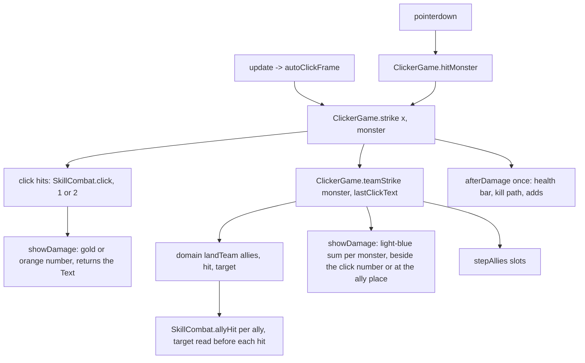

# Team Click Damage Design

**Spec**: `.specs/features/team-click-damage/spec.md`
**Status**: Draft (waits for the owner's answers to spec Q1 to Q5)

---

## Architecture Overview

The change is game-only. The per-second clock (`AllyCombat.advance`) goes away; the part that lands one round of ally hits on the target becomes a pure function, `landTeam`, and the scene calls it from `strike`, the one path of a manual click and an auto click. `update` stops calling the allies. The Equipe texts change their unit. The backend, the API and the database do not change.

Order inside one `strike`: combo step, click hit(s) with their numbers, team strike (only while the main monster lives) with its numbers and sprite steps, combo HUD, `afterDamage()` once. The kill path therefore runs once per click whether the click or an ally killed.

---

## Code Reuse Analysis

### Existing Components to Leverage

| Component | Location | How to Use |
| --- | --- | --- |
| `AllyCombat.land` (the loop over allies with the target seam) | `game/src/domain/combat/allyCombat.js:60-78` | Becomes the exported pure function `landTeam`; same rules (slot order, target read before each hit, stop at a missing or dead target), plus a `hits` list carrying each hit's target |
| `SkillCombat.allyHit` | `game/src/domain/skills/skillCombat.js:187` | Unchanged: the damage of one ally hit |
| `ClickerGame.allyAttackers`, `fightingAllies`, `passives` | `ClickerGame.js:1293-1319` | Unchanged: read at every click |
| The per-monster sum and the ally number place | `ClickerGame.allyFrame` (`:1340-1350`), `allyNumberXOf` (`:1609`), `numberYOf` (`:1602`) | The sum-per-target loop moves into `teamStrike`; `allyNumberXOf` stays for numbers on a monster other than the clicked one |
| `onAllyTick` | `ClickerGame.js:1356-1372` | Renamed `stepAllies`, body unchanged |
| `showDamage` | `ClickerGame.js:1913-1927` | Gains an `originX` argument (default 0.5) and returns the Text it made, so `strike` can anchor the team number |
| `ALLY_TEXT` | `ClickerGame.js:108` | The team number's style, unchanged |
| `allyDamagePerSecond` | `game/src/domain/combat/allyAttacker.js:28` | Renamed `allyDamagePerClick`, same body |
| e2e start helpers | `game/e2e/heroTeamCombat.spec.js:49-104` (`startTeam`), `game/e2e/support/affixFight.js` (`startFight`) | Copied or imported by the new e2e file |

### Integration Points

| System | Integration Method |
| --- | --- |
| Backend | None. `GET /heroes` `team`, `PUT /team`, `POST /team/slots` unchanged |
| Auto click | Already calls `strike` (`autoClickFrame`, `ClickerGame.js:584`); it brings the team with no change |
| Miniboss adds (AD-027) | `landTeam` reads `currentTarget()` before every hit, so a click that kills its add sends the team on to the main |
| Monster affixes (AD-030) | `allyHit` lands through `Monster.land`, so each ally hit is one strike on Escudo de golpes |

---

## Components

### `landTeam` (domain)

- **Purpose**: Lands one round of ally hits: every ally in slot order on the target read right before its hit.
- **Location**: `game/src/domain/combat/allyCombat.js`
- **Interfaces**:
  - `landTeam({ allies, hit, target }): { slots: number[], damage: number, hits: Array<{ slot: number, target: Monster, damage: number }> }`
    - `allies`: `[ { slot, attacker } ]` in slot order; empty lands nothing.
    - `hit(attacker, target) -> number`: lands one hit and returns the damage dealt.
    - `target() -> Monster | null`: read before every hit; a null or dead target ends the round (the later slots do not land).
    - `damage` is the sum of `hits[].damage`; `slots` lists the slots that hit, in order.
- **Dependencies**: none (pure JavaScript, AD-003).
- **Reuses**: the body of `AllyCombat.land`.
- **Removed (T2)**: `ALLY_TICK_MS`, class `AllyCombat`.

### `ClickerGame.strike` (adapter, changed)

- **Purpose**: One click: combo step, click hit(s), team strike, kill path once.
- **Location**: `game/src/adapters/phaser/ClickerGame.js:1617`
- **Interfaces**: `strike(x: number, monster = this.currentTarget()): void` (unchanged signature).
- **Change**: keeps the Text returned by the last `showDamage` of the click loop in `last`; after the loop, `if (this.monster && !this.monster.dead) this.teamStrike(monster, last);`; then `showCombo()` and `afterDamage()` as today.

### `ClickerGame.teamStrike` (adapter, new)

- **Purpose**: The team's part of a click: land, show, step.
- **Location**: `game/src/adapters/phaser/ClickerGame.js`, right after `allyAttackers`.
- **Interfaces**: `teamStrike(clicked: Monster, anchor: Text | null = null): number` (how many allies hit). The caller runs `afterDamage()`.
- **Rules**:
  1. `allies = this.allyAttackers()`; return 0 when it is empty or the main monster is missing or dead.
  2. `landTeam({ allies, target: () => this.currentTarget(), hit: (attacker, target) => this.skills.allyHit({ attacker, monster: target, main: this.monster, boss: this.countdown !== null }).damage })`.
  3. Sum `hits` per target in the order the targets were first hit (a `Map`).
  4. For each `(target, sum)`: when `target === clicked` and `anchor` is set, `showDamage(formatDamage(sum), anchor.x + anchor.width * (1 - anchor.originX) + TEAM_TEXT_GAP, false, ALLY_TEXT, anchor.y, 0)`; otherwise `showDamage(formatDamage(sum), this.allyNumberXOf(target), false, ALLY_TEXT, this.numberYOf(target))`.
  5. `this.stepAllies(slots)`; return `slots.length`.
- **Constant**: `const TEAM_TEXT_GAP = 8;` next to `ALLY_TEXT`.
- **Test seam**: unit and e2e tests that check an ally hit's formula call `teamStrike(scene.currentTarget())` (no anchor: the number stands at the ally place, x 740) followed by `afterDamage()`, which is what `strike` does after the click hits.

### `ClickerGame.update` (adapter, changed)

- Drops `const allyTicks = this.allyFrame(delta);`, its comment and `|| allyTicks > 0`. `allyFrame` and `this.allies = new AllyCombat()` are deleted.

### Equipe texts (adapter view, changed)

- **Location**: `game/src/adapters/phaser/views/teamView.js:36-52`
- `dpsText: \`Dano: ${formatDamage(damage)}/clique\``, `teamDpsText: \`Dano da equipe por clique: ${formatDamage(teamDps)}\``, from `allyDamagePerClick`.
- `game/public/style.css` `.team-dps-line` gains `white-space: nowrap;`.

---

## Data Models

None. No payload, table or stored value changes.

---

## Error Handling Strategy

| Error Scenario | Handling | User Impact |
| --- | --- | --- |
| Heroes not loaded (no leader) | `allyAttackers()` returns `[]`; `teamStrike` returns 0 | The click deals its own damage only |
| A team without allies or below chapter 5 | `fightingAllies` returns `[]` | Same |
| The click killed the main | `teamStrike` is not called | No light-blue number |
| A target dies mid-round | `landTeam` stops at the dead target | Later slots do not hit; kill handled once by `afterDamage` |

---

## Risks & Concerns

| Concern | Location (file:line) | Impact | Mitigation |
| --- | --- | --- | --- |
| Balance shift: team damage now scales with the click rate (x2 at the free auto click, up to x20 at level 4) | `ClickerGame.js:584` (auto click), AD-030 tables | Chapters may feel easier from chapter 5; idle players with the auto click off lose the team | Owner decision Q1 (alternative scale factor offered); the chapter tables were fitted without allies, so no wall appears |
| About 70 existing tests step the ally clock or write `allies.untilTickMs` | Spec § Facts, list of tests; `game/e2e/*.spec.js` freeze helpers; `game/ui-review/heroTeam.shots.js:43`, `minibossAdds.shots.js:22`, `:109`, `techDebtPolish.shots.js:56` | After T2, `allies` is undefined: writing `allies.untilTickMs` throws and every freeze helper fails | T2 re-pins the unit tests; T4 to T6 re-pin the e2e and shot files test by test (tasks.md tables); T6 deletes the `untilTickMs` lines |
| Tests that click with fighting allies now also see the team's damage | `heroTeamPassives.spec.js` (Lyra roll 15, Orina 0.75, Vex roll 8), `minibossAddsTarget.spec.js`, `ClickerGame.test.js` (Orina, Lyra roll 15, power talents, miniboss target) | Their health values change | Each is listed in tasks.md with its new value from spec E11 and the Ally Damage formula |
| The unit fake of Phaser Text has no `width` | `ClickerGame.test.js:171-177` | `teamStrike` would place the number at `NaN` in unit tests | T2 adds `width: String(text).length * 20` to the fake Text; unit tests read positions from it (a `1` is 20 px wide) |
| e2e between T2 and T6 is red | CI `tests.yml` | A commit on `main` would deploy the feature with a red suite | All tasks push to `ci/team-click-damage` (spec Q14); `gitops` merges after the CI run of T8 is green |
| More floating numbers alive at once | `showDamage` tween (`ClickerGame.js:1913`) | Up to about 48 Texts at 20 auto + 4 manual clicks a second | Each Text is destroyed after 800 ms as today; the ui-artist reviews a rapid-click shot |
| The ally damage line could wrap at `999.9K` | `style.css:3509`, card 112 px | A second line pushes the passive out of the 210 px card | `white-space: nowrap`; e2e checks the line's box inside the card; the ui-artist checks the longest value |
| AD-018 says allies hit once a second | `.specs/STATE.md` AD-018 | Conflict with an active decision | New AD-035 (proposed) supersedes the rhythm of AD-018 and keeps the rest |

---

## Tech Decisions

| Decision | Choice | Rationale |
| --- | --- | --- |
| Where the team strike hooks in | Inside `strike`, after the click hit(s), before `afterDamage` | `strike` is the one path of manual and auto clicks; one `afterDamage` keeps the kill path single |
| Anchor of the team number | The Text of the last click number, by its real width | A fixed offset overlaps long numbers (`12.5K` at 32 px is about 105 px wide, a critical about 160 px) |
| Keep `allyCombat.js` as the file name | Yes, export `landTeam` | Fewer import moves; the file still holds the ally combat rule |
| Keep CSS classes, test ids and model field names (`team-dps`, `dpsText`) | Yes | Not player-facing; spec Q13 |

Project-level decision: AD-035 in `.specs/STATE.md`.
