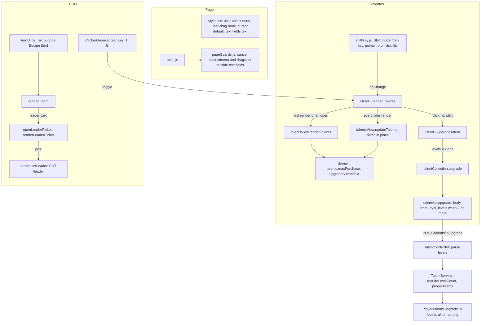

# UI Polish Design

**Spec**: `.specs/features/ui-polish/spec.md`
**Status**: Draft, revision 2 (owner decisions of 2026-11-27 applied: the T and B keys and Equipe in the place of Líder added; approved by the owner on 2026-11-27)

Constraints read before designing: AD-003 (hexagonal game: the new DOM code sits in `adapters/phaser`, pure rules in `domain`), AD-007 (Portuguese text), AD-011 (server-authoritative talents, `fromLevel` guard, the game types no catalog number), AD-013 and AD-017 (a level of grade N costs N points; `costFactor`), AD-016 (expand/contract: the previous backend must keep working), AD-022 (Grove tokens), AD-029 (3) (the painted Talentos tree). Lessons L-010 (exact texts), L-039 (one test per edge case) and L-098 (one test per trigger) shape the test lists. AD-018 (hero team) says the Equipe button joins the rail only once the team is unlocked; UIP-13 changes that, so AD-034 records the new rail and supersedes that part of AD-018. AD-033 records the new talent contract and the in-place pattern.

---

## Architecture Overview



### Approaches for the blink (Large: explored, B recommended)

| | A. Keep rebuilding, reuse images | **B. Build once, patch in place (recommended)** | C. B plus optimistic update |
| --- | --- | --- | --- |
| How | `renderTalents` keeps a cache of the `` elements by key and puts them in the new tree; drop `loading="lazy"` | `renderTalents` builds the screen when Talentos opens; every later render calls `updateTalents`, which writes attributes and texts on the elements already there | B, and the game writes the new level before the answer, rolling back on a refusal |
| Blink | Mostly gone; the whole subtree still swaps, every pulse animation restarts, the focused button is destroyed | Gone: no element of the board or the nodes is created or removed by an upgrade | Gone, and the number moves before the round trip |
| Risk | A cache of DOM nodes outside the DOM; easy to leak or to reuse a node with old listeners | A patch that forgets a field shows a stale value (mitigated by the equivalence test of T7) | A refusal (409, points changed elsewhere) makes the number jump back: a new visible glitch; two sources of truth (against AD-011) |
| Size | Small | Medium: one new function in `talentsView.js` and a branch in `HeroUi.render_talents` | B plus rollback paths and their tests |

**Choice: B.** It removes the cause (new images on every build) rather than hiding it, keeps the focus on the card button for a keyboard player, keeps the backend as the only truth, and gives the follow-up of TD-014 a pattern to copy. C adds a rollback glitch to fix a delay the owner did not report.

---

## Code Reuse Analysis

### Existing Components to Leverage

| Component | Location | How to Use |
| --- | --- | --- |
| Text field rule | `game/src/adapters/phaser/ClickerGame.js:130` (`isTextField`) | Moves to `pageGuards.js` as an export; `ClickerGame.js` imports it (same selector) |
| `renderTalents`, `renderDetail`, `renderNode`, `stateOf` | `game/src/adapters/phaser/views/talentsView.js:37-248` | `renderTalents` stays the first build; `updateTalents` reuses `stateOf`, `branchGlow`, `describeTalentEffect`, `talentLockText`, `talentFullName` and `renderDetail` |
| `iconWithFallback` | `game/src/adapters/phaser/views/dom.js:38` | Builds the lock icon a node gains on reset (same call as `renderNode:128`) |
| Busy and `view` guards | `game/src/adapters/phaser/HeroUi.js:1026-1093` | Kept: `talentBusy`, the `view === this.view` check; `render_talents` changes its body only |
| Shutdown hook | `game/src/adapters/phaser/ClickerGame.js:258` | Calls `this.heroUi.destroy()` |
| 409 reload | `game/src/application/talents/talentCollection.js:73-88` | Unchanged; gains the `levels` argument |
| `fromLevel` checks and lock | `backend/.../domain/Talents.kt:205-246`, `service/TalentService.kt:40-57` | Extended with `levels`; same order, same lock |
| `TalentRequestException` 400, `TalentConflictException` 409 | `backend/.../domain/TalentExceptions.kt`, `adapter/web/ApiExceptionHandler.kt:89-96` | Reused; no new handler |
| Fake backend talents | `game/e2e/support/fakeBackend.js:528-564` | Gains `levels`, a hold, a recorder and a refusal switch |
| Leader list | `game/src/adapters/phaser/views/leaderView.js` (`renderLeaderPicker`) | Reused unchanged inside Equipe |
| Key guards | `ClickerGame.autoClickKey` (`:397`) | The same guards for T and B, plus `hasModifier` |
| Key chip look | `.auto-click-key` (`style.css:1007`) | `.hud-key` copies it at 16 px |

### Integration Points

| System | Integration Method |
| --- | --- |
| Backend API | `POST /talents/{id}/upgrade` body gains optional `levels`; answer shape unchanged |
| Database | None: no migration (AD-016 trivially kept) |
| Deploy regression suite | `deploy/regression.mjs` only reads `GET /talents`; unchanged |
| Page | `main.js` installs the page guards next to `mountVersionLabel` |

---

## Components

### Page guards (UIP-01 to UIP-04)

- **Purpose**: The page stops acting like a document outside the text fields.
- **Location**: `game/public/style.css` (a block right after the `body` rule, `:97-103`); `game/src/adapters/phaser/pageGuards.js` (new); `game/src/main.js`.
- **CSS** (exact):

```css
/* The game is not a page (spec ui-polish): nothing is selected, dragged or shown with the text cursor outside the text fields */
html,
body {
    -webkit-user-select: none;
    user-select: none;
    cursor: default;
}

img {
    -webkit-user-drag: none;
}

input:not([type="checkbox"]):not([type="radio"]):not([type="button"]),
textarea,
[contenteditable="true"] {
    -webkit-user-select: text;
    user-select: text;
    cursor: text;
}
```

- **Interfaces** (`pageGuards.js`):
  - `TEXT_FIELD_SELECTOR: string` = `'textarea, select, [contenteditable]:not([contenteditable="false"]), input:not([type="checkbox"]):not([type="radio"]):not([type="button"])'` (the selector of `ClickerGame.js:130`, unchanged).
  - `isTextField(target: EventTarget | null): boolean` = `Boolean(target?.closest?.(TEXT_FIELD_SELECTOR))`.
  - `installPageGuards(doc: Document = document): () => void` adds one listener `cancel` for `contextmenu` and one for `dragstart` on `doc`; `cancel(event)` calls `event.preventDefault()` unless `isTextField(event.target)`. Returns a function that removes both listeners.
- **Dependencies**: none (DOM only). Layer `phaser` (architecture test allows it).
- **Reuses**: the text field selector of `ClickerGame.js`.

### Talent purchase rules (UIP-09)

- **Purpose**: The pure numbers and the text of the card button.
- **Location**: `game/src/domain/talents/talents.js` (append).
- **Interfaces**:
  - `maxPurchase(talent: { level, maxLevel, nextCost, unlocked }, available: number): { levels: number, cost: number, targetLevel: number }`: `{ levels: 0, cost: 0, targetLevel: level }` when `unlocked === false` or `nextCost` is null; else `levels = max(0, min(maxLevel - level, floor(available / nextCost)))`, `cost = levels x nextCost`, `targetLevel = level + levels`.
  - `upgradeButtonText(talent, available: number, shiftHeld: boolean): string`: `Melhorar até o nível <targetLevel> (<cost> ponto|pontos)` when `shiftHeld` and `levels >= 1`; else `Melhorar (<nextCost> ponto|pontos)`; `ponto` when the number is 1.
- **Reuses**: the price text of `talentsView.js:189`.

### Talent gateway and collection (UIP-09)

- **Location**: `game/src/adapters/http/talentApi.js:12`, `game/src/application/talents/talentCollection.js:73`.
- **Interfaces**:
  - `talentApi.upgrade(talentId, fromLevel, levels = 1)` posts `{ fromLevel }` when `levels === 1`, `{ fromLevel, levels }` otherwise.
  - `collection.upgrade(talentId, fromLevel, levels = 1)` calls `gateway.upgrade(talentId, fromLevel)` when `levels === 1` (two arguments, as today) and `gateway.upgrade(talentId, fromLevel, levels)` otherwise; the rest unchanged.

### Shift mode (UIP-10)

- **Purpose**: One boolean that says whether Shift is held, safe against a missed keyup.
- **Location**: `game/src/adapters/phaser/shiftKey.js` (new).
- **Interfaces**: `createShiftKey({ win = window, doc = document, onChange = () => {} } = {}): { held(): boolean, dispose(): void }`.
  - Listeners on `win`, capture phase (`true`): `keydown` sets `event.key === 'Shift' ? true : event.shiftKey === true`; `keyup` sets `event.key === 'Shift' ? false : event.shiftKey === true`; `pointermove` and `pointerdown` set `event.shiftKey === true`; `blur` sets `false`. On `doc`: `visibilitychange` sets `false` when `doc.visibilityState === 'hidden'`.
  - `set(value)` stores the value and calls `onChange(value)` only when it differs from the stored one. Starts `false`.
  - `dispose()` removes all six listeners.

### Talentos view in place (UIP-06, UIP-07, UIP-09, UIP-11)

- **Location**: `game/src/adapters/phaser/views/talentsView.js`, `game/public/style.css` (talent block, `:2440-2580`).
- **Interfaces**:
  - `renderTalents(talents, points, { busy = false, selectedId = null, shiftHeld = false, onSelect, onUpgrade, onReset })`: as today, plus: the screen carries `data-busy="<busy>"`; the card carries `data-selected-id="<selectedId or ''>"` (also the empty card); the card button is built by `renderUpgradeButton`; Reiniciar pontos gets `disabled = points.spent === 0` and `aria-disabled = String(busy)` and its click calls `onReset()` only when `aria-disabled` is not `'true'`.
  - `onUpgrade(talentId: string, { shift: boolean })` (was `onUpgrade(talent)`): fired by the card button click with `shift = event.shiftKey === true`, only when the button's `aria-disabled` is not `'true'`.
  - `renderUpgradeButton(talent, available, { busy, shiftHeld, onUpgrade })`: `button.talent-upgrade`, `type="button"`, `data-testid="talent-upgrade-<id>"`, `title` = `SHIFT_HINT`, then `patchUpgradeButton`.
  - `patchUpgradeButton(button, talent, available, { busy, shiftHeld })`: `textContent = upgradeButtonText(talent, available, shiftHeld)`; `disabled = available < talent.nextCost`; `aria-disabled = String(busy)`; `data-max = String(shiftHeld && maxPurchase(talent, available).levels >= 1)`.
  - `SHIFT_HINT = 'Segure Shift para melhorar até o máximo'` (export).
  - `updateTalents(screen, talents, points, { busy = false, selectedId = null, shiftHeld = false, onUpgrade }): void`, in this order:
    1. `screen.dataset.busy = String(busy)`.
    2. For each talent with a node (`[data-testid="talent-<id>"]` inside `screen`): write `data-state` (`stateOf(talent, points.available)`), `aria-label` (`<talentFullName>, nível <level> de <maxLevel>`), `aria-pressed` (`String(id === selectedId)`) and the text of `talent-node-level-<id>` (`<level>/<maxLevel>`). When the state is `locked` and the node has no `.talent-node-lock`, insert `iconWithFallback('talent-node-lock', '🔒', 'talent-node-lock')` right after its `.talent-node-icon`; when the state is not `locked`, remove its `.talent-node-lock`.
    3. For each branch, `talent-lit-<branch>`: `style.opacity = String(branchGlow(talents, branch))`.
    4. `talent-points .talent-pill` text: `Pontos de talento: <available>`.
    5. `talent-reset`: `disabled = points.spent === 0`, `aria-disabled = String(busy)`.
    6. The card: when its `data-selected-id` differs from `selectedId ?? ''`, replace it with `renderDetail(...)` (new card, new listeners). Otherwise, when a talent is selected: write `talent-level-<id>` (`Nível <level>/<maxLevel>`) and `talent-effect-<id>` (`Efeito: <describeTalentEffect>`); find the action (`.talent-lock`, `.talent-max` or `.talent-upgrade` inside `.talent-detail-body`); when its kind differs from the kind the talent needs now (`locked` → lock, `nextCost == null` → max, else button), replace only the action with the new one; when both are the button, `patchUpgradeButton`; when both are the lock, write the lock text again (`talentLockText`).
  - The description and the icon of the card are never rewritten by a patch (they depend only on the talent id).
- **CSS** (exact, added to the talent block):

```css
.talent-upgrade { white-space: nowrap; }  /* added to the existing .talent-upgrade rule as a property */
.talent-upgrade[data-max="true"] { box-shadow: 0 0 0 2px var(--gold-400); }
.talent-screen[data-busy="true"] .talent-upgrade,
.talent-screen[data-busy="true"] .talent-reset { cursor: progress; }
```

### HeroUi wiring (UIP-06, UIP-07, UIP-09, UIP-10)

- **Location**: `game/src/adapters/phaser/HeroUi.js`, `game/src/adapters/phaser/ClickerGame.js`.
- **Interfaces**:
  - Constructor: `this.shiftKey = createShiftKey({ onChange: () => this.refreshTalentShift() })`.
  - `refreshTalentShift()`: when `this.open && this.screen === 'talents'` and the body holds a `talent-screen`, calls `this.render_talents()`.
  - `render_talents()`: `const current = this.body.querySelector('[data-testid="talent-screen"]')`; options `{ busy: this.talentBusy, selectedId: this.talentSelected, shiftHeld: this.shiftKey.held(), onSelect: (id) => this.selectTalent(id), onUpgrade: (id, { shift }) => this.upgradeTalent(id, shift), onReset: () => this.resetTalents() }`; when `current` exists, `updateTalents(current, talents, points, options)`; else build with `renderTalents`, `this.body.replaceChildren(screen)` and `placeTalentScroll(screen, null)`. The `talentScrollOf` call goes away (a patched tree keeps its scroll).
  - `upgradeTalent(talentId, shift = false)`: returns at once when `this.talentBusy`; reads `talent` from `this.talents.talents()` by id (returns when missing); `levels = (shift || this.shiftKey.held()) ? maxPurchase(talent, this.talents.points().available).levels : 1`; returns when `levels < 1`; then as today with `await this.talents.upgrade(talent.id, talent.level, levels)`.
  - `resetTalents()`: returns at once when `this.talentBusy`; else as today.
  - `destroy()`: `this.shiftKey.dispose()`.
  - `ClickerGame`: `import { isTextField } from './pageGuards'` replaces the local `isTextField` (`:130`); the shutdown hook (`:258`) calls `this.heroUi?.destroy()`.

### Equipe replaces Líder (UIP-13)

- **Purpose**: One rail button for the leader and the allies, reachable from chapter 1, with nothing of Líder lost (spec Q20).
- **Location**: `game/src/adapters/phaser/HeroUi.js`, `game/src/adapters/phaser/views/teamView.js`, `game/public/style.css`. `views/leaderView.js` is reused unchanged.
- **Before / after**:

| | Before | After |
| --- | --- | --- |
| Rail | Heróis, Mochila, Líder, (Equipe once the team is unlocked), Equipamento, Talentos, Rever chefes | Heróis, Mochila, Equipe, Equipamento, Talentos, Rever chefes, always |
| Leader change | Líder screen (any owned hero, any chapter); `Tornar líder` in Equipe (only an ally in a bought slot) | Equipe leader card -> `Escolher líder` list (any owned hero, any chapter); `Tornar líder` unchanged |
| Equipe before the chapter 5 boss win | Not reachable | Leader card, 4 locked slots, status line `A equipe luta a partir do capítulo 5.` |
| Backend | `PUT /leader` | `PUT /leader`, unchanged |

- **Interfaces**:
  - `HeroUi.openLeaderPicker()`: shows `div.leader-picker` (`h3.team-available-title` `Escolher líder` + `renderLeaderPicker(...)`) through `showDetail`, back to `render_team`.
  - `HeroUi.pickLeader(heroId)`: on success re-opens the list (new leader marked); on failure `Não foi possível trocar o líder.`
  - `teamView.renderLeaderCard(leader, { busy, onLeader })`: a `button.team-slot.is-leader` with the caption `Trocar líder`; `renderTeam` handlers gain `onLeader()`.
- **Removed**: `SCREENS` entry `leader`, `ICONS.leader`, `render_leader`, `refreshTeamButton` and the `teamButton` holder (the rail is `SCREENS` itself).
- **Reuses**: `renderLeaderPicker`, `showDetail` and its `Voltar`, `heroes.setLeader`, `teamModel` (which already renders a locked team from `LOCKED_TEAM`).

### Screen keys (UIP-12, UIP-14)

- **Purpose**: T toggles Talentos and B toggles Mochila; the A key gets the same modifier rule.
- **Location**: `game/src/adapters/phaser/ClickerGame.js` (handlers), `game/src/adapters/phaser/HeroUi.js` (`toggle`, the key chips), `game/public/style.css` (`.hud-key`).
- **Interfaces**:
  - `SCREEN_KEYS = [ [ 'T', 'talents' ], [ 'B', 'bag' ] ]`, registered as Phaser `keydown-T` and `keydown-B` next to `SKILL_KEYS` in `createControls`.
  - `hasModifier(event)`: true with `ctrlKey`, `altKey`, `metaKey` or `shiftKey`.
  - `ClickerGame.screenKey(screen, event)`: nothing on a repeat, a modifier, a text field target, the pause menu or the reset dialog; closes an open auto click window; then `heroUi.toggle(screen)`.
  - `HeroUi.toggle(screen)`: closes when `screen` is the open one, else `show(screen)`.
  - `buttonHtml`: `aria-keyshortcuts` and `span.hud-key` (`data-testid="hud-key-<id>"`) for `bag` (`B`) and `talents` (`T`).
  - `autoClickKey`: its guard gains `hasModifier(event)`.
- **Decision table** (spec Q21 to Q25):

| State when T is pressed (no modifier) | Result |
| --- | --- |
| No hero screen open | Talentos opens |
| Talentos open | Window closes |
| Mochila (or its hero detail / fusion ladder) or any other hero screen open | Talentos replaces it |
| Pause menu or reset dialog shown | Nothing |
| Auto click window open | It closes, Talentos opens |
| Focus in a text field | Nothing (the letter is typed) |
| Auto-repeat | Nothing |
| Ctrl, Alt, Meta or Shift held | Nothing |

B behaves the same with Mochila.

- **CSS**: design value in `tasks.md` T10 (`.hud-key`: 16 px high, Cinzel 700 10 px, `--gold-200` on `--wood-900`, 1 px `--gold-400` border, top 3 px, left 4 px).
- **Reuses**: the guards of `autoClickKey`, `isTextField` of `pageGuards.js`, the `A` chip look (`.auto-click-key`, `style.css:1007`).

### Backend multi-level upgrade (UIP-08)

- **Location**: `backend/src/main/kotlin/br/com/woodriver/infinity_grove_ws/` `domain/Talents.kt`, `domain/TalentExceptions.kt`, `usecase/TalentUseCase.kt`, `service/TalentService.kt`, `adapter/web/TalentController.kt`; `backend/docs/adr/0016-multi-level-talent-upgrade.md` (new).
- **Interfaces**:
  - `TalentDefinition.requireLevelCount(levels: Int): Int`: throws `TalentRequestException("levels must be an integer between 1 and $maxLevel")` when `levels !in 1..maxLevel`; returns `levels`.
  - `PlayerTalents.upgrade(definition: TalentDefinition, fromLevel: Int, rules: TalentRules, count: Int = 1): TalentUpgrade`: checks in order mismatch, locked, `stored >= maxLevel` (`TalentMaxLevelException(definition.id)`), `stored + count > maxLevel` (`TalentMaxLevelException(definition.id, stored, count)`), `available < count x costPerLevel` (`NotEnoughTalentPointsException(available, count x costPerLevel, count)`); returns `TalentUpgrade(copy(levels = levels + (definition.id to stored + count)), count x costPerLevel)`. The domain parameter is `count`, not `levels`, because `PlayerTalents` already has a property `levels` (the map of stored levels); the use case, the service and the HTTP body call it `levels`.
  - `TalentMaxLevelException(talentId: String, fromLevel: Int? = null, levels: Int? = null)`: message `Talent '<id>' is already at the maximum level` when `levels == null`, else `Talent '<id>' at level <fromLevel> cannot rise <levels> levels`; code `TALENT_MAX_LEVEL`.
  - `NotEnoughTalentPointsException(available: Int, cost: Int, levels: Int = 1)`: message `A talent level costs <cost> points, the player has <available>` when `levels == 1`, else `<levels> talent levels cost <cost> points, the player has <available>`; code `NOT_ENOUGH_TALENT_POINTS`.
  - `UpgradeTalentUseCase.upgrade(username: String, talentId: String, fromLevel: Int, levels: Int = 1): PlayerTalents`.
  - `TalentService.upgrade`: after `definition.requireSeenLevel(fromLevel)`, `definition.requireLevelCount(levels)`; passes `levels` to the domain; logs `levels={}` in `Talent upgrade requested` and `Talent upgraded`.
  - `TalentController.upgrade`: `val levels = when (val raw = body["levels"]) { null -> 1; is Int -> raw; else -> throw TalentRequestException("levels must be an integer") }`.

---

## Data Models

### Upgrade request (backend `TalentController`)

```typescript
interface UpgradeRequest {
  fromLevel: number   // integer 0..maxLevel, required (unchanged)
  levels?: number     // integer 1..maxLevel, optional; absent or null = 1 (new)
}
// Answer: TalentsResponse, unchanged: { talents: TalentResponse[], points: { earned, spent, available } }
```

### Purchase (game domain)

```typescript
interface Purchase {
  levels: number       // k = min(maxLevel - level, floor(available / nextCost)), 0 when locked or at the top
  cost: number         // levels x nextCost
  targetLevel: number  // level + levels
}
```

No table, column or migration.

---

## Error Handling Strategy

| Error Scenario | Handling | User Impact |
| --- | --- | --- |
| `levels` not an integer / out of range | 400 `INVALID_TALENT_REQUEST`; the game never sends such a value | `Não foi possível melhorar o talento.` |
| `fromLevel + levels` above the top | 409 `TALENT_MAX_LEVEL`; the collection reloads the tree | `Não foi possível melhorar o talento.` and the true tree |
| Points short for `levels` (spent in another tab) | 409 `NOT_ENOUGH_TALENT_POINTS`; reload | `Pontos de talento insuficientes` and the true tree |
| Stale `fromLevel` (double click, other tab) | 409 `TALENT_LEVEL_MISMATCH`; reload | `Não foi possível melhorar o talento.` |
| Previous backend ignores `levels` | 200 with one level bought | The answered tree, no error line (Q19) |
| Backend unreachable | The collection keeps its tree | `Não foi possível melhorar o talento.` |
| Shift released outside the window | `blur` ends the Shift mode | The button reads T1 at once |

---

## Risks & Concerns

| Concern | Location (file:line) | Impact | Mitigation |
| --- | --- | --- | --- |
| A patch that misses one field shows a stale value | `talentsView.js` `updateTalents` (new) | Wrong level or state on screen | T7 equivalence test: for 6 transitions, a patched screen reads the same as a fresh `renderTalents` of the answered tree (every node's `data-state`, `aria-label`, `aria-pressed`, level chip, lock presence; lit opacities; pill; reset `disabled`; card text and button attributes) |
| The upgrade listener captured the talent object | `talentsView.js:193` | After a patch the button would send the old level | The listener sends only the id; `HeroUi.upgradeTalent` reads the current talent (T8) |
| Window listeners outlive the scene | `shiftKey.js` (new), `ClickerGame.js:258` | A later key event renders a detached screen | `HeroUi.destroy()` from the shutdown hook; unit test that `dispose` removes the six listeners (T6) |
| Tests pinned to `disabled` while busy | `talentsView.test.js` `disables the card button while busy` and the Reiniciar pontos busy case; `HeroUi.test.js` `disables every Melhorar button while the request runs and enables them after` | Fail by design (UIP-07 AC 4) | Re-pinned in T7 and T8 to `aria-disabled`, listed by name |
| `onUpgrade` signature change | `talentsView.test.js` `calls onUpgrade with the talent when the card button is clicked` | Fails by design | Re-pinned in T7 |
| `user-select: none` on `body` could block typing in the login fields | `style.css` (new block) | Login unusable | The text field rule sets `user-select: text`; UIP-01 AC 5 and 6 e2e; the full auth suite runs at release |
| The whole-page CSS could change other screens' look | `style.css` | Unwanted visual change | Only `user-select`, `-webkit-user-drag` and `cursor` change; ui review shots of the start screen and the battle (T17) |
| Other screens keep the blink | `HeroUi.js` render_equipment, render_team, openBagHero, render_farm; `ClickerGame.js:331`; `HeroUi.js:1165` | Same blink elsewhere | TD-014 (Q9) |
| A player below chapter 5 loses the leader change if Líder goes without a replacement | `HeroUi.js:176-191` (`refreshTeamButton`), `:609` (`makeTeamLeader`) | No way to change the leader for a whole part of the campaign | Equipe from chapter 1 with the leader list on its leader card (UIP-13, Q20); e2e `uiPolishHud.spec.js` scenario 14 (T15) |
| Ten existing tests and one review shot open Líder | `tasks.md` T9, T14 | Fail by design | Re-pinned by name in T9 (unit) and T14 (e2e, shots) through `e2e/support/leader.js` |
| T and B could fire while typing or with a browser shortcut | `ClickerGame.js` (new `screenKey`) | A letter lost or Ctrl+B hijacked | `isTextField` and `hasModifier` guards; unit cases 6 to 9 of T10, e2e scenarios 5 and 7 of T15 |
| The cause of the blink is read from the code, not measured with a frame capture | `HeroUi.js:1000-1093` | A remaining blink after the fix | The e2e identity tests prove nothing is rebuilt; the ui-artist checks a shot taken one animation frame after the answer (T17) |

---

## Tech Decisions (only non-obvious ones)

| Decision | Choice | Rationale |
| --- | --- | --- |
| Blink fix | Build once per open, patch in place (Approach B) | Removes the cause; keeps AD-011 |
| Busy state | `aria-disabled` + `progress` cursor, no `disabled` | `disabled` dims to 0.45 (`style.css:203`) for each round trip |
| `levels` absent | Means 1 | The previous game and every existing test send no `levels` |
| Out-of-range `levels` | 400, never clamped | The button promised a target; a different result would surprise the player |
| `levels` 1 on the wire | The game omits it | Keeps the request of a normal click byte-for-byte as today |
| Shift source | Window key and pointer events, plus the click's `shiftKey` | No keyup arrives when Shift is released outside the window |
| Where the Shift mode lives | One tracker per `HeroUi`, disposed on scene shutdown | Talentos is the only user; one place owns the listeners |
| Líder | Folded into Equipe as a sub-view of the leader card | Removes the duplicate screen without losing the leader change before chapter 5 |
| Shortcut handler | Phaser `keydown-T` / `keydown-B` in `ClickerGame`, like A | Same guards and test harness as the existing keys |
| A key hint | A chip on the button, `aria-keyshortcuts` | Matches the auto click button; visible without hovering |

> Project-level: AD-033 (proposed) in `.specs/STATE.md` records the `levels` contract and the in-place update pattern for screens; AD-034 (proposed) records the six-button rail with Equipe in the place of Líder and the screen key rules.
