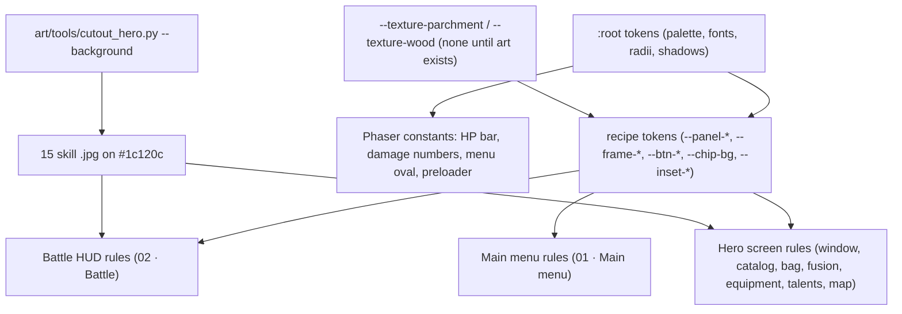

# UI Redesign (Grove Theme) Design

**Spec**: `.specs/features/ui-redesign/spec.md`
**Reference**: `.specs/features/ui-redesign/reference.jpg`
**Status**: Draft for the owner's approval (Q1 decided as D1 on 2026-11-12: round auto click button with a window and the key `A`; Q2 to Q5 open)

---

## Architecture Overview

The game's UI is two layers, and the redesign touches each in its own way:

- **DOM** (every panel, HUD text and control): plain HTML built by `game/src/adapters/phaser/HeroUi.js`, `ClickerGame.js`, `MainMenu.js` and `views/*.js`, placed over the canvas with `scene.add.dom`, styled by the single sheet `game/public/style.css`. The redesign is almost all here: new token values in `:root`, composite **recipe tokens**, and edits of the existing rules of each screen. No markup changes except four additions: `data-stat` and `data-element` on the enemy tags, the weak element chip, the `--timer-left` property, and the round auto click button with its window (D1), which replaces the auto click card.
- **Canvas** (Phaser): the HP bar rectangles, the damage numbers, the menu oval and the preloader bar. Their colours and font are constants in `ClickerGame.js`, `MainMenu.js` and `Preloader.js`; the redesign changes those constants only (sizes and positions stay).



The look of the mock-up is reproduced with CSS: gradients for parchment and wood, a thick dark border plus an outer bronze ring for frames, an inset vignette for burnt edges, Cinzel for headings and gold/orange numbers with a dark stroke. Painted textures are an optional top layer (Q4).

---

## Code Reuse Analysis

### Existing Components to Leverage

| Component | Location | How to Use |
| --- | --- | --- |
| Design tokens in `:root` | `game/public/style.css:4-47` | Change values in place; every rule that already reads `var(--color-bg)`, `--color-surface`, `--color-text`, `--color-accent`, `--font-heading`, `--radius-*`, `--shadow-*` follows without an edit |
| Grouped selector pattern for shared buttons | `style.css:85-144` (`.btn, .auth-actions button, ...`) | Restyle every button through the existing primary and secondary groups |
| Fixed-size HUD boxes | `style.css:401-488` (`.hud-*`) | Keep every box size so Phaser keeps each element where it is (it centres a DOM element on the size it had when added) |
| `cutout()` chroma key with despill | `art/tools/cutout_hero.py:20-34` | Reuse for the skill thumbnails: one new flag flattens the cutout onto `#1c120c` and keeps the frame |
| `elementMultiplier` and `ELEMENTS` | `game/src/domain/combat/elements.js:31` | `weaknessOf` derives the weak element from the same table |
| `ELEMENT_LABELS` | `game/src/domain/heroes/heroes.js:13` | Portuguese names of the weak element chip |
| Lucide skull path of the `Rever chefes` icon | `game/src/adapters/phaser/HeroUi.js:32` | Same path, as a CSS data URI, for the round farm button |
| `prefers-reduced-motion` blocks | `style.css:1956`, `style.css:2397` | Kept; the redesign adds no motion |
| `ui:shots` harness | `game/ui-review.config.js`, `game/ui-review/support/shots.js`, `game/ui-review/heroAscension.shots.js` | New `uiRedesign.shots.js` in the same shape |
| e2e helpers | `game/e2e/support/game.js` (`openMainMenu`, `fillCredentials`, `activeSceneKeys`), `game/e2e/support/fakeBackend.js` (`mockBackend`) | Setup of `e2e/uiRedesign.spec.js` |

### Integration Points

| System | Integration Method |
| --- | --- |
| Google Fonts | `game/index.html` stylesheet link: Cinzel 700 and Figtree 400/600/700/800 replace Caprasimo |
| Backend | None. Skill image names (`HeroSeed.kt`) are unchanged because the files keep their names and format |
| Existing tests | Text, test ids and class names stay; the colour and font literals of the HP bar, damage numbers and menu oval are updated in the named tests; `e2e/autoClick.spec.js` and `e2e/accountReset.spec.js` open the auto click window before they touch its controls (T15) |

---

## Palette

New tokens are added to `:root`; existing tokens get new values (marked *re-mapped*). Everything else in `:root` keeps its value.

| Token | Value | Computed | Use |
| --- | --- | --- | --- |
| `--wood-900` | `#1c120c` | `rgb(28, 18, 12)` | letterbox, inner rings, skill art frame, chips (at 0.85) |
| `--wood-800` | `#2b1d14` | `rgb(43, 29, 20)` | dark frame base (rail buttons, leader card, timer, notice, tiles, secondary buttons) |
| `--wood-700` | `#3d2a1c` | `rgb(61, 42, 28)` | frame gradient top, switch track |
| `--wood-600` | `#5a3d26` | `rgb(90, 61, 38)` | panel border, secondary button gradient top, portrait vignette |
| `--bronze-500` | `#b07a3a` | `rgb(176, 122, 58)` | frame border, panel outer ring, chip border |
| `--gold-400` | `#e0b45a` | `rgb(224, 180, 90)` | icons, primary border, unlocked skill ring, portrait ring |
| `--gold-200` | `#f3d58a` | `rgb(243, 213, 138)` | headings and numbers on wood |
| `--parchment-100` | `#f4e6c8` | `rgb(244, 230, 200)` | text on wood and ember, fields, talent cards |
| `--parchment-200` | `#ead6ad` | `rgb(234, 214, 173)` | panel base colour |
| `--parchment-300` | `#e6d0a2` | `rgb(230, 208, 162)` | inset cards |
| `--ink-900` | `#2a1a10` | `rgb(42, 26, 16)` | text on parchment |
| `--ink-600` | `#6b4a2b` | `rgb(107, 74, 43)` | muted text on parchment |
| `--ember-500` | `#e8742a` | `rgb(232, 116, 42)` | timer ring, badges, farm on |
| `--ember-700` | `#a8431a` | `rgb(168, 67, 26)` | primary button base |
| `--ember-800` | `#8a3510` | `rgb(138, 53, 16)` | combo chip, error line, cooldown text |
| `--color-focus` | `#cc4e1a` | `rgb(204, 78, 26)` | focus outline |
| `--color-bg` *re-mapped* | `#f4e6c8` | | was `#f5ead8` |
| `--color-surface` *re-mapped* | `#e6d0a2` | | was `#ebddc5` |
| `--color-text` *re-mapped* | `#2a1a10` | | was `#201e1d` |
| `--color-accent` *re-mapped* | `#a8431a` | | was `#c67139` |
| `--color-divider` *re-mapped* | `color-mix(in srgb, #2a1a10 22%, transparent)` | | was 16 % of `#201e1d` |
| `--color-neutral-600` *re-mapped* | `#5f5244` | | was `#82796a` (2.84:1 on the inset, now 5.01:1) |
| `--color-neutral-700` *re-mapped* | `#574b3e` | | was `#645c50` (4.36:1 on the inset, now 5.61:1) |
| `--color-accent-2-700` *re-mapped* | `#4a5636` | | was `#56633f` (4.26:1 on the inset, now 5.20:1) |
| `--font-heading` *re-mapped* | `"Cinzel", Georgia, serif` | | was Caprasimo |
| `--radius-md` *re-mapped* | `8px` | | was 16px |
| `--radius-lg` *re-mapped* | `12px` | | was 28px |
| `--shadow-md` *re-mapped* | `0 3px 10px rgb(0 0 0 / 0.35)` | | |
| `--shadow-lg` *re-mapped* | `0 10px 28px rgb(0 0 0 / 0.5)` | | |

Element colours (dots of the enemy tag and the weak chip) reuse the element wheel: FIRE `#e8643c`, WATER `#3f8fd1`, NATURE `#4f9a3c`, LIGHT `#f2c94c`, DARKNESS `#4a3a7a` (`style.css:1491-1495`, the second stop of each badge gradient).

The AD-020 star and level colours (`#7a3fa0`; `#d9a521` with `#201e1d`) and the rarity frame colours are literal values in their rules and do not change.

## Contrast

WCAG 2.x ratios of the computed colours. The e2e test (T28) asserts the first eight rows; the ui-artist (T30) audits the rest.

| # | Text (selector) | On (selector) | Text colour | Background | Ratio |
| --- | --- | --- | --- | --- | --- |
| 1 | `.hero-title` | `.hero-window` | `#2a1a10` | `#ead6ad` | 11.74 |
| 2 | `.hero-hud button` | itself | `#f4e6c8` | `#2b1d14` | 13.19 |
| 3 | `.fusion-button` | itself | `#f4e6c8` | `#a8431a` | 4.88 |
| 4 | `.boss-timer` | itself | `#f3d58a` | `#2b1d14` | 11.40 |
| 5 | `.skill-slot-cooldown` | `.battle-bar` | `#8a3510` | `#ead6ad` | 5.67 |
| 6 | `.hero-error` | itself | `#f4e6c8` | `#8a3510` | 6.54 |
| 7 | `.skill-row.is-locked` | itself | `#574b3e` | `#ead6ad` | 5.93 |
| 8 | `.hero-card .hero-meta` | `.hero-card` | `#4a5636` | `#e6d0a2` | 5.20 |
| 9 | `.hero-stars.is-ascended` | `.hero-card` | `#7a3fa0` | `#e6d0a2` | 4.57 |
| 10 | `.menu-tagline` | menu oval | `#6b4a2b` | `#ead6ad` | 5.58 |
| 11 | `.enemy-stats .tag` | chip (opaque part) | `#f4e6c8` | `#1c120c` | 14.90 |
| 12 | `.combo-hud` | itself | `#f4e6c8` | `#8a3510` | 6.54 |
| 13 | `.talent-effect` | `.talent-card` | `#574b3e` | `#f4e6c8` | 6.85 |
| 14 | `.hero-stars` (1 to 3 stars) | `.hero-card` | `#8c491a` | `#e6d0a2` | 4.51 |
| 15 | talents badge count | badge | `#2a1a10` | `#e8742a` | 5.55 |
| 16 | focus outline (non-text, 3:1) | parchment / wood | `#cc4e1a` | `#ead6ad` / `#2b1d14` | 3.15 / 3.63 |

---

## Recipes

Recipes are **composite custom properties** in `:root`, not new classes: the markup is built by JS and pinned by tests, so each screen rule reads the recipe tokens instead of gaining a class. A recipe is applied by writing its four declarations into the rule (the `background` shorthand first, `background-color` after it, because the shorthand resets the colour).

```css
    /* ══ Grove theme recipes (spec ui-redesign) ══ */
    --texture-parchment: none;
    --texture-wood: none;

    /* Parchment panel: windows, plaques, rail, bars, cards that float */
    --panel-bg: var(--texture-parchment), radial-gradient(ellipse at 50% 40%, var(--parchment-100) 0%, var(--parchment-200) 62%, var(--parchment-300) 100%);
    --panel-border: 3px solid var(--wood-600);
    --panel-shadow: 0 0 0 2px var(--bronze-500), inset 0 0 22px rgb(138 90 43 / 0.45), 0 10px 28px rgb(0 0 0 / 0.55);

    /* Dark wood frame: leader card, rail buttons, timer, notice, tiles */
    --frame-bg: var(--texture-wood), linear-gradient(180deg, var(--wood-700) 0%, var(--wood-800) 55%, var(--wood-900) 100%);
    --frame-border: 2px solid var(--bronze-500);
    --frame-shadow: inset 0 0 0 1px rgb(243 213 138 / 0.25), 0 0 0 2px var(--wood-900), 0 8px 20px rgb(0 0 0 / 0.5);

    /* Buttons: wood (secondary) and ember (primary), both pills */
    --btn-bg: linear-gradient(180deg, var(--wood-600) 0%, var(--wood-800) 100%);
    --btn-primary-bg: linear-gradient(180deg, var(--ember-700) 0%, #7a2e0c 100%);
    --btn-shadow: inset 0 1px 0 rgb(243 213 138 / 0.35), 0 2px 0 var(--wood-900), 0 4px 10px rgb(0 0 0 / 0.4);

    /* Chip: enemy tags, effect tags, weak element */
    --chip-bg: rgb(28 18 12 / 0.85);

    /* Inset card inside a parchment panel */
    --inset-border: 1px solid rgb(90 61 38 / 0.45);
```

| Recipe | Declarations a rule writes | Computed checks |
| --- | --- | --- |
| Parchment panel | `background: var(--panel-bg); background-color: var(--parchment-200); border: var(--panel-border); box-shadow: var(--panel-shadow);` | background-color `rgb(234, 214, 173)`, border 3px `rgb(90, 61, 38)` |
| Dark frame | `background: var(--frame-bg); background-color: var(--wood-800); border: var(--frame-border); box-shadow: var(--frame-shadow);` | background-color `rgb(43, 29, 20)`, border 2px `rgb(176, 122, 58)` |
| Secondary button | `color: var(--parchment-100); background: var(--btn-bg); background-color: var(--wood-800); border: 2px solid var(--bronze-500); box-shadow: var(--btn-shadow);` | background-color `rgb(43, 29, 20)` |
| Primary button | `color: var(--parchment-100); background: var(--btn-primary-bg); background-color: var(--ember-700); border: 2px solid var(--gold-400); box-shadow: var(--btn-shadow);` | background-color `rgb(168, 67, 26)` |
| Chip | `color: var(--parchment-100); background: var(--chip-bg); border: 1px solid var(--bronze-500);` | background-color `rgba(28, 18, 12, 0.85)` |
| Inset card | `background: var(--parchment-300); border: var(--inset-border); border-radius: var(--radius-md);` | background-color `rgb(230, 208, 162)`, radius 8px |

Hover and press of every button: `filter: brightness(1.15)` and `filter: brightness(0.9)`; no transition.

### Texture tokens (Q4)

`--texture-parchment` and `--texture-wood` are `none`, so the first background layer of the panel and frame recipes paints nothing and no file is requested. When the owner adds `game/public/assets/ui-parchment.jpg` or `ui-wood.jpg`, the line in `:root` becomes `--texture-parchment: url("assets/ui-parchment.jpg");` (resp. `--texture-wood: url("assets/ui-wood.jpg");`). The textures are opaque, so they cover the gradient; the border and shadows stay.

---

## Screen Map

Every rule below already exists in `style.css` unless marked *new*. The tasks give the exact declarations.

| Screen / element | Selector(s) | Recipe | Task |
| --- | --- | --- | --- |
| Page | `body`, `:focus-visible` | letterbox `--wood-900`, focus ring | T2 |
| Buttons | the secondary group `style.css:85-115`, the primary group `style.css:117-144` | secondary / primary | T3 |
| Tags and coins | `.tag`, `.tag-element`, `.tag-effect`, `.coin-*::before` | chip, metallic discs | T3 |
| Stage plaque, wallet | `.stage-hud, .wallet` | parchment panel, radius 6px | T6 |
| Chapter tag | `.chapter-hud` | parchment, 2px border, radius 4px | T6 |
| Combo | `.combo-hud` | ember chip | T6 |
| Stage message | `.stage-message` | gold text, dark stroke | T6 |
| Notice | `.card-notice` | dark frame | T6 |
| Boss timer | `.boss-timer`, `.boss-timer::before` *new* | dark frame pill + conic ring | T7 |
| HP frame | `.hud-monster-hp`, `.monster-hp` | double ring + gloss | T8 |
| Enemy line | `.enemy-stats`, `.tag-element::before` *new*, `.tag[data-stat]::before` *new* | chips with icons | T9 |
| Weak element | `.hud-enemy`, `.weak-chip` *new* | chip with dot | T11 |
| Hero rail | `.hero-hud`, `.hero-hud button`, `.hud-badge`, talents badge | parchment strip, framed squares | T12 |
| Battle bar | `.battle-bar`, `.leader-host`, `.leader-card`, `.leader-face`, `.leader-crown`, `.leader-name`, `.leader-bonus`, `.skill-slot*`, `.skill-key`, `.skill-lock-mark` | parchment, dark frame | T13 |
| Auto click, farm | `.hud-auto-click`, `.auto-click`, `.auto-click-button` *new*, `.auto-click-key` *new*, `.auto-click-rate` *new*, `.auto-click-popover` *new*, `.auto-click-toggle*`, `.auto-click-upgrade`, `.reset-account`, `.farm-toggle*` | round buttons, parchment window, switch, primary | T14 (markup, behaviour), T16 (CSS); `.hud-farm` size and the bar positions in T13 |
| Overlays | `.pause-menu, .reset-dialog, .hero-panel`, `.pause-card, .reset-card`, `.pause-title` | dim, parchment card | T17 |
| Hero window | `.hero-window`, `.hero-title`, `.hero-error`, `.hero-empty` | parchment panel | T21 |
| Catalog, detail, farm list, fusion, leader | `.hero-card*`, `.hero-detail-portrait`, `.hero-bonus`, `.skill-row*`, `.skill-art`, `.skill-state`, `.farm-entry`, `.farm-wins`, `.leader-entry.is-current`, `.leader-state`, `.fusion-result` | inset cards | T22 |
| Equipment, tiles, tooltip, bulk sale | `.equip-hero`, `.equip-slot`, `.equip-button*`, `.leader-stats`, `.piece-tile`, `.piece-tooltip`, `.equip-notice`, `.bulk-sell-bar`, `.bulk-sell-yes` | inset, dark tiles, parchment tooltip, primary | T23 |
| Talents | `.talent-points`, `.talent-column`, `.talent-branch-title`, `.talent-card`, `.talent-grade-title` | inset, parchment-100 cards | T24 |
| Boss map | `.farm-map`, `.farm-map-title` | wood ring + bronze ring (box-shadows) | T25 |
| Element wheel, skill tooltip | `.element-wheel`, `.wheel-title`, `.wheel-name`, `.wheel-arrow-label`, `.skill-tooltip` | parchment panel (wheel rings as box-shadows) | T26 |
| Main menu | `.menu-tagline`, `.auth-form input*`, `.auth-message*`, `.welcome-title`, `.welcome-start`, `.path-choice`, `.path-option*` | parchment, primary | T18 (CSS), T19 (oval), T20 (preloader) |

---

## Components

### Grove tokens and recipes (`style.css :root`)

- **Purpose**: one source for colours, fonts, radii, shadows and the five recipes.
- **Location**: `game/public/style.css:4-47`.
- **Interfaces**: the custom properties of § Palette and § Recipes.
- **Reuses**: the existing token names (re-mapped values).

### Boss timer ring

- **Purpose**: show the share of the boss time left as a ring, beside the unchanged `Time: <s>` text (UIR-06).
- **Location**: `game/src/adapters/phaser/ClickerGame.js` `showCountdown()` (`:710`) and `hideCountdown()` (`:715`); CSS `.boss-timer`, `.boss-timer::before`.
- **Interfaces**: inline property `--timer-left` on `.boss-timer`, string with 3 decimals: `Math.min(1, Math.max(0, remainingMs / limitMs)).toFixed(3)`.
- **Reuses**: `BossCountdown.remainingMs`, `BossCountdown.limitMs` (`game/src/domain/campaign/bossCountdown.js`).
- **Why not a big ring with the text inside**: `Time: 37` does not fit a 76 px ring at a readable size, and splitting the text into two spans changes the `textContent` updates that about 15 tests read. The 32 px ring leads the pill instead; the HUD box stays 240 x 48, so no position moves.

```css
.boss-timer::before {
    content: '';
    flex: none;
    width: 32px;
    height: 32px;
    border-radius: 50%;
    background:
        radial-gradient(circle, var(--wood-900) 0 52%, transparent 54%),
        conic-gradient(var(--ember-500) calc(var(--timer-left, 1) * 360deg), rgb(244 230 200 / 0.18) 0);
}
```

### Enemy chips and weak element chip

- **Purpose**: icon chips for the enemy line (UIR-07) and the `Fraco: <elemento>` chip (UIR-08).
- **Location**: `ClickerGame.js` `showEnemyStats()` (`:685`), the three `this.enemyStats.textContent = ''` lines (`:699`, `:852`, `:1025`), `ENEMY_STATS_HTML` (`:68`); `game/src/domain/combat/elements.js` (new `weaknessOf`).
- **Interfaces**:
  - `weaknessOf(defender: string): string | null` - the element whose `elementMultiplier(attacker, defender)` is 2, else null; throws `Unknown element: <x>` like `elementMultiplier`.
  - Element tag: `<span class="tag tag-element" data-element="FIRE">Fire</span>`; stat tags: `<span class="tag" data-stat="physical|magical|crit">…</span>`. Text unchanged.
  - `ENEMY_STATS_HTML = '<div class="hud-box hud-enemy"><div class="weak-chip" data-testid="weak-chip"></div><div class="enemy-stats"></div></div>'`; the scene reads the chip as `this.enemyStats.parentElement.querySelector('.weak-chip')`.
  - `clearEnemyStats()` - new scene method that empties `.enemy-stats` and the weak chip; replaces the three clearing lines.
- **Layout**: `.hud-enemy` becomes a 460 x 80 px column (chip above the line, 4 px gap) at the same scene point (670, 596): box 440..900 x 556..636; content (about 52 px tall) sits at 570..622, under the monster placeholder (bottom 565) and above the battle bar (top 624); the rail starts at x 907.
- **Icons** (CSS masks, coloured by `background-color`):

```css
/* shield */
url("data:image/svg+xml,%3Csvg xmlns='http://www.w3.org/2000/svg' viewBox='0 0 24 24'%3E%3Cpath d='M12 2 4 5v6c0 5.2 3.4 9.5 8 11 4.6-1.5 8-5.8 8-11V5z'/%3E%3C/svg%3E")
/* target */
url("data:image/svg+xml,%3Csvg xmlns='http://www.w3.org/2000/svg' viewBox='0 0 24 24'%3E%3Ccircle cx='12' cy='12' r='9' fill='none' stroke='%23000' stroke-width='3'/%3E%3Ccircle cx='12' cy='12' r='4'/%3E%3C/svg%3E")
/* skull of the farm button (stroke already gold, used as background-image) */
url("data:image/svg+xml,%3Csvg xmlns='http://www.w3.org/2000/svg' viewBox='0 0 24 24' fill='none' stroke='%23e0b45a' stroke-width='2.25' stroke-linecap='round' stroke-linejoin='round'%3E%3Cpath d='M15 22a1 1 0 0 0 1-1v-1a2 2 0 0 0 1.56-3.25 8 8 0 1 0-11.12 0A2 2 0 0 0 8 20v1a1 1 0 0 0 1 1z'/%3E%3Ccircle cx='15' cy='12' r='1'/%3E%3Ccircle cx='9' cy='12' r='1'/%3E%3C/svg%3E")
```

### Phaser constants

| File | Constant | Today | New |
| --- | --- | --- | --- |
| `ClickerGame.js:25` | `HEALTH_BAR.backColor` / `fillColor` | `0xdcd3c4` / `0xc67139` | `0x2a1410` / `0xc0392b` (size 240 x 16 and gap 18 unchanged) |
| `ClickerGame.js:58` | `DAMAGE_FONT` | `{ fontFamily: 'Caprasimo', stroke: '#2e2b25', strokeThickness: 8 }` | `{ fontFamily: 'Cinzel', fontStyle: '700', stroke: '#2a1408', strokeThickness: 8 }` |
| `ClickerGame.js:59` | `CRITICAL_TEXT` | `{ color: '#ffc6a5', fontSize: 48 }` | `{ color: '#ff8a1f', fontSize: 48 }` |
| `ClickerGame.js:60` | `NORMAL_TEXT` | `{ color: '#f5ead8', fontSize: 32 }` | `{ color: '#ffd35c', fontSize: 32 }` |
| `MainMenu.js:9` | `OVAL.color` | `0xf5ead8` | `0xead6ad`, plus `OVAL.rim: 0x5a3d26`, `OVAL.rimWidth: 6` drawn with `setStrokeStyle` |
| `Preloader.js:20,23` | outline / bar | stroke `1, 0xffffff` / fill `0xffffff` | stroke `2, 0xe0b45a` / fill `0xe8742a` |

Cinzel 700 is already in use by the DOM headings when the first damage number is drawn (the main menu title and the HUD plaques load it), so the canvas text gets the web font; if it is not loaded yet, Phaser falls back to the browser default for that number only.

### Auto click button and window (D1)

- **Purpose**: the auto click as a round button in the battle bar, with the key `A`, that opens a window holding the old card's controls (UIR-19, UIR-11 AC 29).
- **Location**: `game/src/adapters/phaser/ClickerGame.js` (`AUTO_CLICK_HUD`, `AUTO_CLICK_HUD_HTML`, `createAutoClickHud`, `showAutoClick`, `openResetDialog`, `escape`, the `shutdown` handler, three new methods); CSS in `style.css`.
- **Reuses**: `renderAutoClick` and `renderResetButton` unchanged (the window's children); `autoClickIntervalText` for the label under the button; the `change` and `click` delegation of `this.autoClickBox` unchanged, so the switch, the upgrade and the reset button work as today.
- **Markup** (one Phaser DOM element, box 80 x 112 at (867, 686)):

```html
<div class="hud-box hud-auto-click"><div class="auto-click" data-testid="auto-click">
  <div class="auto-click-popover" id="auto-click-popover" role="dialog" aria-label="Auto clique" data-testid="auto-click-popover" hidden></div>
  <button type="button" class="auto-click-button" data-testid="auto-click-button" data-on="false"
          aria-label="Auto clique" aria-haspopup="dialog" aria-expanded="false" aria-controls="auto-click-popover">
    <span class="auto-click-key" data-testid="auto-click-key" aria-hidden="true">A</span>
  </button>
  <span class="auto-click-rate" data-testid="auto-click-rate"></span>
</div></div>
```

- **Interfaces** (scene methods):
  - `get autoClickWindowOpen(): boolean` - `!this.autoClickPopover.hidden`.
  - `openAutoClickWindow(): void` - nothing while the auto click is locked; shows the window, `aria-expanded="true"`, focuses `[data-testid="auto-click-toggle"]`.
  - `closeAutoClickWindow({ returnFocus = true } = {}): void` - nothing if closed; hides it, `aria-expanded="false"`, focuses the button when `returnFocus`.
  - `toggleAutoClickWindow(): void` - open or close.
  - `autoClickKey(event): void` - the `keydown-A` handler: returns on `event.repeat`, on a text-field target (`isTextField`), while `this.paused`, while the reset dialog is shown, while `this.heroUi.isOpen`, or while `!this.autoClickOpen`; else toggles.
  - `isTextField(target): boolean` (module function) - `Boolean(target?.closest?.('textarea, select, [contenteditable="true"], input:not([type="checkbox"]):not([type="radio"]):not([type="button"])'))`.
- **Hooks into existing code**: `showAutoClick` renders into the window instead of the old box, writes `data-on` from `this.autoClickEnabled` and the rate label, closes the window when the auto click is locked and restores focus by `data-testid`; `openResetDialog` closes the window (no focus return); `escape` closes an open window first and returns; a capture-phase `pointerdown` listener on `document` closes the window for a press outside `.auto-click` (no focus return) and is removed in the existing `shutdown` handler.
- **Look**: the button is the farm button's twin (56 px circle, dark wood, 3 px bronze ring) with a pointer icon; on: ring `#5fd35a` and a green glow; the badge copies `.skill-key`; the window is a parchment panel 240 px wide anchored 4 px inside the right edge of the box and 10 px above the button, with a tail at 28 px from its right edge pointing at the button centre.

```css
/* pointer icon of the auto click button (Lucide mouse-pointer-click, stroke #f3d58a) */
url("data:image/svg+xml,%3Csvg xmlns='http://www.w3.org/2000/svg' viewBox='0 0 24 24' fill='none' stroke='%23f3d58a' stroke-width='2.25' stroke-linecap='round' stroke-linejoin='round'%3E%3Cpath d='M14 4.1 12 6'/%3E%3Cpath d='m5.1 8-2.9-.8'/%3E%3Cpath d='m6 12-1.9 2'/%3E%3Cpath d='M7.2 2.2 8 5.1'/%3E%3Cpath d='M9.037 9.69a.498.498 0 0 1 .653-.653l11 4.5a.5.5 0 0 1-.074.949l-4.349 1.041a1 1 0 0 0-.74.739l-1.04 4.35a.5.5 0 0 1-.95.074z'/%3E%3C/svg%3E")
```


### Skill thumbnails

- **Purpose**: remove the magenta chroma key from the 15 skill images (UIR-16).
- **Why magenta shows**: the skill art was generated on a solid magenta background (`#ff00ff` family, corner pixels `(254, 23..45, 245..255)`) as a chroma key, like every hero art (`PROMPTS_ASSETS.md`). The standing heroes were cut out to `*_sprite.png` with `art/tools/cutout_hero.py`; the skill images were copied as they were (`8db5905`) and `dom.js:art()` shows them as `.jpg`.
- **Fix**: one new flag on the existing tool. `--background <hex>` composites `cutout()`'s RGBA onto that colour, skips `crop()` (a thumbnail keeps its frame, so `object-fit: cover` keeps today's framing), resizes to `--height`, and saves an RGB JPEG at quality 88. Without the flag the tool behaves as today.
- **Run**: `python art/tools/cutout_hero.py art/<name>.jpg game/public/assets/heroes/<name>.jpg --height 512 --background 1c120c` for the 15 names of the spec. A trial on all 15 gave 0 % magenta pixels, corner `(28, 18, 12)`, 0.96 MB total (36 MB before).
- **References updated**: none. Same names and extension: `dom.js:27` (`art()`), the backend seed (`HeroSeed.kt`), the fake backend (`e2e/support/fakeBackend.js:80-96`) and the tests that read `src` (`heroes.spec.js:153,162`, `skillTooltip.test.js:23`, `catalogView.test.js:56`) stay valid.

---

## Layout

Three scene coordinates change, all in the battle bar, to make room for the round auto click button (D1); every other element stays. Box sizes that change (Phaser centres each DOM element on its box):

| Box | Today | New | Scene extent |
| --- | --- | --- | --- |
| `.hud-enemy` (ENEMY_STATS 670, 596) | 400 x 48 | 460 x 80, column | x 440..900, y 556..636 |
| `.leader-host` (LEADER 154, 686) | 230 x 84 | 240 x 104 | x 34..274, y 634..738 |
| `.skill-bar-host` (SKILL_BAR, `HeroUi.js:19`) | 474 x 100 at x 586 | 474 x 100 at **x 550** | x 313..787, y 636..736 |
| `.hud-auto-click` (AUTO_CLICK_HUD, `ClickerGame.js:75`) | 260 x 160 at (366, 200), the card | 80 x 112 at **(867, 686)**, the round button | x 827..907, y 630..742; button circle x 839..895 |
| `.hud-farm` (FARM_TOGGLE, `ClickerGame.js:71`) | 160 x 48 at x 918 | 80 x 112 at **x 951** | x 911..991, y 630..742; button circle x 923..979 |
| `.auto-click-popover` (inside `.hud-auto-click`, absolute) | - | 240 wide, about 172 tall (about 205 with the reset button) | x 663..903, bottom 10 px above the button (y about 638), top about 466 (433 with reset) |
| `.hero-hud` (HUD 956, 370) | about 96 x 422 | 98 x 478 (7 buttons of 76 x 60 px, 6 px gaps, 8 px padding, 3 px border) | x 907..1005, y 131..609 |

**Battle bar, left to right** (bar x 20..1004, y 624..748, 3 px border): leader card 34..274, gap 39, skills 313..787 (three 150 px slots, unchanged), gap 40, auto click 827..907, gap 4, farm 911..991, 13 px to the bar edge. The skill slots keep 150 px: shifting the bar 36 px left is enough, nothing shrinks. The rail ends at y 609 and the bar starts at y 624, so the two round buttons sit under the rail, not beside it.

**Why the round button no longer covers the monster**: the earlier worry assumed the round button and its open card would both stay on screen. With D1 the button lives inside the bar (y 630..742, below the monster's 565 and the enemy line's content 570..622). Only the window, while open, floats over the right edge of the fight (x 663..903, y about 466..638): it covers part of the monster placeholder, the enemy chips and the weak chip until it closes, as in the mock-up. It never reaches the rail (x 907).

**Phone (390 x 844 viewport)**: the game is the same 1024 x 768 scene scaled to fit, factor 390 / 1024 = 0.381, letterboxed vertically. The bar keeps the same order; the round button is 56 x 0.381 = 21 CSS px wide (its badge 8 px, the window 91 x about 66 CSS px), all inside the scene. That is under the 44 px touch target, like every other control of the scaled scene today (the rail buttons are 29 CSS px); a phone layout is out of scope. The `A` key needs a keyboard; on a touch phone the window opens by tapping the button.

---

## Review Screenshots

`game/ui-review/uiRedesign.shots.js` writes these files (`<name>-desktop.png` and `<name>-phone.png`) into `.specs/features/ui-redesign/ui-review/`:

| File name | State |
| --- | --- |
| `01-preloader` | Preloader bar while `assets/heroes/vex_sprite.png` is held back |
| `02-menu-login` | Main menu, login form, focus in the username field |
| `03-menu-welcome` | Main menu after login (`Welcome back, yan!`) |
| `04-path-choice` | Path choice after `Sign up` |
| `05-battle-boss` | Chapter 2 miniboss, FIRE, defenses 10/20/30, 60 s limit, 2 s in: plaque, tag, wallet, timer ring, HP frame, chips, `Fraco: Água`, rail, leader card, skills, round auto click button (on, green) with `A` and `500 ms`, farm button; nothing on the left of the monster but the wheel |
| `06-battle-combo` | Five clicks with COMBO 10: combo chip and a damage number |
| `07-battle-light` | LIGHT phase monster: no weak chip |
| `08-battle-locked` | 1-star leader: two locked skills |
| `09-skill-tooltip` | Pointer over skill slot 1 |
| `10-notice` | `Carta: Lyra Folhaveloz` notice |
| `11-pause` | Escape |
| `12-reset-dialog` | `Resetar conta` dialog (opened from the auto click window) |
| `13-farm-on` | Farm button drawn checked |
| `14-auto-click-window` | Auto click window opened with `A`, switch focused (focus ring visible), reset button shown |
| `15-auto-click-off` | Auto click switched off, window closed: bronze ring, no glow |
| `20-heroes` | Heróis catalog (stars 3, 4, 7, 2, 6) |
| `21-hero-detail` | Kael 5★ detail |
| `22-bag` | Mochila |
| `23-bag-detail` | A bag entry |
| `24-fusion` | Fusão rows |
| `25-fusion-error` | Failed fusion (error line) |
| `26-leader` | Líder |
| `27-equipment` | Equipamento with pieces of every rarity |
| `28-piece-tooltip` | Pointer over a piece |
| `29-bulk-sell` | Bulk sale bar with three tiles selected |
| `30-talents` | Talentos with points |
| `31-boss-map` | Rever chefes |

---

## Gemini Prompts (for `PROMPTS_ASSETS_UI.md`, task T27)

Appended as section `## 5. Texturas da interface`, before `## Checklist de arquivos`:

````markdown
## 5. Texturas da interface

Duas texturas **repetíveis** (as bordas se encaixam) para os painéis de pergaminho e as molduras de madeira. Sem fundo magenta: são imagens inteiras, em **JPG** (qualidade 85 ou mais), **512×512 px**.

Enquanto o arquivo não existir, o jogo desenha o pergaminho e a madeira com gradientes de CSS. Depois de salvar o arquivo em `game/public/assets/`, troque **uma linha** em `game/public/style.css`, no bloco `:root`:

| Arquivo | Linha de hoje | Linha nova |
|---|---|---|
| `ui-parchment.jpg` | `--texture-parchment: none;` | `--texture-parchment: url("assets/ui-parchment.jpg");` |
| `ui-wood.jpg` | `--texture-wood: none;` | `--texture-wood: url("assets/ui-wood.jpg");` |

### 5.1 Pergaminho — `ui-parchment.jpg`

```
Seamless tileable texture, 512x512, flat top-down scan of aged fantasy
parchment paper. Warm cream and light tan (#f4e6c8 to #e6d0a2), soft fibers,
faint stains and mottling, very low contrast so dark text stays readable on it.
Even lighting, no vignette, no burnt edges, no folds, no shadows, no objects.
No text, no letters, no symbols, no frame, no border, no watermark.
The left edge must continue the right edge and the top edge the bottom edge.
```

### 5.2 Madeira escura — `ui-wood.jpg`

```
Seamless tileable texture, 512x512, flat top-down view of dark stained oak
planks for a fantasy RPG interface. Deep brown (#3d2a1c to #1c120c), visible
grain running horizontally, subtle warm highlights, low contrast so light text
stays readable on it. Even lighting, no vignette, no nails, no metal, no
objects. No text, no letters, no symbols, no frame, no border, no watermark.
The left edge must continue the right edge and the top edge the bottom edge.
```
````

The `Checklist de arquivos` table of that file gains two rows: `ui-parchment.jpg` and `ui-wood.jpg`, both `game/public/assets/`.

---

## Error Handling Strategy

| Error Scenario | Handling | User Impact |
| --- | --- | --- |
| Google Fonts unreachable | Font tokens fall back to Georgia, serif and system-ui | Headings in Georgia; everything works |
| Texture file absent | Token stays `none`; gradient only | Same look as without art; no 404 |
| Skill image fails to load | The frame's own background `#1c120c` shows | A dark empty frame, not a broken parchment hole |
| Canvas text drawn before Cinzel loads | Phaser uses the browser default for that text | One damage number in the default font |
| Enemy element unknown | `weaknessOf` throws like `elementMultiplier`; `showEnemyStats` is only called with server elements already used by the combat | None (same contract as today) |

---

## Risks & Concerns

| Concern | Location (file:line) | Impact | Mitigation |
| --- | --- | --- | --- |
| Tests pin old colours of the HP bar and damage numbers | `game/src/adapters/phaser/ClickerGame.test.js:194-196, 1862, 1870, 2956-2957, 3559, 3563, 3573, 3719` | The gate fails after T8 | T8 lists every line and its new literal; the test names stay |
| Menu test mocks `ellipse` as `{}` | `game/src/adapters/phaser/MainMenu.test.js:36` | `setStrokeStyle` would throw | T19 changes the mock to return `{ setStrokeStyle }` |
| Re-mapping shared tokens shifts rules nobody restyles explicitly | `style.css` (about 300 uses of `--color-*`) | A forgotten corner keeps an odd mix | Re-mapped values stay in the same family (cream to parchment, terracotta to ember); the ui-artist reviews 27 screens on two viewports (T30); findings become tasks |
| The enemy line and `unified-damage` (AD-021, proposed) both edit `showEnemyStats` | `ClickerGame.js:685` | Merge conflict, or a `data-stat` for a tag that no longer exists | Whichever lands second adapts: with one defense the stat tags become `data-stat="defense"` (shield `rgb(176, 122, 58)`) and `crit`; noted here for that feature |
| `:has()` and CSS `mask` need a recent Chromium | `style.css:1165` (already uses `:has`) | Older browsers miss the icons | Already required by the game; icons are decoration, the text stays |
| Cutout blends purple effects close to the key | `art/tools/cutout_hero.py:13` (`KEEP, DROP = 40, 110`) | Some violet glows lose saturation | Trial sheet of 5 skills looked clean; the ui-artist reviews all 15 in `21-hero-detail` and catalog shots |
| `PROMPTS_ASSETS_UI.md` may hold the owner's uncommitted edits | repository root | T27 could commit the owner's work | T27 stops and reports if `git status` shows the file modified before it starts |
| Labels of the rail at 76 px | `.hero-hud button` | `Equipamento` could overflow | Spec edge case; the e2e checks `scrollWidth <= clientWidth` for all seven |
| The old card's e2e flows click controls that are now inside a closed window | `game/e2e/autoClick.spec.js:53-57, 71-72`; `game/e2e/accountReset.spec.js:31-32, 54, 61` | Those tests fail once T14 lands | T15 (test-engineer) opens the window first with a new helper and swaps the `auto-click-toggle` visibility check for `auto-click-button`; T15 runs right after T14, in the same phase |
| The scene test stand-in does not attach DOM nodes to `document` and keeps one handler per `events.once` name | `game/src/adapters/phaser/ClickerGame.test.js:160-185` | Focus tests see no `document.activeElement`; a second `once('shutdown')` would replace the first | T14's focus tests append the auto click node to `document.body`; the scene removes its document listener inside the existing shutdown handler, not in a second one |
| The window re-renders its children on every state change | `ClickerGame.js:251-259` (`showAutoClick`) | A keyboard user loses focus when the switch or the upgrade answers | `showAutoClick` restores focus to the control with the same `data-testid` (UIR-19 AC 15) |

---

## Tech Decisions

| Decision | Choice | Rationale |
| --- | --- | --- |
| Recipes as tokens, not classes | Composite custom properties applied inside existing rules | Markup is built by JS and pinned by tests; classes would need JS edits on every view for no visual gain |
| Edit tokens in place | Re-map the existing token values | Every rule that reads them follows; the screen tasks only add frames and fix exceptions |
| Timer | Small ring leading the unchanged pill | Keeps the text, box size and about 15 tests |
| Weak chip inside the enemy HUD element | Column above `.enemy-stats` | No new scene coordinate; `.enemy-stats` text stays exact for `elements.spec.js` |
| Thumbnails stay JPEG with a dark background | Flatten onto `#1c120c` | No reference to update anywhere; 36 MB become 1 MB |
| Textures behind tokens set to `none` | Turned on by one line each | No 404 before the art exists; Q4 |
| No new motion | No `transition` or `animation` in the new rules | Nothing to switch off for `prefers-reduced-motion` |
| Auto click window | One Phaser DOM element holds the button, its label and the window; the window is absolutely positioned above the button (like `.skill-tooltip.is-above`) and toggled with `hidden` | The box stays 80 x 112 so Phaser keeps it in place; no second scene element to keep in sync |
| Auto click key | Phaser `keydown-A` in the battle scene, ignored for repeats, text fields, pause, reset dialog, hero screens and while locked | `A` is free (keys in use: 1, 2, 3, Q, W, E, Esc); the main menu's text fields live in another scene |

> **Proposed project decision (append to `.specs/STATE.md` as AD-022 when the owner approves):**
> **Decision**: The game's look is the Grove theme of spec `ui-redesign`: the palette and recipe tokens of `game/public/style.css :root` (parchment panels, dark wood frames, ember primary and wood secondary buttons, chips), Cinzel 700 for headings and numbers, Figtree for body text. New UI reads the recipe tokens; painted textures are switched on through `--texture-parchment` and `--texture-wood`.
> **Reason**: Owner request of 2026-11-12 ("redesenhasse todo o jogo no estilo da imagem").
> **Trade-off**: Contrast is held by the token values; a new colour must be checked against the parchment and wood bases. The Organic look (Caprasimo, cream pills) is retired.
> **Scope**: `game/public/style.css`, `game/index.html`, the Phaser colour constants of `ClickerGame.js`, `MainMenu.js`, `Preloader.js`.
