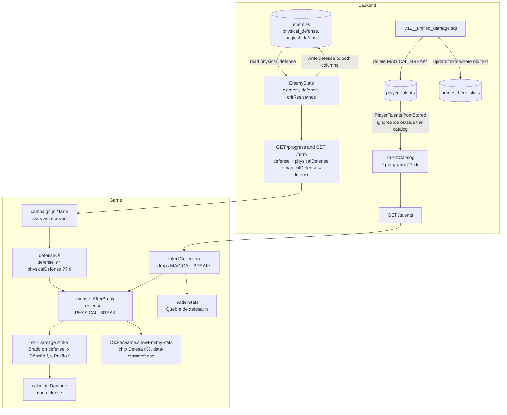

# Unified Damage Design

**Spec**: `.specs/features/unified-damage/spec.md`
**Status**: Approved by the owner on 2026-11-19 ("pode começar o unified-damage"; Q1 points only, Q2 one damage everywhere). Refreshed against `main` at `8543fb5`.

---

## Architecture Overview

No new endpoint, table or screen. The feature removes one concept (the damage type) from three places and widens nothing:

1. **Backend**: `EnemyStats` keeps one `defense`. Persistence still uses the two existing columns (read `physical_defense`, write the defense to both), and the progress and farm APIs answer `defense` plus the two old fields equal to it (expand only, AD-016). The talent catalog loses `MAGICAL_BREAK*` and loads stored levels tolerantly. One migration, `V11__unified_damage.sql`, deletes the `MAGICAL_BREAK*` levels and rewrites the seeded hero texts.
2. **Game domain**: one pure reader `defenseOf(stats)` gives the defense of any payload shape; `calculateDamage`, the break talent, Brado and the enemy line read it. Bênção and Prisão multiply every strike, with the level factor `f` they were cast with (unchanged, AD-020). The skill catalog and the attacker lose `damageType`.
3. **Game views**: the enemy line shows one `Defesa <n>%` chip (`data-stat="defense"`); the attribute panel shows one break line and no damage type; the Talentos screen shows what the backend answers, minus any retired talent.



---

## Deploy Order and Compatibility (AD-016, AD-023)

The backend phase (T1 to T3) is pushed first, the game phases after it, but every combination below works, so no task waits for a deploy. "Previous backend" also covers a rollback: `./deploy.sh --rollback` on the local stack, or Cloud Run traffic sent back to the previous revision (AD-023); in both cases `V11` stays applied.

| Backend running | Game running | What the player gets |
| --- | --- | --- |
| previous | previous | Today's game |
| new (T1 to T3) | previous Worker | Same damage as today: `physicalDefense` and `magicalDefense` both equal `defense`. Old enemy line and attribute panel; the Talentos screen lists 27 talents with the new label; `Quebra de defesa mágica: 0` on the panel. New hero texts |
| previous | new Worker | One defense read from `physicalDefense`; `MAGICAL_BREAK*` dropped from the list (never shown, never applied); old hero texts |
| new | new | The feature |
| previous, after `V11` ran (deploy window or rollback) | either | No `MAGICAL_BREAK*` row means level 0: the previous backend loads every player. A level bought there is ignored by the new backend later (tolerant load) |

**Backend commit order and safety.** T1 (enemy defense) changes no schema. T2 (catalog of 27 plus tolerant load) is safe deployed alone: rows of `MAGICAL_BREAK*` still in the table are ignored on load, so their points already count as available. T3 adds `V11__unified_damage.sql`; Flyway runs it before the backend serves. If a deploy skips T1 or T2 and ships a later commit, nothing breaks, because each commit contains the earlier ones. The deploy regression suite (`deploy/regression.mjs`) checks only the status of `GET /talents`, so the 27-talent answer passes it.

**Migration number.** `V11` is the next free version (`V10__health_legacy_columns_drop.sql` is the last). T3 step 1 lists the folder and takes the next free number if another feature landed one first.

---

## Code Reuse Analysis

### Existing Components to Leverage

| Component | Location | How to Use |
| --- | --- | --- |
| `EnemyStats`, `ChapterDefinition.of` | `backend/.../domain/Chapter.kt:5-25, 151-191` | Drop `magicalDefense`, rename `physicalDefense` to `defense`; the seed passes one value (the 80 / 70 caps and the per-chapter bonus stay) |
| `EnemyEntity.toDomain`, `EnemyRepository.idOf` | `backend/.../adapter/repository/ChapterEntities.kt:40-41`, `EnemyRepository.kt:41-53` | Read `physicalDefense` as the defense; pass the defense twice to the existing native insert and finder |
| `EnemyStatsResponse` | `backend/.../adapter/web/ProgressController.kt:24-39` | Add `defense`; fill the two old fields with it. `FarmController` reuses `ChapterResponse`, so the farm gets it too |
| `TalentCatalog.grade1`, `PlayerTalents` | `backend/.../domain/Talents.kt:60-93, 147-230` | Remove one entry, relabel one; add `PlayerTalents.fromStored` next to the existing logger |
| `TalentService.load` | `backend/.../service/TalentService.kt:71-72` | Build through `fromStored` |
| `V2__lyra_leader_bonus.sql`, `LyraLeaderBonusMigrationIT` | `backend/src/main/resources/db/migration/`, `backend/src/test/.../adapter/repository/` | Guarded text update and its test pattern |
| `TalentPointsMigrationIT` | `backend/src/test/.../adapter/repository/TalentPointsMigrationIT.kt:19-26` | Pattern to run a migration file again in a test (`ClassPathResource`, `users(...)`) |
| `calculateDamage` | `game/src/domain/combat/damage.js:16-29` | Read `defenseOf(defender)`; ignore `damageType` |
| `strike`, `factorOf` | `game/src/domain/skills/skillDamage.js:14-35` | Brado writes `defense`; Bênção and Prisão lose their type checks and keep `factorOf` |
| `monsterAfterBreak` | `game/src/domain/talents/talents.js:24-29` | One defense line |
| `ClickerGame.showEnemyStats` | `game/src/adapters/phaser/ClickerGame.js:785-802` | Two value chips instead of three; keep the weak element chip |
| Enemy chip styles | `game/public/style.css:767-791` | Rename the `physical` rule to `defense`, delete the `magical` rule |
| `createTalentCollection.adopt` | `game/src/application/talents/talentCollection.js:14-20` | Filter retired ids before storing |
| `leaderStats` | `game/src/domain/equipment/leaderStats.js:15-34` | Ten lines |
| `leaderBonusText` | `game/src/domain/heroes/leaderBonus.js:6` | Unchanged: Orina's new text shows with ` (em breve)` |
| skillsAll e2e helpers | `game/e2e/skillsAll.spec.js:7-71` | `bare`, `chapter`, `startAs`, `scene`, `health`, `advance`, `dealt`, `use`, `click` for the new e2e file |

### Integration Points

| System | Integration Method |
| --- | --- |
| Progress and farm APIs | Additive field `defense` on every enemy object; old fields kept |
| Talents API | Same shape; 27 entries instead of 30 |
| Heroes API | Same shape; new texts come from the database (seed or migration) |
| Database | One migration (`delete` + guarded `update`s); no DDL |

---

## Components

### Backend `EnemyStats` (domain)

- **Purpose**: What the player's damage meets in one encounter.
- **Location**: `backend/src/main/kotlin/br/com/woodriver/infinity_grove_ws/domain/Chapter.kt`
- **Interfaces**:
  - `data class EnemyStats(val element: Element, val defense: Int, val critResistance: Int)`; `init` requires `defense in 0..90` (message `defense $defense must be between 0 and 90`) and `critResistance in 0..100`.
  - `EnemyStats.DEFAULT = EnemyStats(Element.FIRE, 0, 0)`.
- **Dependencies**: none.
- **Reuses**: the existing class.

### Backend enemy persistence (adapter)

- **Purpose**: Map the single defense onto the two existing columns.
- **Location**: `adapter/repository/ChapterEntities.kt`, `adapter/repository/EnemyRepository.kt`
- **Interfaces**:
  - `EnemyEntity.toDomain() = EnemyStats(Element.valueOf(element), physicalDefense, critResistance)` (`magicalDefense` is not read).
  - `EnemyRepository.idOf(stats)` calls `insertIfAbsent(element, stats.defense, stats.defense, stats.critResistance)` and `findByElementAndPhysicalDefenseAndMagicalDefenseAndCritResistance(element, stats.defense, stats.defense, stats.critResistance)`. The JPA interface and the native SQL do not change.

### Backend `EnemyStatsResponse` (web)

```kotlin
/** One enemy of the progress and farm payloads. [physicalDefense] and [magicalDefense] repeat [defense] for the game of before unified-damage (TD-002). */
data class EnemyStatsResponse(
    val element: String,
    val defense: Int,
    val physicalDefense: Int,
    val magicalDefense: Int,
    val critResistance: Int,
)
// from(stats): element = stats.element.name, defense = stats.defense, physicalDefense = stats.defense, magicalDefense = stats.defense,
//              critResistance = stats.critResistance
```

JSON of one enemy: `{ "element": "DARKNESS", "defense": 30, "physicalDefense": 30, "magicalDefense": 30, "critResistance": 30 }`.

### Backend talent catalog and tolerant load (domain + service)

- **Location**: `domain/Talents.kt`, `service/TalentService.kt`
- **Interfaces**:
  - `TalentCatalog.grade1` without `MAGICAL_BREAK`; `PHYSICAL_BREAK` label `Quebra de defesa`. KDoc: "The 9 talents of the four branches ... in 3 grades each: the 9 of grade 1, then the 9 of grade 2, then the 9 of grade 3."
  - `PlayerTalents.fromStored(username: String, stored: Map<String, Int>, earned: Int): PlayerTalents` - keeps the entries whose id is in `TalentCatalog.all`, logs WARN `Ignoring talent outside the catalog username={} talent={} level={}` once per other entry, and builds `PlayerTalents(username, kept, earned)`. The `init` check that every id is in the catalog stays (it guards direct construction).
  - `TalentService.load(username) = PlayerTalents.fromStored(username, talentRepository.findAll(username), talentRepository.earnedPoints(username))`.
- **Reuses**: the private logger of `PlayerTalents` (its `private companion object` becomes `companion object` holding `fromStored` and the still-private logger).

### Migration `V11__unified_damage.sql`

Full text (T3 writes it as is):

```sql
-- unified-damage (AD-021): one damage, one enemy defense, one defense break talent.
--
-- 1. The magical defense break left the talent catalog. Its levels are deleted; the talent points they cost come back by themselves,
--    because the points spent are derived from player_talents (V5). The previous backend reads a missing row as level 0.
delete from player_talents
 where talent_id in ('MAGICAL_BREAK', 'MAGICAL_BREAK_G2', 'MAGICAL_BREAK_G3');

-- 2. Texts without damage types. HeroSeeder never overwrites a hero, so a database seeded before this migration keeps the old texts;
--    each update touches only the text that was seeded, so a value tuned in the database survives (pattern of V2).
update heroes
   set leader_bonus = '+20% de dano total.'
 where id = 'orina'
   and leader_bonus = '+20% de Poder Arcano para todo o grupo.';

update hero_skills
   set effect = 'Um golpe que rasga o próprio espaço, causando 1500% de dano a todos os inimigos e ignorando 30% da defesa.'
 where hero_id = 'kael' and slot = 1
   and effect = 'Um golpe que rasga o próprio espaço, causando 1500% de dano físico a todos os inimigos e ignorando 30% da resistência física.';

update hero_skills
   set effect = 'Um grito de guerra que causa Medo: inimigos perdem 30 pontos de defesa por 10s.'
 where hero_id = 'kael' and slot = 3
   and effect = 'Um grito de guerra que causa Medo: inimigos perdem 30% de resistência física por 10s.';

update hero_skills
   set effect = 'Dispara duas flechas, cada uma causando 300% de dano.'
 where hero_id = 'lyra' and slot = 1
   and effect = 'Dispara duas flechas, cada uma causando 300% de dano físico.';

update hero_skills
   set effect = 'Vinhas de espinhos prendem os inimigos por 2s; enquanto presos, recebem +25% de dano.'
 where hero_id = 'orina' and slot = 1
   and effect = 'Vinhas mágicas prendem os inimigos por 2s; enquanto presos, recebem +25% de dano mágico.';

update hero_skills
   set effect = 'Raios caem por 6s, causando 200% de dano por segundo a todos os inimigos.'
 where hero_id = 'orina' and slot = 2
   and effect = 'Raios caem por 6s, causando 200% de dano mágico por segundo a todos os inimigos.';

update hero_skills
   set effect = 'Uma chuva de estrelas causa 2500% de dano em área.'
 where hero_id = 'orina' and slot = 3
   and effect = 'Uma chuva de estrelas causa 2500% de dano mágico em área.';

update hero_skills
   set effect = 'Por 15s, todos os aliados ganham +20% de Precisão, +30% de dano e +25% de velocidade de ataque.'
 where hero_id = 'seraphine' and slot = 1
   and effect = 'Por 15s, todos os aliados ganham +20% de Precisão, +30% de Força e +25% de velocidade de ataque.';

update hero_skills
   set effect = 'Um pilar de luz atinge todos os inimigos, causando 800% de dano (+50% contra criaturas do Submundo).'
 where hero_id = 'seraphine' and slot = 2
   and effect = 'Um pilar de luz atinge todos os inimigos, causando 800% de dano mágico (+50% contra criaturas do Submundo).';
```

Every statement can run twice with the same result (the guard no longer matches; the delete finds nothing). On a fresh database the tables are empty when Flyway runs it, and `HeroSeeder` then seeds the new texts from `HeroSeed`.

### Game `defenseOf` (domain)

```js
//  game/src/domain/combat/monster.js
//  The one defense of a monster's stats (spec unified-damage): `defense`, else `physicalDefense` of a payload from the backend of before
//  unified-damage (TD-002), else 0. `magicalDefense` is never read.
export const defenseOf = (stats) => stats.defense ?? stats.physicalDefense ?? 0;

//  A monster without attributes: fire, no defense, no critical resistance
export const DEFAULT_STATS = { element: 'FIRE', defense: 0, critResistance: 0 };
```

`monster.js` imports only `./numberFormat`, so `damage.js`, `skillDamage.js`, `talents.js` and `ClickerGame.js` can import it without a cycle.

### Game `calculateDamage` (domain)

`const defense = defenseOf(defender) * (1 - Math.min(100, attacker.armorPierce ?? 0) / 100);` The comment names the defender `{ element, defense, critResistance }`. After T8: no `PHYSICAL` / `MAGICAL` export and `PLAYER = { element: FIRE, baseDamage: 1, critChance: 10, critMultiplier: 2 }`. `formatDamage` and its `formatShort` import stay.

### Game `monsterAfterBreak` (domain)

```js
//  The stats of a monster after the break talents: points off the one defense (PHYSICAL_BREAK, all grades) and off the critical resistance
//  (CRIT_RESIST_BREAK), none below 0. Every other field is kept as received.
export const monsterAfterBreak = (stats, talents) => ({
    ...stats,
    defense: Math.max(0, defenseOf(stats) - talentValue(talents, 'PHYSICAL_BREAK')),
    critResistance: Math.max(0, stats.critResistance - talentValue(talents, 'CRIT_RESIST_BREAK'))
});
```

`ICON_NAMES` loses `MAGICAL_BREAK`.

### Game `strike` (domain)

```js
const BENCAO_DAMAGE_PERCENT = 30;
const PRISAO_DAMAGE_PERCENT = 25;

const target = debuffs.includes('brado')
    ? { ...defender, defense: Math.max(0, defenseOf(defender) - BRADO_DEFENSE_POINTS * factorOf(factors, 'brado')) }
    : defender;
const blessing = buffs.includes('bencao') ? 1 + BENCAO_DAMAGE_PERCENT * factorOf(factors, 'bencao') / 100 : 1;
const prison = debuffs.includes('prisao') ? 1 + PRISAO_DAMAGE_PERCENT * factorOf(factors, 'prisao') / 100 : 1;
return { damage: damage * blessing * prison * darkness * multiplier, critical };
```

`strike`, `clickDamage`, `hitDamage` and `tickDamage` take no `damageType`. The level factors keep coming from `SkillCombat.factors()` (`hero-ascension`), so a level 2 Prisão gives 1.3125 and a level 3 Bênção 1.45 on every strike.

### Game `showEnemyStats` (adapter) and the chip style

```js
//  "Water  Defesa 10%  Crit res 12%", one chip each; the double spaces are hidden between the chips. data-element and data-stat give each
//  chip its dot or icon (spec ui-redesign UIR-07); the one defense is read by defenseOf (spec unified-damage)
showEnemyStats (stats)
{
    const { element, critResistance } = stats;
    const name = element.charAt(0) + element.slice(1).toLowerCase();
    const chips = [ [ 'defense', `Defesa ${defenseOf(stats)}%` ], [ 'crit', `Crit res ${critResistance}%` ] ];
    const tags = [
        el('span', 'tag tag-element', name, { 'data-element': element }),
        ...chips.map(([ stat, text ]) => el('span', 'tag', text, { 'data-stat': stat }))
    ];

    this.enemyStats.replaceChildren(...tags.flatMap((tag, index) => (index ? [ el('span', 'gap', '  '), tag ] : [ tag ])));

    const weak = weaknessOf(element);

    this.weakChip.textContent = weak ? `Fraco: ${ELEMENT_LABELS[weak]}` : '';
    this.weakChip.setAttribute('data-element', weak ?? '');
}
```

`game/public/style.css`: the selector `.tag[data-stat="physical"]` becomes `.tag[data-stat="defense"]` (same `--stat-color: #b07a3a` and shield `--stat-icon`); the whole `.tag[data-stat="magical"]` block is deleted. The other chip rules do not change; the row is one chip shorter.

### Game `talentCollection` (application)

```js
//  Talents the backend of before unified-damage still answers; they left the catalog and are dropped on read (spec unified-damage, TD-002)
export const RETIRED_TALENT_IDS = [ 'MAGICAL_BREAK', 'MAGICAL_BREAK_G2', 'MAGICAL_BREAK_G3' ];
// adopt(tree): talents = tree.talents.filter((talent) => !RETIRED_TALENT_IDS.includes(talent.id));
```

### Game `leaderStats` (domain)

Lines in order: `element`, `clickDamage`, `critChance`, `critDamage`, `armorPierce`, `bossDamage`, `minibossTime`, `bossTime`, `breakDefense` (`Quebra de defesa: <PHYSICAL_BREAK value>`), `breakCrit`.

---

## Data Models

```typescript
// Enemy of the progress and farm payloads (backend answer after T1)
interface EnemyStatsResponse {
  element: 'FIRE' | 'WATER' | 'NATURE' | 'LIGHT' | 'DARKNESS'
  defense: number          // 0..90, the one defense (seeds: 0..80)
  physicalDefense: number  // = defense, for the previous game (TD-002)
  magicalDefense: number   // = defense, for the previous game (TD-002)
  critResistance: number   // 0..100 (seeds: 0..70)
}

// What the game reads (any of the three shapes)
type EnemyStatsInGame =
  | { element: string, defense: number, critResistance: number }                                            // DEFAULT_STATS
  | { element: string, defense: number, physicalDefense: number, magicalDefense: number, critResistance: number } // new backend, monsterAfterBreak output
  | { element: string, physicalDefense: number, magicalDefense: number, critResistance: number }                  // previous backend
```

No table changes. `player_talents` loses the `MAGICAL_BREAK*` rows; `heroes.leader_bonus` and `hero_skills.effect` change for 9 rows.

---

## Error Handling Strategy

| Error Scenario | Handling | User Impact |
| --- | --- | --- |
| A stored talent id is outside the catalog | `PlayerTalents.fromStored` drops it and logs WARN | The player sees the other levels; the dropped level's points count as available |
| `POST /talents/MAGICAL_BREAK*/upgrade` | Existing `TalentCatalog.find` throws `TalentNotFoundException` → 404 `TALENT_NOT_FOUND` | Only a stale or forged client can send it; the Talentos screen never offers it |
| Previous backend answers `MAGICAL_BREAK*` | The game drops them in `talentCollection` | No card, no effect |
| Payload without `defense` | `defenseOf` falls back to `physicalDefense`, then 0 | Same damage as today's clicks |
| A hero text tuned in the database | The guarded update does not match | The tuned text stays |

---

## Risks & Concerns

| Concern | Location (file:line) | Impact | Mitigation |
| --- | --- | --- | --- |
| Many tests build defenders with positional helpers `enemy(element, physical, magical, crit)` | `game/src/domain/combat/damage.test.js:4`, `game/src/domain/skills/skillDamage.test.js:5` | A helper changed to `(element, defense, crit)` silently turns a 4-argument call's critical resistance into 0 | T6 changes the `skillDamage.test.js` helper and lists every 3- and 4-argument call with its new form; the other helpers (`damage.test.js:4`, `skillCombat.test.js:7`, `ClickerGame.test.js:1954, 2675, 3478`, `talents.test.js:15` until T7) stay in the old shape, which `defenseOf` reads (TD-002) |
| `PlayerTalents` throws on an unknown id | `backend/.../domain/Talents.kt:152-158` | A `MAGICAL_BREAK*` row written by the previous backend after `V11` would fail every talent request | `fromStored` (T2) filters before construction; unit and integration tests cover it |
| Another migration lands first | `backend/src/main/resources/db/migration/` | Flyway refuses a lower unapplied version | T3 step 1 lists the folder and takes the next free number |
| Defense rows tuned with different values | `enemies` | The magical value is lost from play | D7: `physical_defense` wins; no seeded row of chapters 1 to 15 differs |
| A transitional state between T4 and T7 where `monsterAfterBreak` still writes `physicalDefense` | `talents.js:24-29` | A payload with `defense` would ignore the break talent until T7 | Order fixed in the tasks: T6 moves Brado to `defense` first (it reads `defenseOf` of what `monsterAfterBreak` returns, so it works with either shape), then T7 moves the break. Moving the break before Brado would make Brado write a `physicalDefense` that `defenseOf` no longer reads. Every commit is green on its unit gate; the new payload reaches the game only through the fake backend after T11 |
| e2e scenarios that pin `Physical def` / `Magical def` or the `physical` / `magical` chips | `game/e2e/elements.spec.js:37, 62`, `talents.spec.js:36, 45`, `uiRedesign.spec.js:844-873` | They fail from T5 until T11 rewrites them (T5 to T10 gate on Vitest only) | T11 runs right after T10 and is the first task with a Playwright gate; the Verifier runs the full suites after T14 |
| Specs of verified features still describe the split (`elements`, `hero-skills`, `talents`, `click-power`, `hero-ascension`, `campaign-chapters`) | `.specs/features/*/spec.md` | Readers find two damage types | AD-021 in `STATE.md` supersedes those parts (L-052) |
| `hero-team` and `miniboss-adds` specs (not built) define a TEAM damage, `team_resistance` and separate physical / magical buffs | `.specs/features/hero-team/spec.md:81, 98, 117-118, 161`, `.specs/features/miniboss-adds/spec.md:14, 45-62` | Cannot be built as written | D14 (owner Q2) and AD-018 status; both specs are revised when they are picked up |

---

## Tech Decisions (only non-obvious ones)

| Decision | Choice | Rationale |
| --- | --- | --- |
| Where the game normalises the defense | A tolerant reader `defenseOf` used by the four consumers, not a mapper in `campaign.js` | Keeps every existing fixture and the previous backend working without touching dozens of payloads; removed with TD-002 |
| Enemy schema | Unchanged in this feature | A new `not null` column breaks the previous backend's inserts; a nullable one adds a third source of truth |
| Talent id | Keep `PHYSICAL_BREAK*` | A rename breaks the previous backend on load (Facts) |
| Retired-talent handling in the game | Filter by exact ids in the application layer | The domain stays free of rollout code; one list to delete with TD-002 |
| Defense chip | Reuse the physical chip's shield and colour under `data-stat="defense"` | The player already reads that shield as defense; no new asset |

> **Project-level decision:** AD-021 in `.specs/STATE.md` records the single damage and defense, the rollout rules and the owner answers of 2026-11-19.
