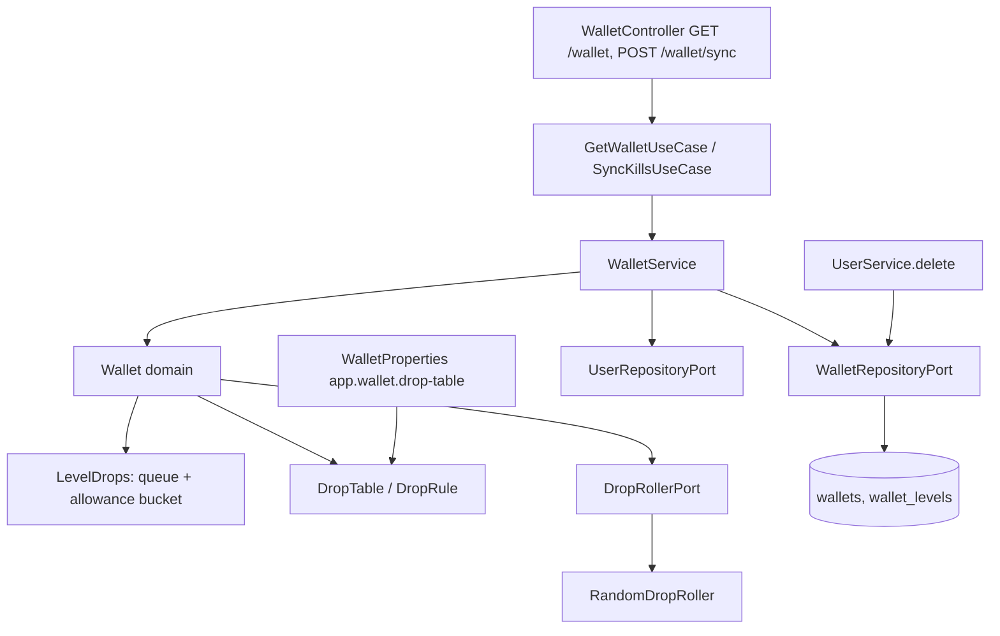

# Wallet Design

**Spec**: `.specs/features/wallet/spec.md`
**Status**: Approved (user asked to run the whole flow without stopping)

---

## Architecture Overview

Same flat hexagonal layout as the rest of the backend (`adapter` → `usecase`/`port` → `service` → `domain`). All rules live in the `Wallet` domain object: it derives denominations, refills the allowance, accepts kills, credits queued values and refills queues. `WalletService` loads the wallet under a row lock, applies one domain operation and saves. The drop table is configuration turned into a validated `DropTable` bean at startup.



`GET /wallet` flow: service checks the user exists, locks the wallet row (creating it with `insert ... on conflict do nothing` first when absent), calls `wallet.refreshed(table, roller, now)` (adds levels new to the table, re-rolls queues holding out-of-range values, refills the allowance), saves, returns.
`POST /wallet/sync` flow: same load, then `wallet.credit(kills, table, roller, now)` returning the new wallet and the accepted counts.

---

## Code Reuse Analysis

### Existing Components to Leverage

| Component | Location | How to Use |
| --- | --- | --- |
| `BusinessException` + `ApiExceptionHandler` | `domain/BusinessException.kt`, `adapter/web/ApiExceptionHandler.kt` | Add `WalletRequestException` subclasses, mapped to 400 |
| `SecurityProperties` + `@EnableConfigurationProperties` | `adapter/security/`, `InfinityGroveWsApplication.kt` | Same pattern for `WalletProperties` fail-fast validation |
| `Clock` bean | `InfinityGroveWsApplication.kt` | `WalletService` reads time from it, tests use `MutableClock` |
| `UserEntity` / `UserRepository` / `JpaUserRepository` | `adapter/repository/` | Entity + adapter + Jpa interface pattern |
| `RefreshTokenRepository` custom `@Modifying @Query` | `adapter/repository/RefreshTokenRepository.kt` | Pattern for the native `insert ... on conflict do nothing` |
| `Fakes.kt`, `MutableClock` | `src/test/.../Fakes.kt` | Add `InMemoryWalletRepository`, `SequenceDropRoller` |
| `IntegrationTestBase`, `UserControllerIT` | `src/test/...` | Testcontainers Postgres + RestAssured; clean `wallets` before each test |
| `SecurityConfig` | `adapter/security/SecurityConfig.kt` | `anyRequest().authenticated()` already protects `/wallet/**`; no change |

### Integration Points

| System | Integration Method |
| --- | --- |
| Postgres | New tables `wallets` and `wallet_levels`, created by Hibernate `ddl-auto: update` |
| `UserService.delete` | Also calls `WalletRepositoryPort.deleteByUsername` (WAL-24) |
| Access token | `Principal.name` (JWT `sub`) is the wallet owner (WAL-06) |

---

## Components

### DropRule / DropTable (domain)

- **Purpose**: One level's `minCopper`, `maxCopper`, `killIntervalMs`, and the validated set of levels.
- **Location**: `domain/DropTable.kt`
- **Interfaces**:
  - `DropRule(level, minCopper, maxCopper, killIntervalMs)` - init rejects `level < 1`, `minCopper < 1`, `maxCopper < minCopper`, `killIntervalMs < 1`, message names the level.
  - `DropRule.roll(roller: DropRollerPort): Int` - `roller.roll(minCopper, maxCopper)`.
  - `DropRule.accepts(value: Int): Boolean` - value in range.
  - `DropTable(rules: List<DropRule>)` - init rejects empty and duplicate levels. `ruleFor(level: Int): DropRule?`, `levels: List<Int>`.
- **Dependencies**: `DropRollerPort`.

### LevelDrops (domain)

- **Purpose**: One player's state for one level: the 20-value queue and the allowance bucket.
- **Location**: `domain/LevelDrops.kt`
- **Interfaces**:
  - `LevelDrops(level, queue: List<Int>, allowance: Int, allowanceUpdatedAt: Long)`
  - `LevelDrops.fresh(rule, roller, now)` - queue of 20 rolls, allowance 20.
  - `refreshed(rule, roller, now)` - re-rolls the whole queue when any value is out of range or the size is not 20, then refills the allowance.
  - `accept(requested: Int, rule, roller, now): Pair<LevelDrops, Accepted>` where `Accepted(count, creditedCopper)` - refills the allowance, `count = min(requested, allowance)` (queue is 20 and allowance max is 20, so `count <= 20`), removes the first `count` values, refills the queue, spends `count`.
- **Allowance refill**: `steps = (now - updatedAt) / interval` (0 when negative); `allowance = min(20, allowance + steps)`; `updatedAt = now` when the cap is reached, else `updatedAt + steps * interval`. The refill runs before every spend, so leaving the cap starts the timer at `now`.
- **Dependencies**: `DropRule`, `DropRollerPort`.

### Wallet (domain)

- **Purpose**: Owns the copper total and all level states; the single entry point for the rules.
- **Location**: `domain/Wallet.kt`
- **Interfaces**:
  - `Wallet(username, copper: Long, levels: Map<Int, LevelDrops>)`
  - `Wallet.open(username, table, roller, now)` - 0 copper, fresh state for every level.
  - `refreshed(table, roller, now): Wallet` - adds missing levels, refreshes known ones; levels absent from the table keep their stored state (hidden).
  - `credit(kills: Map<Int, Int>, table, roller, now): SyncResult` - throws `UnknownLevelException` for a level outside the table before changing anything; otherwise calls `accept` per level, adds the credited copper clamped at `Long.MAX_VALUE`.
  - `coins(): Coins` - `Coins(gold: Long, silver: Int, copper: Int)` from the total (`copper = T % 100`, `silver = T / 100 % 100`, `gold = T / 10 000`).
  - `dropsFor(table): Map<Int, List<Int>>` - queues of table levels only.
  - `SyncResult(wallet, accepted: Map<Int, Int>)`, logs requested vs accepted, WARN on discard.
- **Dependencies**: `DropTable`, `LevelDrops`.

### Ports and use cases

- `port/WalletPorts.kt`: `DropRollerPort.roll(min: Int, max: Int): Int`; `WalletRepositoryPort { findForUpdate(username): Wallet?; createIfAbsent(wallet); save(wallet); deleteByUsername(username) }`.
- `usecase/WalletUseCase.kt`: `GetWalletUseCase.get(username): Wallet`; `SyncKillsUseCase.sync(username, kills: Map<Int, Int>): SyncResult`.

### WalletService

- **Purpose**: Orchestrates user check, lock, domain call, save.
- **Location**: `service/WalletService.kt` (`@Service @Transactional`, logger in `private companion object`)
- **Dependencies**: `WalletRepositoryPort`, `UserRepositoryPort`, `DropTable`, `DropRollerPort`, `Clock`.
- `load(username)`: `UserNotFoundException` when the user is gone; `findForUpdate ?: createIfAbsent(Wallet.open(...)).let { findForUpdate }`.

### Adapters

- `adapter/repository/WalletEntity.kt`, `WalletLevelEntity.kt` (composite id `username + level`, `drops` as comma-separated text, `allowance` int, `allowance_updated_at` long), `JpaWalletRepository.kt` (`@Lock(PESSIMISTIC_WRITE)` find, native insert-on-conflict, delete), `WalletRepository.kt` (implements `WalletRepositoryPort`).
- `adapter/config/WalletProperties.kt`: `@ConfigurationProperties("app.wallet") data class WalletProperties(dropTable: List<DropRuleProperties> = default level 1)` and a `DropTable` bean (`WalletConfig`); registered in `@EnableConfigurationProperties`.
- `adapter/config/RandomDropRoller.kt`: `ThreadLocalRandom.current().nextInt(min, max + 1)`.
- `adapter/web/WalletController.kt`: reads `Principal.name`; DTOs `WalletResponse`, `WalletStateResponse`, `SyncResponse`; parses the sync body from a raw map and throws `InvalidKillsException` for a missing or non-object `kills`, or a count that is not an integer or is negative; a key that is not a table level goes to the domain as `UnknownLevelException`.
- `ApiExceptionHandler`: `WalletRequestException` → 400.

---

## Data Models

```kotlin
data class DropRule(val level: Int, val minCopper: Int, val maxCopper: Int, val killIntervalMs: Long)
data class LevelDrops(val level: Int, val queue: List<Int>, val allowance: Int, val allowanceUpdatedAt: Long)
data class Wallet(val username: String, val copper: Long, val levels: Map<Int, LevelDrops>)
data class Coins(val gold: Long, val silver: Int, val copper: Int)
```

Tables: `wallets(username pk, copper bigint)`, `wallet_levels(username, level, drops text, allowance int, allowance_updated_at bigint, pk(username, level))`. No foreign key (the repo has none today); `UserService.delete` removes the rows.

Wire format: `GET /wallet` → `{ "wallet": {"gold","silver","copper"}, "drops": {"1":[...]} }`; `POST /wallet/sync` `{ "kills": {"1": 3} }` → `{ "wallet", "accepted": {"1": 3}, "drops" }`.

---

## Error Handling Strategy

| Error Scenario | Handling | User Impact |
| --- | --- | --- |
| `kills` missing, not an object, bad count | `InvalidKillsException` `WALLET_INVALID_KILLS`, 400 | Game logs it and keeps its counts |
| Level not in the table | `UnknownLevelException` `WALLET_UNKNOWN_LEVEL`, 400, nothing credited | Same |
| Token user deleted | `UserNotFoundException`, 404 | Game stops syncing |
| No/invalid token | `ProblemAuthenticationEntryPoint`, 401 | Existing refresh flow |
| Invalid drop table | `IllegalArgumentException` at startup naming the entry | Backend does not start |
| Malformed JSON | Spring default 400 | Game keeps its counts |

---

## Risks & Concerns

| Concern | Location (file:line) | Impact | Mitigation |
| --- | --- | --- | --- |
| Cheater claims kills it never made | `Wallet.credit` | Up to 1 kill per `killIntervalMs` per level of free coins | Allowance bucket; limitation recorded as AD-002 in `STATE.md` |
| Two first requests create the wallet at once | `WalletService.load` | Primary-key violation, one request 500 | `insert ... on conflict do nothing` then locked select |
| Concurrent syncs double-credit a queued value | `JpaWalletRepository.findForUpdate` | Inflated wallet | `PESSIMISTIC_WRITE` row lock inside the service transaction; IT with parallel requests |
| JWT of a deleted user keeps working up to 24 h (AD-001) | `WalletService.load` | Orphan wallet rows | User existence check before any wallet work |
| Queue text column parsed by hand | `WalletLevelEntity` | Corrupt row breaks the player's wallet | Parse with `toInt`, entity round-trip IT; no free-form input reaches it |
| `Fakes.kt` and `UserService` constructor change | `UserService.kt`, `UserServiceTest.kt` | Existing tests stop compiling | T-task updates the constructor call and tests together |

---

## Tech Decisions (only non-obvious ones)

| Decision | Choice | Rationale |
| --- | --- | --- |
| Where to store queue and allowance | Separate `wallet_levels` table with columns, not a JSON column | Hibernate JSON mapping needs a Jackson 2 mapper; Spring Boot 4 ships Jackson 3 |
| Fractional allowance progress | Advance `allowanceUpdatedAt` by whole intervals | No time lost to rounding when syncs are frequent |
| Table change handling | Re-roll the whole queue when any value is out of range | Simple and matches WAL-10 without partial queues |
| Unknown level handling | Reject the whole request | A partial credit would be hard for the client to reconcile |
| Lock strategy | Pessimistic row lock on `wallets` | The request is short and per player; avoids retry loops |
| Cheating limitation | Recorded as `AD-002` in `STATE.md` | Future features must know kills are client-reported |
