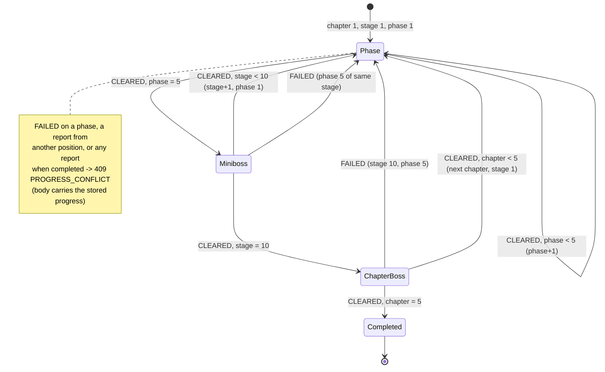
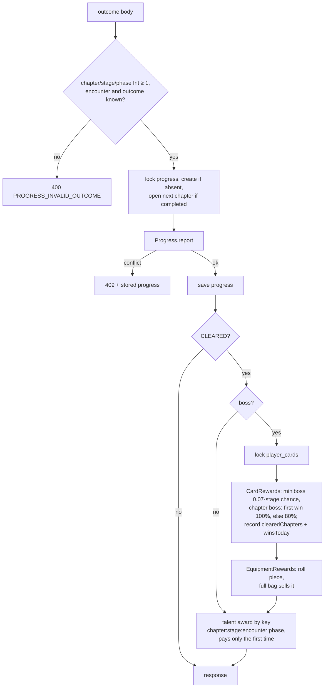
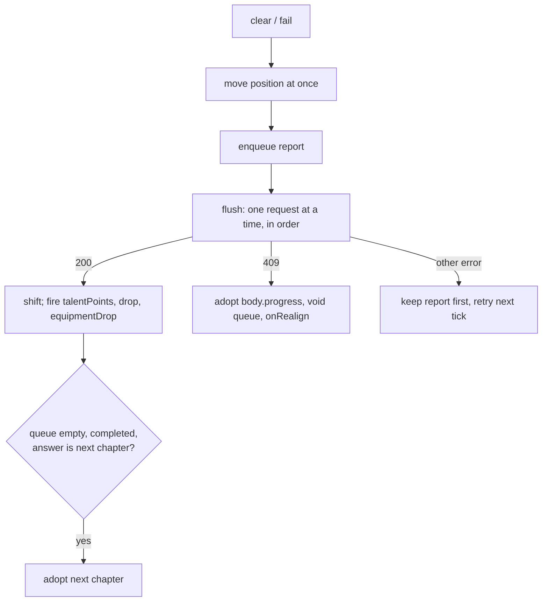

# Flowchart — campaign

## Position state machine (backend `Progress.report`, mirrored by the game `Campaign`)

## Outcome report (`POST /progress/outcome`)

## Client report queue (`campaignSession`)

